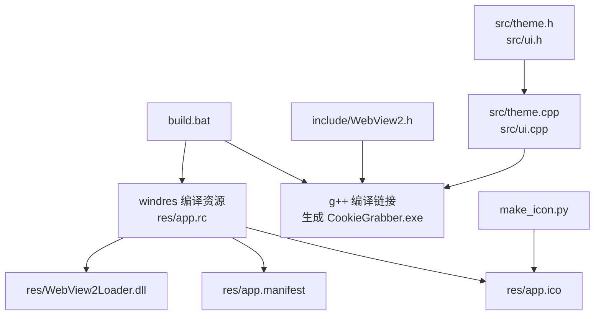
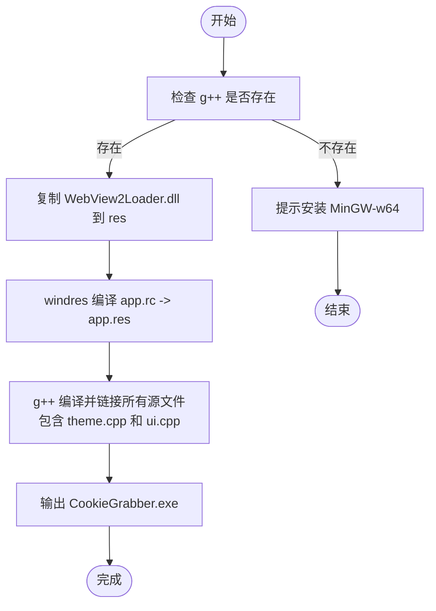
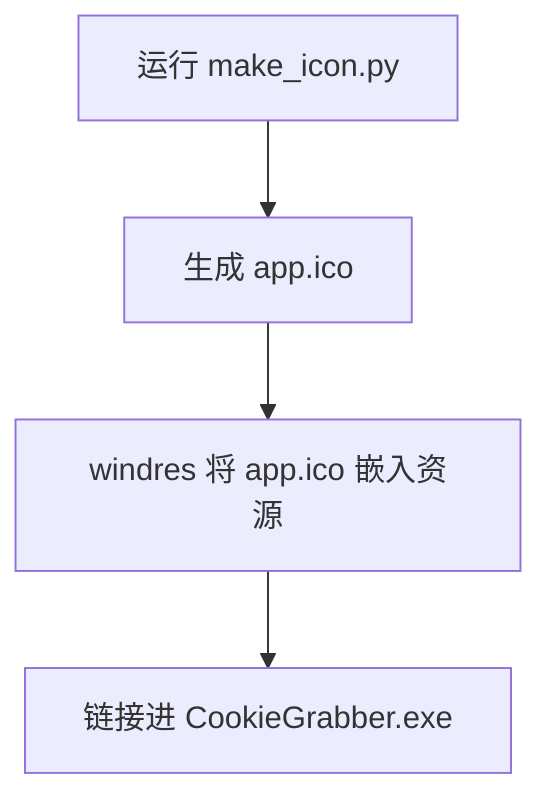
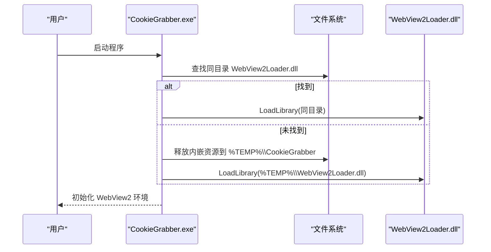
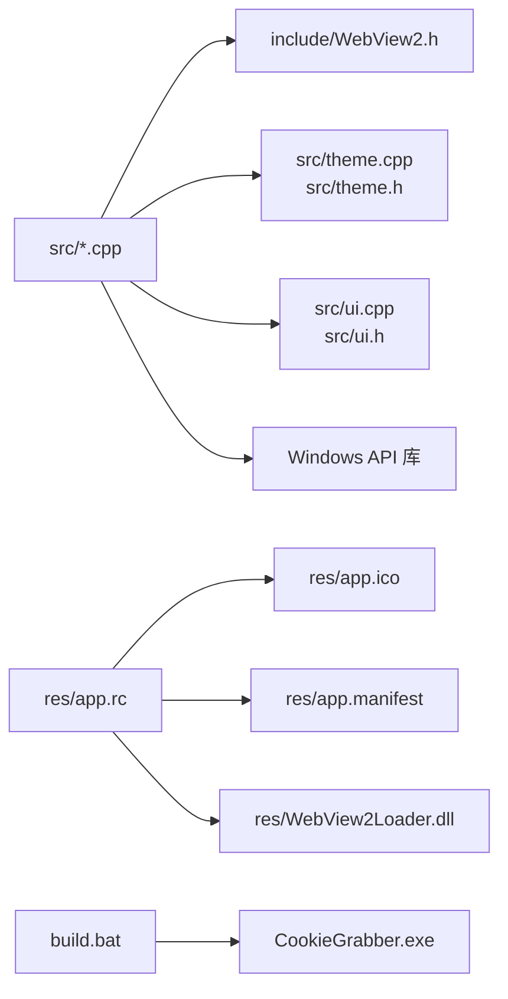

# 安装与构建

<cite>
**本文引用的文件**   
- [build.bat](file://build.bat)
- [make_icon.py](file://make_icon.py)
- [app.rc](file://res/app.rc)
- [app.manifest](file://res/app.manifest)
- [webview.h](file://src/webview.h)
- [webview.cpp](file://src/webview.cpp)
- [theme.cpp](file://src/theme.cpp)
- [theme.h](file://src/theme.h)
- [ui.cpp](file://src/ui.cpp)
- [ui.h](file://src/ui.h)
</cite>

## 目录
1. [简介](#简介)
2. [项目结构](#项目结构)
3. [环境准备](#环境准备)
4. [构建脚本使用方法](#构建脚本使用方法)
5. [资源文件处理](#资源文件处理)
6. [单文件分发配置](#单文件分发配置)
7. [依赖关系分析](#依赖关系分析)
8. [常见问题与解决方案](#常见问题与解决方案)
9. [性能与体积优化建议](#性能与体积优化建议)
10. [结论](#结论)

## 简介
本指南面向希望在 Windows 上编译和分发 Cookie 抓取工具的用户。文档说明 MinGW-w64、WebView2 SDK、Windows 开发环境的准备步骤，详细解释构建脚本 build.bat 的编译参数和资源处理流程，并给出图标生成、单文件打包以及常见构建问题的排查方法。

**更新摘要**
- 新增主题系统和UI绘制系统的构建支持
- 更新了编译源文件列表以包含 theme.cpp 和 ui.cpp
- 增强了视觉语言和原生界面绘制的集成说明

## 项目结构
本项目采用"源码 + 资源 + 构建脚本"的简洁结构：
- src：C++ 源码，包含 UI、WebView2 宿主封装、Cookie 抓取、日志、设置、主题系统和UI绘制模块。
- res：Windows 资源文件，包括应用清单、资源脚本、内嵌 WebView2Loader.dll。
- include：第三方头文件（例如 WebView2.h）。
- test：测试页面与本地服务脚本。
- build.bat：MinGW-w64 一键构建脚本。
- make_icon.py：纯 Python 生成的 ICO 图标生成脚本。

**图表来源**
- [build.bat:21-29](file://build.bat#L21-L29)
- [app.rc:4-11](file://res/app.rc#L4-L11)
- [app.manifest:1-16](file://res/app.manifest#L1-L16)
- [make_icon.py:48-50](file://make_icon.py#L48-L50)
- [theme.cpp:1-119](file://src/theme.cpp#L1-L119)
- [ui.cpp:1-350](file://src/ui.cpp#L1-L350)

**章节来源**
- [build.bat:1-34](file://build.bat#L1-L34)
- [app.rc:1-12](file://res/app.rc#L1-L12)
- [app.manifest:1-17](file://res/app.manifest#L1-L17)
- [make_icon.py:1-51](file://make_icon.py#L1-L51)
- [theme.cpp:1-119](file://src/theme.cpp#L1-L119)
- [ui.cpp:1-350](file://src/ui.cpp#L1-L350)

## 环境准备
### 必需组件
- Windows 系统（x64）
- MinGW-w64（含 g++、windres）
- WebView2 SDK（提供 include/WebView2.h 及必要的类型定义）
- WebView2 运行时（运行期由程序加载 WebView2Loader.dll）

### MinGW-w64 安装
- 推荐通过 WinGet 安装 BrechtSanders.WinLibs.POSIX.UCRT，该包会提供 g++ 与 windres。
- 构建脚本默认优先使用 LOCALAPPDATA 下的 WinGet 安装路径；若未找到 g++，会提示安装命令。
- 也可将 MinGW-w64 的 bin 目录加入 PATH，使 where g++ 能找到编译器。

### WebView2 SDK 安装
- 需要放置 include/WebView2.h 到 include 目录，以便编译阶段解析 WebView2 接口。
- 运行时依赖 WebView2 运行时提供的 WebView2Loader.dll；构建脚本会将 WebView2Loader.dll 复制到 res 目录并嵌入资源，实现单文件分发。

### Windows 开发环境
- 确保系统已安装 WebView2 运行时，否则程序启动时会提示初始化失败。
- 如需 DPI 感知和多显示器适配，请保持系统为较新版本的 Windows，并确保应用清单启用 PerMonitorV2。

**章节来源**
- [build.bat:10-18](file://build.bat#L10-L18)
- [webview.cpp:193-213](file://src/webview.cpp#L193-L213)
- [webview.cpp:217-238](file://src/webview.cpp#L217-L238)
- [app.manifest:9-14](file://res/app.manifest#L9-L14)

## 构建脚本使用方法
### 基本用法
在命令行中直接执行根目录的 build.bat：
- 自动检测 g++ 是否可用。
- 调用 windres 编译资源脚本 app.rc，生成 res/app.res。
- 调用 g++ 编译所有源文件并链接系统库，输出 CookieGrabber.exe。
- 打印输出文件大小并提示构建完成。

### 关键编译参数说明
- -std=c++17：启用 C++17 标准。
- -O2：开启二级优化。
- -municode：Unicode 支持。
- -mwindows：创建 Windows GUI 子系统。
- -D_WIN32_WINNT=0x0A00 / -DWINVER=0x0A00：目标 Windows 版本为 10。
- -Wall：开启常用警告。
- -Iinclude -Isrc：包含头文件路径。
- -lole32 -loleaut32 -luuid -lgdi32 -lcomctl32 -lshell32 -lcomdlg32 -ladvapi32 -ldwmapi：链接 Windows API 库。
- -static -static-libgcc -static-libstdc++：静态链接 GCC/STL 运行时，便于单文件分发。

### 资源处理流程
- 复制 include/WebView2Loader.dll 到 res 目录（若存在），供 windres 嵌入。
- windres 读取 res/app.rc，生成 res/app.res。
- g++ 将 app.res 与源码一起链接，最终生成可执行文件。

**更新** 构建系统现已包含新的主题系统和UI绘制模块：
- src/theme.cpp：实现主题调色板、深色模式检测和CSS生成
- src/ui.cpp：实现UI绘制层、字体管理和控件绘制原语

**图表来源**
- [build.bat:14-29](file://build.bat#L14-L29)

**章节来源**
- [build.bat:1-34](file://build.bat#L1-L34)

## 资源文件处理
### 应用图标
- 使用 make_icon.py 生成 32x32、32bpp 的 ICO 文件。
- 脚本无需外部依赖，纯 Python 实现，输出路径默认为 res/app.ico。
- 可在构建前运行脚本更新图标，然后重新构建。

**图表来源**
- [make_icon.py:48-50](file://make_icon.py#L48-L50)
- [app.rc:4-5](file://res/app.rc#L4-L5)

**章节来源**
- [make_icon.py:1-51](file://make_icon.py#L1-L51)
- [app.rc:1-12](file://res/app.rc#L1-L12)

### 应用清单与 DPI 感知
- app.manifest 声明 COM 控件 v6 依赖、PerMonitorV2 DPI 感知、UTF-8 代码页。
- app.rc 将 app.manifest 作为资源嵌入，确保运行时生效。

**章节来源**
- [app.manifest:1-17](file://res/app.manifest#L1-L17)
- [app.rc:7-8](file://res/app.rc#L7-L8)

### WebView2Loader.dll 内嵌
- app.rc 将 WebView2Loader.dll 以 RCDATA 资源形式嵌入。
- 运行时优先尝试从 exe 同目录加载 WebView2Loader.dll；若不存在，则释放内嵌资源到临时目录后加载。
- 销毁时若从临时目录加载，会删除临时文件，避免残留。

**章节来源**
- [app.rc:10-11](file://res/app.rc#L10-L11)
- [webview.cpp:193-213](file://src/webview.cpp#L193-L213)
- [webview.cpp:241-252](file://src/webview.cpp#L241-L252)

## 单文件分发配置
### 原理
- 构建脚本使用 -static -static-libgcc -static-libstdc++ 静态链接 C/C++ 运行时。
- WebView2Loader.dll 被嵌入资源，程序运行时按需释放到临时目录并加载。
- 最终产物 CookieGrabber.exe 为单文件，便于分发。

### 分发注意事项
- 目标机器需安装 WebView2 运行时，否则程序无法创建 WebView2 环境。
- 若用户手动替换了 WebView2Loader.dll，请确保其架构与程序一致（x64）。
- 程序首次运行会在临时目录写入 WebView2Loader.dll，请确保临时目录可写。

**图表来源**
- [webview.cpp:193-213](file://src/webview.cpp#L193-L213)
- [webview.cpp:217-238](file://src/webview.cpp#L217-L238)

**章节来源**
- [build.bat:27-29](file://build.bat#L27-L29)
- [app.rc:10-11](file://res/app.rc#L10-L11)
- [webview.cpp:193-213](file://src/webview.cpp#L193-L213)

## 依赖关系分析
### 编译期依赖
- include/WebView2.h：WebView2 接口头文件。
- MinGW-w64：g++、windres。
- Windows SDK 头文件：ole32、oleaut32、uuid、gdi32、comctl32、shell32、comdlg32、advapi32、dwmapi。
- **新增**：theme.h、ui.h：主题系统和UI绘制模块的头文件。

### 运行期依赖
- WebView2 运行时：提供 WebView2Loader.dll 与浏览器内核能力。
- Windows API：COM、Shell、DPI、UI 相关库。
- **新增**：主题系统和UI绘制模块提供一致的视觉语言。

**图表来源**
- [build.bat:21-29](file://build.bat#L21-L29)
- [app.rc:4-11](file://res/app.rc#L4-L11)
- [theme.cpp:1-119](file://src/theme.cpp#L1-L119)
- [ui.cpp:1-350](file://src/ui.cpp#L1-L350)

**章节来源**
- [build.bat:21-29](file://build.bat#L21-L29)
- [app.rc:1-12](file://res/app.rc#L1-L12)
- [theme.cpp:1-119](file://src/theme.cpp#L1-L119)
- [ui.cpp:1-350](file://src/ui.cpp#L1-L350)

## 常见问题与解决方案
### 找不到 g++
- 现象：构建脚本提示未找到 g++。
- 原因：MinGW-w64 未安装或 PATH 未配置。
- 解决：
  - 使用 winget 安装 BrechtSanders.WinLibs.POSIX.UCRT。
  - 或将 MinGW-w64 的 bin 目录加入 PATH。

**章节来源**
- [build.bat:14-18](file://build.bat#L14-L18)

### WebView2 初始化失败
- 现象：程序启动提示 WebView2 运行时可能未安装。
- 原因：系统未安装 WebView2 运行时。
- 解决：安装 Edge WebView2 运行时。

**章节来源**
- [webview.cpp:217-238](file://src/webview.cpp#L217-L238)

### ld 合并清单警告
- 现象：链接器输出".rsrc merge failure: multiple non-default manifests"警告。
- 原因：CRT 的空占位清单与应用清单合并时的无害警告。
- 影响：无实际影响，最终保留应用清单。

**章节来源**
- [build.bat:6-9](file://build.bat#L6-L9)

### 图标不显示或尺寸异常
- 现象：应用图标未显示或显示模糊。
- 原因：未生成 app.ico 或图标格式不符合要求。
- 解决：运行 make_icon.py 生成 32x32 32bpp 的 app.ico，再重新构建。

**章节来源**
- [make_icon.py:1-51](file://make_icon.py#L1-L51)
- [app.rc:4-5](file://res/app.rc#L4-L5)

### WebView2Loader.dll 缺失或架构不匹配
- 现象：程序无法加载 WebView2Loader.dll。
- 原因：未复制 WebView2Loader.dll 到 res 目录，或 dll 架构与程序不一致。
- 解决：
  - 确保 include/WebView2Loader.dll 存在并被复制到 res。
  - 确认 dll 为 x64 版本，与 CookieGrabber.exe 架构一致。

**章节来源**
- [build.bat:23](file://build.bat#L23)
- [webview.cpp:193-213](file://src/webview.cpp#L193-L213)

### 主题系统编译错误
- 现象：编译时找不到 theme.h 或 theme.cpp 编译失败。
- 原因：theme.cpp 和 ui.cpp 是新添加的源文件，需要确保构建脚本正确包含它们。
- 解决：检查 build.bat 中的 g++ 命令是否包含 src\theme.cpp 和 src\ui.cpp。

**章节来源**
- [build.bat:28](file://build.bat#L28)
- [theme.cpp:1-119](file://src/theme.cpp#L1-L119)
- [ui.cpp:1-350](file://src/ui.cpp#L1-L350)

## 性能与体积优化建议
- 保持 -O2 优化级别，平衡编译速度与运行性能。
- 使用 -static -static-libgcc -static-libstdc++ 减少运行期依赖，但会增加二进制体积。
- 若需进一步减小体积，可考虑裁剪不必要的系统库链接（需谨慎评估功能影响）。
- 图标生成脚本为轻量级纯 Python，不影响构建性能。
- **新增**：主题系统和UI绘制模块提供了高效的绘制原语，减少了重复代码和维护成本。

[本节为通用建议，不涉及具体文件分析]

## 结论
通过本指南，您可以完成 MinGW-w64 与 WebView2 SDK 的环境准备，理解 build.bat 的构建流程与参数含义，掌握资源文件处理与单文件分发配置，并能快速定位和解决常见构建问题。

**重要更新**：构建系统现已集成了全新的主题系统和UI绘制模块，这些模块提供了：
- 统一的视觉语言和调色板管理
- 深色模式和浅色模式的自动切换
- 高性能的原生UI绘制能力
- 与WebView2起始页的视觉一致性

建议在正式分发前，在干净的目标机器上进行端到端验证，确保 WebView2 运行时与 WebView2Loader.dll 的正确性，同时验证主题系统和UI绘制功能的正常运行。