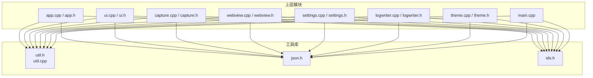
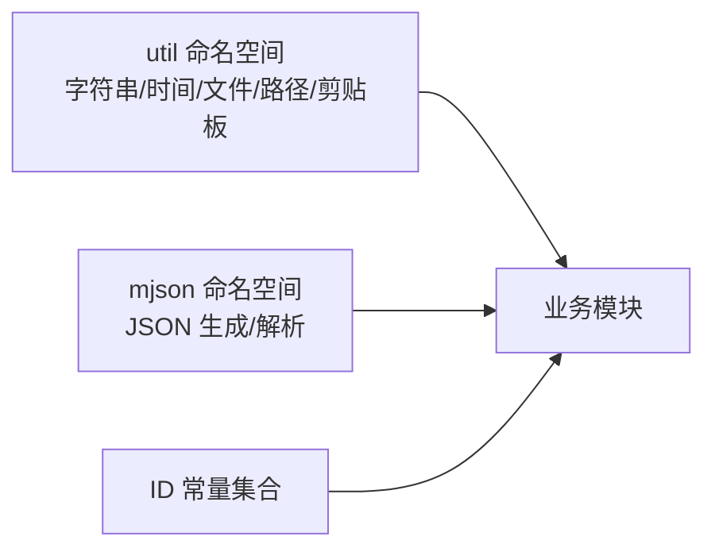
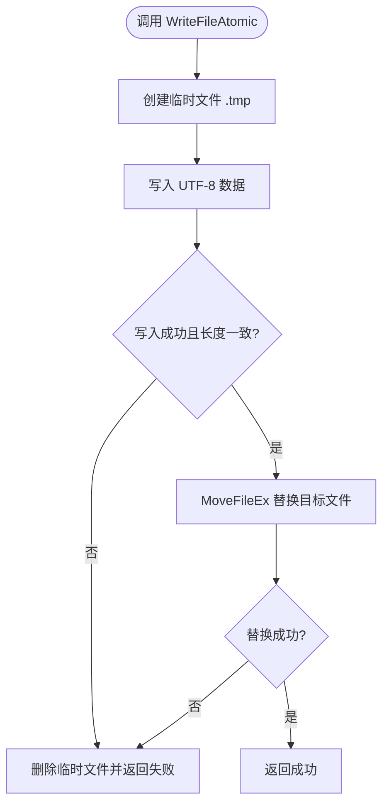
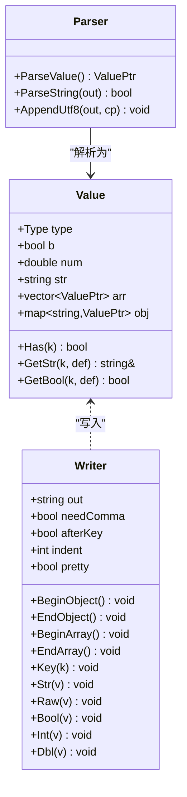
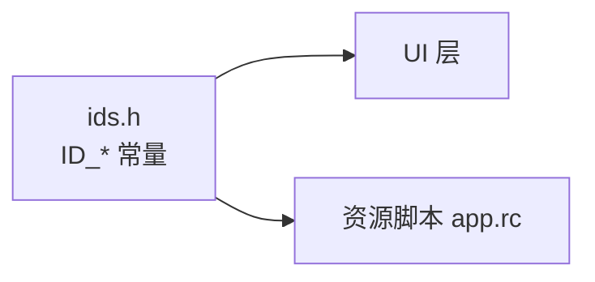
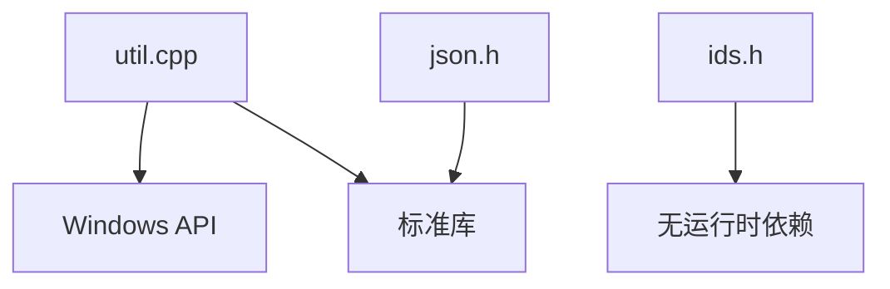

# 工具函数库

<cite>
**本文引用的文件**   
- [util.h](file://src/util.h)
- [util.cpp](file://src/util.cpp)
- [json.h](file://src/json.h)
- [ids.h](file://src/ids.h)
</cite>

## 目录
1. [简介](#简介)
2. [项目结构](#项目结构)
3. [核心组件](#核心组件)
4. [架构总览](#架构总览)
5. [详细组件分析](#详细组件分析)
6. [依赖关系分析](#依赖关系分析)
7. [性能与健壮性](#性能与健壮性)
8. [故障排查指南](#故障排查指南)
9. [结论](#结论)
10. [附录：API 参考](#附录api-参考)

## 简介
本工具函数库为 Windows C++ 应用提供通用辅助能力，涵盖字符串处理、文件操作、日期时间格式化、剪贴板操作、路径解析与 JSON 编解码。同时提供 UI 控件与资源 ID 的集中定义，便于跨模块统一引用。文档面向业务开发者，帮助快速理解并正确调用这些工具函数。

## 项目结构
本项目将工具函数按职责拆分到独立头/源文件中：
- util.h / util.cpp：通用工具（字符串转换、时间格式、文件读写、路径解析、剪贴板）
- json.h：极简 JSON 生成器与解析器（header-only，无第三方依赖）
- ids.h：UI 控件与资源 ID 常量定义

**图表来源**
- [util.h:1-46](file://src/util.h#L1-L46)
- [json.h:1-223](file://src/json.h#L1-L223)
- [ids.h:1-33](file://src/ids.h#L1-L33)

**章节来源**
- [util.h:1-46](file://src/util.h#L1-L46)
- [json.h:1-223](file://src/json.h#L1-L223)
- [ids.h:1-33](file://src/ids.h#L1-L33)

## 核心组件
- 通用工具 util：字符串编码转换、日志时间格式化、Cookie 过期时间转换、文件读取/写入/追加、目录探测与清理、剪贴板设置、字符串修剪与大小写处理等。
- JSON 库 mjson：轻量级 header-only JSON 生成器 Writer 与递归下降解析器 Parse，支持对象、数组、字符串、数字、布尔、null，并提供键值访问接口。
- 常量 ids：集中管理 UI 控件与资源 ID，避免魔法数字散落各处。

**章节来源**
- [util.h:1-46](file://src/util.h#L1-L46)
- [util.cpp:1-198](file://src/util.cpp#L1-L198)
- [json.h:1-223](file://src/json.h#L1-L223)
- [ids.h:1-33](file://src/ids.h#L1-L33)

## 架构总览
工具库以“纯函数 + 命名空间”的方式组织，不引入全局状态，便于在多个模块中复用。JSON 库以 header-only 形式集成，零外部依赖；ID 常量作为共享配置被 UI 与逻辑层共同引用。

**图表来源**
- [util.h:7-45](file://src/util.h#L7-L45)
- [json.h:12-222](file://src/json.h#L12-L222)
- [ids.h:1-33](file://src/ids.h#L1-L33)

## 详细组件分析

### 通用工具 util
- 字符串与编码
  - Utf8ToWide：UTF-8 字节串转宽字符串。返回空串当输入为空。
  - WideToUtf8：宽字符串转 UTF-8。返回空串当输入为空。
  - WideToAnsi：宽字符串转 ANSI（用于 MessageBox 等旧式 API）。返回空串当输入为空。
  - Trim/ToLower/StartsWithI：宽字符串修剪空白、小写化、忽略大小写的前缀匹配。
- 时间与日志
  - NowLogTime/NowLogTimeA：本地时间，格式如 “YYYY.MM.DD HH:MM”。
  - NowIsoUtc：UTC ISO8601 时间，如 “YYYY-MM-DDTHH:MM:SSZ”。
  - CookieExpiresToIso：将 Cookie 的 double Unix 秒转为 ISO8601；若 isSession 或 expires<=0 则返回 “session”。
- 文件与路径
  - ReadFileBytes：安全读取整个文件为字节（限制最大 64MB），失败返回 false。
  - ModuleDir：获取 exe 所在目录（带结尾反斜杠）。
  - LocalAppDir：返回 %LOCALAPPDATA%\CookieGrabber，并确保目录存在。
  - DirExists：判断目录是否存在。
  - DeleteDirRecursive：静默递归删除目录（使用 SHFileOperationW）。
  - ResolveLogDir：优先使用 exe 目录作为日志目录，不可写时回退到 %LOCALAPPDATA%\CookieGrabber\logs。
  - WriteFileAtomic：原子写（临时文件 + MoveFileEx 替换），data 为 UTF-8 字节。
  - AppendFile：单次追加写入。
- 剪贴板
  - SetClipboardText：设置系统剪贴板文本（宽字符），需要窗口句柄 owner。

**图表来源**
- [util.cpp:135-149](file://src/util.cpp#L135-L149)

**章节来源**
- [util.h:9-43](file://src/util.h#L9-L43)
- [util.cpp:9-195](file://src/util.cpp#L9-L195)

#### 使用示例（业务调用思路）
- 在日志记录中拼接时间戳：
  - 使用 NowLogTimeA() 或 NowIsoUtc() 生成时间前缀，再与日志消息拼接后通过 AppendFile 追加到日志文件。
- 在导出 Cookie 列表时：
  - 使用 CookieExpiresToIso 将过期时间转换为可读的 ISO8601 或 “session”，以便前端展示或持久化。
- 在保存用户配置时：
  - 使用 WriteFileAtomic 确保配置文件写入的原子性，避免部分写入导致损坏。
- 在复制结果到剪贴板时：
  - 使用 SetClipboardText 传入当前窗口句柄，实现一键复制。

**章节来源**
- [util.cpp:37-68](file://src/util.cpp#L37-L68)
- [util.cpp:135-158](file://src/util.cpp#L135-L158)
- [util.cpp:160-177](file://src/util.cpp#L160-L177)

### JSON 处理库 mjson
- 类型与访问
  - Value：表示 JSON 值，包含 Null/Bool/Number/String/Array/Object 五种类型。
  - Has/GetStr/GetBool：对 Object 类型的便捷访问方法，提供默认值。
- 生成器 Writer
  - BeginObject/EndObject、BeginArray/EndArray：构建对象与数组结构。
  - Key/Str/Raw/Bool/Int/Dbl：写入键名与各类值。
  - pretty：是否输出缩进美化格式。
- 解析器 Parse
  - 递归下降解析，支持 Unicode 转义与代理对（surrogate pairs）。
  - 返回 ValuePtr（shared_ptr<Value>），失败返回 nullptr。

**图表来源**
- [json.h:42-86](file://src/json.h#L42-L86)
- [json.h:88-215](file://src/json.h#L88-L215)

**章节来源**
- [json.h:14-59](file://src/json.h#L14-L59)
- [json.h:62-86](file://src/json.h#L62-L86)
- [json.h:88-220](file://src/json.h#L88-L220)

#### 使用示例（业务调用思路）
- 构造 JSON 响应：
  - 使用 Writer.BeginObject()/EndObject() 包裹对象，Writer.Key()/Str()/Int()/Dbl() 写入字段，最后取 Writer.out 作为 JSON 字符串。
- 解析 JSON 配置：
  - 使用 Parse(text) 得到 ValuePtr，再通过 Has()/GetStr()/GetBool() 安全地读取字段，缺失时使用默认值。

**章节来源**
- [json.h:62-86](file://src/json.h#L62-L86)
- [json.h:217-220](file://src/json.h#L217-L220)

### ID 常量定义 ids
- 用途：集中管理 UI 控件与资源 ID，避免魔法数字，保证 app.h 与 res/app.rc 共用同一份 ID。
- 分类：
  - 导航与按钮：ID_NAV_BROWSER、ID_BTN_OPEN、ID_BTN_CAPTURE、ID_BTN_REFRESH、ID_BTN_CLEAR、ID_BTN_CAPTURE_TKN、ID_BTN_FILL、ID_BTN_ADD、ID_BTN_EDIT、ID_BTN_DEL、ID_BTN_SAVE、ID_BTN_OPENLOG
  - 输入与选择：ID_URL、ID_PRESET_LIST、ID_PRESET_COMBO、ID_LOGIN_URL、ID_LOG_DIR、ID_CHK_AUTO、ID_CHK_CLIP、ID_CHK_HIST、ID_CHK_FIRST、ID_RAD_STR、ID_RAD_JSON、ID_RAD_BOTH
  - 对话框与子项：IDD_PRESET、IDC_PRESET_NAME、IDC_PRESET_URL

**图表来源**
- [ids.h:1-33](file://src/ids.h#L1-L33)

**章节来源**
- [ids.h:1-33](file://src/ids.h#L1-L33)

## 依赖关系分析
- util 依赖 Windows API（MultiByteToWideChar、CreateFileW、SHFileOperationW、SHGetKnownFolderPath 等）与标准库（cstdio/cstring/cctime）。
- mjson 仅依赖标准库（string/vector/map/memory/cstdio/cstdlib/cstring），无第三方依赖。
- ids.h 无运行时依赖，仅为编译期常量。

**图表来源**
- [util.cpp:1-6](file://src/util.cpp#L1-L6)
- [json.h:1-10](file://src/json.h#L1-L10)
- [ids.h:1-2](file://src/ids.h#L1-L2)

**章节来源**
- [util.cpp:1-6](file://src/util.cpp#L1-L6)
- [json.h:1-10](file://src/json.h#L1-L10)
- [ids.h:1-2](file://src/ids.h#L1-L2)

## 性能与健壮性
- 文件读取限制：ReadFileBytes 限制最大 64MB，防止内存占用过大。
- 原子写入：WriteFileAtomic 通过临时文件 + MoveFileEx 替换，避免并发写入导致的文件损坏。
- 路径可写探测：ResolveLogDir 先尝试 exe 目录，不可写自动回退到 %LOCALAPPDATA% 下的 logs 目录，提升部署鲁棒性。
- JSON 解析：递归下降解析器对非法输入返回 nullptr，调用方需判空处理。
- 剪贴板：SetClipboardText 在失败时会释放分配的内存并关闭剪贴板，避免资源泄漏。

[本节为通用指导，无需具体文件引用]

## 故障排查指南
- 无法写入日志
  - 检查 ResolveLogDir 的回退逻辑，确认 %LOCALAPPDATA%\CookieGrabber\logs 是否存在并可写。
  - 若使用 WriteFileAtomic，确认磁盘空间与权限。
- 剪贴板设置失败
  - 确认传入的 owner 窗口句柄有效，且当前进程具有剪贴板访问权限。
- JSON 解析失败
  - 检查输入是否为合法 JSON，注意转义与代理对；解析失败会返回 nullptr，调用方应判空。
- 路径不存在或无效
  - 使用 DirExists 进行前置检查；必要时使用 LocalAppDir 获取受保护目录。

**章节来源**
- [util.cpp:121-133](file://src/util.cpp#L121-L133)
- [util.cpp:135-149](file://src/util.cpp#L135-L149)
- [util.cpp:160-177](file://src/util.cpp#L160-L177)
- [json.h:217-220](file://src/json.h#L217-L220)

## 结论
该工具函数库提供了稳定、易用的基础能力，覆盖字符串、时间、文件、路径、剪贴板与 JSON 编解码，并通过集中化的 ID 常量提升 UI 与资源的一致性。建议在业务模块中优先复用这些工具函数，以保证行为一致性与可维护性。

[本节为总结性内容，无需具体文件引用]

## 附录：API 参考

### util 命名空间
- 字符串与编码
  - Utf8ToWide(s): 返回 std::wstring
  - WideToUtf8(w): 返回 std::string
  - WideToAnsi(w): 返回 std::string
  - Trim(s): 返回 std::wstring
  - ToLower(s): 返回 std::wstring
  - StartsWithI(s, prefix): 返回 bool
- 时间与日志
  - NowLogTime(): 返回 std::wstring
  - NowLogTimeA(): 返回 std::string
  - NowIsoUtc(): 返回 std::string
  - CookieExpiresToIso(expires, isSession): 返回 std::string
- 文件与路径
  - ReadFileBytes(path, out): 返回 bool
  - ModuleDir(): 返回 std::wstring
  - LocalAppDir(): 返回 std::wstring
  - DirExists(path): 返回 bool
  - DeleteDirRecursive(path): 返回 void
  - ResolveLogDir(): 返回 std::wstring
  - WriteFileAtomic(path, data): 返回 bool
  - AppendFile(path, data): 返回 bool
- 剪贴板
  - SetClipboardText(text, owner): 返回 bool

**章节来源**
- [util.h:9-43](file://src/util.h#L9-L43)
- [util.cpp:9-195](file://src/util.cpp#L9-L195)

### mjson 命名空间
- 类型与访问
  - Value::Has(k): 返回 bool
  - Value::GetStr(k, def=""): 返回 const std::string&
  - Value::GetBool(k, def=false): 返回 bool
- 生成器
  - Writer::BeginObject()/EndObject()
  - Writer::BeginArray()/EndArray()
  - Writer::Key(k)/Str(v)/Raw(v)/Bool(v)/Int(v)/Dbl(v)
  - Writer::pretty: 控制是否美化输出
- 解析器
  - Parse(text): 返回 ValuePtr（失败返回 nullptr）

**章节来源**
- [json.h:42-86](file://src/json.h#L42-L86)
- [json.h:217-220](file://src/json.h#L217-L220)

### ids.h 常量
- 导航与按钮：ID_NAV_BROWSER、ID_BTN_OPEN、ID_BTN_CAPTURE、ID_BTN_REFRESH、ID_BTN_CLEAR、ID_BTN_CAPTURE_TKN、ID_BTN_FILL、ID_BTN_ADD、ID_BTN_EDIT、ID_BTN_DEL、ID_BTN_SAVE、ID_BTN_OPENLOG
- 输入与选择：ID_URL、ID_PRESET_LIST、ID_PRESET_COMBO、ID_LOGIN_URL、ID_LOG_DIR、ID_CHK_AUTO、ID_CHK_CLIP、ID_CHK_HIST、ID_CHK_FIRST、ID_RAD_STR、ID_RAD_JSON、ID_RAD_BOTH
- 对话框与子项：IDD_PRESET、IDC_PRESET_NAME、IDC_PRESET_URL

**章节来源**
- [ids.h:1-33](file://src/ids.h#L1-L33)