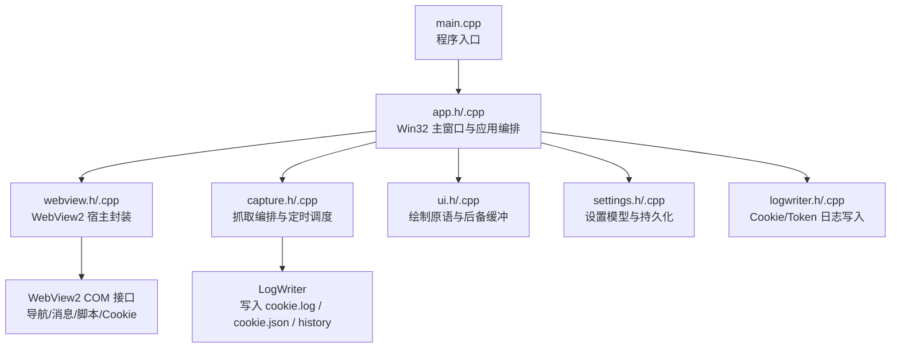
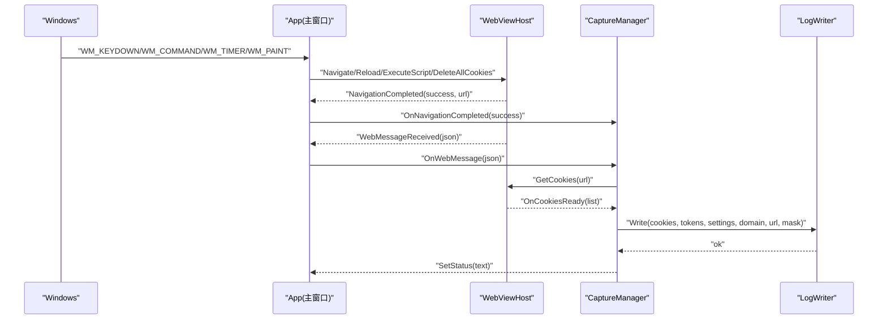
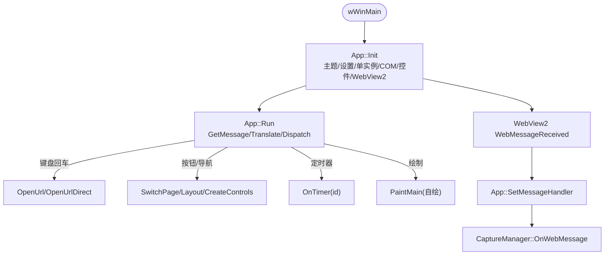
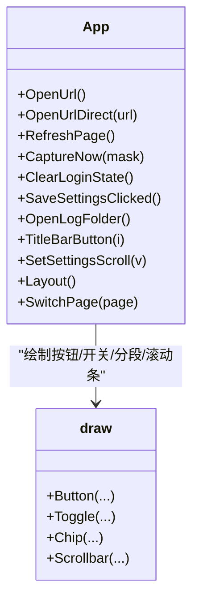
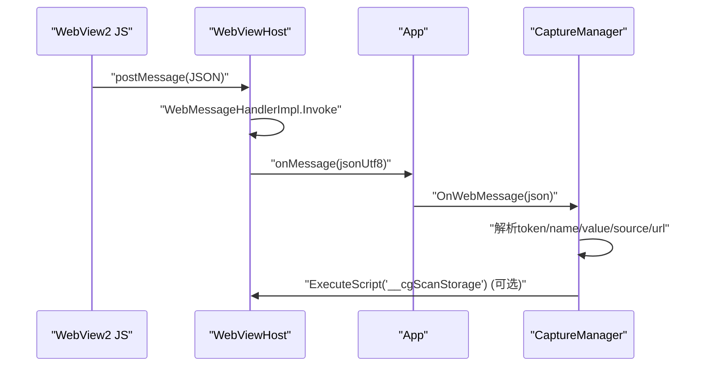
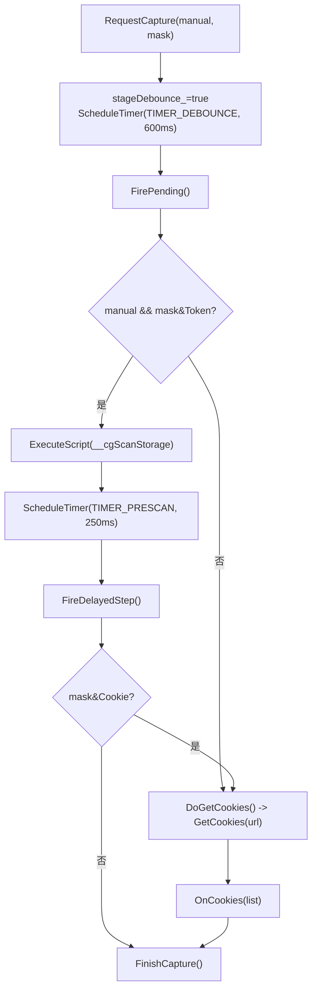
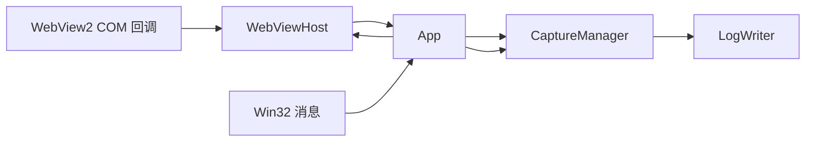
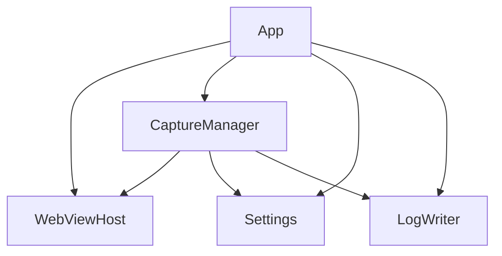

# 事件系统设计

<cite>
**本文引用的文件**   
- [main.cpp](file://src/main.cpp)
- [app.h](file://src/app.h)
- [app.cpp](file://src/app.cpp)
- [webview.h](file://src/webview.h)
- [webview.cpp](file://src/webview.cpp)
- [capture.h](file://src/capture.h)
- [capture.cpp](file://src/capture.cpp)
- [ui.h](file://src/ui.h)
- [ui.cpp](file://src/ui.cpp)
- [settings.h](file://src/settings.h)
- [settings.cpp](file://src/settings.cpp)
- [logwriter.h](file://src/logwriter.h)
- [logwriter.cpp](file://src/logwriter.cpp)
</cite>

## 目录
1. [引言](#引言)
2. [项目结构](#项目结构)
3. [核心组件](#核心组件)
4. [架构总览](#架构总览)
5. [详细组件分析](#详细组件分析)
6. [依赖关系分析](#依赖关系分析)
7. [性能与异步特性](#性能与异步特性)
8. [故障排查指南](#故障排查指南)
9. [结论](#结论)

## 引言
本设计文档聚焦于 Cookie 抓取工具的事件系统，重点说明以下方面：
- Win32 消息循环与 WebView2 事件模型的集成方式。
- 用户界面事件处理流程，包括按钮点击、窗口操作、鼠标悬停等交互。
- WebView2 JavaScript 与 C++ 后端的双向通信机制。
- 定时器系统与异步任务调度。
- 事件传播图与回调函数注册机制。
- 常见事件处理模式与最佳实践。

该应用采用 Win32 原生 UI + WebView2 宿主封装 + 抓取编排 + 日志写入的分层架构。UI 层负责绘制与输入，WebView2 层负责页面渲染与 JS 桥接，抓取层负责 Token/Cookie 采集与防抖，日志层负责持久化。

## 项目结构
仓库按功能模块组织在 `src/` 下：
- 入口与主循环：`main.cpp`、`app.h/.cpp`
- WebView2 宿主封装：`webview.h/.cpp`
- 抓取编排：`capture.h/.cpp`
- 绘制与 UI 原语：`ui.h/.cpp`
- 设置模型与持久化：`settings.h/.cpp`
- 日志写入：`logwriter.h/.cpp`

**图表来源**
- [main.cpp:6-18](file://src/main.cpp#L6-L18)
- [app.h:15-183](file://src/app.h#L15-L183)
- [webview.h:11-70](file://src/webview.h#L11-L70)
- [capture.h:10-63](file://src/capture.h#L10-L63)
- [ui.h:11-93](file://src/ui.h#L11-L93)
- [settings.h:6-26](file://src/settings.h#L6-L26)
- [logwriter.h:10-53](file://src/logwriter.h#L10-L53)

**章节来源**
- [main.cpp:6-18](file://src/main.cpp#L6-L18)
- [app.h:15-183](file://src/app.h#L15-L183)

## 核心组件
- App：Win32 主窗口、控件创建、布局、消息循环、定时器、WebView2 生命周期管理、业务方法（打开 URL、刷新、抓取、清除登录状态）。
- WebViewHost：WebView2 环境/控制器创建、导航、脚本注入、WebMessage 接收、Cookie 读取、Resize/Focus。
- CaptureManager：Token 三通道汇总、Cookie 拉取、登录态检测、自动抓取防抖、定时轮询与延迟步骤。
- Painter/Fonts/draw：后备缓冲、字体集、基础绘制原语与组件（按钮、开关、分段胶囊、滚动条）。
- Settings：默认预设、加载/保存设置。
- LogWriter：Cookie/Token 数据序列化与原子写入历史日志。

**章节来源**
- [app.h:15-183](file://src/app.h#L15-L183)
- [webview.h:11-70](file://src/webview.h#L11-L70)
- [capture.h:10-63](file://src/capture.h#L10-L63)
- [ui.h:11-93](file://src/ui.h#L11-L93)
- [settings.h:6-26](file://src/settings.h#L6-L26)
- [logwriter.h:10-53](file://src/logwriter.h#L10-L53)

## 架构总览
整体事件流从 Win32 消息进入，经 App 分发到具体业务；WebView2 通过 COM 回调将 WebMessage 和 NavigationCompleted 回传给 App，再由 App 转发给 CaptureManager；CaptureManager 使用定时器与异步 Cookie 获取完成最终抓取与日志写入。

**图表来源**
- [app.cpp:141-169](file://src/app.cpp#L141-L169)
- [webview.cpp:275-285](file://src/webview.cpp#L275-L285)
- [capture.cpp:58-87](file://src/capture.cpp#L58-L87)
- [capture.cpp:164-175](file://src/capture.cpp#L164-L175)
- [logwriter.cpp:35-44](file://src/logwriter.cpp#L35-L44)

## 详细组件分析

### Win32 消息循环与 WebView2 事件集成
- 入口 `wWinMain` 解析命令行初始 URL，调用 `App::Init` 初始化主题、设置、单实例互斥体、COM、控件，并启动 WebView2。
- `App::Run` 实现标准 Win32 消息循环，特殊处理地址框回车直接打开 URL。
- WebView2 的导航完成与 WebMessage 通过 `WebViewHost` 的 COM 处理器回调到 `App`，再转发给 `CaptureManager`。

**图表来源**
- [main.cpp:6-18](file://src/main.cpp#L6-L18)
- [app.cpp:175-187](file://src/app.cpp#L175-L187)
- [app.cpp:141-169](file://src/app.cpp#L141-L169)
- [webview.cpp:103-118](file://src/webview.cpp#L103-L118)
- [capture.cpp:58-87](file://src/capture.cpp#L58-L87)

**章节来源**
- [main.cpp:6-18](file://src/main.cpp#L6-L18)
- [app.cpp:175-187](file://src/app.cpp#L175-L187)
- [webview.cpp:103-118](file://src/webview.cpp#L103-L118)

### 用户界面事件处理流程
- 按钮点击：导航标签（浏览器/设置/说明）、打开、刷新、立即抓取 Cookie/Token、保存设置、清除登录状态、打开日志文件夹等按钮均通过 `CreateWindowW` 创建，并在 `Layout` 中定位。点击后由 `App` 的业务方法处理，如 `OpenUrl`、`RefreshPage`、`CaptureNow`、`SaveSettingsClicked`、`ClearLoginState`、`OpenLogFolder`。
- 窗口操作：标题栏最小化/最大化/关闭通过 `TitleBarButton` 处理。
- 鼠标悬停：自绘控件通过 `HoverCtl`、`Tracking`、`tbHot_`、`tbPress_` 跟踪悬停与按下状态，配合 `draw::Button`、`draw::Toggle`、`draw::Chip` 等原语进行视觉反馈。
- 滚动：设置页自定义滚动条，`SetSettingsScroll` 同步更新布局并重绘。

**图表来源**
- [app.cpp:274-347](file://src/app.cpp#L274-L347)
- [app.cpp:563-747](file://src/app.cpp#L563-L747)
- [ui.cpp:227-350](file://src/ui.cpp#L227-L350)

**章节来源**
- [app.cpp:274-347](file://src/app.cpp#L274-L347)
- [app.cpp:563-747](file://src/app.cpp#L563-L747)
- [ui.cpp:227-350](file://src/ui.cpp#L227-L350)

### WebView2 JavaScript 与 C++ 双向通信
- 前端注入 Token 捕获脚本：`WebViewHost::TokenHookScript()` 在文档创建时执行，拦截 `fetch`、`XMLHttpRequest`、localStorage/sessionStorage，并通过 `window.chrome.webview.postMessage` 发送 JSON 消息。
- 后端接收：`WebMessageHandlerImpl` 将字符串或 JSON 消息转为 UTF-8 字符串，调用 `WebViewHost::OnWebMessage`，再由 `App::SetMessageHandler` 路由到 `CaptureManager::OnWebMessage`。
- 反向控制：C++ 可通过 `ExecuteScript` 主动执行 JS，例如手动触发存储扫描 `window.__cgScanStorage()`。

**图表来源**
- [webview.cpp:433-535](file://src/webview.cpp#L433-L535)
- [webview.cpp:103-118](file://src/webview.cpp#L103-L118)
- [app.cpp:141-146](file://src/app.cpp#L141-L146)
- [capture.cpp:58-87](file://src/capture.cpp#L58-L87)

**章节来源**
- [webview.cpp:433-535](file://src/webview.cpp#L433-L535)
- [webview.cpp:103-118](file://src/webview.cpp#L103-L118)
- [app.cpp:141-146](file://src/app.cpp#L141-L146)
- [capture.cpp:58-87](file://src/capture.cpp#L58-L87)

### 定时器系统与异步任务调度
- 定时器 ID 定义：`TIMER_POLL=1`、`TIMER_DEBOUNCE=2`、`TIMER_PRESCAN=3`。
- 轮询：`App::Init` 设置 1500ms 定时器，`App::OnTimer` 调用 `CaptureManager::PollTick`，周期性检查 Cookie 快照变化与首次打开自动抓取。
- 防抖：`RequestCapture` 合并多次请求，设置 600ms 防抖定时器，到期后 `FirePending`。
- 预扫描：手动抓取 Token 时先执行 JS 扫描存储，等待 250ms 后 `FireDelayedStep`，再决定是否拉取 Cookie。
- 异步 Cookie 获取：`GetCookies` 通过 `ICoreWebView2CookieManager` 异步回调 `OnCookiesReady`，避免阻塞 UI。

**图表来源**
- [capture.cpp:135-175](file://src/capture.cpp#L135-L175)
- [capture.cpp:145-162](file://src/capture.cpp#L145-L162)
- [app.cpp:711-726](file://src/app.cpp#L711-L726)

**章节来源**
- [capture.cpp:135-175](file://src/capture.cpp#L135-L175)
- [capture.cpp:145-162](file://src/capture.cpp#L145-L162)
- [app.cpp:711-726](file://src/app.cpp#L711-L726)

### 事件传播图与回调函数注册机制
- 回调注册点：
  - `App::Init` 中 `webview_.SetMessageHandler` 与 `webview_.SetNavHandler`。
  - `CaptureManager::Init` 传入 `StatusFn` 与 `ScheduleFn`，用于更新状态与调度定时器。
- 事件传播路径：
  - WebView2 COM 回调 → `WebViewHost` → `App` → `CaptureManager` → `LogWriter`。
  - Win32 消息 → `App` → 业务方法 → WebView2 或 CaptureManager。

**图表来源**
- [app.cpp:141-169](file://src/app.cpp#L141-L169)
- [capture.cpp:14-21](file://src/capture.cpp#L14-L21)
- [webview.cpp:275-285](file://src/webview.cpp#L275-L285)

**章节来源**
- [app.cpp:141-169](file://src/app.cpp#L141-L169)
- [capture.cpp:14-21](file://src/capture.cpp#L14-L21)
- [webview.cpp:275-285](file://src/webview.cpp#L275-L285)

### 常见事件处理模式与最佳实践
- 按钮点击：统一通过 `BS_OWNERDRAW` 自绘，结合 `draw::Button` 提供悬停/按下/禁用状态反馈。
- 窗口操作：标题栏按钮通过 `ShowWindow` 与 `PostMessageW(WM_CLOSE)` 处理，避免直接销毁窗口对象。
- 鼠标悬停：使用 `hoverCtl_` 与 `tracking_` 跟踪，确保自绘控件在悬停时重绘。
- 滚动：设置页自定义滚动条，滚动后立即 `RedrawWindow` 同步重绘，避免中间帧错位。
- WebView2 就绪检测：定时器连续检测，失败达到阈值提示安装运行时。
- 防抖与预扫描：抓取请求合并，避免频繁 IO；手动抓取 Token 时先扫描存储，再按需拉 Cookie。
- 日志写入：原子替换覆盖文件，追加历史日志，进程内互斥保护。

**章节来源**
- [app.cpp:274-347](file://src/app.cpp#L274-L347)
- [app.cpp:563-747](file://src/app.cpp#L563-L747)
- [capture.cpp:135-175](file://src/capture.cpp#L135-L175)
- [logwriter.cpp:35-44](file://src/logwriter.cpp#L35-L44)

## 依赖关系分析
- App 依赖 WebViewHost、CaptureManager、Settings、LogWriter。
- WebViewHost 依赖 WebView2 COM 接口与 util/json 工具。
- CaptureManager 依赖 WebViewHost、Settings、LogWriter。
- UI 绘制层独立于业务逻辑，仅被 App 调用。

**图表来源**
- [app.h:15-183](file://src/app.h#L15-L183)
- [webview.h:11-70](file://src/webview.h#L11-L70)
- [capture.h:10-63](file://src/capture.h#L10-L63)
- [settings.h:6-26](file://src/settings.h#L6-L26)
- [logwriter.h:10-53](file://src/logwriter.h#L10-L53)

**章节来源**
- [app.h:15-183](file://src/app.h#L15-L183)
- [webview.h:11-70](file://src/webview.h#L11-L70)
- [capture.h:10-63](file://src/capture.h#L10-L63)
- [settings.h:6-26](file://src/settings.h#L6-L26)
- [logwriter.h:10-53](file://src/logwriter.h#L10-L53)

## 性能与异步特性
- 双缓冲绘制：Painter 使用 top-down DIB 段，避免高频 resize/滚动时的旧帧残影。
- 定时器轮询：1500ms 周期检查 Cookie 变化，避免频繁 IO。
- 防抖与预扫描：600ms 防抖窗口合并抓取请求，250ms 预扫描等待存储变更。
- 异步 Cookie 获取：通过 `ICoreWebView2CookieManager` 异步回调，不阻塞 UI。
- 日志原子写入：覆盖文件使用临时文件+原子替换，历史日志追加，进程内互斥保护。

[本节为通用性能讨论，不直接分析具体文件]

## 故障排查指南
- WebView2 未就绪：定时器检测失败达到阈值提示安装 Edge WebView2 运行时。
- 抓取失败：检查当前 URL 是否为 http/https/file；确认 WebView2 已就绪；查看日志错误输出。
- 清除登录状态失败：若重建失败，提示重启应用；数据目录残留需重启后完全清除。
- 剪贴板复制失败：抓取完成后提示复制失败，但不影响日志写入。

**章节来源**
- [app.cpp:711-726](file://src/app.cpp#L711-L726)
- [capture.cpp:164-175](file://src/capture.cpp#L164-L175)
- [app.cpp:600-637](file://src/app.cpp#L600-L637)
- [capture.cpp:216-231](file://src/capture.cpp#L216-L231)

## 结论
本事件系统以 Win32 消息循环为核心，结合 WebView2 的 COM 回调机制，实现了从 UI 交互到页面内容捕获再到日志持久化的完整链路。通过定时器与异步任务调度，系统在保持 UI 响应性的同时完成了 Cookie 与 Token 的自动抓取。绘制层与业务逻辑解耦，提升了可维护性与扩展性。建议在实际使用中遵循防抖与预扫描模式，避免频繁 IO，并确保 WebView2 运行时正确安装。

[本节为总结性内容，不直接分析具体文件]