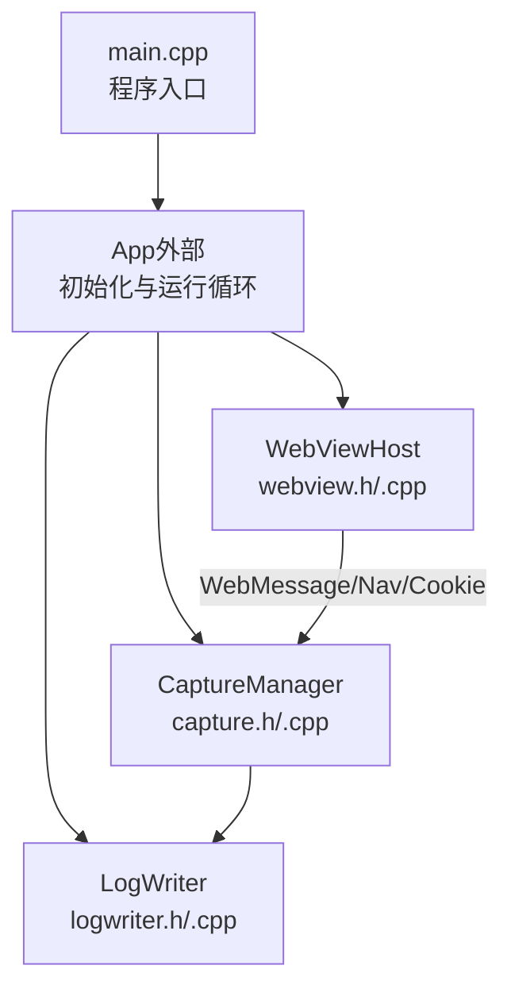
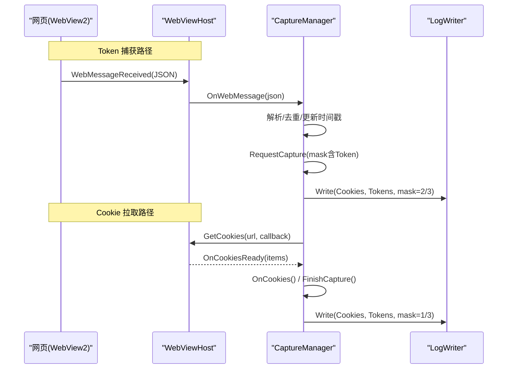
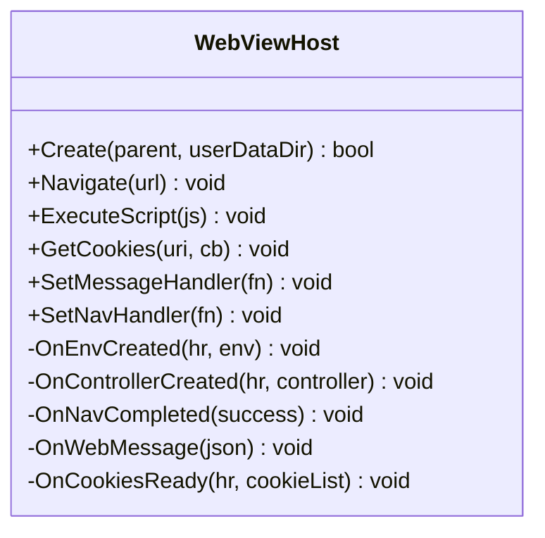
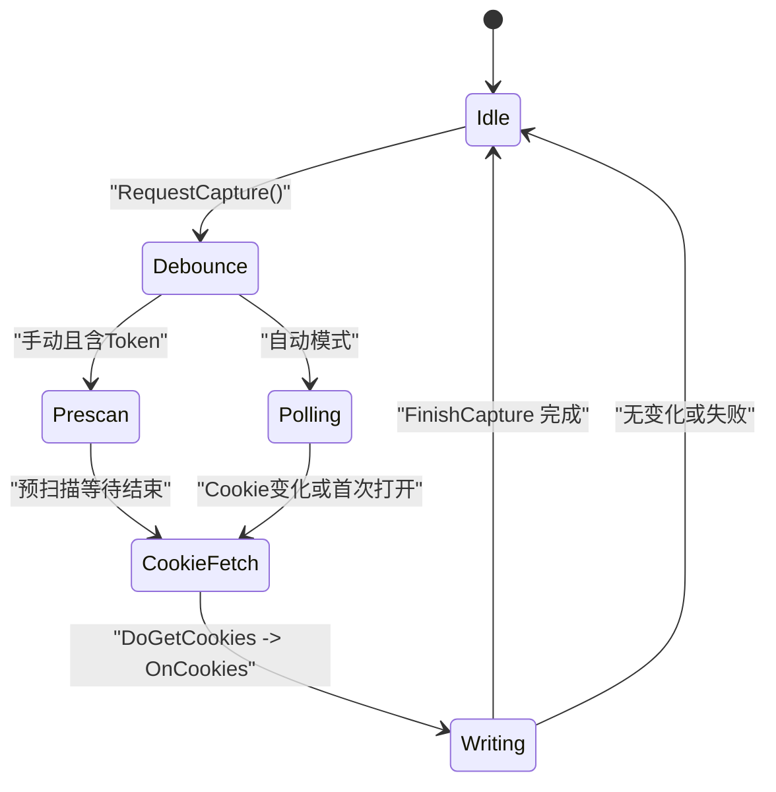
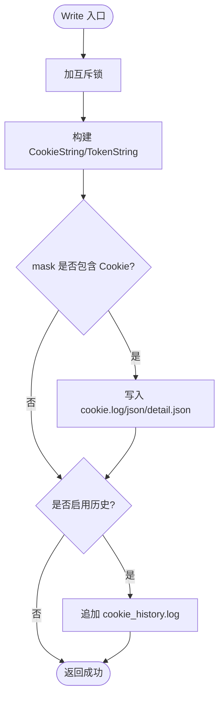
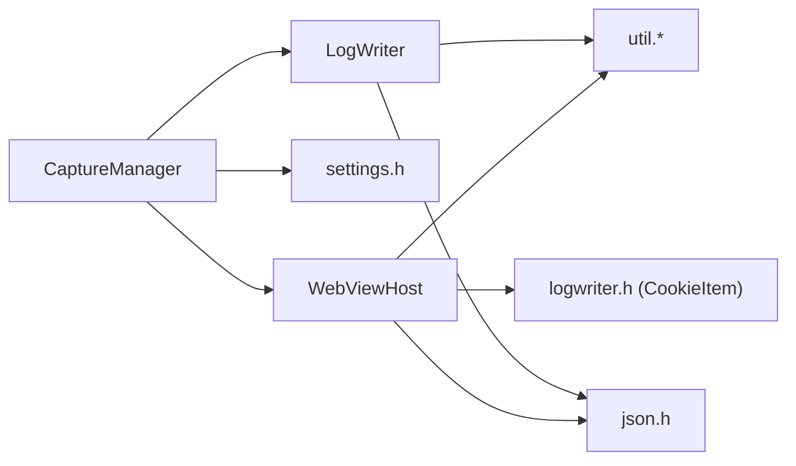

# 数据流设计

<cite>
**本文引用的文件**   
- [main.cpp](file://src/main.cpp)
- [webview.h](file://src/webview.h)
- [webview.cpp](file://src/webview.cpp)
- [capture.h](file://src/capture.h)
- [capture.cpp](file://src/capture.cpp)
- [logwriter.h](file://src/logwriter.h)
- [logwriter.cpp](file://src/logwriter.cpp)
</cite>

## 目录
1. [引言](#引言)
2. [项目结构](#项目结构)
3. [核心组件](#核心组件)
4. [架构总览](#架构总览)
5. [详细组件分析](#详细组件分析)
6. [依赖关系分析](#依赖关系分析)
7. [性能与并发特性](#性能与并发特性)
8. [故障排查指南](#故障排查指南)
9. [结论](#结论)

## 引言
本文面向 Cookie 与 Token 抓取工具的数据流设计，完整追踪从 WebView2 页面事件到 CaptureManager 处理，再到 LogWriter 持久化存储的全过程。文档重点说明：
- WebView2 消息、导航完成、Cookie 异步回调如何进入应用层；
- CaptureManager 的防抖、预扫描、首次打开检测等状态机；
- LogWriter 的文件写入策略、线程安全与数据格式转换；
- 不同场景下的数据流路径、状态转换图与流程图。

## 项目结构
本仓库采用按职责划分的模块组织方式：
- 入口与初始化：main.cpp 启动程序并调用 App 初始化；
- WebView2 宿主封装：webview.h/cpp 负责环境创建、控制器生命周期、脚本注入、消息桥接与 Cookie 读取；
- 抓取编排：capture.h/cpp 汇总 Token 三通道、Cookie 拉取、登录态检测与自动抓取；
- 日志写入：logwriter.h/cpp 负责多格式输出、原子替换与追加历史；
- 其他：settings、ui、util、json 等为支撑模块。

图表来源
- [main.cpp:6-18](file://src/main.cpp#L6-L18)
- [webview.h:11-30](file://src/webview.h#L11-L30)
- [capture.h:10-31](file://src/capture.h#L10-L31)
- [logwriter.h:30-47](file://src/logwriter.h#L30-L47)

章节来源
- [main.cpp:1-20](file://src/main.cpp#L1-L20)

## 核心组件
- WebViewHost：封装 WebView2 环境、控制器、导航、脚本注入、消息与 Cookie 获取；提供 SetMessageHandler/SetNavHandler 将 WebView2 回调转发给上层。
- CaptureManager：聚合 Token 捕获结果与 Cookie 快照，实现防抖、预扫描、首次打开检测、登录态判断，并最终驱动 LogWriter 写入。
- LogWriter：统一格式化 Cookie/Token 数据，支持字符串、JSON、明细 JSON 与历史日志，使用互斥锁保证进程内并发安全。

章节来源
- [webview.h:11-70](file://src/webview.h#L11-L70)
- [capture.h:10-63](file://src/capture.h#L10-L63)
- [logwriter.h:10-52](file://src/logwriter.h#L10-L52)

## 架构总览
整体数据流分为两条主线：
- Token 捕获线：WebView2 注入脚本 → WebMessageReceived → WebViewHost::OnWebMessage → CaptureManager::OnWebMessage → 更新 tokens_ 与脏标记 → 触发 RequestCapture → 防抖后写日志。
- Cookie 拉取线：定时轮询或手动触发 → WebViewHost::GetCookies → OnCookiesReady → CaptureManager::OnCookies → FinishCapture → LogWriter::Write。

图表来源
- [webview.cpp:86-119](file://src/webview.cpp#L86-L119)
- [webview.cpp:141-162](file://src/webview.cpp#L141-L162)
- [webview.cpp:389-430](file://src/webview.cpp#L389-L430)
- [capture.cpp:58-87](file://src/capture.cpp#L58-L87)
- [capture.cpp:164-182](file://src/capture.cpp#L164-L182)
- [capture.cpp:184-232](file://src/capture.cpp#L184-L232)
- [logwriter.cpp:35-143](file://src/logwriter.cpp#L35-L143)

## 详细组件分析

### WebViewHost：WebView2 事件与数据桥接
- 生命周期：Create 初始化 COM 与加载器，OnEnvCreated/OnControllerCreated 建立控制器与事件订阅；Destroy 释放资源。
- 事件桥接：add_NavigationCompleted 与 add_WebMessageReceived 分别转发到 OnNavCompleted 与 OnWebMessage，再回调上层 onNav_/onMessage_。
- Cookie 读取：GetCookies 通过 ICoreWebView2CookieManager 异步获取，OnCookiesReady 将 ICoreWebView2CookieList 转换为 CookieItem 向量并回调。
- Token 注入：TokenHookScript 在文档创建时注入，拦截 fetch/XMLHttpRequest/Storage，向 host 发送 token 类型消息。

图表来源
- [webview.h:11-70](file://src/webview.h#L11-L70)
- [webview.cpp:217-252](file://src/webview.cpp#L217-L252)
- [webview.cpp:254-296](file://src/webview.cpp#L254-L296)
- [webview.cpp:385-430](file://src/webview.cpp#L385-L430)

章节来源
- [webview.h:11-70](file://src/webview.h#L11-L70)
- [webview.cpp:14-182](file://src/webview.cpp#L14-L182)
- [webview.cpp:184-252](file://src/webview.cpp#L184-L252)
- [webview.cpp:254-349](file://src/webview.cpp#L254-L349)
- [webview.cpp:351-430](file://src/webview.cpp#L351-L430)
- [webview.cpp:432-537](file://src/webview.cpp#L432-L537)

### CaptureManager：抓取编排与状态机
- 初始化与重置：Init 绑定 WebViewHost、Settings、LogWriter 与回调；ResetState 清理所有状态与定时器。
- Token 处理：OnWebMessage 解析 JSON，同名同源的 Token 保留最新值，设置 tokensDirty_ 并在自动抓取开启时触发 RequestCapture。
- 导航处理：OnNavigationCompleted 记录首次导航完成，切换域名时清空累积 Token 与快照。
- 轮询与防抖：PollTick 定时拉取 Cookie，比较快照变化后触发 RequestCapture；RequestCapture 合并 mask 并启动防抖计时器；FirePending/FireDelayedStep 控制预扫描与 Cookie 拉取顺序。
- 写入决策：FinishCapture 根据 mask 与变更检测决定是否写入，并更新 lastSnapshot_/lastDomain_/lastTime_，必要时复制剪贴板。

图表来源
- [capture.cpp:135-162](file://src/capture.cpp#L135-L162)
- [capture.cpp:164-182](file://src/capture.cpp#L164-L182)
- [capture.cpp:184-232](file://src/capture.cpp#L184-L232)

章节来源
- [capture.h:10-63](file://src/capture.h#L10-L63)
- [capture.cpp:14-56](file://src/capture.cpp#L14-L56)
- [capture.cpp:58-102](file://src/capture.cpp#L58-L102)
- [capture.cpp:104-133](file://src/capture.cpp#L104-L133)
- [capture.cpp:135-182](file://src/capture.cpp#L135-L182)
- [capture.cpp:184-245](file://src/capture.cpp#L184-L245)
- [capture.cpp:247-253](file://src/capture.cpp#L247-L253)

### LogWriter：持久化与格式转换
- 数据结构：CookieItem 与 TokenItem 定义字段与语义；CookieString/TokenString 生成扁平字符串用于日志。
- 写入流程：Write 加互斥锁，按 mask 与 Settings 决定输出哪些文件；cookie.log/cookie.json/cookie_detail.json 使用原子替换，cookie_history.log 追加。
- 格式映射：
  - cookie.log：时间行 + Cookie 串；
  - cookie.json：扁平对象，time/domain/url/cookie/token；
  - cookie_detail.json：结构化数组 cookies/tokens，包含 expires/httpOnly/secure/sameSite 等；
  - cookie_history.log：追加记录 domain/url/cookies_count/tokens_count 及内容。

图表来源
- [logwriter.cpp:9-29](file://src/logwriter.cpp#L9-L29)
- [logwriter.cpp:31-53](file://src/logwriter.cpp#L31-L53)
- [logwriter.cpp:55-143](file://src/logwriter.cpp#L55-L143)

章节来源
- [logwriter.h:10-52](file://src/logwriter.h#L10-L52)
- [logwriter.cpp:1-144](file://src/logwriter.cpp#L1-L144)

## 依赖关系分析
- WebViewHost 依赖 util/json 进行字符串转换与 JSON 辅助；依赖 logwriter.h 中的 CookieItem 类型以保持一致性。
- CaptureManager 依赖 webview.h、settings.h、logwriter.h，并通过回调函数 onStatus/onSchedule 与 UI/定时器集成。
- LogWriter 依赖 util/json 进行文件操作与 JSON 序列化。

图表来源
- [webview.h:1-10](file://src/webview.h#L1-L10)
- [webview.cpp:1-7](file://src/webview.cpp#L1-L7)
- [capture.h:1-9](file://src/capture.h#L1-L9)
- [logwriter.h:1-9](file://src/logwriter.h#L1-L9)

章节来源
- [webview.h:1-10](file://src/webview.h#L1-L10)
- [webview.cpp:1-7](file://src/webview.cpp#L1-L7)
- [capture.h:1-9](file://src/capture.h#L1-L9)
- [logwriter.h:1-9](file://src/logwriter.h#L1-L9)

## 性能与并发特性
- WebView2 回调线程：WebMessageReceived/NavigationCompleted/GetCookiesCompleted 由 WebView2 调度，可能不在 UI 线程；WebViewHost 仅做轻量转发，避免阻塞。
- CaptureManager 防抖与预扫描：通过 TIMER_DEBOUNCE/TIMER_PRESCAN 合并多次 Token 捕获请求，减少频繁写入；预扫描确保手动抓取时先收集 localStorage/sessionStorage。
- LogWriter 线程安全：Write 使用 std::mutex 保护，保证同一时刻只有一个线程写入文件；覆盖类文件使用原子替换，历史日志使用追加，降低竞争与损坏风险。
- Cookie 快照比对：PollTick 中比较 CookieString(lastCookies_) 与上次快照，仅在变化时触发抓取，减少无效 IO。

[本节为通用指导，不直接分析具体代码文件]

## 故障排查指南
- WebView2 未安装或初始化失败：main.cpp 中 Init 失败会弹出提示；检查 WebView2 运行时是否已安装。
- 无法抓取 Cookie：
  - 当前 URL 非 http/https/file 会被拒绝；确认页面地址有效。
  - 首次打开检测需等待 firstOpenPending_ 逻辑；可观察状态文本“检测到已是登录状态，正在抓取…”。
- Token 未捕获：
  - 检查 TokenHookScript 是否注入成功；确认 fetch/XMLHttpRequest/Storage 被拦截。
  - 同名同源 Token 只保留最新值；若值未变化不会触发写入。
- 写入失败：
  - 查看 errOut 错误信息；检查日志目录权限与磁盘空间；确认 settings 配置是否正确。
- 剪贴板复制失败：
  - 当开启 clipboard 选项但系统剪贴板不可用时，状态会提示复制失败，但不影响日志写入。

章节来源
- [main.cpp:14-18](file://src/main.cpp#L14-L18)
- [capture.cpp:104-133](file://src/capture.cpp#L104-L133)
- [capture.cpp:164-182](file://src/capture.cpp#L164-L182)
- [capture.cpp:207-232](file://src/capture.cpp#L207-L232)
- [logwriter.cpp:49-53](file://src/logwriter.cpp#L49-L53)

## 结论
该数据流设计通过 WebViewHost 将 WebView2 的事件与数据可靠地桥接到应用层，CaptureManager 以防抖与预扫描机制协调 Token 与 Cookie 的采集节奏，最终由 LogWriter 以线程安全的方式输出多种格式的持久化文件。整体架构清晰、职责分离，适合扩展新的捕获源与输出格式。