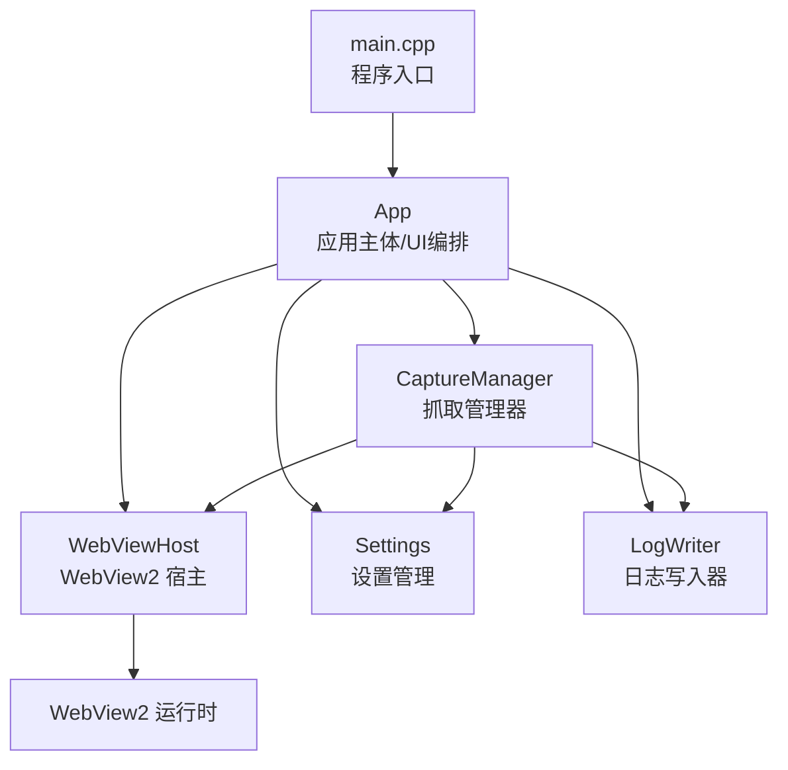
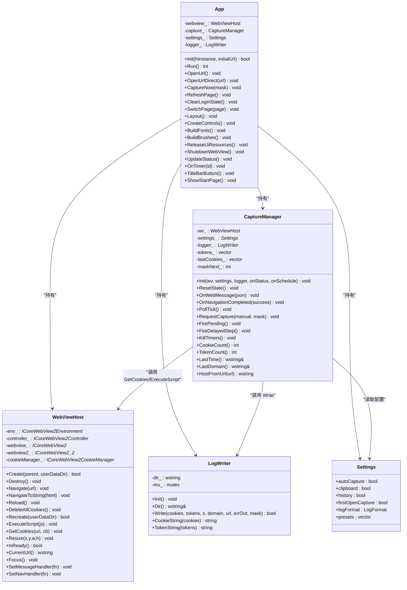
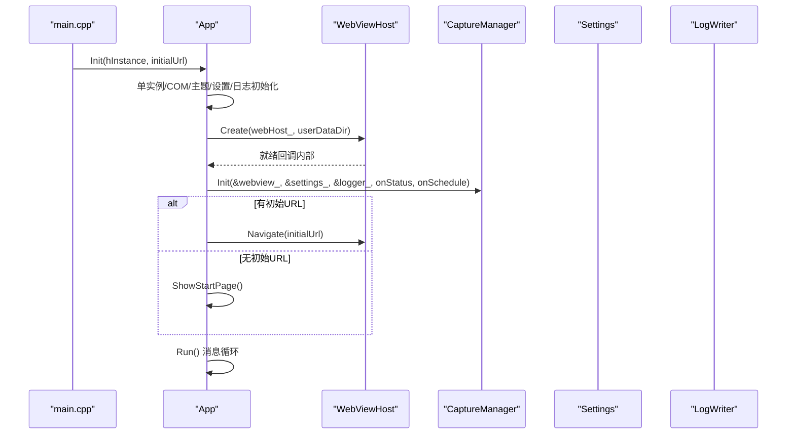
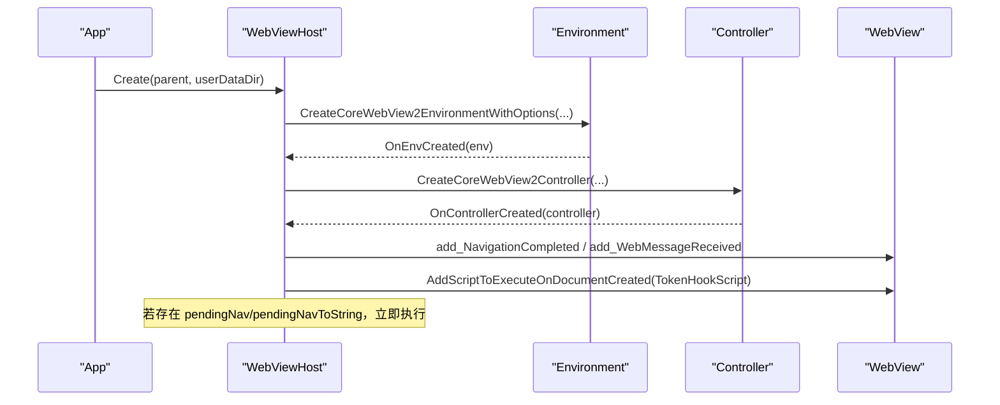
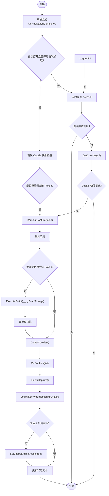
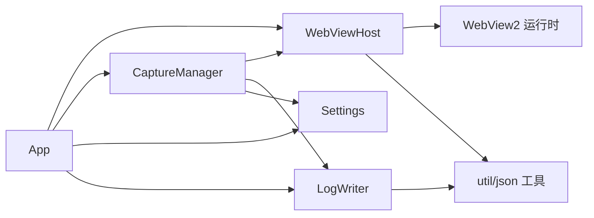

# 架构设计

<cite>
**本文引用的文件**   
- [main.cpp](file://src/main.cpp)
- [app.h](file://src/app.h)
- [app.cpp](file://src/app.cpp)
- [webview.h](file://src/webview.h)
- [webview.cpp](file://src/webview.cpp)
- [capture.h](file://src/capture.h)
- [capture.cpp](file://src/capture.cpp)
- [settings.h](file://src/settings.h)
- [settings.cpp](file://src/settings.cpp)
- [logwriter.h](file://src/logwriter.h)
- [logwriter.cpp](file://src/logwriter.cpp)
</cite>

## 目录
1. [引言](#引言)
2. [项目结构](#项目结构)
3. [核心组件](#核心组件)
4. [架构总览](#架构总览)
5. [详细组件分析](#详细组件分析)
6. [依赖关系分析](#依赖关系分析)
7. [性能与可靠性考虑](#性能与可靠性考虑)
8. [故障排查指南](#故障排查指南)
9. [结论](#结论)

## 引言
本文件面向 Cookie 抓取工具的系统级设计与实现，重点说明整体架构、模块职责、通信机制和数据流向。系统以 Win32 GUI 为入口，通过 WebView2 宿主加载网页，在页面中注入 Token 捕获脚本；抓取管理器负责 Cookie 快照比对、Token 汇总、登录态检测与自动抓取编排；设置管理提供持久化配置；日志写入器统一输出 Cookie/Token 到多种格式。文档同时给出架构图、类图、时序图和流程图，帮助开发者快速理解技术决策与扩展点。

## 项目结构
仓库采用按功能划分的源码组织方式：
- src/main.cpp：程序入口，解析命令行参数并启动应用主体。
- src/app.*：Win32 主窗口、UI 控件、布局、主题、事件循环与模块编排。
- src/webview.*：WebView2 环境/控制器生命周期封装、导航、消息桥接、Cookie 读取与脚本注入。
- src/capture.*：抓取流程编排（防抖、预扫描、Cookie 拉取、Token 汇总、状态机）。
- src/settings.*：设置模型与 JSON 持久化。
- src/logwriter.*：日志文件生成与原子写入。
- res/*：资源文件（含内嵌 WebView2Loader.dll 等资源）。
- test/*：测试站点与示例。

**图表来源**
- [main.cpp:6-18](file://src/main.cpp#L6-L18)
- [app.h:15-182](file://src/app.h#L15-L182)
- [webview.h:11-70](file://src/webview.h#L11-L70)
- [capture.h:10-63](file://src/capture.h#L10-L63)
- [settings.h:6-25](file://src/settings.h#L6-L25)
- [logwriter.h:10-52](file://src/logwriter.h#L10-L52)

**章节来源**
- [main.cpp:1-20](file://src/main.cpp#L1-L20)
- [app.h:1-183](file://src/app.h#L1-L183)

## 核心组件
- App 应用主体
  - 职责：Win32 窗口创建、主题与字体画刷、响应式布局、控件管理、消息循环、WebView2 生命周期协调、抓取触发、状态栏更新、单实例控制。
  - 关键接口：Init/Run/OpenUrl/CaptureNow/RefreshPage/ClearLoginState/SwitchPage/Layout/CreateControls/BuildFonts/BuildBrushes/ReleaseUiResources/ShutdownWebView/UpdateStatus/OnTimer/TitleBarButton/ShowStartPage 等。
  - 设计要点：单例模式（Get()）、双缓冲绘制、DPI 感知、定时器驱动轮询与阶段调度。

- WebViewHost WebView2 宿主
  - 职责：WebView2 环境/控制器创建、导航、刷新、脚本注入、WebMessage 回调、Cookie 异步获取、窗口尺寸同步、销毁与重建。
  - 关键接口：Create/Destroy/Navigate/NavigateToString/Reload/DeleteAllCookies/Recreate/ExecuteScript/GetCookies/Resize/IsReady/CurrentUrl/Focus/SetMessageHandler/SetNavHandler。
  - 设计要点：COM 处理器对象生命周期管理、延迟执行待处理导航、加载器动态加载策略（优先 exe 同目录，否则释放内嵌资源到临时目录）。

- CaptureManager 抓取管理器
  - 职责：Token 三通道汇总（请求头、存储、响应体）、Cookie 拉取与快照比对、登录态检测、自动抓取防抖与预扫描、定时轮询、结果写日志与剪贴板。
  - 关键接口：Init/ResetState/OnWebMessage/OnNavigationCompleted/PollTick/RequestCapture/FirePending/FireDelayedStep/KillTimers/CookieCount/TokenCount/LastTime/LastDomain/HostFromUrl。
  - 设计要点：状态机（防抖/预扫描/轮询/抓取飞行标志）、掩码合并（Cookie/Token 独立）、变更检测、与 WebViewHost/Settings/LogWriter 协作。

- Settings 设置管理
  - 职责：定义设置模型（自动抓取、剪贴板、历史、首次打开抓取、日志格式、预设列表），JSON 读写与默认值。
  - 关键接口：LoadSettings/SaveSettings/SettingsFilePath/DefaultSettings。
  - 设计要点：默认预设以主流网盘优先（六个网盘 + B站/GitHub），字段兼容与降级；`presets` 为整体覆盖。

- LogWriter 日志写入器
  - 职责：Cookie/Token 数据序列化，输出 cookie.log、cookie.json、cookie_detail.json、cookie_history.log；支持字符串/JSON/两者格式；原子写入与追加历史；进程内互斥。
  - 关键接口：Init/Dir/Write/CookieString/TokenString。
  - 设计要点：WriteFileAtomic 原子替换、AppendFile 追加、mutex 保护、时间戳与域名/URL 元信息。

**章节来源**
- [app.h:15-182](file://src/app.h#L15-L182)
- [webview.h:11-70](file://src/webview.h#L11-L70)
- [capture.h:10-63](file://src/capture.h#L10-L63)
- [settings.h:6-25](file://src/settings.h#L6-L25)
- [logwriter.h:10-52](file://src/logwriter.h#L10-L52)

## 架构总览
系统采用“应用主体 + 宿主 + 管理器 + 设置 + 日志”的分层架构：
- 应用主体作为 UI 与业务编排中心，持有 WebViewHost、CaptureManager、Settings、LogWriter 实例。
- WebViewHost 屏蔽 WebView2 COM 细节，向上暴露导航、消息、Cookie 操作。
- CaptureManager 订阅 WebViewHost 的 WebMessage 与导航完成事件，驱动 Cookie 拉取与 Token 汇总，并通过 LogWriter 输出。
- Settings 提供可持久化的行为开关与预设。
- LogWriter 保证日志一致性（原子写入）与多格式输出。

**图表来源**
- [app.h:15-182](file://src/app.h#L15-L182)
- [webview.h:11-70](file://src/webview.h#L11-L70)
- [capture.h:10-63](file://src/capture.h#L10-L63)
- [settings.h:6-25](file://src/settings.h#L6-L25)
- [logwriter.h:10-52](file://src/logwriter.h#L10-L52)

## 详细组件分析

### App 应用主体
- 初始化流程
  - 单实例互斥检查，避免多进程共享 WebView2 userdata 冲突。
  - COM STA 初始化、通用控件初始化、主题解析、设置加载、日志目录初始化。
  - 注册窗口类、创建主窗口、启用圆角与边框色、居中显示。
  - 绑定 WebViewHost 的消息与导航回调，创建 WebViewHost，初始化 CaptureManager。
  - 根据初始 URL 或起始页展示。

- 事件与定时器
  - 地址框回车触发 OpenUrl。
  - 定时器 1：轮询 PollTick 与 WebView2 就绪检测计数。
  - 定时器 2/3：防抖到期与预扫描等待到期，分别触发 FirePending/FireDelayedStep。

- UI 与布局
  - 顶部导航标签（浏览器/设置/说明），全宽状态栏。
  - 响应式布局：宽/中/窄三档，工具栏卡片自适应换行。
  - 设置页表单行几何计算与滚动裁剪。

- 清理与资源
  - 字体/画刷创建与释放，内存 DC/位图缓存按需重建。
  - WebView2 销毁与重建（删除数据目录后重新创建环境与控制器）。

**图表来源**
- [main.cpp:6-18](file://src/main.cpp#L6-L18)
- [app.cpp:66-172](file://src/app.cpp#L66-L172)
- [webview.cpp:217-296](file://src/webview.cpp#L217-L296)

**章节来源**
- [app.cpp:66-172](file://src/app.cpp#L66-L172)
- [app.cpp:175-187](file://src/app.cpp#L175-L187)
- [app.cpp:218-272](file://src/app.cpp#L218-L272)
- [app.cpp:274-347](file://src/app.cpp#L274-L347)
- [app.cpp:379-538](file://src/app.cpp#L379-L538)
- [app.cpp:540-561](file://src/app.cpp#L540-L561)
- [app.cpp:563-598](file://src/app.cpp#L563-L598)
- [app.cpp:600-637](file://src/app.cpp#L600-L637)
- [app.cpp:639-700](file://src/app.cpp#L639-L700)
- [app.cpp:702-747](file://src/app.cpp#L702-L747)
- [app.cpp:749-800](file://src/app.cpp#L749-L800)

### WebViewHost WebView2 宿主
- 生命周期
  - Create：创建 userDataDir、STA 初始化、加载 WebView2Loader（优先 exe 同目录，否则释放内嵌资源到 %TEMP%\CookieGrabber），异步创建 Environment -> Controller -> WebView。
  - Destroy：注销事件、关闭控制器、释放 WebView2/Env/CookieManager、卸载 Loader 与临时文件。
  - Recreate：注销事件、关闭控制器、释放对象、递归删除数据目录（重试数次）、重新 Create。

- 导航与脚本
  - Navigate/NavigateToString：若控制器未就绪则挂起 pendingNav_/pendingNavToString_，控制器就绪后自动执行。
  - Reload：刷新当前页面。
  - ExecuteScript：注入 Token 捕获脚本（TokenHookScript），并在文档创建时执行。

- 消息与 Cookie
  - SetMessageHandler/SetNavHandler：回调函数用于桥接 WebView2 事件到上层。
  - GetCookies：异步获取 Cookie 列表，回调返回 CookieItem 向量。

**图表来源**
- [webview.cpp:217-296](file://src/webview.cpp#L217-L296)

**章节来源**
- [webview.cpp:184-214](file://src/webview.cpp#L184-L214)
- [webview.cpp:217-252](file://src/webview.cpp#L217-L252)
- [webview.cpp:254-296](file://src/webview.cpp#L254-L296)
- [webview.cpp:298-310](file://src/webview.cpp#L298-L310)
- [webview.cpp:312-342](file://src/webview.cpp#L312-L342)
- [webview.cpp:344-383](file://src/webview.cpp#L344-L383)
- [webview.cpp:385-430](file://src/webview.cpp#L385-L430)
- [webview.cpp:432-537](file://src/webview.cpp#L432-L537)

### CaptureManager 抓取管理器
- 数据流
  - WebViewHost 注入 Token 捕获脚本，页面通过 window.chrome.webview.postMessage 发送 Token 消息。
  - OnWebMessage 解析 JSON，去重同名 Token，记录 capturedAt，必要时触发 RequestCapture(false)。
  - OnNavigationCompleted 处理首次打开逻辑与域名切换（清空旧域名的 Token 累积）。
  - PollTick 定时轮询 Cookie 快照，变化时 RequestCapture(false)。
  - RequestCapture 合并掩码（Cookie/Token），进入防抖阶段；防抖到期后可能先执行存储预扫描（手动抓取 Token 场景），再拉取 Cookie 或直接写 Token。
  - FinishCapture 进行变更检测（Cookie 快照对比或 tokensDirty_），调用 LogWriter.Write，可选复制到剪贴板，更新状态文本。

- 登录态检测
  - IsLoggedIn 基于 Cookie 名称关键字匹配（session/sess/token/auth/jwt/ticket/login/sso/sid）。

**图表来源**
- [capture.cpp:58-87](file://src/capture.cpp#L58-L87)
- [capture.cpp:89-102](file://src/capture.cpp#L89-L102)
- [capture.cpp:104-133](file://src/capture.cpp#L104-L133)
- [capture.cpp:135-162](file://src/capture.cpp#L135-L162)
- [capture.cpp:164-182](file://src/capture.cpp#L164-L182)
- [capture.cpp:184-232](file://src/capture.cpp#L184-L232)
- [capture.cpp:234-245](file://src/capture.cpp#L234-L245)

**章节来源**
- [capture.cpp:14-21](file://src/capture.cpp#L14-L21)
- [capture.cpp:23-39](file://src/capture.cpp#L23-L39)
- [capture.cpp:41-52](file://src/capture.cpp#L41-L52)
- [capture.cpp:54-56](file://src/capture.cpp#L54-L56)
- [capture.cpp:58-87](file://src/capture.cpp#L58-L87)
- [capture.cpp:89-102](file://src/capture.cpp#L89-L102)
- [capture.cpp:104-133](file://src/capture.cpp#L104-L133)
- [capture.cpp:135-162](file://src/capture.cpp#L135-L162)
- [capture.cpp:164-182](file://src/capture.cpp#L164-L182)
- [capture.cpp:184-232](file://src/capture.cpp#L184-L232)
- [capture.cpp:234-245](file://src/capture.cpp#L234-L245)
- [capture.cpp:247-253](file://src/capture.cpp#L247-L253)

### Settings 设置管理
- 模型与默认值
  - 默认预设以六个主流网盘优先，再加 B站与 GitHub 登录页。
  - 默认开启自动抓取、剪贴板、历史、首次打开抓取。
  - 日志格式支持 String/Json/Both。

- 持久化
  - LoadSettings：从 %LOCALAPPDATA%\CookieGrabber\settings.json 读取，兼容缺失字段。
  - SaveSettings：格式化 JSON 原子写入。

**章节来源**
- [settings.cpp:7-20](file://src/settings.cpp#L7-L20)
- [settings.cpp:22-48](file://src/settings.cpp#L22-L48)
- [settings.cpp:50-76](file://src/settings.cpp#L50-L76)

### LogWriter 日志写入器
- 输出格式
  - cookie.log：字符串格式（第一行时间，第二行 Cookie 串）。
  - cookie.json：扁平简洁型（time/domain/url/cookie/token）。
  - cookie_detail.json：结构化明细型（cookies 数组 + tokens 数组）。
  - cookie_history.log：追加历史（domain/url/cookie数量/token数量 + 内容）。

- 写入策略
  - 原子写入：使用 WriteFileAtomic 覆盖文件，避免中断导致损坏。
  - 历史追加：AppendFile 追加历史日志。
  - 进程内互斥：mutex 保护 Write 方法。

**章节来源**
- [logwriter.cpp:9-29](file://src/logwriter.cpp#L9-L29)
- [logwriter.cpp:31-33](file://src/logwriter.cpp#L31-L33)
- [logwriter.cpp:35-144](file://src/logwriter.cpp#L35-L144)

## 依赖关系分析
- 耦合关系
  - App 强依赖 WebViewHost、CaptureManager、Settings、LogWriter。
  - CaptureManager 依赖 WebViewHost（GetCookies/ExecuteScript）、Settings（行为开关）、LogWriter（输出）。
  - WebViewHost 依赖 WebView2 COM 接口与 util/json 工具。
  - LogWriter 依赖 Settings（格式选择）与 util/json 工具。

- 外部依赖
  - WebView2 运行时：需安装 Edge WebView2 运行时，否则提示用户安装。
  - Windows API：COM、DWM、Shell、文件 IO、剪贴板等。

**图表来源**
- [app.h:15-182](file://src/app.h#L15-L182)
- [webview.h:11-70](file://src/webview.h#L11-L70)
- [capture.h:10-63](file://src/capture.h#L10-L63)
- [settings.h:6-25](file://src/settings.h#L6-L25)
- [logwriter.h:10-52](file://src/logwriter.h#L10-L52)

**章节来源**
- [app.h:15-182](file://src/app.h#L15-L182)
- [webview.h:11-70](file://src/webview.h#L11-L70)
- [capture.h:10-63](file://src/capture.h#L10-L63)
- [settings.h:6-25](file://src/settings.h#L6-L25)
- [logwriter.h:10-52](file://src/logwriter.h#L10-L52)

## 性能与可靠性考虑
- WebView2 加载器策略
  - 优先加载 exe 同目录 WebView2Loader.dll，失败则释放内嵌资源到 %TEMP%\CookieGrabber，避免重复释放与覆盖写冲突。
  - 重建时复用已加载的加载器，防止覆盖正在映射的文件。

- 文件写入可靠性
  - 原子写入覆盖文件，避免部分写入导致损坏。
  - 历史日志追加写入，减少频繁覆盖开销。
  - 进程内互斥确保并发安全。

- 界面性能
  - 双缓冲绘制减少闪烁。
  - DPI 缩放与响应式布局提升不同分辨率体验。
  - 定时器轮询间隔合理（1.5s），避免过度 IO。

- 错误恢复
  - WebView2 就绪检测计数，多次失败提示用户安装运行时。
  - 清除登录状态时尽力删除 Web 存储与数据目录，必要时重启应用。

[本节为通用指导，不直接分析具体文件]

## 故障排查指南
- WebView2 初始化失败
  - 现象：状态栏提示“WebView2 初始化失败：请安装 Edge WebView2 运行时后重试”。
  - 原因：缺少 WebView2 运行时或加载器加载失败。
  - 处理：安装 Edge WebView2 运行时；确认 exe 同目录或临时目录 WebView2Loader.dll 可用。

- 抓取无变化
  - 现象：状态栏显示“登录状态无变化”。
  - 原因：Cookie 快照未变且无新 Token。
  - 处理：确认页面已登录；检查自动抓取与历史日志；手动点击抓取按钮。

- 日志写入失败
  - 现象：状态栏提示“抓取完成但写日志失败: ...”。
  - 原因：磁盘权限不足或路径不可写。
  - 处理：检查日志目录权限；确认 exe 目录或 %LOCALAPPDATA%\CookieGrabber\logs 可写。

- 无法清除登录状态
  - 现象：提示“清除失败：WebView2 重建失败，请重启应用后重试”。
  - 原因：数据目录被占用或残留。
  - 处理：重启应用；确认 userdata 目录可删除；必要时手动清理。

**章节来源**
- [app.cpp:714-725](file://src/app.cpp#L714-L725)
- [app.cpp:600-637](file://src/app.cpp#L600-L637)
- [capture.cpp:216-232](file://src/capture.cpp#L216-L232)
- [logwriter.cpp:35-144](file://src/logwriter.cpp#L35-L144)

## 结论
该 Cookie 抓取工具通过清晰的模块划分与事件驱动架构，实现了稳定的 Cookie/Token 抓取与日志输出。App 作为编排中心，WebViewHost 屏蔽 WebView2 复杂性，CaptureManager 负责抓取流程与状态机，Settings 提供持久化配置，LogWriter 保证日志一致性与多格式输出。系统设计兼顾性能与可靠性，适合进一步扩展更多网站预设与抓取策略。

[本节为总结性内容，不直接分析具体文件]