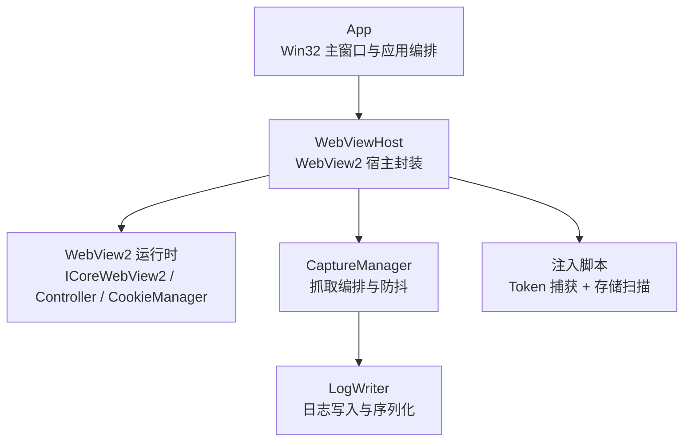
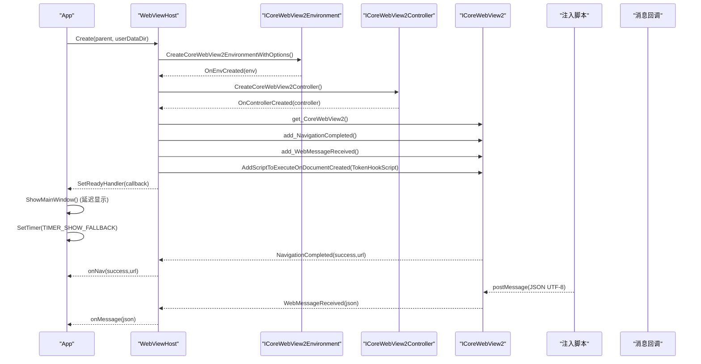
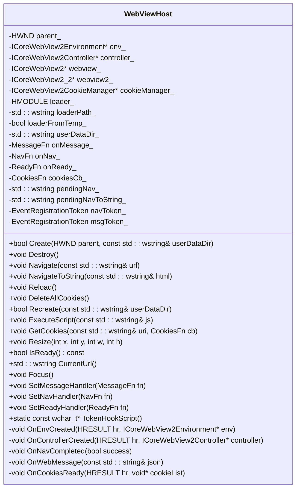
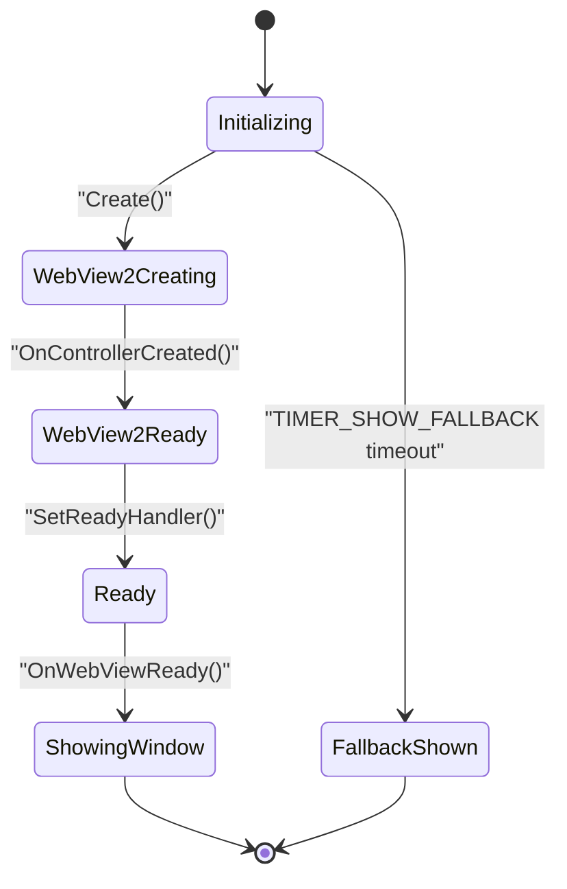
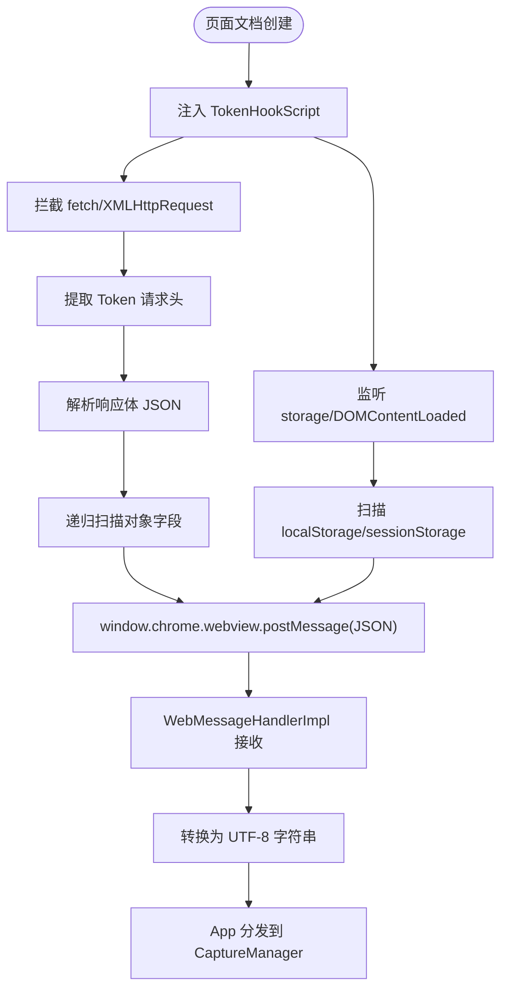
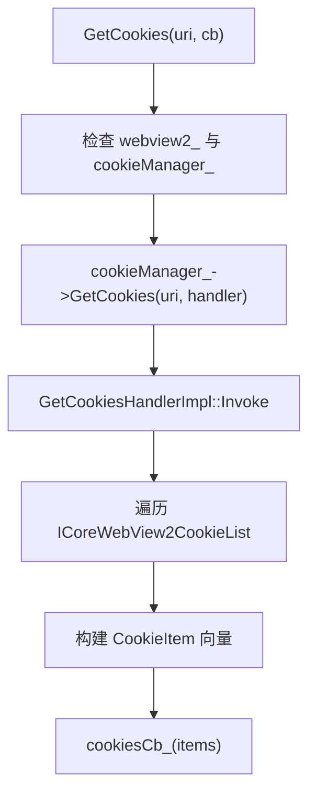
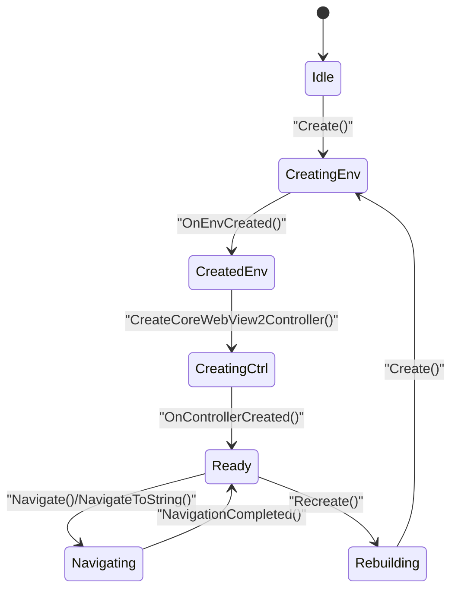
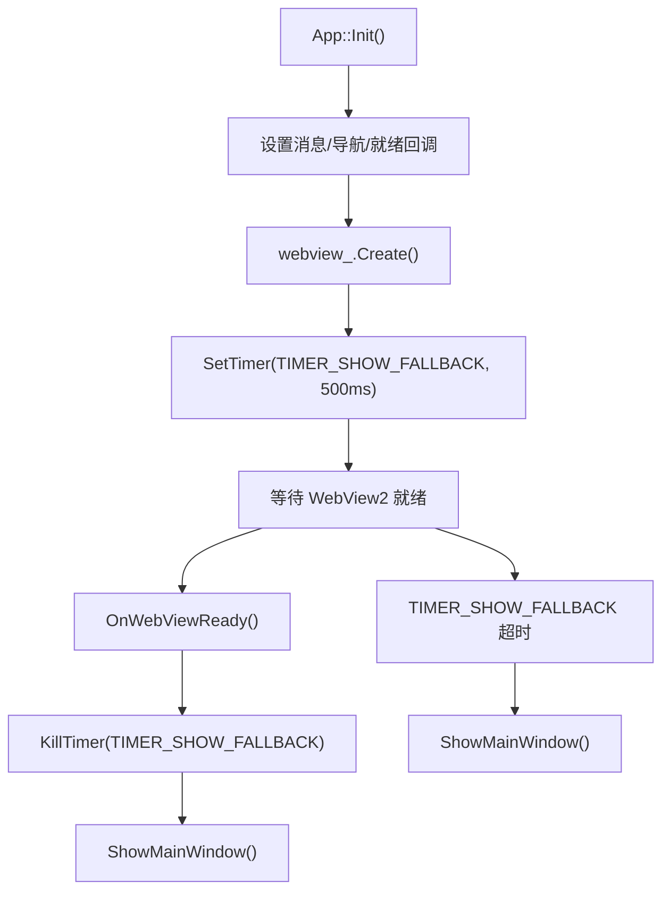
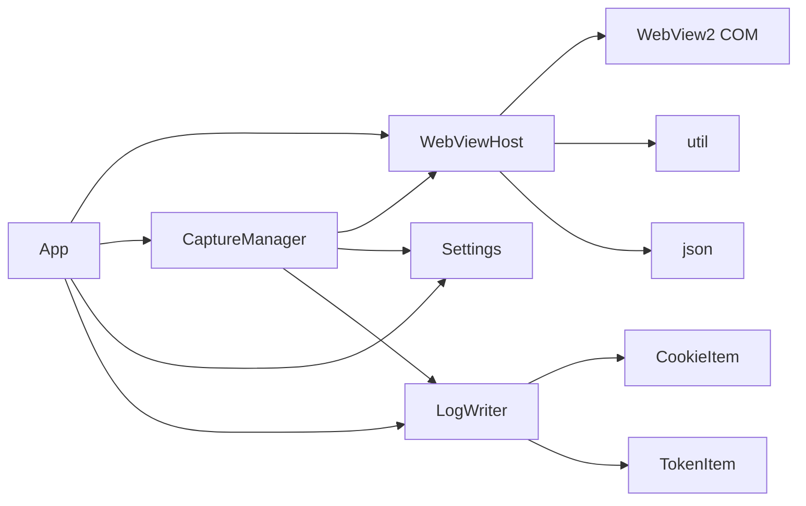

# WebView2 宿主模块 (WebViewHost)

<cite>
**本文引用的文件**   
- [webview.h](file://src/webview.h)
- [webview.cpp](file://src/webview.cpp)
- [app.h](file://src/app.h)
- [app.cpp](file://src/app.cpp)
- [capture.h](file://src/capture.h)
- [capture.cpp](file://src/capture.cpp)
- [logwriter.h](file://src/logwriter.h)
</cite>

## 更新摘要
**变更内容**   
- 新增 IsWebViewReady() 和 OnWebViewReady() 方法以解决 WebView2 初始化时机问题
- 添加 ShowMainWindow() 函数实现延迟窗口显示机制
- 引入回退计时器 TIMER_SHOW_FALLBACK 确保错误处理时的界面可见性
- 改进 WebView2 生命周期管理，避免启动时出现空白或黑屏
- 优化 HostWndProc 绘制逻辑，提供启动过渡提示

## 目录
1. [简介](#简介)
2. [项目结构](#项目结构)
3. [核心组件](#核心组件)
4. [架构总览](#架构总览)
5. [详细组件分析](#详细组件分析)
6. [依赖关系分析](#依赖关系分析)
7. [性能与并发特性](#性能与并发特性)
8. [故障排查指南](#故障排查指南)
9. [结论](#结论)
10. [附录：关键方法使用示例](#附录关键方法使用示例)

## 简介
本模块为基于 Microsoft Edge WebView2 的宿主封装，负责 WebView2 环境初始化、控制器生命周期管理、页面导航、JavaScript 注入、消息通道、Cookie 获取以及会话重建。它与上层应用 App 和抓取编排 CaptureManager 协作，提供"自动/手动抓取 Cookie 与 Token"的能力，并通过日志写入模块输出结构化结果。

该文档聚焦于 WebViewHost 类的设计与实现，包括：
- WebView2 环境加载与 COM 初始化
- 控制器创建与事件订阅
- 页面导航与待执行队列
- JavaScript 注入与消息通道
- Cookie 异步获取接口
- 异步模型、事件驱动、错误处理与重试
- 与 C++ 层通信协议、数据序列化与安全考虑
- 与 App 模块集成方式及回调机制

**更新** 新增了完善的 WebView2 初始化时机管理机制，通过 IsWebViewReady()、OnWebViewReady() 和 ShowMainWindow() 方法解决了启动时序问题，并添加了回退计时器确保错误情况下的用户体验。

## 项目结构
WebViewHost 位于 src/webview.{h,cpp}，对外暴露高层 API；App 在 src/app.{h,cpp} 中持有 WebViewHost 实例并设置消息与导航回调；CaptureManager 在 src/capture.{h,cpp} 中编排抓取流程；CookieItem/TokenItem 等数据结构定义在 src/logwriter.h。

图表来源
- [app.h:15-192](file://src/app.h#L15-L192)
- [webview.h:11-74](file://src/webview.h#L11-L74)
- [capture.h:10-64](file://src/capture.h#L10-L64)
- [logwriter.h:10-52](file://src/logwriter.h#L10-L52)

章节来源
- [webview.h:1-74](file://src/webview.h#L1-L74)
- [webview.cpp:1-542](file://src/webview.cpp#L1-L542)
- [app.h:15-192](file://src/app.h#L15-L192)
- [capture.h:10-64](file://src/capture.h#L10-L64)
- [logwriter.h:10-52](file://src/logwriter.h#L10-L52)

## 核心组件
- WebViewHost：封装 WebView2 环境加载、控制器创建、导航、脚本注入、消息通道、Cookie 获取、会话重建。
- App：Win32 GUI 应用主体，持有 WebViewHost 实例，注册消息与导航回调，协调 UI 与抓取流程。
- CaptureManager：抓取编排器，负责 Token 汇总、Cookie 拉取、登录态检测、防抖与定时轮询。
- LogWriter：日志写入与序列化，定义 CookieItem/TokenItem 数据结构。

**更新** App 模块新增了 WebView2 就绪状态管理和窗口显示控制逻辑，包括 IsWebViewReady()、OnWebViewReady()、ShowMainWindow() 方法和回退计时器机制。

章节来源
- [webview.h:11-74](file://src/webview.h#L11-L74)
- [webview.cpp:217-362](file://src/webview.cpp#L217-L362)
- [app.h:15-192](file://src/app.h#L15-L192)
- [capture.h:10-64](file://src/capture.h#L10-L64)
- [logwriter.h:10-52](file://src/logwriter.h#L10-L52)

## 架构总览
WebViewHost 通过动态加载 WebView2Loader.dll（优先 exe 同目录，否则释放内嵌资源到临时目录），初始化 COM STA，创建 ICoreWebView2Environment 与 ICoreWebView2Controller，并订阅 NavigationCompleted、WebMessageReceived 事件。页面文档创建时注入 TokenHookScript，用于拦截 fetch/XMLHttpRequest 请求头、响应体 JSON、localStorage/sessionStorage 变更，并通过 window.chrome.webview.postMessage 将 Token 信息以 UTF-8 JSON 字符串回传给宿主。

**更新** 新增了完整的初始化时序控制：App 在 Init 中设置 WebView2 就绪回调，延迟显示主窗口直到控制器真正就绪，同时设置回退计时器确保即使初始化失败也能显示界面。

图表来源
- [webview.cpp:185-239](file://src/webview.cpp#L185-L239)
- [webview.cpp:254-296](file://src/webview.cpp#L254-L296)
- [webview.cpp:298-306](file://src/webview.cpp#L298-L306)
- [webview.cpp:385-391](file://src/webview.cpp#L385-L391)
- [app.cpp:141-185](file://src/app.cpp#L141-L185)

## 详细组件分析

### WebViewHost 设计与实现
- 环境加载策略：
  - 优先从 exe 同目录加载 WebView2Loader.dll。
  - 若不存在，则从内嵌资源释放到 %TEMP%\CookieGrabber\WebView2Loader.dll 并加载。
  - 复用已加载的 loader，避免重复释放或覆盖写。
- COM 初始化：
  - 使用 CoInitializeEx(COINIT_APARTMENTTHREADED)，兼容已初始化的 STA。
- 控制器生命周期：
  - 创建 Environment -> Controller -> CoreWebView2，并 QueryInterface 获取 ICoreWebView2_2 以支持 CookieManager。
  - 订阅 NavigationCompleted、WebMessageReceived，并在文档创建时注入 TokenHookScript。
  - **新增** 在控制器创建完成后调用 onReady_ 回调通知 App 控制器已就绪。
- 导航与待执行队列：
  - 若控制器未就绪，Navigate/NavigateToString 会缓存 pendingNav_/pendingNavToString_，待控制器就绪后自动执行。
- 脚本注入与消息通道：
  - TokenHookScript 拦截 fetch/XMLHttpRequest 请求头与响应体 JSON，扫描 localStorage/sessionStorage，通过 window.chrome.webview.postMessage 发送 JSON 字符串。
  - WebMessageHandlerImpl 将消息转换为 UTF-8 字符串，调用 OnWebMessage，再由 App 分发到 CaptureManager。
- Cookie 获取：
  - GetCookies(uri, cb) 通过 ICoreWebView2CookieManager::GetCookies 异步获取 Cookie 列表，回调中解析为 CookieItem 向量并调用用户回调。
  - cookieManager_ 长驻保留，确保异步操作期间存活。
- 会话重建：
  - Recreate(userDataDir) 注销事件、关闭控制器、释放对象、删除数据目录（带重试）、重新 Create。
- 其他能力：
  - ExecuteScript(js) 执行任意脚本。
  - DeleteAllCookies() 清空当前配置所有 Cookie。
  - Resize/Focus/CurrentUrl 等辅助方法。

图表来源
- [webview.h:11-74](file://src/webview.h#L11-L74)
- [webview.cpp:217-362](file://src/webview.cpp#L217-L362)

章节来源
- [webview.cpp:185-239](file://src/webview.cpp#L185-L239)
- [webview.cpp:254-362](file://src/webview.cpp#L254-L362)
- [webview.cpp:385-430](file://src/webview.cpp#L385-L430)
- [webview.cpp:433-542](file://src/webview.cpp#L433-L542)

### WebView2 初始化时机管理与窗口显示控制

**新增** 为解决 WebView2 初始化时序问题，App 模块实现了完整的生命周期管理机制：

- **IsWebViewReady() 方法**：检查 WebViewHost 的 IsReady() 状态，判断控制器是否已创建完成。
- **OnWebViewReady() 方法**：WebView2 就绪回调处理函数，取消回退定时器并显示主窗口。
- **ShowMainWindow() 方法**：幂等的窗口显示函数，确保只首次显示一次，并立即完成首帧绘制。
- **回退计时器 TIMER_SHOW_FALLBACK**：500ms 超时保护，确保即使 WebView2 初始化失败也能显示界面。

**更新** 初始化流程改为：
1. App::Init 中设置 WebView2 就绪回调，但不立即显示窗口
2. 设置回退计时器 TIMER_SHOW_FALLBACK 作为兜底
3. WebViewHost::OnControllerCreated 中调用 onReady_ 回调
4. App::OnWebViewReady 中取消回退定时器并显示主窗口
5. 如果 WebView2 初始化失败，回退计时器触发 ShowMainWindow()

图表来源
- [app.cpp:168-185](file://src/app.cpp#L168-L185)
- [app.cpp:247-260](file://src/app.cpp#L247-L260)
- [app.cpp:769-774](file://src/app.cpp#L769-L774)
- [webview.cpp:297-301](file://src/webview.cpp#L297-L301)

章节来源
- [app.h:18-22](file://src/app.h#L18-L22)
- [app.cpp:168-185](file://src/app.cpp#L168-L185)
- [app.cpp:247-260](file://src/app.cpp#L247-L260)
- [app.cpp:769-774](file://src/app.cpp#L769-L774)
- [webview.cpp:297-301](file://src/webview.cpp#L297-L301)

### JavaScript 注入机制与消息通道
- 注入时机：AddScriptToExecuteOnDocumentCreated，在文档创建阶段执行 TokenHookScript。
- 注入内容：
  - 拦截 window.fetch 与 XMLHttpRequest，提取常见 Token 请求头（如 authorization、x-token 等）。
  - 解析响应体 JSON，递归扫描包含 token/jwt 等关键字的字段值。
  - 监听 storage 事件与 DOMContentLoaded，扫描 localStorage/sessionStorage。
  - 去重与大小限制，防止内存膨胀。
  - 通过 window.chrome.webview.postMessage 发送 JSON 字符串，格式包含 type/name/value/source/url。
- 宿主接收：
  - WebMessageHandlerImpl 将消息转为 UTF-8 字符串，调用 OnWebMessage。
  - App 中先判断是否起始页控制消息（{"cg":"nav","url":"..."}），否则交给 CaptureManager.OnWebMessage 解析 Token。

图表来源
- [webview.cpp:121-139](file://src/webview.cpp#L121-L139)
- [webview.cpp:275-285](file://src/webview.cpp#L275-L285)
- [webview.cpp:438-542](file://src/webview.cpp#L438-L542)
- [app.cpp:148-153](file://src/app.cpp#L148-L153)
- [capture.cpp:58-87](file://src/capture.cpp#L58-L87)

章节来源
- [webview.cpp:121-139](file://src/webview.cpp#L121-L139)
- [webview.cpp:275-285](file://src/webview.cpp#L275-L285)
- [webview.cpp:438-542](file://src/webview.cpp#L438-L542)
- [app.cpp:148-153](file://src/app.cpp#L148-L153)
- [capture.cpp:58-87](file://src/capture.cpp#L58-L87)

### Cookie 获取接口与数据模型
- 接口：GetCookies(uri, cb)
  - 通过 ICoreWebView2CookieManager::GetCookies 异步获取 Cookie 列表。
  - 回调中遍历 ICoreWebView2CookieList，逐项读取 name/value/domain/path/expires/httpOnly/secure/isSession/sameSite，构造 CookieItem 向量。
  - 注意：cookieList 由 WebView2 回调约定不归属本处理器，不得 Release。
- 数据模型：CookieItem
  - 字段：name、value、domain、path、expires、httpOnly、secure、isSession、sameSite。
  - sameSite 映射 COREWEBVIEW2_COOKIE_SAME_SITE_KIND 枚举。

图表来源
- [webview.cpp:356-367](file://src/webview.cpp#L356-L367)
- [webview.cpp:398-435](file://src/webview.cpp#L398-L435)
- [logwriter.h:10-20](file://src/logwriter.h#L10-L20)

章节来源
- [webview.cpp:356-367](file://src/webview.cpp#L356-L367)
- [webview.cpp:398-435](file://src/webview.cpp#L398-L435)
- [logwriter.h:10-20](file://src/logwriter.h#L10-L20)

### 异步编程模型与事件驱动架构
- 异步模型：
  - WebView2 环境/控制器创建、导航完成、消息接收、Cookie 获取均为异步回调。
  - WebViewHost 内部使用 COM 处理器类（EnvHandlerImpl、ControllerHandlerImpl、NavCompletedHandlerImpl、WebMessageHandlerImpl、GetCookiesHandlerImpl）桥接回调到成员函数。
- 事件驱动：
  - NavigationCompleted 触发 OnNavCompleted，进而调用 App 的 onNav 回调，更新 UI 状态。
  - WebMessageReceived 触发 OnWebMessage，App 根据消息类型分发到起始页控制或 CaptureManager。
  - **新增** 控制器创建完成触发 OnControllerCreated，调用 onReady_ 回调通知 App。
- 重试机制：
  - Recreate 删除数据目录时进行最多 6 次重试，每次间隔 300ms，等待浏览器进程退出。
  - App 启动后定时器轮询 WebView2 就绪状态，连续多次未就绪提示安装运行时。

图表来源
- [webview.cpp:217-239](file://src/webview.cpp#L217-L239)
- [webview.cpp:254-296](file://src/webview.cpp#L254-L296)
- [webview.cpp:325-347](file://src/webview.cpp#L325-L347)
- [app.cpp:755-776](file://src/app.cpp#L755-L776)

章节来源
- [webview.cpp:217-239](file://src/webview.cpp#L217-L239)
- [webview.cpp:254-296](file://src/webview.cpp#L254-L296)
- [webview.cpp:325-347](file://src/webview.cpp#L325-L347)
- [app.cpp:755-776](file://src/app.cpp#L755-L776)

### 错误处理与健壮性
- COM 初始化失败：Create 返回 false。
- 环境/控制器创建失败：回调中忽略无效参数，保持宿主可用。
- 导航失败：NavigationCompleted 回调中 success=false，App 仍可更新状态。
- Cookie 获取失败：OnCookiesReady 中 HRESULT 失败时返回空列表，回调仍被调用。
- 数据目录删除失败：Recreate 重试多次，最终可能残留目录，App 提示重启应用。
- WebView2 运行时缺失：**新增** App 定时器轮询，多次未就绪提示安装运行时，同时回退计时器确保界面可见。
- **新增** HostWndProc 自绘启动过渡提示，避免 WebView2 初始化期间的黑屏或空白区域。

**更新** 错误处理增强了用户体验：
1. WebView2 初始化失败时，回退计时器会在 500ms 后显示主窗口
2. HostWndProc 在 WebView2 未就绪时绘制"正在初始化浏览器引擎…"提示
3. App::OnTimer 中连续 8 次检测未就绪时提示安装 WebView2 运行时

章节来源
- [webview.cpp:217-239](file://src/webview.cpp#L217-L239)
- [webview.cpp:254-296](file://src/webview.cpp#L254-L296)
- [webview.cpp:398-435](file://src/webview.cpp#L398-L435)
- [webview.cpp:325-347](file://src/webview.cpp#L325-L347)
- [app.cpp:755-776](file://src/app.cpp#L755-L776)
- [app.cpp:1631-1662](file://src/app.cpp#L1631-L1662)

### 与 C++ 层的通信协议、数据序列化与安全考虑
- 通信协议：
  - 前端通过 window.chrome.webview.postMessage 发送 JSON 字符串。
  - 宿主将消息转换为 UTF-8 字符串，传递给 App，再分发给 CaptureManager。
- 数据序列化：
  - CookieItem/TokenItem 在 LogWriter 中定义，用于日志写入与格式化。
  - CookieString/TokenString 静态方法生成字符串表示。
- 安全考虑：
  - TokenHookScript 对 Token 值长度进行限制（>=6 且 <8192），并对响应体大小限制（<=4MB）。
  - 去重机制防止重复上报。
  - 仅扫描常见 Token 键名，降低误报率。
  - 宿主侧不直接执行前端传入的脚本，仅注入受控脚本。

章节来源
- [webview.cpp:438-542](file://src/webview.cpp#L438-L542)
- [logwriter.h:10-52](file://src/logwriter.h#L10-L52)
- [capture.cpp:58-87](file://src/capture.cpp#L58-L87)

### 与 App 模块的集成方式与回调机制
- App 在 Init 中：
  - 设置 WebViewHost 的消息回调：优先处理起始页控制消息，否则交给 CaptureManager。
  - 设置导航回调：更新地址栏、站点标题、计数等 UI 状态。
  - **新增** 设置 WebViewHost 的就绪回调：投递 WM_APP_WEBVIEW_READY 消息到主窗口过程。
  - 创建 WebViewHost 并传递父窗口句柄与 userDataDir。
  - 初始化 CaptureManager，绑定状态更新与定时器调度回调。
  - **新增** 设置回退计时器 TIMER_SHOW_FALLBACK，500ms 超时确保界面可见。
- App 的生命周期：
  - Run 消息循环中处理回车打开 URL。
  - ShutdownWebView 调用 WebViewHost::Destroy。
  - ClearLoginState 调用 ExecuteScript 清理存储、DeleteAllCookies、Recreate 重建会话。
  - **新增** WM_APP_WEBVIEW_READY 消息处理：调用 OnWebViewReady() 显示主窗口。

**更新** 集成流程增加了 WebView2 就绪检测和窗口显示控制：

图表来源
- [app.cpp:148-185](file://src/app.cpp#L148-L185)
- [app.cpp:1610-1612](file://src/app.cpp#L1610-L1612)
- [app.cpp:247-260](file://src/app.cpp#L247-L260)
- [app.cpp:769-774](file://src/app.cpp#L769-L774)

章节来源
- [app.cpp:148-185](file://src/app.cpp#L148-L185)
- [app.cpp:600-637](file://src/app.cpp#L600-L637)
- [app.cpp:214-216](file://src/app.cpp#L214-L216)
- [app.cpp:1610-1612](file://src/app.cpp#L1610-L1612)

## 依赖关系分析
WebViewHost 依赖 WebView2 COM 接口、util 工具函数、json 解析库；App 依赖 WebViewHost、CaptureManager、Settings、LogWriter；CaptureManager 依赖 WebViewHost、Settings、LogWriter；LogWriter 定义 CookieItem/TokenItem。

**更新** App 模块现在还依赖 WebView2 就绪状态管理和窗口显示控制逻辑。

图表来源
- [app.h:15-192](file://src/app.h#L15-L192)
- [webview.h:1-10](file://src/webview.h#L1-L10)
- [capture.h:1-9](file://src/capture.h#L1-L9)
- [logwriter.h:10-52](file://src/logwriter.h#L10-L52)

章节来源
- [app.h:15-192](file://src/app.h#L15-L192)
- [webview.h:1-10](file://src/webview.h#L1-L10)
- [capture.h:1-9](file://src/capture.h#L1-L9)
- [logwriter.h:10-52](file://src/logwriter.h#L10-L52)

## 性能与并发特性
- 异步优先：所有 WebView2 交互均通过回调异步完成，避免阻塞 UI 线程。
- 防抖与预扫描：CaptureManager 使用定时器防抖（600ms）与预扫描（250ms），减少频繁 Cookie 拉取。
- 内存控制：TokenHookScript 对响应体大小与 Token 值长度进行限制，定期清理 seen 表。
- 资源管理：WebViewHost 在 Destroy 中正确释放 COM 对象与加载器 DLL，必要时删除临时文件。
- 重试机制：Recreate 删除数据目录最多重试 6 次，避免浏览器进程未完全退出导致的失败。
- **新增** 启动优化：延迟窗口显示直到 WebView2 真正就绪，避免用户看到空白或黑屏界面。

**更新** 性能优化包括：
1. WebView2 就绪前不显示主窗口，避免无意义的重绘
2. HostWndProc 仅在 WebView2 未就绪时绘制过渡提示
3. 回退计时器确保最坏情况下 500ms 内显示界面

[本节为通用性能讨论，不直接分析具体文件]

## 故障排查指南
- WebView2 初始化失败：
  - 检查是否安装 Edge WebView2 运行时。
  - **新增** App 定时器轮询多次未就绪会提示安装运行时。
  - **新增** 回退计时器确保即使初始化失败也能显示界面。
- 导航失败：
  - 检查 URL 是否为有效 http/https/file 协议。
  - NavigationCompleted 回调中 success=false 时更新状态。
- Cookie 获取为空：
  - 检查当前 URL 是否为有效协议。
  - 确认 CookieManager 已成功获取。
- 数据目录无法删除：
  - Recreate 重试多次后仍残留，提示重启应用。
- Token 未捕获：
  - 检查注入脚本是否成功执行。
  - 确认前端是否使用 fetch/XMLHttpRequest 或存储了 Token。
- **新增** 启动时黑屏或空白：
  - 检查 HostWndProc 是否正确绘制过渡提示。
  - 确认 IsWebViewReady() 状态检测逻辑。
  - 验证回退计时器是否正常工作。

**更新** 故障排查增加了 WebView2 初始化相关的问题诊断：

章节来源
- [app.cpp:755-776](file://src/app.cpp#L755-L776)
- [app.cpp:1631-1662](file://src/app.cpp#L1631-L1662)
- [webview.cpp:398-435](file://src/webview.cpp#L398-L435)
- [webview.cpp:325-347](file://src/webview.cpp#L325-L347)

## 结论
WebViewHost 提供了稳定、异步、事件驱动的 WebView2 宿主封装，支持环境加载、控制器管理、页面导航、JavaScript 注入、消息通道与 Cookie 获取。通过与 App 和 CaptureManager 的协作，实现了自动/手动抓取 Cookie 与 Token 的能力，并通过 LogWriter 输出结构化日志。其错误处理与重试机制增强了健壮性，适合在 Win32 应用中嵌入 WebView2 功能。

**更新** 最新的改进包括完善的 WebView2 初始化时机管理，通过 IsWebViewReady()、OnWebViewReady() 和 ShowMainWindow() 方法解决了启动时序问题，配合回退计时器和过渡提示机制，确保了在各种异常情况下的用户体验。

[本节为总结，不直接分析具体文件]

## 附录：关键方法使用示例

### Navigate() 使用示例
- 场景：用户输入 URL 后打开页面。
- 步骤：
  - App::OpenUrlDirect 校验 URL 并调用 WebViewHost::Navigate。
  - 若控制器未就绪，URL 会被缓存至 pendingNav_，待控制器就绪后自动执行。
  - NavigationCompleted 回调更新 UI 状态。

参考路径
- [app.cpp:615-625](file://src/app.cpp#L615-L625)
- [webview.cpp:303-306](file://src/webview.cpp#L303-L306)
- [webview.cpp:287-295](file://src/webview.cpp#L287-L295)

### EvaluateScript() 使用示例
- 场景：清除本地存储或执行自定义脚本。
- 步骤：
  - App::ClearLoginState 调用 WebViewHost::ExecuteScript 清理 localStorage/sessionStorage。
  - WebViewHost::ExecuteScript 通过 ICoreWebView2::ExecuteScript 异步执行脚本。

参考路径
- [app.cpp:656-658](file://src/app.cpp#L656-L658)
- [webview.cpp:349-354](file://src/webview.cpp#L349-L354)

### GetCookies() 使用示例
- 场景：抓取当前页面的 Cookie。
- 步骤：
  - CaptureManager::DoGetCookies 调用 WebViewHost::GetCookies。
  - WebViewHost::GetCookies 通过 CookieManager::GetCookies 异步获取 Cookie 列表。
  - OnCookiesReady 解析 CookieItem 向量并调用用户回调。
  - CaptureManager::OnCookies 更新状态并写入日志。

参考路径
- [capture.cpp:164-175](file://src/capture.cpp#L164-L175)
- [webview.cpp:356-367](file://src/webview.cpp#L356-L367)
- [webview.cpp:398-435](file://src/webview.cpp#L398-L435)
- [capture.cpp:177-182](file://src/capture.cpp#L177-L182)

### IsWebViewReady() 与 OnWebViewReady() 使用示例
- 场景：检测 WebView2 初始化状态并控制窗口显示。
- 步骤：
  - App::IsWebViewReady() 返回 WebViewHost::IsReady() 状态。
  - WebViewHost::OnControllerCreated 中调用 onReady_ 回调。
  - App::OnWebViewReady() 取消回退定时器并显示主窗口。
  - 回退计时器 TIMER_SHOW_FALLBACK 确保初始化失败时仍能显示界面。

**新增** 参考路径
- [app.h:18-22](file://src/app.h#L18-L22)
- [app.cpp:247-260](file://src/app.cpp#L247-L260)
- [app.cpp:769-774](file://src/app.cpp#L769-L774)
- [webview.cpp:297-301](file://src/webview.cpp#L297-L301)

### ShowMainWindow() 使用示例
- 场景：延迟显示主窗口，避免启动时出现空白界面。
- 步骤：
  - App::ShowMainWindow() 幂等显示主窗口并立即完成首帧绘制。
  - 在 OnWebViewReady() 中调用，确保 WebView2 真正就绪后再显示。
  - 在回退计时器超时中调用，确保初始化失败时仍能显示界面。

**新增** 参考路径
- [app.cpp:249-254](file://src/app.cpp#L249-L254)
- [app.cpp:256-260](file://src/app.cpp#L256-L260)
- [app.cpp:769-774](file://src/app.cpp#L769-L774)