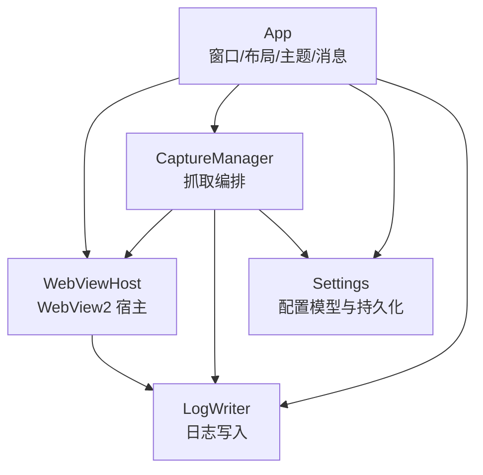
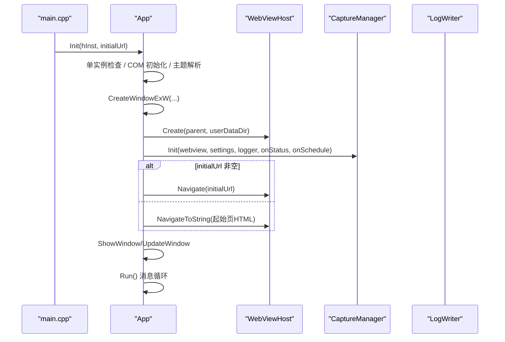
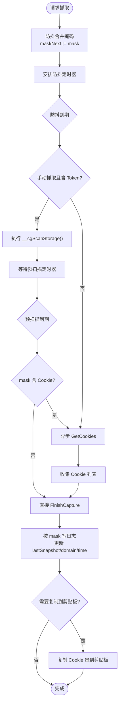
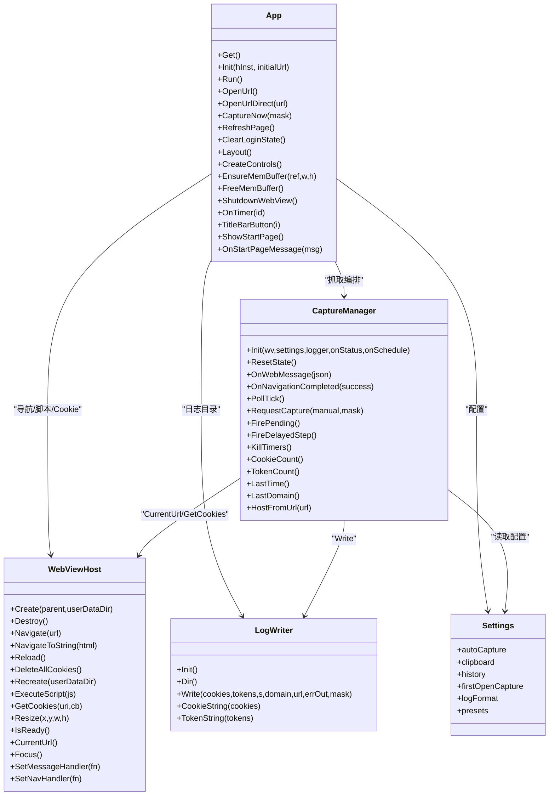

# 应用主体模块 (App)

<cite>
**本文引用的文件**   
- [app.h](file://src/app.h)
- [app.cpp](file://src/app.cpp)
- [webview.h](file://src/webview.h)
- [webview.cpp](file://src/webview.cpp)
- [capture.h](file://src/capture.h)
- [capture.cpp](file://src/capture.cpp)
- [settings.h](file://src/settings.h)
- [settings.cpp](file://src/settings.cpp)
- [logwriter.h](file://src/logwriter.h)
- [logwriter.cpp](file://src/logwriter.cpp)
</cite>

## 目录
1. [简介](#简介)
2. [项目结构](#项目结构)
3. [核心组件](#核心组件)
4. [架构总览](#架构总览)
5. [详细组件分析](#详细组件分析)
6. [依赖关系分析](#依赖关系分析)
7. [性能与绘制特性](#性能与绘制特性)
8. [故障排查指南](#故障排查指南)
9. [结论](#结论)

## 简介
本模块是 Cookie 抓取工具的 Windows 桌面应用主体，负责：
- 单实例控制、COM 初始化、Win32 窗口创建与消息循环。
- WebView2 宿主生命周期管理（环境/控制器创建、导航、脚本注入、Cookie 读取）。
- 抓取编排（Cookie 快照比对、Token 三通道捕获、登录态检测、防抖与预扫描）。
- 响应式布局（宽/中/窄三档）、DPI 感知与缩放、无边框窗口交互。
- 界面状态管理、控件创建与管理、自绘主题、双缓冲绘制。
- 设置持久化与日志写入（Cookie/Token 多格式输出）。

该文档聚焦 App 类的设计理念、职责边界、与其他子模块的协作方式，以及关键业务方法的使用路径和实现细节。

## 项目结构
应用采用分层+功能模块组织：
- 应用主体：App（窗口、布局、主题、消息、定时器、状态）。
- Web 视图：WebViewHost（WebView2 封装）。
- 抓取编排：CaptureManager（Cookie/Token 采集、防抖、定时轮询）。
- 配置：Settings（预设、抓取开关、日志格式）。
- 日志：LogWriter（cookie.log / cookie.json / cookie_detail.json / cookie_history.log）。
- 工具与主题：util、theme（颜色、起始页 CSS、路径等）。

图表来源
- [app.h:15-183](file://src/app.h#L15-L183)
- [webview.h:11-70](file://src/webview.h#L11-L70)
- [capture.h:10-63](file://src/capture.h#L10-L63)
- [settings.h:6-26](file://src/settings.h#L6-L26)
- [logwriter.h:10-52](file://src/logwriter.h#L10-L52)

章节来源
- [app.h:1-183](file://src/app.h#L1-L183)
- [app.cpp:1-1576](file://src/app.cpp#L1-L1576)

## 核心组件
- App：应用主体，单例模式，协调 WebViewHost、CaptureManager、Settings、LogWriter；负责窗口生命周期、消息处理、布局、DPI、双缓冲绘制、UI 资源管理。
- WebViewHost：WebView2 环境/控制器创建、导航、脚本注入、消息转发、Cookie 异步获取、数据目录重建。
- CaptureManager：Cookie 快照比对、Token 三通道捕获（请求头、localStorage/sessionStorage、响应体），自动抓取、防抖、预扫描。
- Settings：加载/保存 settings.json，包含抓取开关、日志格式、网站预设。
- LogWriter：按 mask 写 Cookie/Token 日志，支持字符串与 JSON 两种格式，历史追加。

章节来源
- [app.h:15-183](file://src/app.h#L15-L183)
- [webview.h:11-70](file://src/webview.h#L11-L70)
- [capture.h:10-63](file://src/capture.h#L10-L63)
- [settings.h:6-26](file://src/settings.h#L6-L26)
- [logwriter.h:10-52](file://src/logwriter.h#L10-L52)

## 架构总览
App 作为编排中心，在 Init() 中完成：
- 单实例互斥体创建与冲突处理。
- COM 初始化、通用控件初始化。
- 主题解析与 Settings 加载。
- 主窗口创建、DWM 圆角与边框色设置、居中显示。
- WebViewHost 创建并绑定消息/导航回调。
- CaptureManager 初始化并注入状态更新与定时器调度回调。
- 根据初始 URL 或默认起始页进行导航。

运行期通过 Run() 的消息循环分发 WM_COMMAND、WM_TIMER、WM_SIZE、WM_DPICHANGED、WM_NCHITTEST 等消息，驱动 UI 与业务逻辑。

图表来源
- [app.cpp:66-173](file://src/app.cpp#L66-L173)
- [webview.cpp:217-239](file://src/webview.cpp#L217-L239)
- [capture.cpp:14-21](file://src/capture.cpp#L14-L21)

## 详细组件分析

### App 类设计与职责
- 单例模式：Get() 返回静态实例，确保全局唯一应用上下文。
- 窗口生命周期：Init() 注册窗口类、创建主窗口与 WebView 宿主；Run() 进入消息循环；WM_DESTROY 清理定时器、WebView、内存缓冲、单实例句柄。
- 响应式布局：Layout() 根据客户区宽度选择 LayoutExpanded/Compact/Narrow，计算标题栏、顶部导航、工具栏卡片、Web 卡片、设置表单区域；SwitchPage() 切换浏览器/设置/说明页。
- DPI 感知：S(v) 使用 MulDiv 进行 DPI 缩放；WM_DPICHANGED 时重建字体/画刷并重新布局。
- 双缓冲绘制：EnsureMemBuffer()/FreeMemBuffer() 维护 HDC/HBITMAP，尺寸变化才重建；WM_PAINT 优先绘制到内存 DC 后 BitBlt 到屏幕。
- 控件创建与管理：CreateControls() 创建导航标签、地址框、按钮、WebView 宿主、设置表单控件；ApplyFonts() 批量设置字体；BuildBrushes()/ReleaseUiResources() 管理主题画刷与画笔。
- 界面状态：caption_/statusText_/hintMsg_ 用于标题摘要、状态行、提示文本；toggleOn_/segSel_ 管理开关与分段单选状态。
- 定时器：ScheduleTimer()/OnTimer() 管理轮询、防抖、预扫描；KillCaptureTimers() 统一销毁。
- 标题栏与无边框：TitleBarButton() 最小化/最大化/关闭；NCCALCSIZE/NCHITTEST/鼠标事件实现拖拽、缩放、悬停、点击行为。

关键方法与职责映射：
- OpenUrl()/OpenUrlDirect(url)：从地址框取 URL 或直接打开，标准化协议前缀，切换到浏览器页，设置 caption，调用 WebViewHost::Navigate。
- CaptureNow(mask)：委托 CaptureManager::RequestCapture(true, mask)，mask=1 仅 Cookie，mask=2 仅 Token。
- RefreshPage()：切换到浏览器页，检查 WebView 就绪，Reload()，等待 NavigationCompleted 更新 UI。
- ClearLoginState()：确认对话框，清空 localStorage/sessionStorage，删除 Cookie，重建 WebView2 数据目录，重置 CaptureManager 状态，显示起始页或提示。
- SaveSettingsClicked()/SaveUiSettings()：同步 UI 状态到 Settings，持久化 settings.json。
- OnPresetComboSel()：根据预设回填登录网址。
- ShowStartPage()/OnStartPageMessage(msg)：生成起始页 HTML，处理来自 WebView 的导航消息。

章节来源
- [app.h:15-183](file://src/app.h#L15-L183)
- [app.cpp:66-173](file://src/app.cpp#L66-L173)
- [app.cpp:175-187](file://src/app.cpp#L175-L187)
- [app.cpp:191-216](file://src/app.cpp#L191-L216)
- [app.cpp:218-272](file://src/app.cpp#L218-L272)
- [app.cpp:274-347](file://src/app.cpp#L274-L347)
- [app.cpp:379-538](file://src/app.cpp#L379-L538)
- [app.cpp:540-561](file://src/app.cpp#L540-L561)
- [app.cpp:563-581](file://src/app.cpp#L563-L581)
- [app.cpp:583-598](file://src/app.cpp#L583-L598)
- [app.cpp:600-637](file://src/app.cpp#L600-L637)
- [app.cpp:639-700](file://src/app.cpp#L639-L700)
- [app.cpp:749-821](file://src/app.cpp#L749-L821)
- [app.cpp:1220-1567](file://src/app.cpp#L1220-L1567)

### WebViewHost 集成点
- 环境/控制器创建：LoadLoaderDll() 优先加载 exe 同目录 WebView2Loader.dll，否则释放内嵌资源到临时目录；Create() 初始化 COM、创建 Environment/Controller。
- 导航与脚本：Navigate()/NavigateToString()/Reload()；ExecuteScript() 注入 TokenHookScript()；GetCookies() 异步获取 Cookie 列表。
- 消息与导航回调：SetMessageHandler()/SetNavHandler() 将 WebView 事件转发给上层（App/CaptureManager）。
- 数据目录重建：Recreate() 注销事件、关闭控制器、删除数据目录（重试）、重新创建环境。

章节来源
- [webview.h:11-70](file://src/webview.h#L11-L70)
- [webview.cpp:184-239](file://src/webview.cpp#L184-L239)
- [webview.cpp:254-310](file://src/webview.cpp#L254-L310)
- [webview.cpp:312-342](file://src/webview.cpp#L312-L342)
- [webview.cpp:344-391](file://src/webview.cpp#L344-L391)
- [webview.cpp:393-430](file://src/webview.cpp#L393-L430)
- [webview.cpp:432-537](file://src/webview.cpp#L432-L537)

### CaptureManager 编排逻辑
- 初始化：Init() 注入 WebViewHost、Settings、LogWriter 与回调函数。
- 登录态检测：IsLoggedIn() 基于 Cookie 名称关键字判断是否已登录。
- 轮询与防抖：PollTick() 定时拉取 Cookie 快照并与上次快照比较；RequestCapture() 合并掩码并触发防抖定时器；FirePending() 执行预扫描或直接拉 Cookie；FireDelayedStep() 延迟步骤完成后决定是否拉 Cookie。
- 结果处理：FinishCapture() 根据 mask 决定写 Cookie/Token 日志，更新 lastSnapshot_/lastDomain_/lastTime_，必要时复制剪贴板。
- 域名切换：OnNavigationCompleted() 在成功导航时切换域名则清空 Token 累积与 Cookie 快照。

图表来源
- [capture.cpp:135-162](file://src/capture.cpp#L135-L162)
- [capture.cpp:164-182](file://src/capture.cpp#L164-L182)
- [capture.cpp:184-232](file://src/capture.cpp#L184-L232)

章节来源
- [capture.h:10-63](file://src/capture.h#L10-L63)
- [capture.cpp:14-21](file://src/capture.cpp#L14-L21)
- [capture.cpp:23-52](file://src/capture.cpp#L23-L52)
- [capture.cpp:54-102](file://src/capture.cpp#L54-L102)
- [capture.cpp:104-133](file://src/capture.cpp#L104-L133)
- [capture.cpp:135-162](file://src/capture.cpp#L135-L162)
- [capture.cpp:164-182](file://src/capture.cpp#L164-L182)
- [capture.cpp:184-232](file://src/capture.cpp#L184-L232)
- [capture.cpp:234-253](file://src/capture.cpp#L234-L253)

### Settings 与 LogWriter 协作
- Settings：DefaultSettings() 提供预设（微博、知乎、B站、GitHub）；LoadSettings()/SaveSettings() 读写 settings.json，包含 autoCapture、clipboard、history、firstOpenCapture、logFormat、presets。
- LogWriter：Init() 解析日志目录；Write() 按 mask 写 cookie.log（字符串）、cookie.json（扁平）、cookie_detail.json（结构化明细）、cookie_history.log（追加），线程安全（mutex）。

章节来源
- [settings.h:6-26](file://src/settings.h#L6-L26)
- [settings.cpp:7-76](file://src/settings.cpp#L7-L76)
- [logwriter.h:10-52](file://src/logwriter.h#L10-L52)
- [logwriter.cpp:9-144](file://src/logwriter.cpp#L9-L144)

### 窗口消息处理机制
- 主窗口过程 MainWndProc：
  - WM_CREATE：设置 main_、DPI、构建字体/画刷、创建控件、布局。
  - WM_ERASEBKGND：返回 1 配合双缓冲。
  - WM_PAINT：双缓冲绘制，失败时降级为直接绘制。
  - WM_SIZE：重算布局并失效整个客户区。
  - WM_DPICHANGED：调整窗口位置、重建 UI 资源、重新布局。
  - WM_GETMINMAXINFO：限制最小尺寸。
  - 无边框框架：WM_NCCALCSIZE/WM_NCHITTEST/WM_NCACTIVATE/WM_ACTIVATE/WM_LBUTTONDBLCLK/WM_LBUTTONDOWN/WM_LBUTTONUP/WM_MOUSEMOVE/WM_MOUSELEAVE/WM_CAPTURECHANGED/WM_MOUSEWHEEL。
  - WM_DRAWITEM：自绘导航标签、现代按钮、开关、分段单选。
  - WM_CTLCOLOR*：设置控件背景/文字颜色。
  - WM_COMMAND：按钮/组合框/复选框/单选按钮事件路由到 App 方法。
  - WM_TIMER：OnTimer() 处理轮询、防抖、预扫描。
  - WM_DESTROY：清理定时器、WebView、内存缓冲、单实例句柄，PostQuitMessage。

章节来源
- [app.cpp:1220-1567](file://src/app.cpp#L1220-L1567)

### 定时器管理与 DPI 感知
- 定时器：
  - TIMER_POLL（1）：CaptureManager::PollTick() + WebView2 就绪检测计数。
  - TIMER_DEBOUNCE（2）：CaptureManager::FirePending()。
  - TIMER_PRESCAN（3）：CaptureManager::FireDelayedStep()。
- DPI 感知：
  - S(v) 使用 MulDiv(dpi_, 96) 进行缩放。
  - WM_DPICHANGED：SetWindowPos 调整尺寸、SetDpi、ReleaseUiResources、BuildFonts、BuildBrushes、ApplyFonts、Layout、InvalidateRect。

章节来源
- [app.cpp:139-140](file://src/app.cpp#L139-L140)
- [app.cpp:189-189](file://src/app.cpp#L189-L189)
- [app.cpp:711-728](file://src/app.cpp#L711-L728)
- [app.cpp:1254-1265](file://src/app.cpp#L1254-L1265)

### 界面状态管理与控件创建
- 页面切换：SwitchPage() 隐藏/显示浏览器页与设置页控件，重置滚动，刷新导航标签。
- 控件创建：CreateControls() 创建导航标签、地址框、按钮、WebView 宿主、设置表单控件；ApplyFonts() 批量设置字体；RefreshPresetList() 填充预设下拉与历史网址。
- 状态信息：CaptionText()/StatusText()/HintText() 供状态行绘制；ToggleOn()/SegSel() 管理开关与分段单选。
- 设置页滚动：SettingsScroll()/SettingsContentH()/SettingsViewH()/SettingsViewRect() 与自定义滚动条绘制与交互。

章节来源
- [app.cpp:379-538](file://src/app.cpp#L379-L538)
- [app.cpp:540-561](file://src/app.cpp#L540-L561)
- [app.cpp:639-700](file://src/app.cpp#L639-L700)
- [app.cpp:730-741](file://src/app.cpp#L730-L741)
- [app.cpp:1029-1032](file://src/app.cpp#L1029-L1032)
- [app.cpp:1149-1189](file://src/app.cpp#L1149-L1189)

### 双缓冲绘制机制
- EnsureMemBuffer(ref, w, h)：若已有兼容 DC/位图且尺寸匹配则复用；否则释放旧资源并创建新 DC/位图。
- FreeMemBuffer()：释放 DC/位图并清零尺寸。
- WM_PAINT：BeginPaint -> EnsureMemBuffer -> PaintMain(MemDC) -> BitBlt 到屏幕；分配失败时直接 PaintMain(dc)。
- 优势：高频滚动/重绘减少 GDI 对象分配，避免闪烁与模糊。

章节来源
- [app.cpp:191-216](file://src/app.cpp#L191-L216)
- [app.cpp:1233-1249](file://src/app.cpp#L1233-L1249)

### 关键业务方法示例路径
- OpenUrl()：从地址框取 URL 并打开。
  - 参考路径：[app.cpp:563-569](file://src/app.cpp#L563-L569)
- OpenUrlDirect(url)：直接打开 URL，标准化协议前缀，切换到浏览器页，设置 caption，调用 WebViewHost::Navigate。
  - 参考路径：[app.cpp:571-581](file://src/app.cpp#L571-L581)
- CaptureNow(mask)：委托 CaptureManager::RequestCapture(true, mask)。
  - 参考路径：[app.cpp:583-586](file://src/app.cpp#L583-L586)
- RefreshPage()：切换到浏览器页，检查 WebView 就绪，Reload()。
  - 参考路径：[app.cpp:588-598](file://src/app.cpp#L588-L598)
- ClearLoginState()：确认对话框，清空存储与 Cookie，重建 WebView2 数据目录，重置状态。
  - 参考路径：[app.cpp:600-637](file://src/app.cpp#L600-L637)
- SaveSettingsClicked()/SaveUiSettings()：同步 UI 状态到 Settings，持久化 settings.json。
  - 参考路径：[app.cpp:664-700](file://src/app.cpp#L664-L700)
- ShowStartPage()/OnStartPageMessage(msg)：生成起始页 HTML，处理导航消息。
  - 参考路径：[app.cpp:749-821](file://src/app.cpp#L749-L821)

## 依赖关系分析
- App 依赖：
  - WebViewHost：导航、脚本注入、Cookie 读取、数据目录重建。
  - CaptureManager：抓取编排、防抖、预扫描、状态更新。
  - Settings：配置模型与持久化。
  - LogWriter：日志写入。
- WebViewHost 依赖：
  - util/json：路径工具、JSON 解析与写入。
  - WebView2 API：环境/控制器/消息/导航/Cookie。
- CaptureManager 依赖：
  - WebViewHost：CurrentUrl/GetCookies/ExecuteScript。
  - Settings：autoCapture/clipboard/history/firstOpenCapture/logFormat/presets。
  - LogWriter：CookieString/TokenString/Write。
- Settings 依赖：
  - util/json：settings.json 读写。
- LogWriter 依赖：
  - util/json：JSON 写入。
  - util：路径、时间、文件原子写入。

图表来源
- [app.h:15-183](file://src/app.h#L15-L183)
- [webview.h:11-70](file://src/webview.h#L11-L70)
- [capture.h:10-63](file://src/capture.h#L10-L63)
- [settings.h:6-26](file://src/settings.h#L6-L26)
- [logwriter.h:10-52](file://src/logwriter.h#L10-L52)

章节来源
- [app.h:15-183](file://src/app.h#L15-L183)
- [webview.h:11-70](file://src/webview.h#L11-L70)
- [capture.h:10-63](file://src/capture.h#L10-L63)
- [settings.h:6-26](file://src/settings.h#L6-L26)
- [logwriter.h:10-52](file://src/logwriter.h#L10-L52)

## 性能与绘制特性
- 双缓冲绘制：内存 DC/位图复用，减少频繁分配；WM_PAINT 失败时降级为直接绘制，保证内容正确。
- DPI 感知：MulDiv 缩放字体/画刷/几何；WM_DPICHANGED 重建 UI 资源并重新布局。
- 自绘控件：Owner-draw BUTTON 自行填充背景，避免系统擦除不可靠导致的残影；悬停/按下状态局部 InvalidateRect 提升性能。
- 滚动优化：设置页滚动合并滚轮消息，只渲染最终位置；子控件部分可见时使用 HRGN 裁剪，避免错位残片。
- WebView2 就绪检测：定时器计数多次未就绪则提示用户安装运行时，避免异步创建失败无感知。

章节来源
- [app.cpp:191-216](file://src/app.cpp#L191-L216)
- [app.cpp:1233-1249](file://src/app.cpp#L1233-L1249)
- [app.cpp:1254-1265](file://src/app.cpp#L1254-L1265)
- [app.cpp:829-1003](file://src/app.cpp#L829-L1003)
- [app.cpp:1467-1478](file://src/app.cpp#L1467-L1478)
- [app.cpp:711-728](file://src/app.cpp#L711-L728)

## 故障排查指南
- WebView2 初始化失败：
  - 现象：状态行提示“WebView2 初始化失败：请安装 Edge WebView2 运行时后重试”。
  - 原因：定时器计数达到阈值（8 次）仍未就绪。
  - 处理：安装 WebView2 运行时后重启应用。
  - 参考路径：[app.cpp:711-728](file://src/app.cpp#L711-L728)
- 清除登录状态失败：
  - 现象：提示“清除失败：WebView2 重建失败，请重启应用后重试”。
  - 原因：数据目录删除失败或 WebView2 会话未完全关闭。
  - 处理：重启应用后重试；检查 userdata 目录残留。
  - 参考路径：[app.cpp:600-637](file://src/app.cpp#L600-L637)
- 抓取但写日志失败：
  - 现象：状态行提示“抓取完成但写日志失败: ...”。
  - 原因：LogWriter::Write 返回 false，errOut 包含失败文件名。
  - 处理：检查日志目录权限与磁盘空间；查看 cookie.log / cookie.json / cookie_detail.json / cookie_history.log 写入情况。
  - 参考路径：[capture.cpp:184-232](file://src/capture.cpp#L184-L232)
  - 参考路径：[logwriter.cpp:35-144](file://src/logwriter.cpp#L35-L144)
- 地址栏回车无效：
  - 现象：输入 URL 后回车未打开。
  - 原因：焦点不在地址框或其子控件。
  - 处理：确保焦点在 urlCombo_ 或其子控件；Run() 中 WM_KEYDOWN VK_RETURN 会调用 OpenUrl()。
  - 参考路径：[app.cpp:175-187](file://src/app.cpp#L175-L187)
  - 参考路径：[app.cpp:563-569](file://src/app.cpp#L563-L569)

章节来源
- [app.cpp:711-728](file://src/app.cpp#L711-L728)
- [app.cpp:600-637](file://src/app.cpp#L600-L637)
- [capture.cpp:184-232](file://src/capture.cpp#L184-L232)
- [logwriter.cpp:35-144](file://src/logwriter.cpp#L35-L144)
- [app.cpp:175-187](file://src/app.cpp#L175-L187)
- [app.cpp:563-569](file://src/app.cpp#L563-L569)

## 结论
App 类作为应用主体，承担了窗口生命周期、消息处理、布局与主题、DPI 感知、双缓冲绘制、UI 资源管理等核心职责，并通过回调与接口协调 WebViewHost、CaptureManager、Settings、LogWriter 等子模块，形成清晰的职责边界与数据流向。其设计强调：
- 单实例与 COM 初始化保障稳定性。
- 响应式布局与 DPI 感知提升跨分辨率体验。
- 双缓冲绘制与自绘控件优化性能与视觉一致性。
- 抓取编排的防抖与预扫描机制提高准确性与用户体验。
- 配置与日志的持久化与线程安全保证数据可靠性。

在实际使用中，开发者可通过 OpenUrl()/OpenUrlDirect() 控制导航，通过 CaptureNow() 触发抓取，通过 RefreshPage() 刷新页面，通过 ClearLoginState() 重置登录状态，通过 SaveSettingsClicked() 持久化设置，从而完整覆盖应用的核心业务流程。