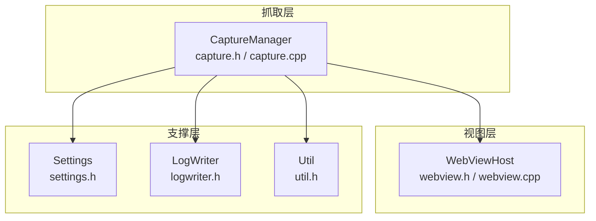
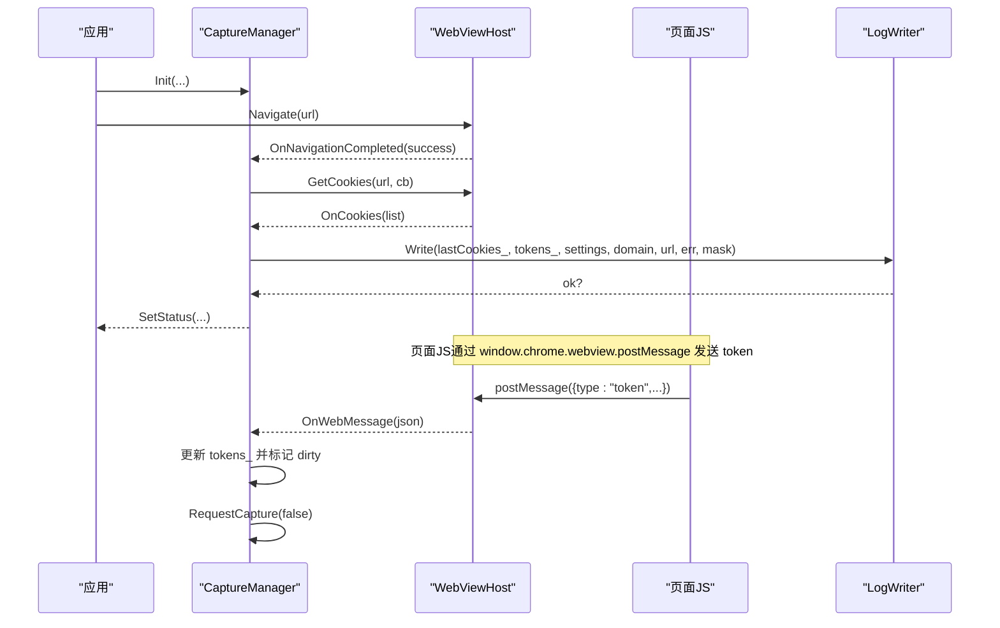
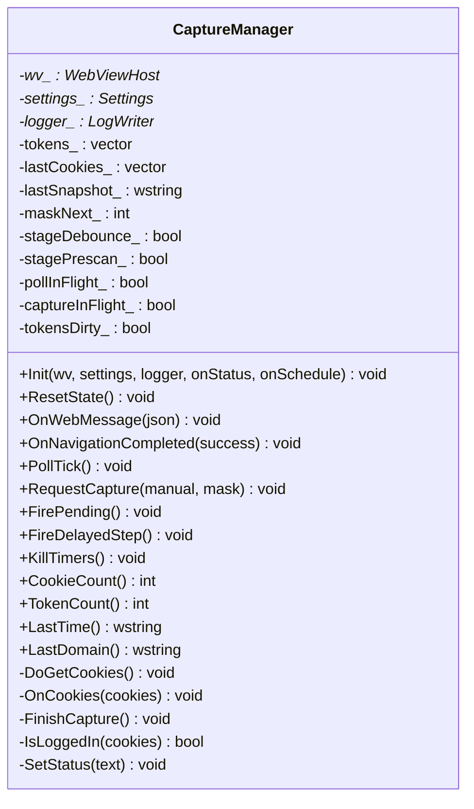
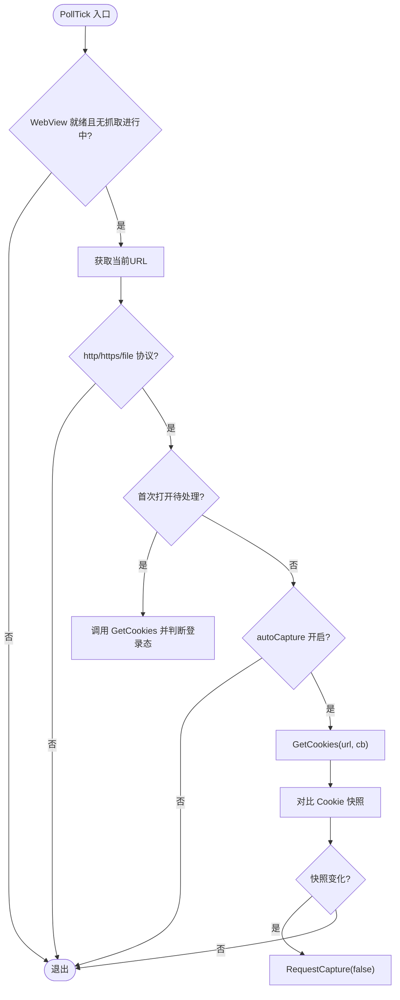
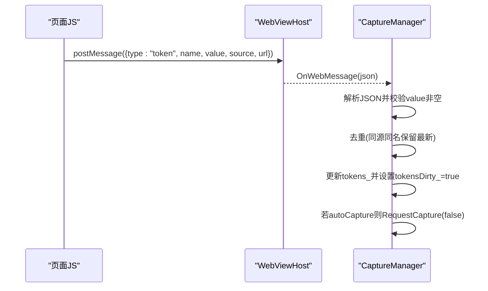
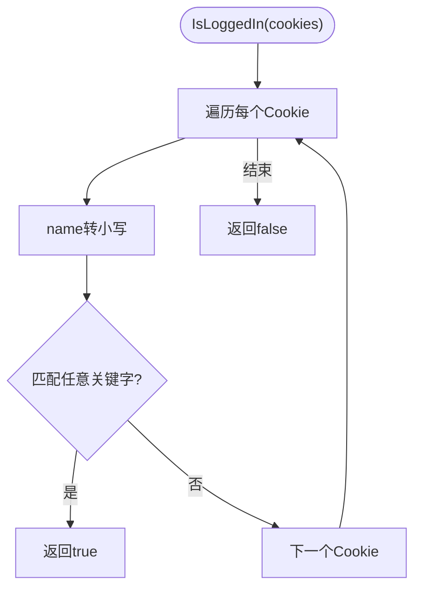
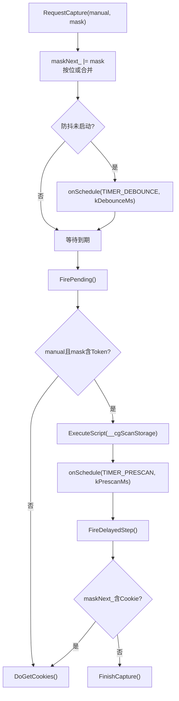
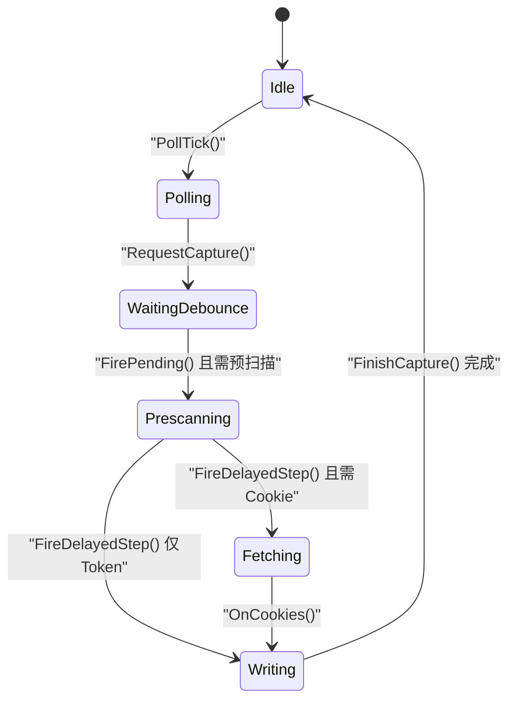
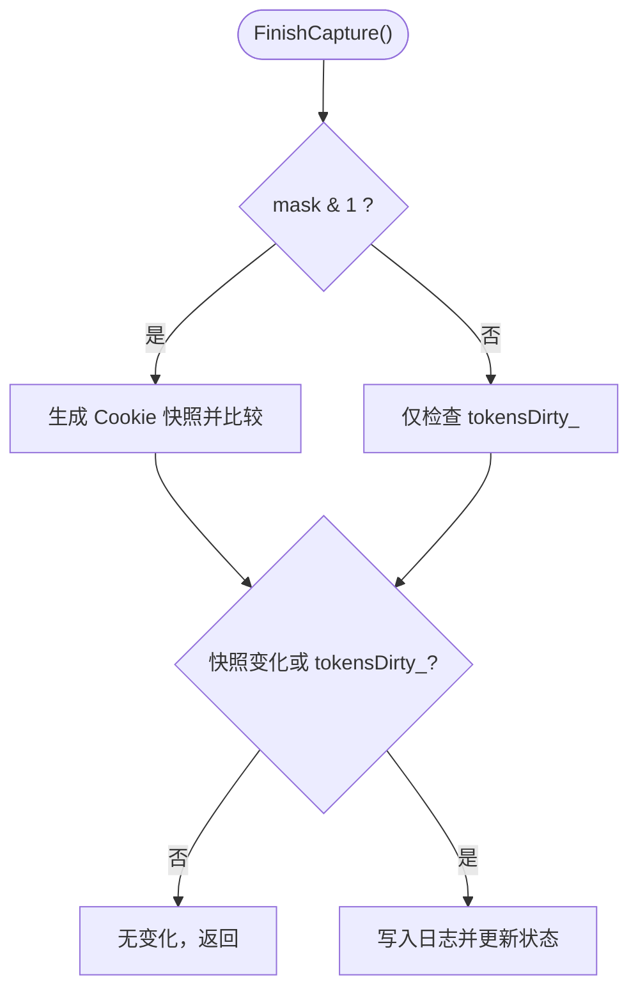
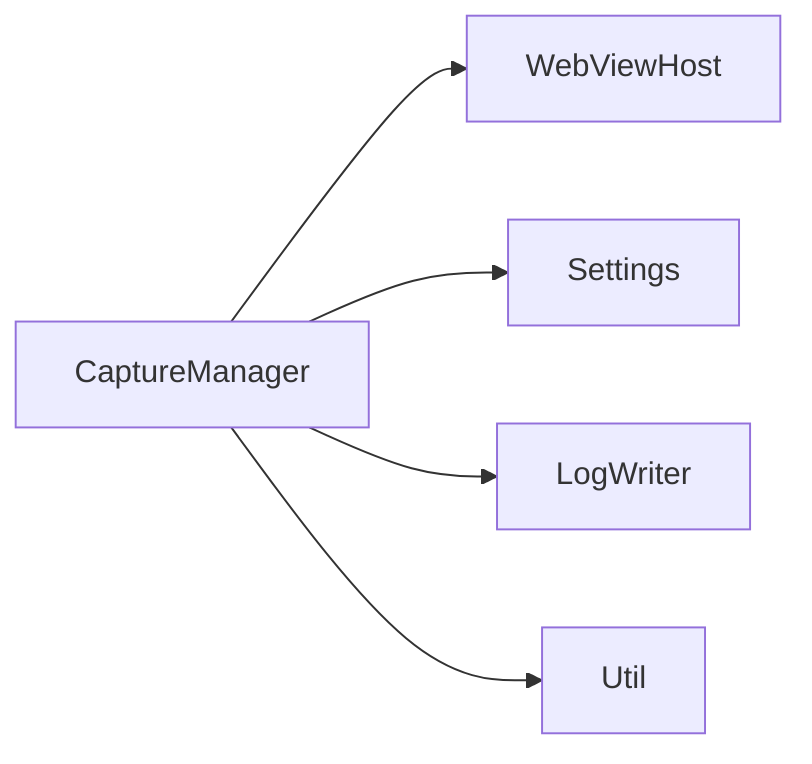

# 抓取管理器模块 (CaptureManager)

<cite>
**本文引用的文件**   
- [capture.h](file://src/capture.h)
- [capture.cpp](file://src/capture.cpp)
- [webview.h](file://src/webview.h)
- [webview.cpp](file://src/webview.cpp)
- [settings.h](file://src/settings.h)
- [logwriter.h](file://src/logwriter.h)
- [util.h](file://src/util.h)
</cite>

## 目录
1. [引言](#引言)
2. [项目结构](#项目结构)
3. [核心组件](#核心组件)
4. [架构总览](#架构总览)
5. [详细组件分析](#详细组件分析)
6. [依赖关系分析](#依赖关系分析)
7. [性能与内存管理](#性能与内存管理)
8. [故障排查指南](#故障排查指南)
9. [结论](#结论)

## 引言
本模块聚焦于"抓取管理器" CaptureManager，负责在 WebView 环境中自动或手动抓取 Cookie 与 Token，并维护登录状态检测、防抖调度、预扫描策略以及最终日志写入。其核心能力包括：
- Cookie 自动捕获与快照比对
- Token 三通道捕获（Cookie、localStorage、sessionStorage）
- 登录态检测与首次打开策略
- 定时轮询、防抖与预扫描
- 与 WebViewHost 的异步数据交互和错误处理

**最新更新**：引入了防抖窗口内掩码合并优化和 Cookie 快照比较逻辑优化，提升了抓取效率和准确性。

## 项目结构
抓取管理器位于 src 目录下，主要实现集中在 capture.h 与 capture.cpp；WebView 宿主封装在 webview.h 与 webview.cpp；配置与日志分别由 settings.h 与 logwriter.h 提供；通用工具函数在 util.h 中。

图表来源
- [capture.h:10-63](file://src/capture.h#L10-L63)
- [webview.h:11-70](file://src/webview.h#L11-L70)

章节来源
- [capture.h:1-63](file://src/capture.h#L1-L63)
- [webview.h:1-70](file://src/webview.h#L1-L70)

## 核心组件
- CaptureManager：编排抓取流程，协调 Cookie 拉取、Token 汇总、登录态检测、防抖与预扫描、最终写日志。
- WebViewHost：封装 WebView2 环境、控制器、导航、脚本注入、消息桥接、Cookie 读取等底层能力。
- Settings：提供 autoCapture、firstOpenCapture、clipboard 等开关。
- LogWriter：负责将 Cookie/Token 持久化到日志，并提供 Cookie 字符串序列化。
- Util：提供字符串、时间、剪贴板等通用工具。

章节来源
- [capture.h:10-63](file://src/capture.h#L10-L63)
- [webview.h:11-70](file://src/webview.h#L11-L70)
- [settings.h:1-200](file://src/settings.h#L1-L200)
- [logwriter.h:1-200](file://src/logwriter.h#L1-L200)
- [util.h:1-200](file://src/util.h#L1-L200)

## 架构总览
CaptureManager 通过 WebViewHost 获取 Cookie 与执行 JS 脚本，同时接收来自 WebView 的消息回调以汇聚 Token。整体数据流如下：

图表来源
- [capture.cpp:58-87](file://src/capture.cpp#L58-L87)
- [capture.cpp:89-133](file://src/capture.cpp#L89-L133)
- [capture.cpp:177-232](file://src/capture.cpp#L177-L232)
- [webview.cpp:389-430](file://src/webview.cpp#L389-L430)

## 详细组件分析

### CaptureManager 类设计
CaptureManager 是抓取流程的编排者，关键职责：
- 初始化与状态重置
- 解析 WebView 消息中的 Token
- 导航完成后的域名切换与首次打开策略
- 定时轮询 Cookie 变化并触发抓取
- 防抖合并多次抓取请求
- 预扫描 localStorage/sessionStorage
- 最终按掩码写入 Cookie/Token 并更新状态

图表来源
- [capture.h:10-63](file://src/capture.h#L10-L63)

章节来源
- [capture.h:10-63](file://src/capture.h#L10-L63)

### Cookie 自动捕获与快照比对
- 定时轮询 PollTick() 每 kPollMs 毫秒检查一次当前 URL 的 Cookie。
- 仅对 http/https/file 协议进行 Cookie 查询，避免 about:blank 等导致崩溃。
- 使用 LogWriter::CookieString 生成 Cookie 字符串快照，并与 lastSnapshot_ 比较，若不同则触发抓取。
- 首次打开时，若启用 firstOpenCapture，则在第一次导航完成后主动拉取 Cookie 并判断是否已登录。

图表来源
- [capture.cpp:104-133](file://src/capture.cpp#L104-L133)

章节来源
- [capture.cpp:104-133](file://src/capture.cpp#L104-L133)

### Token 三通道捕获（Cookie、localStorage、sessionStorage）
Token 捕获通过 WebViewHost 注入的 JS 脚本实现，覆盖三个通道：
- 请求头：拦截 fetch/XMLHttpRequest 的请求头，匹配常见 Token 头名。
- 响应体：解析 JSON 响应体，递归扫描包含 token/jwt 等键名的值。
- 存储：扫描 localStorage/sessionStorage，匹配 token/jwt 键名。

当页面 JS 通过 window.chrome.webview.postMessage 发送 token 消息后，CaptureManager.OnWebMessage 解析并去重（同源同名保留最新），同时标记 tokensDirty_ 并在启用自动抓取时触发 RequestCapture。

图表来源
- [capture.cpp:58-87](file://src/capture.cpp#L58-L87)
- [webview.cpp:432-535](file://src/webview.cpp#L432-L535)

章节来源
- [capture.cpp:58-87](file://src/capture.cpp#L58-L87)
- [webview.cpp:432-535](file://src/webview.cpp#L432-L535)

### 登录状态检测
IsLoggedIn() 基于 Cookie 名称关键字判断是否已登录，关键字包括 session、sess、token、auth、jwt、ticket、login、sso、sid 等。首次打开策略会在检测到已登录时立即触发抓取。

图表来源
- [capture.cpp:234-245](file://src/capture.cpp#L234-L245)

章节来源
- [capture.cpp:234-245](file://src/capture.cpp#L234-L245)

### 防抖机制与预扫描策略
- **防抖优化**：RequestCapture() 使用 `maskNext_ |= mask` 进行按位或合并，而非覆盖，确保防抖窗口内多次请求能够保留所有抓取范围，防止 overlay 冲突。
- **预扫描**：当手动抓取且包含 Token（mask&2）时，先执行 window.__cgScanStorage() 主动扫描 localStorage/sessionStorage，再通过 TIMER_PRESCAN 延迟执行 FireDelayedStep()，随后按需拉取 Cookie 或直接写 Token。

图表来源
- [capture.cpp:135-162](file://src/capture.cpp#L135-L162)

章节来源
- [capture.cpp:135-162](file://src/capture.cpp#L135-L162)

### 数据结构设计：CookieItem 与 TokenItem
- **CookieItem**：表示单个 Cookie 项，包含 name、value、domain、path、expires、httpOnly、secure、isSession、sameSite 等字段，用于 Cookie 快照与日志写入。
- **TokenItem**：表示单个 Token 项，包含 name、value、source、url、capturedAt 等字段，用于 Token 汇总与日志写入。

这些结构在 WebViewHost 的 Cookie 读取回调中被填充，并在 CaptureManager.FinishCapture() 中传递给 LogWriter.Write()。

章节来源
- [webview.cpp:393-430](file://src/webview.cpp#L393-L430)
- [capture.cpp:177-232](file://src/capture.cpp#L177-L232)
- [logwriter.h:10-28](file://src/logwriter.h#L10-L28)

### 定时轮询机制与状态机
- 定时器 ID：TIMER_POLL=1、TIMER_DEBOUNCE=2、TIMER_PRESCAN=3。
- 轮询间隔 kPollMs=1500ms，防抖间隔 kDebounceMs=600ms，预扫描等待 kPrescanMs=250ms。
- 状态标志：pollInFlight_、captureInFlight_、stageDebounce_、stagePrescan_、tokensDirty_、firstNavDone_、firstOpenPending_、manualNext_、maskNext_。

图表来源
- [capture.cpp:8-12](file://src/capture.cpp#L8-L12)
- [capture.cpp:104-162](file://src/capture.cpp#L104-L162)
- [capture.cpp:177-232](file://src/capture.cpp#L177-L232)

章节来源
- [capture.cpp:8-12](file://src/capture.cpp#L8-L12)
- [capture.cpp:104-162](file://src/capture.cpp#L104-L162)
- [capture.cpp:177-232](file://src/capture.cpp#L177-L232)

### 与 WebViewHost 的数据交互与错误处理
- WebViewHost.GetCookies(uri, cb) 异步获取 Cookie 列表，回调中填充 CookieItem 并调用 CaptureManager.OnCookies()。
- WebViewHost.ExecuteScript(js) 用于注入 TokenHookScript 与执行 __cgScanStorage。
- WebViewHost.SetMessageHandler 将页面消息转发给 CaptureManager.OnWebMessage。
- 错误处理：
  - 非有效协议页面直接提示不支持抓取。
  - 写日志失败时记录错误信息并更新状态。
  - 剪贴板复制失败时给出相应提示。

章节来源
- [webview.cpp:351-362](file://src/webview.cpp#L351-L362)
- [webview.cpp:344-349](file://src/webview.cpp#L344-L349)
- [capture.cpp:164-175](file://src/capture.cpp#L164-L175)
- [capture.cpp:207-232](file://src/capture.cpp#L207-L232)

### 优化的 Cookie 快照比较逻辑
**新增功能**：在 FinishCapture() 方法中实现了智能的 Cookie 快照比较逻辑：
- 当包含 Cookie 捕获（mask&1）时，正常比较 Cookie 快照与 tokensDirty_ 标志
- 当仅 Token 捕获（mask&1 为假）时，跳过 Cookie 快照比较，直接使用 tokensDirty_ 标志判断
- 这种优化避免了不必要的 Cookie 快照生成和比较操作，提升了仅 Token 捕获场景的性能

图表来源
- [capture.cpp:184-232](file://src/capture.cpp#L184-L232)

章节来源
- [capture.cpp:184-232](file://src/capture.cpp#L184-L232)

## 依赖关系分析
CaptureManager 依赖 WebViewHost 进行 Cookie 读取与脚本执行，依赖 Settings 控制行为开关，依赖 LogWriter 进行持久化，依赖 Util 进行字符串与时间处理。

图表来源
- [capture.h:6-8](file://src/capture.h#L6-L8)
- [capture.cpp:1-4](file://src/capture.cpp#L1-L4)

章节来源
- [capture.h:1-9](file://src/capture.h#L1-L9)
- [capture.cpp:1-4](file://src/capture.cpp#L1-L4)

## 性能与内存管理
- **防抖合并优化**：通过 `maskNext_ |= mask` 按位或合并多次抓取请求，减少重复 IO 并防止 overlay 冲突。
- **预扫描延迟**：kPrescanMs=250ms 避免频繁扫描存储。
- **Cookie 快照优化**：仅在 Cookie 串变化时触发抓取，仅 Token 捕获时跳过不必要的快照比较。
- Token 去重：同源同名保留最新值，避免重复写入。
- WebView2 资源管理：WebViewHost 在 Destroy 时释放 COM 对象与加载器 DLL，避免内存泄漏。
- 大响应体限制：JS 侧对响应体长度限制为 4MB，防止过大 JSON 解析开销。

章节来源
- [capture.cpp:135-162](file://src/capture.cpp#L135-L162)
- [capture.cpp:184-232](file://src/capture.cpp#L184-L232)
- [webview.cpp:241-252](file://src/webview.cpp#L241-L252)
- [webview.cpp:500-510](file://src/webview.cpp#L500-L510)

## 故障排查指南
- 无法抓取 Cookie：
  - 检查当前 URL 是否为 http/https/file 协议。
  - 确认 WebView 已就绪且无抓取进行中。
- Token 未捕获：
  - 确认页面 JS 已注入 TokenHookScript。
  - 检查 Token 名称是否匹配正则 token|jwt。
  - 查看控制台是否有 postMessage 错误。
- 写日志失败：
  - 检查 LogWriter.Write 返回值与错误信息。
  - 确认磁盘权限与路径有效性。
- 剪贴板复制失败：
  - 检查系统剪贴板可用性。
  - 查看 SetClipboardText 返回值。

章节来源
- [capture.cpp:164-175](file://src/capture.cpp#L164-L175)
- [capture.cpp:207-232](file://src/capture.cpp#L207-L232)
- [webview.cpp:432-535](file://src/webview.cpp#L432-L535)

## 结论
CaptureManager 通过 Cookie 快照比对、Token 三通道捕获、防抖与预扫描策略，实现了稳定高效的抓取流程。**最新的优化包括防抖窗口内掩码合并和 Cookie 快照比较逻辑优化，进一步提升了抓取效率和准确性**。其与 WebViewHost 的异步交互确保了低耦合与高内聚，结合 Settings 与 LogWriter 提供了灵活的配置与可靠的持久化能力。在实际使用中，建议合理配置 autoCapture 与 firstOpenCapture，并根据业务需求调整关键字匹配与日志策略。