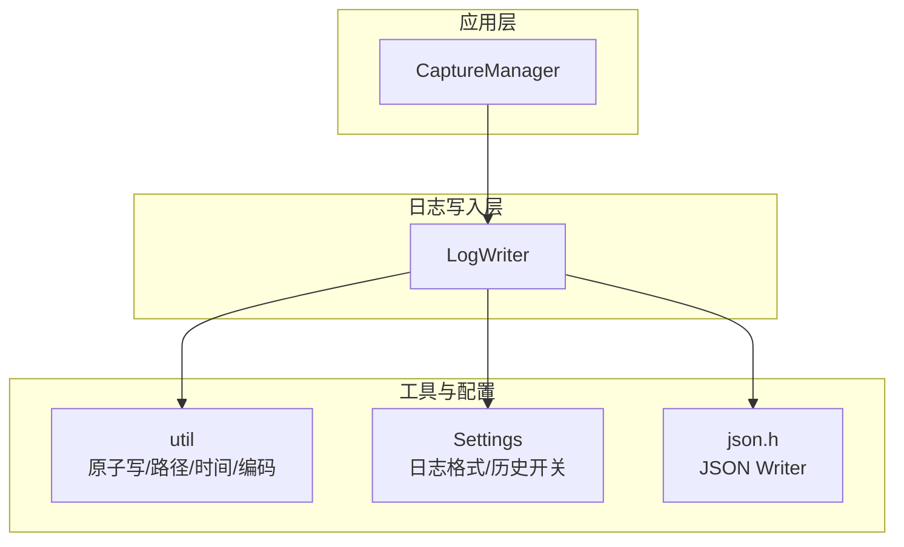
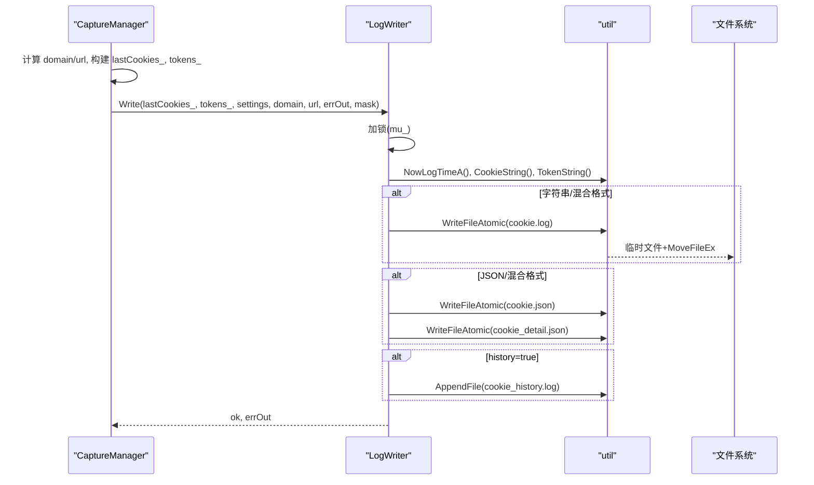
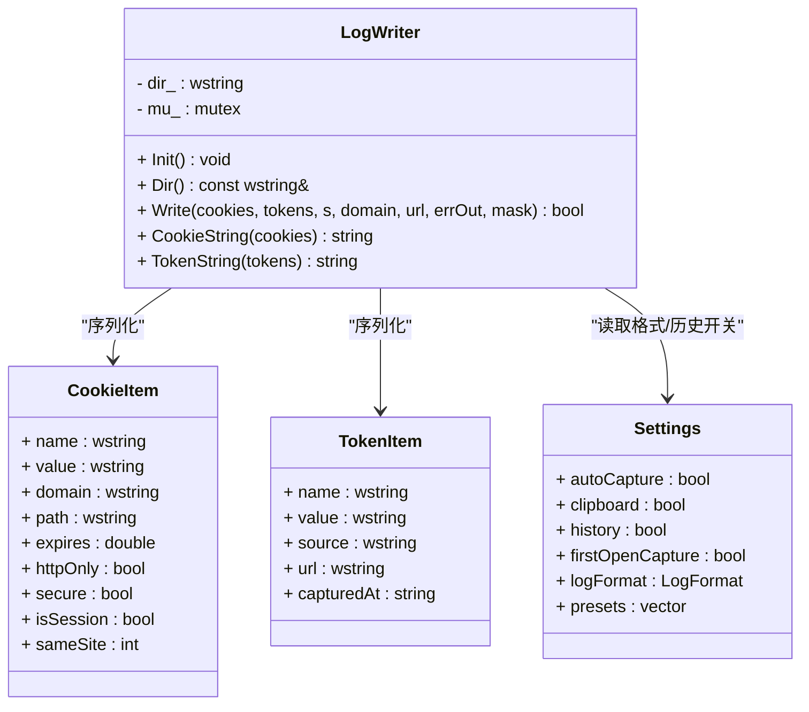
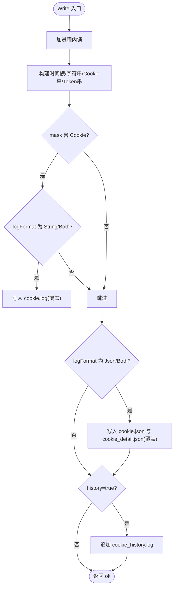
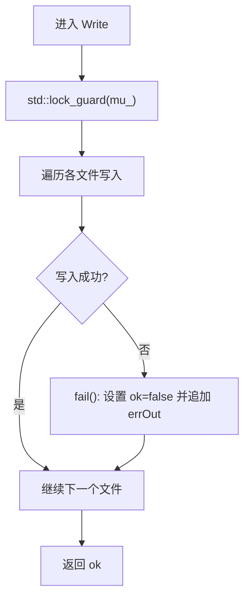
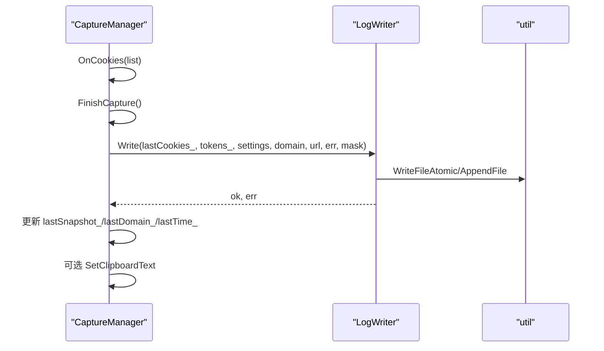
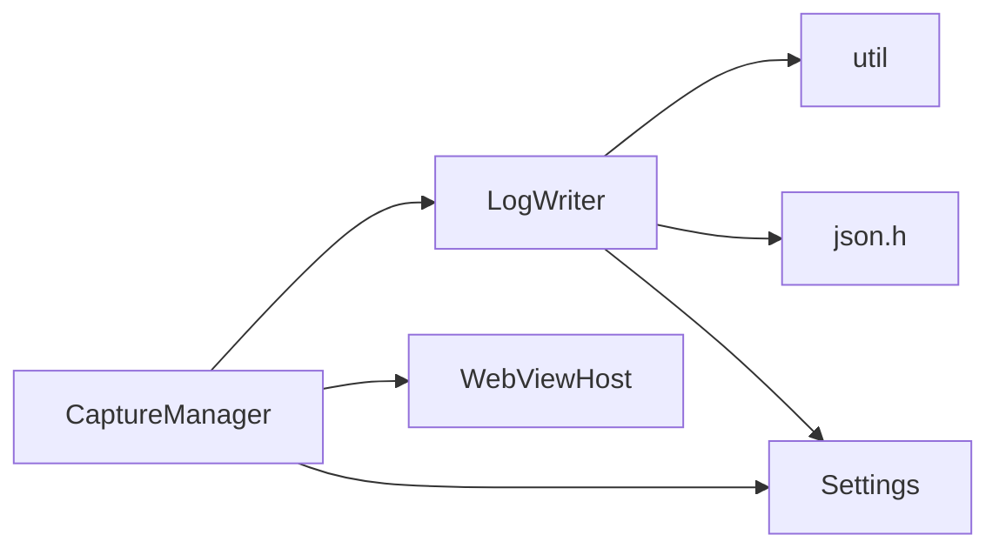

# 日志写入器模块 (LogWriter)

<cite>
**本文引用的文件**   
- [logwriter.h](file://src/logwriter.h)
- [logwriter.cpp](file://src/logwriter.cpp)
- [capture.h](file://src/capture.h)
- [capture.cpp](file://src/capture.cpp)
- [settings.h](file://src/settings.h)
- [util.h](file://src/util.h)
</cite>

## 目录
1. [引言](#引言)
2. [项目结构](#项目结构)
3. [核心组件](#核心组件)
4. [架构总览](#架构总览)
5. [详细组件分析](#详细组件分析)
6. [依赖关系分析](#依赖关系分析)
7. [性能与并发特性](#性能与并发特性)
8. [故障排查指南](#故障排查指南)
9. [结论](#结论)

## 引言
本文件面向“日志写入器模块”，围绕 LogWriter 类的设计、多格式日志输出机制、原子文件操作、进程内互斥、文件轮转策略（当前实现为覆盖/追加）、日志级别与格式化模板、编码处理、高性能写入优化、缓冲区管理、异步写入机制，以及与 CaptureManager 的数据集成和错误处理进行系统化说明。文档以代码级事实为依据，并辅以图示帮助理解。

## 项目结构
LogWriter 位于 src 目录下，负责将 Cookie 与 Token 数据持久化为多种日志格式：
- cookie.log：字符串格式，两行（时间 + Cookie 串）
- cookie.json：扁平 JSON，包含 time/domain/url/cookie/token
- cookie_detail.json：结构化明细 JSON，包含 cookies[] 与 tokens[]
- cookie_history.log：历史追加日志，记录抓取摘要与内容片段

图表来源
- [capture.h:10-21](file://src/capture.h#L10-L21)
- [logwriter.h:30-52](file://src/logwriter.h#L30-L52)
- [settings.h:6-20](file://src/settings.h#L6-L20)
- [util.h:31-37](file://src/util.h#L31-L37)

章节来源
- [logwriter.h:1-52](file://src/logwriter.h#L1-L52)
- [logwriter.cpp:1-144](file://src/logwriter.cpp#L1-L144)
- [capture.h:10-21](file://src/capture.h#L10-L21)
- [settings.h:6-20](file://src/settings.h#L6-L20)
- [util.h:31-37](file://src/util.h#L31-L37)

## 核心组件
- LogWriter：封装日志目录解析、Cookie/Token 序列化、多格式落盘、进程内互斥与错误聚合。
- CookieItem / TokenItem：日志数据模型，分别描述 Cookie 字段与 Token 元信息。
- Settings：控制日志格式（String/Json/Both）、是否启用历史追加、自动抓取等。
- util：提供 UTF-8 编解码、时间戳、原子写、追加写、日志目录解析等基础能力。
- CaptureManager：捕获编排者，负责触发抓取、合并掩码、防抖、预扫描，并最终调用 LogWriter.Write()。

章节来源
- [logwriter.h:10-52](file://src/logwriter.h#L10-L52)
- [settings.h:6-20](file://src/settings.h#L6-L20)
- [util.h:9-37](file://src/util.h#L9-L37)
- [capture.h:10-21](file://src/capture.h#L10-L21)

## 架构总览
LogWriter 在 CaptureManager 的 FinishCapture() 中被调用，根据 mask 决定写入 Cookie 或 Token，并根据 Settings::logFormat 选择输出格式。所有写入均通过 util 提供的原子写接口保证一致性；历史日志使用追加写。

图表来源
- [capture.cpp:184-232](file://src/capture.cpp#L184-L232)
- [logwriter.cpp:35-143](file://src/logwriter.cpp#L35-L143)
- [util.h:31-37](file://src/util.h#L31-L37)

## 详细组件分析

### LogWriter 类设计
- 职责边界
  - Init()：解析日志目录（优先 exe 目录，不可写回退 %LOCALAPPDATA%\CookieGrabber\logs）。
  - Write()：统一入口，按 mask 与 Settings::logFormat 组合输出多文件。
  - CookieString()/TokenString()：静态方法，生成标准 Cookie/Token 字符串。
- 线程安全
  - 内部 std::mutex mu_ 保证进程内互斥，Write() 全程持锁。
- 数据模型
  - CookieItem：name/value/domain/path/expires/httpOnly/secure/isSession/sameSite。
  - TokenItem：name/value/source/url/capturedAt。

图表来源
- [logwriter.h:10-52](file://src/logwriter.h#L10-L52)
- [settings.h:6-20](file://src/settings.h#L6-L20)

章节来源
- [logwriter.h:1-52](file://src/logwriter.h#L1-L52)
- [logwriter.cpp:9-143](file://src/logwriter.cpp#L9-L143)

### 多格式日志输出机制
- 字符串格式（cookie.log）
  - 第一行：本地时间戳（NowLogTimeA），第二行：Cookie 串（CookieString）。
  - 仅在 Settings::logFormat 为 String 或 Both 时写入。
- 简洁 JSON（cookie.json）
  - 扁平对象：time/domain/url/cookie/token。
  - token 字段：空时为 ""；单个 token 直接为字符串；多个 token 转为对象键值对。
  - 仅在 Settings::logFormat 为 Json 或 Both 时写入。
- 明细 JSON（cookie_detail.json）
  - 结构化数组 cookies[] 与 tokens[]，字段完整映射 CookieItem/TokenItem。
  - expires 转换为 ISO8601 或 "session"；sameSite 映射为 "None"/"Lax"/"Strict"。
  - 仅在 Settings::logFormat 为 Json 或 Both 时写入。
- 历史日志（cookie_history.log）
  - 追加模式，记录时间、domain、url、cookies/tokens 数量及内容片段。
  - 由 Settings::history 控制。

图表来源
- [logwriter.cpp:35-143](file://src/logwriter.cpp#L35-L143)
- [settings.h:6-18](file://src/settings.h#L6-L18)

章节来源
- [logwriter.cpp:35-143](file://src/logwriter.cpp#L35-L143)
- [settings.h:6-18](file://src/settings.h#L6-L18)

### 原子文件操作与追加写
- 原子写（覆盖）
  - 通过 util::WriteFileAtomic 实现“临时文件 + MoveFileEx 替换”，确保写入过程不被其他进程观察到半写状态。
  - 用于 cookie.log、cookie.json、cookie_detail.json。
- 追加写
  - 通过 util::AppendFile 单次追加，用于 cookie_history.log。
- 编码
  - 所有文本内容均以 UTF-8 字节写入，无 BOM。宽字符通过 WideToUtf8 转换。

章节来源
- [util.h:31-37](file://src/util.h#L31-L37)
- [logwriter.cpp:55-140](file://src/logwriter.cpp#L55-L140)

### 进程内互斥与错误处理
- 互斥
  - 使用 std::mutex mu_ 在 Write() 中加锁，保证同一时刻仅一个线程执行写入逻辑。
- 错误聚合
  - 内部 fail lambda 将失败原因累积到 errOut，最终返回 ok 标志位。
  - CaptureManager 在收到 ok=false 时更新 UI 状态提示。

图表来源
- [logwriter.cpp:35-53](file://src/logwriter.cpp#L35-L53)
- [capture.cpp:207-218](file://src/capture.cpp#L207-L218)

章节来源
- [logwriter.cpp:35-53](file://src/logwriter.cpp#L35-L53)
- [capture.cpp:207-218](file://src/capture.cpp#L207-L218)

### 日志级别管理与格式化模板
- 日志级别
  - 当前未实现传统意义上的日志级别（如 DEBUG/INFO/WARN/ERROR），而是通过 mask 区分 Cookie/Token 两类写入范围。
- 格式化模板
  - 字符串格式：固定两行（时间 + Cookie 串）。
  - JSON 格式：由 json.h 的 Writer 动态构造对象/数组，pretty 打印。
  - 历史格式：固定前缀 + 动态字段拼接。

章节来源
- [logwriter.cpp:55-140](file://src/logwriter.cpp#L55-L140)
- [settings.h:6-18](file://src/settings.h#L6-L18)

### 高性能写入优化与缓冲区管理
- 内存缓冲
  - CookieString/TokenString 预先构建字符串，避免重复拼接。
  - JSON 使用 Writer.out 作为一次性缓冲区，最后统一写入磁盘。
- I/O 优化
  - 原子写减少中间态可见性；追加写避免覆盖历史。
- 异步写入
  - 当前 Write() 同步阻塞；但 CaptureManager 通过定时器与回调实现异步抓取流程，不阻塞主循环。

章节来源
- [logwriter.cpp:9-29](file://src/logwriter.cpp#L9-L29)
- [logwriter.cpp:61-123](file://src/logwriter.cpp#L61-L123)
- [capture.cpp:104-175](file://src/capture.cpp#L104-L175)

### 与 CaptureManager 的数据集成
- 数据流
  - CaptureManager 维护 lastCookies_ 与 tokens_，并在 FinishCapture() 中调用 LogWriter.Write()。
  - mask 参数由 RequestCapture() 合并，支持仅 Cookie、仅 Token 或两者。
- 变更检测
  - 若仅 Cookie 变化或 tokensDirty_ 为真，才触发写入；否则视为无变化。
- 剪贴板
  - 当 settings.clipboard 为真且写入成功时，尝试复制 Cookie 串到剪贴板。

图表来源
- [capture.cpp:177-232](file://src/capture.cpp#L177-L232)
- [logwriter.cpp:35-143](file://src/logwriter.cpp#L35-L143)

章节来源
- [capture.cpp:177-232](file://src/capture.cpp#L177-L232)
- [logwriter.cpp:35-143](file://src/logwriter.cpp#L35-L143)

## 依赖关系分析
- LogWriter 依赖
  - util：时间、路径、原子写、追加写、UTF-8 编解码。
  - json.h：JSON 序列化 Writer。
  - settings.h：读取日志格式与历史开关。
- CaptureManager 依赖
  - WebViewHost：获取 Cookie、URL、执行脚本。
  - Settings：自动抓取、剪贴板、首次打开抓取等。
  - LogWriter：最终落盘。

图表来源
- [capture.h:10-21](file://src/capture.h#L10-L21)
- [logwriter.h:30-52](file://src/logwriter.h#L30-L52)
- [settings.h:6-20](file://src/settings.h#L6-L20)
- [util.h:31-37](file://src/util.h#L31-L37)

章节来源
- [capture.h:10-21](file://src/capture.h#L10-L21)
- [logwriter.h:30-52](file://src/logwriter.h#L30-L52)
- [settings.h:6-20](file://src/settings.h#L6-L20)
- [util.h:31-37](file://src/util.h#L31-L37)

## 性能与并发特性
- 进程内互斥
  - 通过 std::mutex 保证单写者，避免竞争条件。
- 批量构建
  - CookieString/TokenString 一次性构建，减少多次字符串拼接开销。
- JSON 序列化
  - 使用 Writer.out 作为一次性缓冲区，减少多次 I/O。
- 异步抓取
  - CaptureManager 通过定时器与回调实现非阻塞抓取，但 LogWriter.Write() 本身同步执行。
- 建议优化
  - 若未来需要更高吞吐，可引入后台写入队列与批处理，但仍需保持进程内互斥与顺序一致性。

[本节为通用性能讨论，不直接分析具体文件]

## 故障排查指南
- 常见问题
  - 日志目录不可写：Init() 会回退到 %LOCALAPPDATA%\CookieGrabber\logs，检查该目录权限。
  - 写入失败：errOut 会累积失败原因，查看 CaptureManager 的状态提示。
  - 历史日志未生成：确认 Settings::history 是否为真。
  - JSON 字段缺失：检查 Settings::logFormat 是否为 Json 或 Both。
- 定位步骤
  - 检查 Write() 返回值与 errOut。
  - 核对 cookie.log/cookie.json/cookie_detail.json/cookie_history.log 是否存在与内容。
  - 验证 URL 与 domain 是否正确提取。

章节来源
- [logwriter.cpp:31-53](file://src/logwriter.cpp#L31-L53)
- [capture.cpp:207-218](file://src/capture.cpp#L207-L218)

## 结论
LogWriter 以清晰的分层与明确的职责边界，实现了 Cookie 与 Token 的多格式日志输出。其通过原子写与追加写保障数据一致性，借助进程内互斥避免竞争，结合 CaptureManager 的异步抓取流程形成完整的捕获-写入链路。当前实现已满足常见场景需求；若未来需要更高吞吐或更复杂的轮转策略，可在现有基础上扩展后台队列与文件轮转机制。