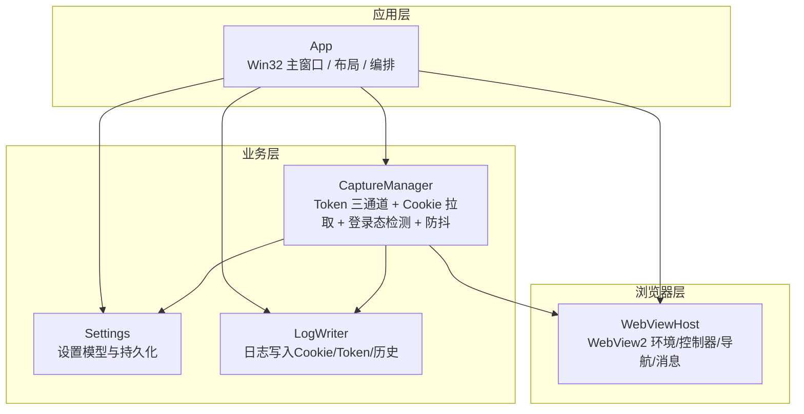
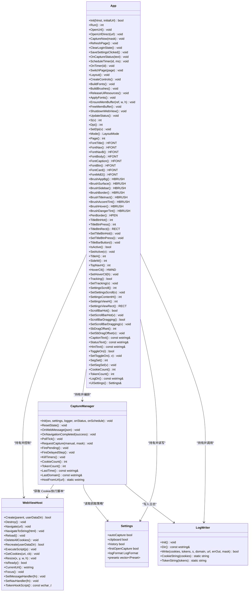
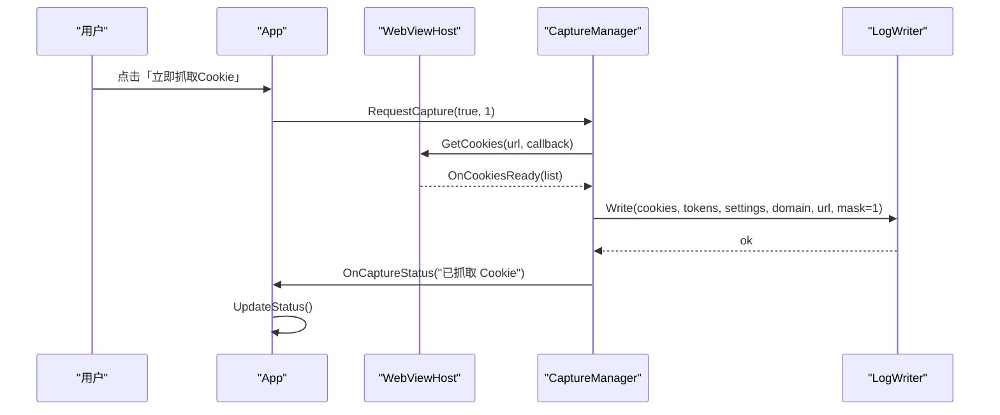
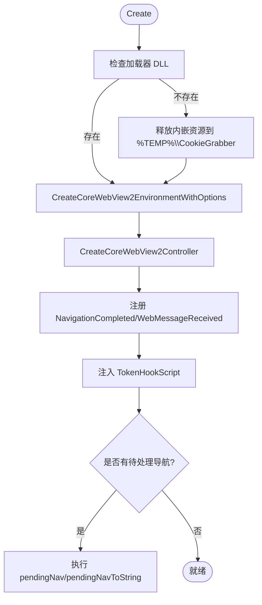
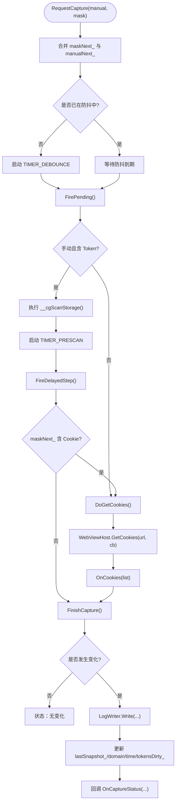
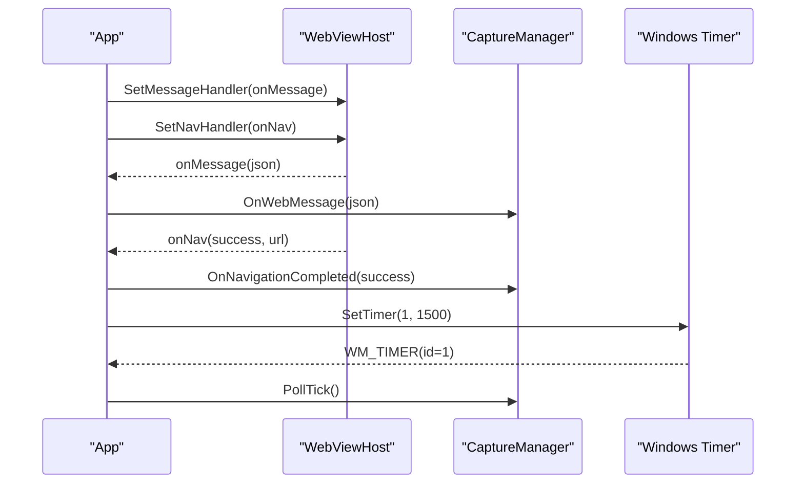

# 核心模块设计

<cite>
**本文引用的文件**   
- [app.h](file://src/app.h)
- [app.cpp](file://src/app.cpp)
- [webview.h](file://src/webview.h)
- [webview.cpp](file://src/webview.cpp)
- [capture.h](file://src/capture.h)
- [capture.cpp](file://src/capture.cpp)
- [settings.h](file://src/settings.h)
- [settings.cpp](file://src/settings.cpp)
- [logwriter.h](file://src/logwriter.h)
- [logwriter.cpp](file://src/logwriter.cpp)
</cite>

## 目录
1. [引言](#引言)
2. [项目结构](#项目结构)
3. [核心组件总览](#核心组件总览)
4. [架构总览](#架构总览)
5. [详细组件分析](#详细组件分析)
6. [依赖关系与通信机制](#依赖关系与通信机制)
7. [性能与可靠性特性](#性能与可靠性特性)
8. [故障排查指南](#故障排查指南)
9. [结论](#结论)

## 引言
本文件聚焦于 Cookie 抓取工具的核心模块设计，围绕 App、WebViewHost、CaptureManager、Settings、LogWriter 五大类展开。文档从职责划分、接口设计、数据结构、关键方法、事件驱动与回调机制、设计模式应用等维度进行系统化说明，并给出类关系图、时序图和流程图，帮助读者快速理解系统整体架构与关键实现路径。

## 项目结构
仓库采用按功能划分的源码组织方式：
- src 下每个核心能力对应一个头文件与源文件对，例如 webview.h/cpp、capture.h/cpp、settings.h/cpp、logwriter.h/cpp；
- app.h/cpp 作为 Win32 GUI 应用主体，负责窗口生命周期、布局、控件创建、消息循环以及各模块编排；
- 辅助模块 theme、util、json、ids 提供主题、工具函数、JSON 解析与控件 ID 定义；
- res 包含资源清单与图标资源；test 提供测试页面与本地服务脚本。

**图表来源**
- [app.h:15-183](file://src/app.h#L15-L183)
- [webview.h:11-70](file://src/webview.h#L11-L70)
- [capture.h:10-63](file://src/capture.h#L10-L63)
- [settings.h:6-25](file://src/settings.h#L6-L25)
- [logwriter.h:10-52](file://src/logwriter.h#L10-L52)

**章节来源**
- [app.h:1-183](file://src/app.h#L1-L183)
- [app.cpp:66-173](file://src/app.cpp#L66-L173)

## 核心组件总览
- App：单例式应用入口，封装 Win32 窗口、主题、布局、控件、定时器、WebView 宿主、抓取编排、设置与日志。对外暴露 OpenUrl/CaptureNow/RefreshPage/ClearLoginState 等业务方法，对内协调 WebViewHost、CaptureManager、Settings、LogWriter。
- WebViewHost：WebView2 的轻量封装，负责环境加载、控制器创建、导航、脚本注入、WebMessage 转发、Cookie 异步读取、窗口尺寸同步与销毁重建。
- CaptureManager：抓取编排器，聚合 Token 捕获（JS Hook）、Cookie 拉取、登录态检测、自动抓取（防抖 + 预扫描），并通过回调通知 UI 状态。
- Settings：设置数据模型与 JSON 持久化，支持预设站点、抓取开关、日志格式等。
- LogWriter：日志写入器，支持 cookie.log、cookie.json、cookie_detail.json、cookie_history.log，保证 UTF-8 无 BOM、原子写与进程内互斥。

**章节来源**
- [app.h:15-183](file://src/app.h#L15-L183)
- [webview.h:11-70](file://src/webview.h#L11-L70)
- [capture.h:10-63](file://src/capture.h#L10-L63)
- [settings.h:6-25](file://src/settings.h#L6-L25)
- [logwriter.h:10-52](file://src/logwriter.h#L10-L52)

## 架构总览
系统采用“UI 编排 + 浏览器宿主 + 抓取编排 + 配置与日志”的分层结构：
- UI 层（App）负责用户交互、布局与状态展示；
- 浏览器层（WebViewHost）屏蔽 WebView2 复杂生命周期与 COM 对象管理；
- 业务层（CaptureManager）组合浏览器能力与设置/日志，完成抓取策略；
- 基础设施层（Settings、LogWriter）提供配置与 I/O 能力。

**图表来源**
- [app.h:15-183](file://src/app.h#L15-L183)
- [webview.h:11-70](file://src/webview.h#L11-L70)
- [capture.h:10-63](file://src/capture.h#L10-L63)
- [settings.h:6-25](file://src/settings.h#L6-L25)
- [logwriter.h:10-52](file://src/logwriter.h#L10-L52)

## 详细组件分析

### App 类：应用主体与编排中心
- 设计理念
  - 单例式全局访问点：通过静态 Get() 返回唯一实例，简化跨模块访问。
  - 模块化编排：在 Init 中初始化主题、设置、日志，创建 WebViewHost 与 CaptureManager，并注册消息与导航回调。
  - 响应式布局：根据客户区宽度切换 LayoutExpanded/Compact/Narrow 三种档位，动态调整控件位置与可见性。
  - 双缓冲绘制：内存 DC+位图缓存减少闪烁，配合 InvalidateRect 精准刷新。
- 关键接口
  - 业务：OpenUrl/OpenUrlDirect/CaptureNow/RefreshPage/ClearLoginState/SaveSettingsClicked/OpenLogFolder。
  - UI：SwitchPage/Layout/CreateControls/BuildFonts/BuildBrushes/ReleaseUiResources/ApplyFonts/EnsureMemBuffer/FreeMemBuffer。
  - 状态：UpdateStatus/SwitchPage/OnCaptureStatus/OnTimer/TitleBarButton。
- 关键数据结构
  - 布局：mode_/page_/sideW_/topNavH_/titleH_ 等；
  - 控件句柄：navBrowser_/urlCombo_/btnOpen_/webHost_ 等；
  - 绘制资源：字体/画刷/画笔；
  - 滚动与悬停：settingsScroll_/hoverCtl_/tracking_ 等；
  - 状态文本：caption_/statusText_/hintMsg_；
  - 子模块：Settings/WebViewHost/CaptureManager/LogWriter。
- 设计模式
  - 单例模式：Get() 返回静态实例；
  - 观察者模式：通过 SetMessageHandler/SetNavHandler 将 WebViewHost 的消息与导航结果回调给 App，再由 App 更新 UI 状态；
  - 命令模式（隐式）：按钮点击映射到具体业务方法（如 SaveSettingsClicked/ClearLoginState）。

**图表来源**
- [app.cpp:583-586](file://src/app.cpp#L583-L586)
- [capture.cpp:135-175](file://src/capture.cpp#L135-L175)
- [webview.cpp:351-362](file://src/webview.cpp#L351-L362)
- [logwriter.cpp:35-83](file://src/logwriter.cpp#L35-L83)

**章节来源**
- [app.h:15-183](file://src/app.h#L15-L183)
- [app.cpp:66-173](file://src/app.cpp#L66-L173)
- [app.cpp:563-600](file://src/app.cpp#L563-L600)
- [app.cpp:702-728](file://src/app.cpp#L702-L728)

### WebViewHost 类：WebView2 宿主封装
- 设计理念
  - 生命周期隔离：Environment/Controller/Webview/CookieManager 分阶段创建与释放，避免资源泄漏。
  - 加载器策略：优先 exe 同目录 WebView2Loader.dll，否则释放内嵌资源到临时目录后加载，提升可移植性。
  - 异步回调链：通过 COM Handler 将 EnvironmentCreated/ControllerCreated/NavigationCompleted/WebMessageReceived/GetCookiesCompleted 转交给内部方法，再触发上层回调。
  - 待处理导航：控制器未就绪时挂起 Navigate/NavigateToString，待就绪后自动执行。
- 关键接口
  - 生命周期：Create/Destroy/Recreate；
  - 导航与控制：Navigate/NavigateToString/Reload/Resize/Focus/CurrentUrl；
  - Cookie：DeleteAllCookies/GetCookies；
  - 脚本：ExecuteScript/TokenHookScript；
  - 回调：SetMessageHandler/SetNavHandler。
- 关键数据结构
  - COM 对象指针：env_/controller_/webview_/webview2_/cookieManager_；
  - 回调函数：onMessage_/onNav_/cookiesCb_；
  - 待处理导航：pendingNav_/pendingNavToString_；
  - 资源：loader_/loaderPath_/loaderFromTemp_。

**图表来源**
- [webview.cpp:185-239](file://src/webview.cpp#L185-L239)
- [webview.cpp:254-296](file://src/webview.cpp#L254-L296)
- [webview.cpp:298-306](file://src/webview.cpp#L298-L306)

**章节来源**
- [webview.h:11-70](file://src/webview.h#L11-L70)
- [webview.cpp:185-239](file://src/webview.cpp#L185-L239)
- [webview.cpp:254-306](file://src/webview.cpp#L254-L306)
- [webview.cpp:351-362](file://src/webview.cpp#L351-L362)
- [webview.cpp:433-535](file://src/webview.cpp#L433-L535)

### CaptureManager 类：抓取编排与防抖
- 设计理念
  - 多通道聚合：Token 来自 JS Hook（请求头/存储/响应体），Cookie 通过 WebView2 CookieManager 异步获取，两者独立但统一落盘。
  - 防抖与预扫描：手动抓取 Token 时先执行 __cgScanStorage，延迟等待存储扫描完成后再决定是否拉取 Cookie。
  - 登录态检测：首次打开或轮询 Cookie 快照变化时触发抓取；支持仅 Cookie/仅 Token 掩码控制。
  - 状态回传：通过 StatusFn 回调通知 UI，通过 ScheduleFn 使用 App 定时器调度。
- 关键接口
  - 初始化：Init(WebViewHost*, Settings*, LogWriter*, StatusFn, ScheduleFn)；
  - 生命周期：ResetState/KillTimers；
  - 事件：OnWebMessage/OnNavigationCompleted；
  - 抓取：RequestCapture/PollTick/FirePending/FireDelayedStep/DoGetCookies/OnCookies/FinishCapture。
- 关键数据结构
  - 抓取状态：tokens_/lastCookies_/lastSnapshot_/lastDomain_/lastTime_/currentHost_；
  - 流程控制：maskNext_/manualNext_/stageDebounce_/stagePrescan_/pollInFlight_/captureInFlight_/tokensDirty_；
  - 回调：onStatus_/onSchedule_。

**图表来源**
- [capture.cpp:135-175](file://src/capture.cpp#L135-L175)
- [capture.cpp:145-162](file://src/capture.cpp#L145-L162)
- [capture.cpp:184-232](file://src/capture.cpp#L184-L232)

**章节来源**
- [capture.h:10-63](file://src/capture.h#L10-L63)
- [capture.cpp:14-21](file://src/capture.cpp#L14-L21)
- [capture.cpp:58-87](file://src/capture.cpp#L58-L87)
- [capture.cpp:104-133](file://src/capture.cpp#L104-L133)
- [capture.cpp:135-232](file://src/capture.cpp#L135-L232)

### Settings 类：设置模型与持久化
- 设计理念
  - 简单数据模型：布尔开关 + 枚举 + 预设列表，便于 UI 绑定与 JSON 序列化。
  - 默认值与兼容：LoadSettings 提供默认值与字段兼容处理；SaveSettings 以 pretty JSON 输出。
  - 路径固定：settings.json 位于 %LOCALAPPDATA%\CookieGrabber\settings.json。
- 关键接口
  - LoadSettings/SaveSettings/SettingsFilePath/DefaultSettings。
- 关键数据结构
  - Settings：autoCapture/clipboard/history/firstOpenCapture/logFormat/presets；
  - Preset：name/url；
  - LogFormat：String/Json/Both。

**章节来源**
- [settings.h:6-25](file://src/settings.h#L6-L25)
- [settings.cpp:9-75](file://src/settings.cpp#L9-L75)

### LogWriter 类：日志写入与格式化
- 设计理念
  - 多格式输出：字符串（cookie.log）、扁平 JSON（cookie.json）、结构化明细（cookie_detail.json）、历史追加（cookie_history.log）。
  - 原子写与互斥：非历史文件使用临时文件+原子替换，历史文件追加；进程内互斥保护。
  - 路径策略：日志目录优先 exe 目录，不可写则回退 %LOCALAPPDATA%\CookieGrabber\logs。
- 关键接口
  - Init/Write/CookieString/TokenString。
- 关键数据结构
  - CookieItem：name/value/domain/path/expires/httpOnly/secure/isSession/sameSite；
  - TokenItem：name/value/source/url/capturedAt。

**章节来源**
- [logwriter.h:10-52](file://src/logwriter.h#L10-L52)
- [logwriter.cpp:9-29](file://src/logwriter.cpp#L9-L29)
- [logwriter.cpp:31-143](file://src/logwriter.cpp#L31-L143)

## 依赖关系与通信机制
- 依赖关系
  - App 依赖所有其他模块：WebViewHost（浏览器）、CaptureManager（抓取）、Settings（配置）、LogWriter（日志）。
  - CaptureManager 依赖 WebViewHost（Cookie 读取/脚本执行）、Settings（策略）、LogWriter（落盘）。
  - WebViewHost 依赖 util/json/WebView2 SDK。
  - LogWriter 依赖 Settings（决定输出格式）与 util/json。
- 通信机制
  - 事件驱动：WebViewHost 通过 COM 回调触发 OnNavCompleted/OnWebMessage，App 通过 SetNavHandler/SetMessageHandler 接收并分发。
  - 回调函数：CaptureManager 通过 StatusFn 通知 UI 状态，通过 ScheduleFn 使用 App 定时器；WebViewHost 通过 CookiesFn 返回 Cookie 列表。
  - 定时器协作：App::OnTimer 分发至 CaptureManager 的 PollTick/FirePending/FireDelayedStep，实现防抖与预扫描。

**图表来源**
- [app.cpp:141-165](file://src/app.cpp#L141-L165)
- [capture.cpp:104-133](file://src/capture.cpp#L104-L133)

**章节来源**
- [app.cpp:141-165](file://src/app.cpp#L141-L165)
- [capture.cpp:104-133](file://src/capture.cpp#L104-L133)

## 性能与可靠性特性
- WebView2 加载器优化：优先使用 exe 同目录 DLL，失败时释放内嵌资源到临时目录，避免重复下载与冲突。
- 异步 IO：Cookie 读取与脚本执行均异步，避免阻塞 UI 线程。
- 防抖与预扫描：防止频繁抓取导致 I/O 压力；手动 Token 抓取先扫描存储，提高准确性。
- 原子写与互斥：日志写入保证一致性，避免部分写入；进程内互斥保护并发安全。
- 双缓冲绘制：减少重绘闪烁，提升界面流畅度。
- 错误提示：WebView2 初始化失败时通过多次检测提示用户安装运行时；抓取失败时记录错误信息并反馈 UI。

[本节为通用性能讨论，不直接分析具体文件]

## 故障排查指南
- WebView2 初始化失败
  - 现象：状态栏提示“WebView2 初始化失败：请安装 Edge WebView2 运行时后重试”。
  - 原因：COM 初始化失败或 CreateCoreWebView2EnvironmentWithOptions 失败。
  - 排查：确认 WebView2 运行时已安装；检查环境变量与权限；查看 App::OnTimer 中的检测计数逻辑。
  - 相关代码路径
    - [app.cpp:711-728](file://src/app.cpp#L711-L728)
    - [webview.cpp:217-239](file://src/webview.cpp#L217-L239)
- Cookie 抓取失败
  - 现象：状态栏显示“当前页面不支持抓取（非 http/https/file 页面）”或“尚未打开页面，无法抓取”。
  - 原因：URL 无效或未就绪；WebView2 未就绪。
  - 排查：确认当前 URL 有效；检查 WebViewHost.IsReady；查看 CaptureManager.DoGetCookies 分支。
  - 相关代码路径
    - [capture.cpp:164-175](file://src/capture.cpp#L164-L175)
    - [webview.cpp:370-383](file://src/webview.cpp#L370-L383)
- 日志写入失败
  - 现象：状态栏显示“抓取完成但写日志失败: ...”，errOut 包含失败文件名。
  - 原因：磁盘不可写、路径不存在、权限不足。
  - 排查：检查日志目录是否存在且可写；查看 LogWriter::Write 的错误收集逻辑。
  - 相关代码路径
    - [logwriter.cpp:35-143](file://src/logwriter.cpp#L35-L143)
    - [capture.cpp:207-219](file://src/capture.cpp#L207-L219)

**章节来源**
- [app.cpp:711-728](file://src/app.cpp#L711-L728)
- [webview.cpp:217-239](file://src/webview.cpp#L217-L239)
- [capture.cpp:164-175](file://src/capture.cpp#L164-L175)
- [logwriter.cpp:35-143](file://src/logwriter.cpp#L35-L143)

## 结论
本系统以 App 为核心编排者，结合 WebViewHost 提供的浏览器能力、CaptureManager 的抓取策略、Settings 的配置管理与 LogWriter 的可靠日志写入，构建了一个稳定、可扩展的 Cookie/Token 抓取工具。通过事件驱动与回调机制，UI 与业务解耦；通过防抖与预扫描提升抓取效率与准确性；通过原子写与互斥保障日志一致性。该设计既满足当前需求，也为后续扩展（如更多抓取源、更丰富的日志格式）预留了良好空间。