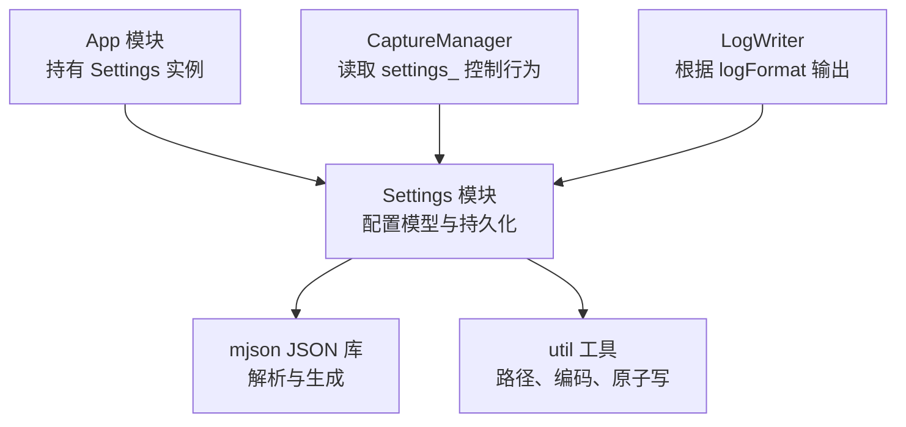
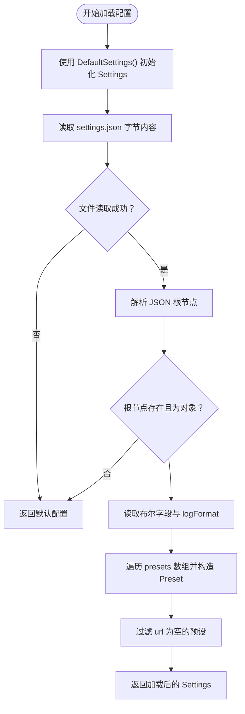
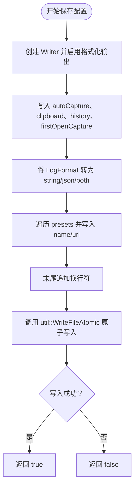
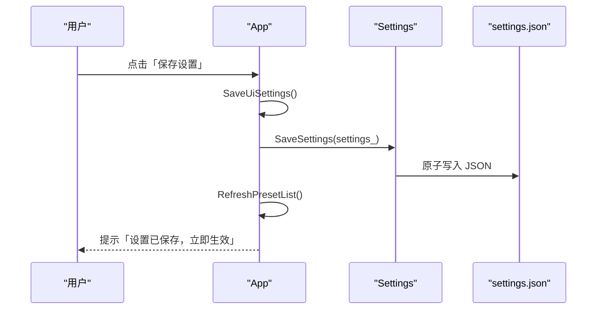
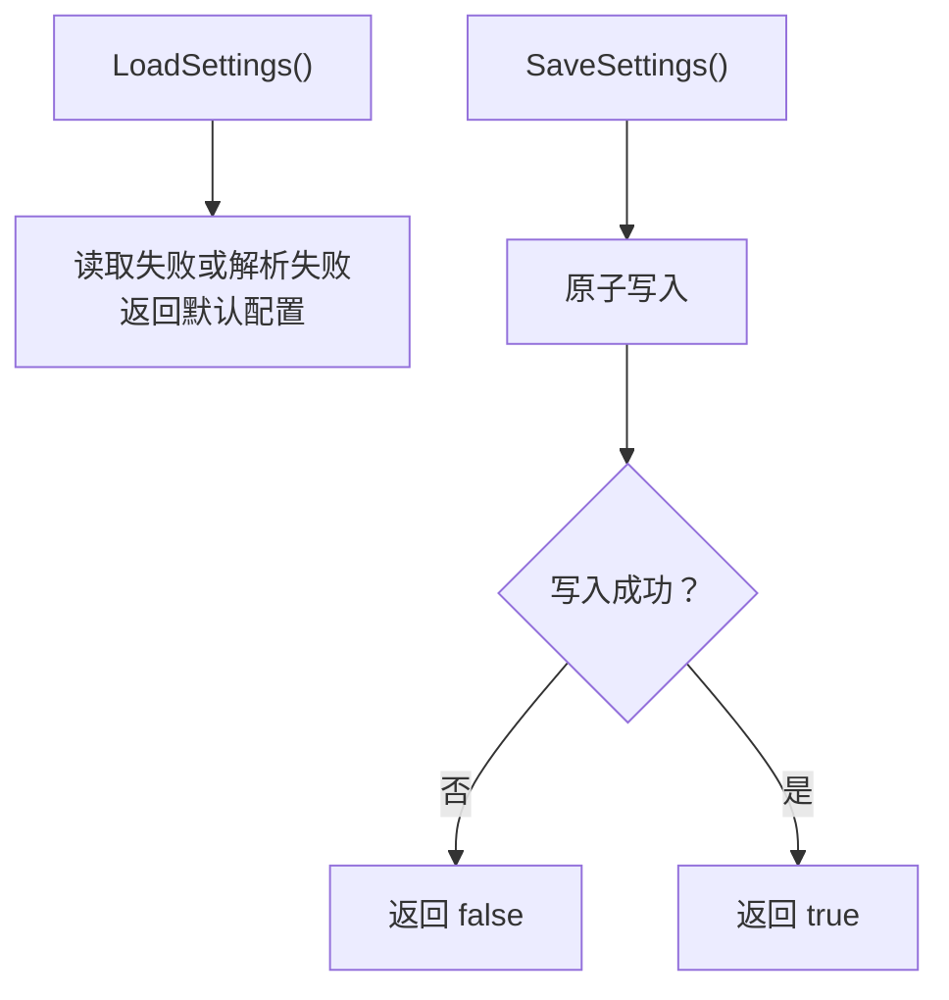
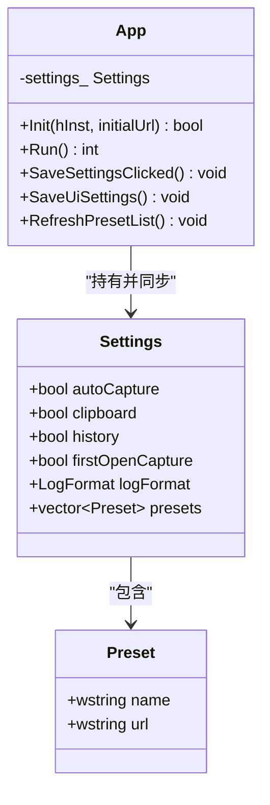
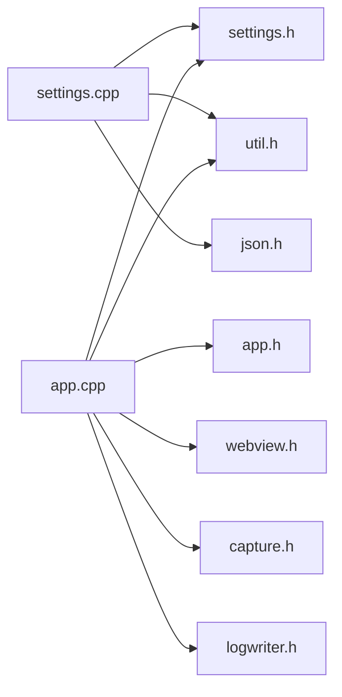

# 设置管理模块（Settings）

<cite>
**本文引用的文件**   
- [settings.h](file://src/settings.h)
- [settings.cpp](file://src/settings.cpp)
- [app.h](file://src/app.h)
- [app.cpp](file://src/app.cpp)
- [util.h](file://src/util.h)
- [util.cpp](file://src/util.cpp)
- [json.h](file://src/json.h)
</cite>

## 目录
1. [引言](#引言)
2. [项目结构与职责划分](#项目结构与职责划分)
3. [核心数据模型与默认值](#核心数据模型与默认值)
4. [配置文件格式与读写流程](#配置文件格式与读写流程)
5. [预设网站管理与用户偏好](#预设网站管理与用户偏好)
6. [线程安全、文件锁与异常恢复](#线程安全文件锁与异常恢复)
7. [与 App 模块的配置同步机制](#与-app-模块的配置同步机制)
8. [使用示例：保存与加载配置](#使用示例保存与加载配置)
9. [依赖关系分析](#依赖关系分析)
10. [性能与健壮性建议](#性能与健壮性建议)
11. [故障排查指南](#故障排查指南)
12. [结论](#结论)

## 引言
本模块负责 Cookie 抓取工具的设置管理，包括：
- 定义 `Settings` 数据结构与默认值。
- 将用户偏好持久化为 `%LOCALAPPDATA%\CookieGrabber\settings.json`。
- 管理"预设网站"列表，支持增删改查。
- 提供 JSON 配置文件的读取、写入、验证与兼容处理。
- 通过原子写保证配置文件的完整性。
- 与 `App` 模块联动，实现界面状态与配置文件的同步。

该模块不直接创建窗口，也不直接捕获 Cookie，而是作为"配置中心"，被 `App`、`CaptureManager`、日志等模块共同消费。

## 项目结构与职责划分
- `settings.h`：声明 `Settings`、`Preset`、`LogFormat`，以及 `LoadSettings()`、`SaveSettings()`、`DefaultSettings()`、`SettingsFilePath()`。
- `settings.cpp`：实现配置路径、默认值、JSON 解析与序列化。
- `app.h` / `app.cpp`：持有当前 `Settings` 实例，负责 UI 与配置的绑定、保存按钮逻辑、预设下拉框刷新。
- `util.h` / `util.cpp`：提供 UTF-8/宽字符转换、本地应用目录、原子写、追加写、剪贴板等基础能力。
- `json.h`：轻量级 JSON 解析器与生成器，无第三方依赖。

**图表来源**
- [app.h:15-183](file://src/app.h#L15-L183)
- [settings.h:1-26](file://src/settings.h#L1-L26)
- [settings.cpp:1-81](file://src/settings.cpp#L1-L81)
- [json.h:1-223](file://src/json.h#L1-L223)
- [util.h:1-46](file://src/util.h#L1-L46)

**章节来源**
- [settings.h:1-26](file://src/settings.h#L1-L26)
- [settings.cpp:1-81](file://src/settings.cpp#L1-L81)
- [app.h:15-183](file://src/app.h#L15-L183)
- [app.cpp:110-173](file://src/app.cpp#L110-L173)

## 核心数据模型与默认值
### Settings 结构
`Settings` 是本次文档的核心数据结构，包含以下字段：
- `autoCapture`：检测到登录状态变化时自动抓取。
- `clipboard`：抓取后复制到剪贴板。
- `history`：是否追加写入历史日志。
- `firstOpenCapture`：首次打开若已登录则自动抓取。
- `logFormat`：日志格式枚举，支持字符串、JSON、或两者都写。
- `presets`：预设网站列表，每个元素包含名称和登录网址。

### Preset 结构
`Preset` 表示一个预设网站：
- `name`：显示名称，例如"百度网盘"。
- `url`：登录地址，例如"https://pan.baidu.com"。

### LogFormat 枚举
- `String`：仅字符串格式。
- `Json`：仅 JSON 格式。
- `Both`：同时写入两种格式。

### 默认值策略
`DefaultSettings()` 会返回一组合理的初始配置：
- 布尔开关默认开启。
- 日志格式默认为字符串。
- **更新**：预设网站优先包含主流网盘服务（百度网盘、阿里云盘、夸克网盘、天翼云盘、迅雷网盘、115网盘），并保留 B站和 GitHub 以维持用户连续性。

这种设计保证了：
- 首次运行不会报错。
- 旧版本缺失字段时能回退到合理默认值。
- 新增字段时不会破坏已有配置。

**章节来源**
- [settings.h:6-25](file://src/settings.h#L6-L25)
- [settings.cpp:13-25](file://src/settings.cpp#L13-L25)

## 配置文件格式与读写流程
### 配置文件位置
配置文件位于：
`%LOCALAPPDATA%\CookieGrabber\settings.json`

路径由 `SettingsFilePath()` 拼接 `util::LocalAppDir()` 与文件名得到。

### JSON 字段说明
| 字段名 | 类型 | 含义 | 默认值 |
|---|---|---|---|
| `autoCapture` | 布尔 | 自动抓取开关 | `true` |
| `clipboard` | 布尔 | 抓取后复制到剪贴板 | `true` |
| `history` | 布尔 | 记录历史日志 | `true` |
| `firstOpenCapture` | 布尔 | 首次打开已登录则自动抓取 | `true` |
| `logFormat` | 字符串 | 日志格式：`string`、`json`、`both` | `string` |
| `presets` | 数组 | 预设网站列表 | 空数组；加载失败时使用 `DefaultSettings()` |

每个 `presets` 元素为对象：
| 字段名 | 类型 | 含义 |
|---|---|---|
| `name` | 字符串 | 预设名称 |
| `url` | 字符串 | 登录网址 |

### LoadSettings() 流程
`LoadSettings()` 的加载逻辑如下：

**图表来源**
- [settings.cpp:27-53](file://src/settings.cpp#L27-L53)

关键行为：
- 如果文件不存在、无法读取、JSON 解析失败、根节点不是对象，都会回退到默认配置。
- 布尔字段使用带默认值的读取接口，避免缺失字段导致崩溃。
- `logFormat` 通过字符串映射到枚举。
- `presets` 数组中的对象会被转换为 `Preset`，并跳过 `url` 为空的项目。

### SaveSettings() 流程
`SaveSettings()` 的保存逻辑如下：

**图表来源**
- [settings.cpp:55-80](file://src/settings.cpp#L55-L80)

关键行为：
- 使用 `Writer` 生成可读的 JSON。
- 所有字段按固定顺序写入，便于人类阅读和对比差异。
- `presets` 中的宽字符名称和 URL 会通过 `WideToUtf8` 转为 UTF-8。
- 最终通过 `util::WriteFileAtomic` 原子写入，避免部分写入导致配置损坏。

**章节来源**
- [settings.cpp:9-11](file://src/settings.cpp#L9-L11)
- [settings.cpp:27-53](file://src/settings.cpp#L27-L53)
- [settings.cpp:55-80](file://src/settings.cpp#L55-L80)
- [util.cpp:108-119](file://src/util.cpp#L108-L119)
- [util.cpp:135-149](file://src/util.cpp#L135-L149)

## 预设网站管理与用户偏好
### 预设网站的增删改查
当前代码中，预设网站的主要操作集中在 `App` 层：

- **查询**：`RefreshPresetList()` 将 `settings_.presets` 填充到预设下拉框和历史地址下拉框。
- **修改**：`SaveSettingsClicked()` 在用户选择某个预设并修改登录网址后，更新对应 `Preset.url`，然后调用 `SaveSettings(settings_)`。
- **添加**：当前没有独立的"添加预设"按钮；扩展时可基于现有逻辑增加"新增预设项"入口。
- **删除**：当前没有独立的"删除预设"按钮；扩展时可基于下拉框索引删除对应项并重新保存。

**图表来源**
- [app.cpp:708-731](file://src/app.cpp#L708-L731)
- [app.cpp:683-695](file://src/app.cpp#L683-L695)
- [settings.cpp:55-80](file://src/settings.cpp#L55-L80)

### 预设网站配置更新
**更新**：预设网站已从传统的社交媒体平台（微博、知乎）调整为云存储服务，反映了现代用户更频繁的 Cookie/Token 抓取需求场景：

- **主要云存储服务商**：
  - 百度网盘 (https://pan.baidu.com)
  - 阿里云盘 (https://www.alipan.com)
  - 夸克网盘 (https://pan.quark.cn)
  - 天翼云盘 (https://cloud.189.cn)
  - 迅雷网盘 (https://pan.xunlei.com)
  - 115网盘 (https://115.com)
- **保留的常用站点**：
  - B站 (https://www.bilibili.com)
  - GitHub (https://github.com/login)

### 历史记录管理
`history` 字段控制是否追加写入历史日志。该字段本身只影响日志写入策略；实际日志文件路径和写入逻辑由 `LogWriter` 与 `CaptureManager` 协作完成。`Settings` 模块不负责具体日志文件名，但提供开关。

### 用户偏好设置
用户偏好包括：
- 自动抓取开关。
- 剪贴板复制开关。
- 历史日志开关。
- 首次打开自动抓取开关。
- 日志格式选择。
- 预设网站列表。

这些偏好通过 `App::SaveUiSettings()` 从 UI 控件状态同步到 `settings_`，再调用 `SaveSettings()` 持久化。

**章节来源**
- [app.cpp:683-731](file://src/app.cpp#L683-L731)
- [settings.h:13-20](file://src/settings.h#L13-L20)
- [settings.cpp:13-25](file://src/settings.cpp#L13-L25)

## 线程安全、文件锁与异常恢复
### 线程安全
- `Settings` 结构本身是普通数据结构，不包含互斥量或原子变量。
- 当前应用中，`App` 在 UI 线程中加载和保存配置。
- `CaptureManager` 通过指针访问 `settings_`，用于判断是否自动抓取、是否写历史等。
- 因此，模块层面没有显式加锁；线程安全依赖调用方约定：不要在多线程并发读写同一 `Settings` 实例时绕过 `App` 的保存流程。

### 文件锁
- 代码中没有使用操作系统级别的文件锁。
- 配置写入采用"临时文件 + 替换"的方式，而不是直接覆盖原文件。
- 这降低了并发写入导致文件损坏的概率，但不能替代真正的文件锁。

### 异常恢复策略
- 读取失败时返回默认配置，避免程序崩溃。
- JSON 解析失败时返回默认配置。
- 根节点不是对象时返回默认配置。
- `presets` 数组中无效对象会被跳过。
- `url` 为空的预设不会被加入最终列表。
- 写入失败时返回 `false`，调用方可据此决定是否提示用户重试。

**图表来源**
- [settings.cpp:27-53](file://src/settings.cpp#L27-L53)
- [settings.cpp:55-80](file://src/settings.cpp#L55-L80)
- [util.cpp:135-149](file://src/util.cpp#L135-L149)

**章节来源**
- [settings.cpp:27-80](file://src/settings.cpp#L27-L80)
- [util.cpp:135-149](file://src/util.cpp#L135-L149)

## 与 App 模块的配置同步机制
`App` 模块持有 `Settings settings_;`，并在初始化时加载配置：

1. `App::Init()` 中调用 `LoadSettings()`。
2. `CreateControls()` 中将 UI 开关状态与 `settings_` 字段同步。
3. 用户点击「保存设置」时，`SaveSettingsClicked()` 先调用 `SaveUiSettings()`，再处理预设网址变更。
4. `SaveUiSettings()` 将 UI 状态写回 `settings_` 并调用 `SaveSettings()`。
5. `RefreshPresetList()` 根据 `settings_.presets` 刷新下拉框。

**图表来源**
- [app.h:15-183](file://src/app.h#L15-L183)
- [settings.h:8-25](file://src/settings.h#L8-L25)

**章节来源**
- [app.cpp:110-173](file://src/app.cpp#L110-L173)
- [app.cpp:341-347](file://src/app.cpp#L341-L347)
- [app.cpp:683-744](file://src/app.cpp#L683-L744)

## 使用示例：保存与加载配置
以下示例以"如何使用"为主，不直接粘贴源码，而是给出调用路径和语义说明。

### 示例一：启动时加载配置
适用场景：应用初始化阶段需要读取用户上次保存的设置。

调用链：
1. `App::Init()` 调用 `LoadSettings()`。
2. `LoadSettings()` 返回 `Settings`。
3. `App` 将 `settings_` 分发给 UI 和抓取模块。

参考路径：
- [app.cpp:110-173](file://src/app.cpp#L110-L173)
- [settings.cpp:27-53](file://src/settings.cpp#L27-L53)

### 示例二：用户点击保存设置
适用场景：用户在设置页修改开关、日志格式或预设网址后保存。

调用链：
1. 用户点击「保存设置」。
2. `App::SaveSettingsClicked()` 调用 `SaveUiSettings()`。
3. `SaveUiSettings()` 将 UI 状态写入 `settings_` 并调用 `SaveSettings(settings_)`。
4. 如果当前选中了预设且登录网址发生变化，则更新 `presets` 并再次保存。
5. 刷新预设下拉框并提示用户。

参考路径：
- [app.cpp:708-731](file://src/app.cpp#L708-L731)
- [settings.cpp:55-80](file://src/settings.cpp#L55-L80)

### 示例三：手动保存配置
适用场景：非 UI 场景下，业务逻辑需要直接保存 `Settings`。

推荐方式：
- 构造或修改 `Settings` 对象。
- 调用 `SaveSettings(s)`。
- 检查返回值，失败时记录日志或提示用户。

参考路径：
- [settings.cpp:55-80](file://src/settings.cpp#L55-L80)

### 示例四：手动加载配置
适用场景：需要独立于 `App` 读取配置，例如测试或工具函数。

推荐方式：
- 调用 `LoadSettings()`。
- 使用返回的 `Settings` 对象。
- 如需默认值，可调用 `DefaultSettings()` 作为基线。

参考路径：
- [settings.cpp:13-53](file://src/settings.cpp#L13-L53)

**章节来源**
- [app.cpp:708-744](file://src/app.cpp#L708-L744)
- [settings.cpp:13-80](file://src/settings.cpp#L13-L80)

## 依赖关系分析
### 模块依赖
- `settings.cpp` 依赖：
  - `settings.h`：数据结构与接口。
  - `util.h`：路径、UTF-8 转换、原子写。
  - `json.h`：JSON 解析与生成。
- `app.cpp` 依赖：
  - `app.h`：类定义。
  - `settings.h`：加载和保存配置。
  - `util.h`：路径、字符串处理。
  - `webview.h`、`capture.h`、`logwriter.h`：业务集成。

**图表来源**
- [settings.cpp:1-3](file://src/settings.cpp#L1-L3)
- [app.cpp:1-10](file://src/app.cpp#L1-L10)
- [app.h:1-11](file://src/app.h#L1-L11)

### 耦合度评估
- `Settings` 模块低耦合：只关注配置模型和 JSON 持久化。
- `App` 模块高内聚：集中处理 UI、WebView、抓取、日志和配置。
- `util` 是基础设施层，被多个模块复用。
- `json.h` 是头文件库，零运行时依赖，适合轻量项目。

**章节来源**
- [settings.cpp:1-3](file://src/settings.cpp#L1-L3)
- [app.cpp:1-10](file://src/app.cpp#L1-L10)
- [app.h:1-11](file://src/app.h#L1-L11)

## 性能与健壮性建议
### 性能
- 配置文件通常很小，JSON 解析和序列化开销可忽略。
- `Writer.pretty = true` 提升可读性，但对小文件性能影响有限。
- `presets` 列表较短时，线性遍历足够高效。

### 健壮性
- 建议在 `SaveSettingsClicked()` 中检查 `SaveSettings()` 返回值，失败时提示用户并重试。
- 可在 `LoadSettings()` 中增加更详细的错误日志，例如记录文件大小、解析失败位置。
- 可为 `Preset.url` 增加基本格式校验，例如要求以 `http://`、`https://` 或 `file://` 开头。
- 如需多进程共享配置，应引入文件锁或命名互斥体。

[本节为通用建议，不直接分析具体文件]

## 故障排查指南
### 常见问题与定位
| 现象 | 可能原因 | 排查步骤 |
|---|---|---|
| 启动后设置未生效 | 配置文件损坏或权限不足 | 检查 `%LOCALAPPDATA%\CookieGrabber\settings.json` 是否存在且可读 |
| 保存后配置丢失 | 原子写入失败 | 检查磁盘空间、权限、杀毒软件拦截 |
| 预设网站不显示 | `presets` 数组为空或解析失败 | 检查 JSON 中 `presets` 是否为数组，每项是否包含 `name` 和 `url` |
| 日志格式不正确 | `logFormat` 字符串映射错误 | 检查 JSON 中 `logFormat` 是否为 `string`、`json` 或 `both` |
| 中文名称乱码 | UTF-8 转换问题 | 确认编辑器保存为 UTF-8，且 `WideToUtf8` / `Utf8ToWide` 使用正确 |
| 预设网站与预期不符 | 预设配置已更新 | 检查 `DefaultSettings()` 中的预设网站列表 |

### 调试建议
- 打印 `SettingsFilePath()` 返回值，确认配置文件路径。
- 在 `LoadSettings()` 中观察是否进入默认配置分支。
- 在 `SaveSettings()` 中观察 `Writer.out` 生成的 JSON 是否符合预期。
- 使用文本编辑器打开 `settings.json`，检查语法是否正确。
- 检查预设网站列表是否包含预期的云存储服务。

**章节来源**
- [settings.cpp:9-11](file://src/settings.cpp#L9-L11)
- [settings.cpp:27-80](file://src/settings.cpp#L27-L80)
- [settings.cpp:13-25](file://src/settings.cpp#L13-L25)
- [util.cpp:108-119](file://src/util.cpp#L108-L119)
- [util.cpp:135-149](file://src/util.cpp#L135-L149)

## 结论
`Settings` 模块是一个简洁、可靠、低耦合的配置管理组件。它通过清晰的 `Settings` 数据模型、合理的默认值策略、健壮的 JSON 解析与原子写入机制，为 Cookie 抓取工具提供了稳定的配置基础。配合 `App` 模块，实现了从 UI 到持久化的完整闭环。

**更新**：预设网站配置已优化为以云存储服务为主，更好地满足现代用户的 Cookie/Token 抓取需求，同时保留了 B站和 GitHub 以维持用户连续性。

未来可扩展方向包括：
- 增加预设网站的增删按钮。
- 增加配置导入导出功能。
- 增加配置版本迁移逻辑。
- 增加多进程文件锁。
- 增加更严格的 URL 校验和错误诊断。
- 支持更多云存储服务的预设配置。

[本节为总结性内容，不直接分析具体文件]