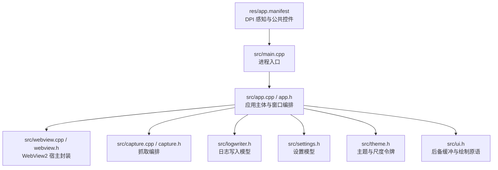
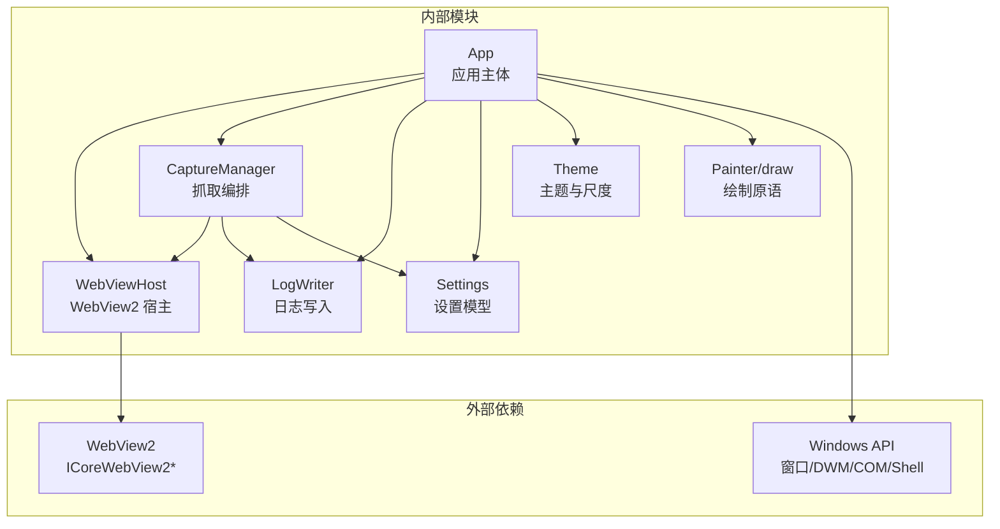
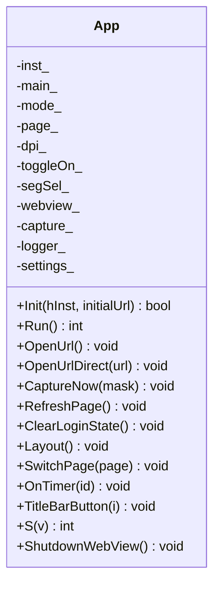
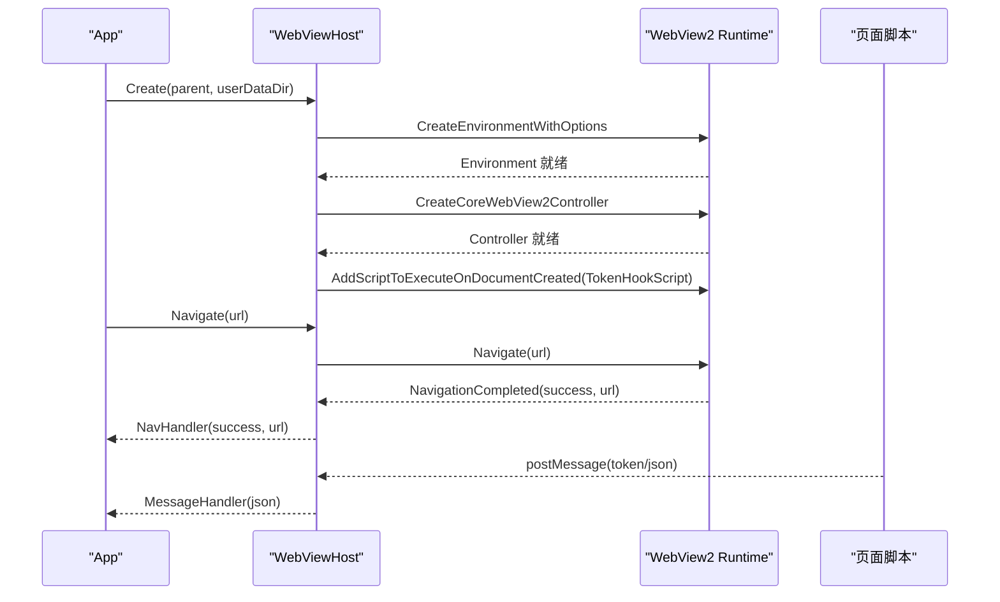
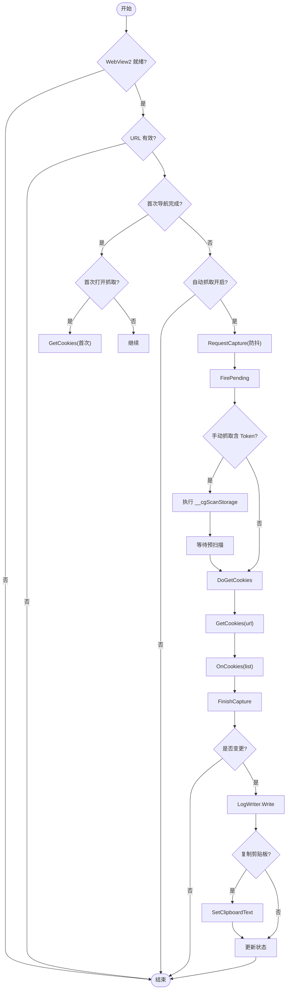
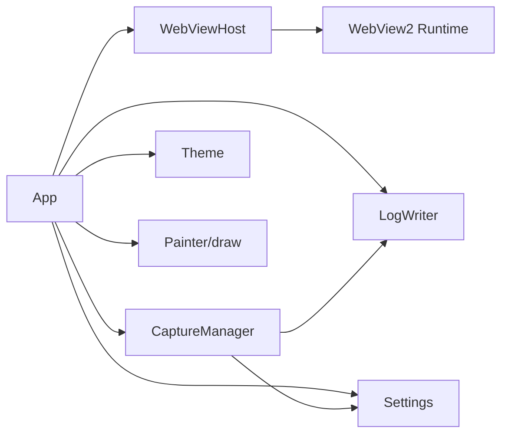
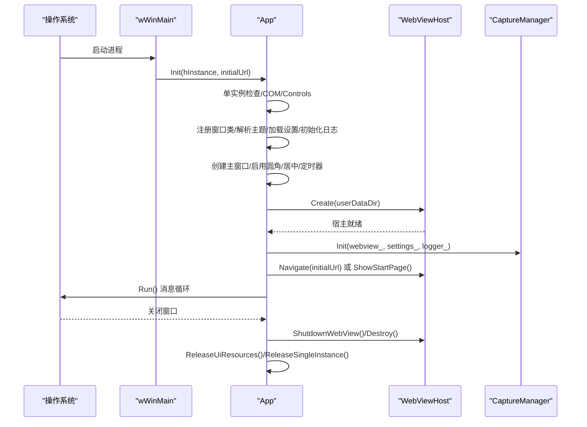

# 系统概览

<cite>
**本文引用的文件**   
- [main.cpp](file://src/main.cpp)
- [app.h](file://src/app.h)
- [app.cpp](file://src/app.cpp)
- [ui.h](file://src/ui.h)
- [webview.h](file://src/webview.h)
- [webview.cpp](file://src/webview.cpp)
- [capture.h](file://src/capture.h)
- [capture.cpp](file://src/capture.cpp)
- [settings.h](file://src/settings.h)
- [logwriter.h](file://src/logwriter.h)
- [theme.h](file://src/theme.h)
- [app.manifest](file://res/app.manifest)
</cite>

## 目录
1. [引言](#引言)
2. [项目结构](#项目结构)
3. [核心组件](#核心组件)
4. [架构总览](#架构总览)
5. [详细组件分析](#详细组件分析)
6. [依赖关系分析](#依赖关系分析)
7. [性能与绘制特性](#性能与绘制特性)
8. [生命周期管理](#生命周期管理)
9. [单实例控制与 DPI 感知](#单实例控制与-dpi-感知)
10. [故障排查指南](#故障排查指南)
11. [结论](#结论)

## 引言
本文件为 Cookie 抓取工具的系统概览文档，面向希望理解整体架构、模块职责、数据流和外部依赖的读者。应用采用 Win32 GUI 与 WebView2 混合架构：原生层负责现代化无边框窗口、响应式布局、主题与绘制；WebView2 承载网页并注入 Token 捕获脚本；抓取编排层协调 Cookie 快照、Token 汇总与日志写入；设置与日志模块提供持久化与输出能力。

设计目标包括：
- 现代化无边框窗口与圆角边框。
- 按宽度划分的响应式布局（宽/中/窄三档）。
- 模块化设计：UI、WebView2、抓取编排、设置、日志、主题相互解耦。
- 完整生命周期：进程启动 → 初始化 → 消息循环 → 资源释放。
- 单实例控制，避免多进程共享 WebView2 userdata 冲突。
- PerMonitorV2 DPI 感知，保证高分屏下布局与字体缩放正确。

## 项目结构
仓库采用“功能域 + 平台封装”的组织方式：
- `src`：核心源码，包含入口、应用主体、UI 绘制、WebView2 宿主、抓取编排、设置、日志、主题等。
- `res`：资源清单与 manifest，声明 DPI 感知与公共控件版本。
- `include`：第三方头文件占位。
- `test`：测试用起始页与本地服务。
- 构建脚本与图标生成脚本位于根目录。

图表来源
- [main.cpp:6-18](file://src/main.cpp#L6-L18)
- [app.cpp:66-172](file://src/app.cpp#L66-L172)
- [webview.h:11-30](file://src/webview.h#L11-L30)
- [capture.h:10-31](file://src/capture.h#L10-L31)
- [logwriter.h:30-47](file://src/logwriter.h#L30-L47)
- [settings.h:6-20](file://src/settings.h#L6-L20)
- [theme.h:10-36](file://src/theme.h#L10-L36)
- [app.manifest:10-14](file://res/app.manifest#L10-L14)

章节来源
- [main.cpp:1-20](file://src/main.cpp#L1-L20)
- [app.h:15-183](file://src/app.h#L15-L183)
- [app.cpp:66-172](file://src/app.cpp#L66-L172)
- [webview.h:11-71](file://src/webview.h#L11-L71)
- [capture.h:10-64](file://src/capture.h#L10-L64)
- [logwriter.h:10-53](file://src/logwriter.h#L10-L53)
- [settings.h:6-26](file://src/settings.h#L6-L26)
- [theme.h:10-91](file://src/theme.h#L10-L91)
- [app.manifest:1-17](file://res/app.manifest#L1-L17)

## 核心组件
- 应用主体 App：负责窗口创建、主题解析、控件布局、页面切换、定时器调度、WebView2 集成、抓取状态更新。
- WebViewHost：封装 WebView2 环境创建、控制器生命周期、导航、脚本注入、Cookie 读取、消息桥接。
- CaptureManager：协调 Cookie 快照比对、Token 通道汇总、登录态检测、防抖与预扫描、日志写入触发。
- LogWriter：定义 CookieItem/TokenItem 数据结构，实现 UTF-8 无 BOM 日志原子写入与历史追加。
- Settings：保存自动抓取、剪贴板、历史、首次打开抓取、日志格式与预设站点。
- Theme：集中调色板与尺度令牌，供原生绘制与起始页 CSS 共用。
- UI 绘制层 Painter/draw：后备缓冲、字体集、统一绘制原语，确保视觉一致性。

章节来源
- [app.h:15-183](file://src/app.h#L15-L183)
- [webview.h:11-71](file://src/webview.h#L11-L71)
- [capture.h:10-64](file://src/capture.h#L10-L64)
- [logwriter.h:10-53](file://src/logwriter.h#L10-L53)
- [settings.h:6-26](file://src/settings.h#L6-L26)
- [theme.h:10-91](file://src/theme.h#L10-L91)
- [ui.h:11-93](file://src/ui.h#L11-L93)

## 架构总览
下图展示外部依赖与内部模块的关系：
- 外部依赖：WebView2（浏览器内核）、Windows API（窗口、DWM、COM、Shell）。
- 内部模块：App 作为编排中心，组合 WebViewHost、CaptureManager、LogWriter、Settings、Theme、UI 绘制。

图表来源
- [app.cpp:66-172](file://src/app.cpp#L66-L172)
- [webview.cpp:217-252](file://src/webview.cpp#L217-L252)
- [capture.cpp:14-21](file://src/capture.cpp#L14-L21)
- [logwriter.h:30-47](file://src/logwriter.h#L30-L47)
- [settings.h:13-20](file://src/settings.h#L13-L20)
- [theme.h:80-91](file://src/theme.h#L80-L91)
- [ui.h:11-93](file://src/ui.h#L11-L93)

## 详细组件分析

### 应用主体 App
职责：
- 进程初始化、单实例检查、COM 初始化、Common Controls 初始化。
- 注册主窗口类与 WebView2 Host 窗口类。
- 解析主题、加载设置、初始化日志。
- 创建主窗口、启用圆角与边框色、居中显示。
- 绑定 WebView2 消息与导航回调，创建 WebView2 宿主。
- 初始化抓取管理器，处理初始 URL 或起始页。
- 维护布局模式、标题栏按钮、悬停跟踪、滚动状态。
- 双缓冲内存 DC/位图缓存，按尺寸变化重建。
- 提供 DPI 缩放函数 S()，暴露各绘制资源访问器。

关键流程要点：
- Init 中完成所有子系统初始化与窗口创建。
- Run 进入消息循环，支持地址框回车打开。
- Layout 根据客户区宽度选择三档布局，计算顶部导航、状态栏、内容区几何。
- SwitchPage 在浏览器页与设置页之间切换，隐藏/显示对应控件并裁剪滚动区域。
- OpenUrl/OpenUrlDirect 标准化 URL 前缀，切换到浏览器页并导航。
- CaptureNow/RefreshPage/ClearLoginState 分别触发抓取、刷新、清除会话。
- OnTimer 轮询抓取、WebView2 就绪检测、定时任务派发。
- TitleBarButton 处理最小化、最大化/还原、关闭。

图表来源
- [app.h:15-183](file://src/app.h#L15-L183)
- [app.cpp:66-172](file://src/app.cpp#L66-L172)
- [app.cpp:175-187](file://src/app.cpp#L175-L187)
- [app.cpp:379-538](file://src/app.cpp#L379-L538)
- [app.cpp:563-598](file://src/app.cpp#L563-L598)
- [app.cpp:600-637](file://src/app.cpp#L600-L637)
- [app.cpp:711-728](file://src/app.cpp#L711-L728)
- [app.cpp:743-747](file://src/app.cpp#L743-L747)

章节来源
- [app.h:15-183](file://src/app.h#L15-L183)
- [app.cpp:66-172](file://src/app.cpp#L66-L172)
- [app.cpp:175-187](file://src/app.cpp#L175-L187)
- [app.cpp:379-538](file://src/app.cpp#L379-L538)
- [app.cpp:563-598](file://src/app.cpp#L563-L598)
- [app.cpp:600-637](file://src/app.cpp#L600-L637)
- [app.cpp:711-728](file://src/app.cpp#L711-L728)
- [app.cpp:743-747](file://src/app.cpp#L743-L747)

### WebView2 宿主 WebViewHost
职责：
- 动态加载 WebView2Loader.dll（优先 exe 同目录，否则释放内嵌资源到临时目录）。
- 异步创建 Environment 与 Controller，订阅 NavigationCompleted 与 WebMessageReceived。
- 注入 Token 捕获脚本，拦截 fetch/XMLHttpRequest 请求头与响应体，扫描 localStorage/sessionStorage。
- 提供 Navigate/NavigateToString/Reload/DeleteAllCookies/Recreate/ExecuteScript/GetCookies/Resize/CurrentUrl/Focus 等方法。
- 通过回调将 WebView2 事件转发给上层（App/CaptureManager）。

关键流程要点：
- Create 中初始化 COM、加载加载器、创建 Environment 与 Controller。
- OnControllerCreated 中绑定事件、注入脚本、处理挂起的导航。
- GetCookies 使用 CookieManager 异步获取 Cookie 列表，构造 CookieItem 集合。
- Recreate 注销事件、关闭控制器、删除 userDataDir 并重试，再重新创建。
- Destroy 释放所有 COM 对象与加载器引用，必要时清理临时 DLL。

图表来源
- [webview.cpp:185-214](file://src/webview.cpp#L185-L214)
- [webview.cpp:217-252](file://src/webview.cpp#L217-L252)
- [webview.cpp:254-296](file://src/webview.cpp#L254-L296)
- [webview.cpp:298-310](file://src/webview.cpp#L298-L310)
- [webview.cpp:320-342](file://src/webview.cpp#L320-L342)
- [webview.cpp:351-362](file://src/webview.cpp#L351-L362)
- [webview.cpp:433-535](file://src/webview.cpp#L433-L535)

章节来源
- [webview.h:11-71](file://src/webview.h#L11-L71)
- [webview.cpp:185-214](file://src/webview.cpp#L185-L214)
- [webview.cpp:217-252](file://src/webview.cpp#L217-L252)
- [webview.cpp:254-296](file://src/webview.cpp#L254-L296)
- [webview.cpp:298-310](file://src/webview.cpp#L298-L310)
- [webview.cpp:320-342](file://src/webview.cpp#L320-L342)
- [webview.cpp:351-362](file://src/webview.cpp#L351-L362)
- [webview.cpp:433-535](file://src/webview.cpp#L433-L535)

### 抓取编排 CaptureManager
职责：
- 接收 WebView2 消息（Token）与导航完成事件。
- 定时轮询 Cookie 快照，比较变化后触发抓取。
- 支持手动抓取与自动抓取，掩码区分 Cookie/Token。
- 防抖与预扫描：手动抓取时先执行存储扫描，等待后再拉取 Cookie。
- 调用 LogWriter 写入 Cookie/Token 日志，更新状态与计数。
- 提供 IsLoggedIn 启发式判断（基于 Cookie 名关键词）。

关键流程要点：
- OnWebMessage 解析 JSON，去重同名 Token，标记 tokensDirty_，必要时触发自动抓取。
- PollTick 每 1500ms 轮询，若首次打开且已登录则立即抓取。
- RequestCapture 合并 maskNext_，启动防抖定时器。
- FirePending 决定是否先执行存储扫描，再延迟一步拉 Cookie。
- FinishCapture 比较快照与脏标记，调用 logger_.Write，可选复制到剪贴板。

图表来源
- [capture.cpp:14-21](file://src/capture.cpp#L14-L21)
- [capture.cpp:58-87](file://src/capture.cpp#L58-L87)
- [capture.cpp:89-102](file://src/capture.cpp#L89-L102)
- [capture.cpp:104-133](file://src/capture.cpp#L104-L133)
- [capture.cpp:135-162](file://src/capture.cpp#L135-L162)
- [capture.cpp:164-182](file://src/capture.cpp#L164-L182)
- [capture.cpp:184-232](file://src/capture.cpp#L184-L232)
- [capture.cpp:234-245](file://src/capture.cpp#L234-L245)

章节来源
- [capture.h:10-64](file://src/capture.h#L10-L64)
- [capture.cpp:14-21](file://src/capture.cpp#L14-L21)
- [capture.cpp:58-87](file://src/capture.cpp#L58-L87)
- [capture.cpp:89-102](file://src/capture.cpp#L89-L102)
- [capture.cpp:104-133](file://src/capture.cpp#L104-L133)
- [capture.cpp:135-162](file://src/capture.cpp#L135-L162)
- [capture.cpp:164-182](file://src/capture.cpp#L164-L182)
- [capture.cpp:184-232](file://src/capture.cpp#L184-L232)
- [capture.cpp:234-245](file://src/capture.cpp#L234-L245)

### 日志写入 LogWriter
职责：
- 定义 CookieItem/TokenItem 数据结构。
- 初始化日志目录（优先 exe 目录，不可写回退 %LOCALAPPDATA%\CookieGrabber\logs）。
- 按设置写入 cookie.log、cookie.json、cookie_detail.json、cookie_history.log。
- 覆盖文件使用临时文件+原子替换，历史日志追加。
- 进程内互斥保护，避免并发写入损坏。

章节来源
- [logwriter.h:10-53](file://src/logwriter.h#L10-L53)

### 设置模型 Settings
职责：
- 保存自动抓取、剪贴板、历史、首次打开抓取、日志格式与预设站点。
- 提供 LoadSettings/SaveSettings/DefaultSettings/SettingsFilePath。

章节来源
- [settings.h:6-26](file://src/settings.h#L6-L26)

### 主题与尺度 Theme
职责：
- 集中 Palette 调色板与 scale 尺度令牌。
- DetectDarkMode 检测深色模式，Resolve 应用主题。
- StartPageCss 生成起始页 CSS，使 WebView2 起始页与原生绘制同源。

章节来源
- [theme.h:10-91](file://src/theme.h#L10-L91)

### UI 绘制层 Painter/draw
职责：
- Painter 提供 32bpp top-down DIB 段后备缓冲，避免高频 resize/滚动残影。
- Fonts 按 DPI 一次性构建字体集。
- draw 命名空间提供统一绘制原语：矩形、圆角卡片、文字排版、按钮、分段胶囊、滚动条、点等。

章节来源
- [ui.h:11-93](file://src/ui.h#L11-L93)

## 依赖关系分析
- App 依赖 WebViewHost 进行网页渲染与 Cookie/Token 获取。
- CaptureManager 依赖 WebViewHost 获取 Cookie，依赖 LogWriter 写入日志，依赖 Settings 读取配置。
- WebViewHost 依赖 WebView2 运行时与 Windows COM。
- App 依赖 Theme 提供颜色与尺度，依赖 UI 绘制层进行自绘控件与状态行绘制。
- Manifest 声明 DPI 感知与公共控件版本，影响窗口行为与外观。

图表来源
- [app.cpp:66-172](file://src/app.cpp#L66-L172)
- [webview.cpp:217-252](file://src/webview.cpp#L217-L252)
- [capture.cpp:14-21](file://src/capture.cpp#L14-L21)
- [logwriter.h:30-47](file://src/logwriter.h#L30-L47)
- [settings.h:13-20](file://src/settings.h#L13-L20)
- [theme.h:80-91](file://src/theme.h#L80-L91)
- [ui.h:11-93](file://src/ui.h#L11-L93)

章节来源
- [app.cpp:66-172](file://src/app.cpp#L66-L172)
- [webview.cpp:217-252](file://src/webview.cpp#L217-L252)
- [capture.cpp:14-21](file://src/capture.cpp#L14-L21)
- [logwriter.h:30-47](file://src/logwriter.h#L30-L47)
- [settings.h:13-20](file://src/settings.h#L13-L20)
- [theme.h:80-91](file://src/theme.h#L80-L91)
- [ui.h:11-93](file://src/ui.h#L11-L93)

## 性能与绘制特性
- 双缓冲与后备缓冲：App 使用内存 DC/位图缓存，Painter 使用 DIB 段，减少闪烁与旧帧残影。
- 按需重建缓冲区：EnsureMemBuffer 仅在尺寸变化时重建，避免频繁分配。
- 滚动优化：设置页滚动时同步 RedrawWindow，避免 WM_PAINT 被挤压导致中间错位帧。
- 子控件裁剪：滚动时将子控件移出视口的部分裁剪，防止遮挡标题栏/状态行。
- 字体与画刷批量创建：BuildFonts/BuildBrushes 一次性创建并按需应用，ReleaseUiResources 统一释放。
- WebView2 加载策略：优先 exe 同目录 WebView2Loader.dll，否则释放内嵌资源到临时目录，避免重复释放与覆盖写失败。

章节来源
- [app.cpp:191-212](file://src/app.cpp#L191-L212)
- [app.cpp:218-272](file://src/app.cpp#L218-L272)
- [app.cpp:730-741](file://src/app.cpp#L730-L741)
- [app.cpp:504-531](file://src/app.cpp#L504-L531)
- [webview.cpp:185-214](file://src/webview.cpp#L185-L214)
- [webview.cpp:241-252](file://src/webview.cpp#L241-L252)
- [ui.h:8-24](file://src/ui.h#L8-L24)

## 生命周期管理
从进程启动到资源释放的关键步骤：
1. wWinMain 解析命令行参数，调用 App::Init。
2. App::Init 创建单实例互斥体，初始化 COM 与 Common Controls。
3. 注册主窗口类与 WebView2 Host 窗口类，解析主题与设置，初始化日志。
4. 创建主窗口，启用圆角与边框色，居中显示，设置轮询定时器。
5. 绑定 WebView2 消息与导航回调，创建 WebView2 宿主，初始化抓取管理器。
6. 若有初始 URL 则导航，否则显示起始页。
7. App::Run 进入消息循环，处理键盘与窗口消息。
8. 退出时释放 UI 资源、销毁 WebView2、关闭单实例句柄。

图表来源
- [main.cpp:6-18](file://src/main.cpp#L6-L18)
- [app.cpp:66-172](file://src/app.cpp#L66-L172)
- [app.cpp:175-187](file://src/app.cpp#L175-L187)
- [webview.cpp:217-252](file://src/webview.cpp#L217-L252)
- [capture.cpp:14-21](file://src/capture.cpp#L14-L21)

章节来源
- [main.cpp:1-20](file://src/main.cpp#L1-L20)
- [app.cpp:66-172](file://src/app.cpp#L66-L172)
- [app.cpp:175-187](file://src/app.cpp#L175-L187)
- [webview.cpp:217-252](file://src/webview.cpp#L217-L252)
- [capture.cpp:14-21](file://src/capture.cpp#L14-L21)

## 单实例控制与 DPI 感知
- 单实例控制：通过全局互斥体 Local\CookieGrabberSingleInstance 实现。若已存在，则恢复并置顶已有窗口，或提示已在运行。
- DPI 感知：manifest 声明 PerMonitorV2 与 PerMonitor，启用高分屏自适应；App::S() 以 dpi_ 缩放逻辑像素；字体高度与窗口尺寸均经 MulDiv 换算。
- 窗口居中：根据工作区与 DPI 计算宽高与位置，确保在不同显示器上居中显示。

章节来源
- [app.cpp:70-83](file://src/app.cpp#L70-L83)
- [app.cpp:130-138](file://src/app.cpp#L130-L138)
- [app.cpp:189-189](file://src/app.cpp#L189-L189)
- [app.manifest:10-14](file://res/app.manifest#L10-L14)

## 故障排查指南
常见问题与定位建议：
- WebView2 初始化失败：
  - 现象：状态栏提示“WebView2 初始化失败：请安装 Edge WebView2 运行时后重试”。
  - 原因：未安装 WebView2 运行时或加载器加载失败。
  - 排查：确认 WebView2Loader.dll 可加载（exe 同目录或临时目录），检查 CoInitializeEx 与 STA 线程。
  - 相关代码路径：[app.cpp:711-728](file://src/app.cpp#L711-L728)、[webview.cpp:185-214](file://src/webview.cpp#L185-L214)。
- 无法抓取 Cookie：
  - 现象：状态栏提示“尚未打开页面，无法抓取”或“当前页面不支持抓取（非 http/https/file 页面）”。
  - 原因：URL 为空或非受支持的协议。
  - 排查：确认当前 URL 有效，WebView2 已就绪。
  - 相关代码路径：[capture.cpp:164-175](file://src/capture.cpp#L164-L175)。
- 清除登录状态失败：
  - 现象：提示“清除失败：WebView2 重建失败，请重启应用后重试”。
  - 原因：userDataDir 删除失败或 WebView2 重建异常。
  - 排查：检查数据目录权限，确认浏览器进程已退出。
  - 相关代码路径：[app.cpp:600-637](file://src/app.cpp#L600-L637)、[webview.cpp:320-342](file://src/webview.cpp#L320-L342)。
- 日志写入失败：
  - 现象：状态栏提示“抓取完成但写日志失败: ...”。
  - 原因：日志目录不可写或文件原子替换失败。
  - 排查：检查日志目录权限与磁盘空间。
  - 相关代码路径：[capture.cpp:207-218](file://src/capture.cpp#L207-L218)。

章节来源
- [app.cpp:711-728](file://src/app.cpp#L711-L728)
- [webview.cpp:185-214](file://src/webview.cpp#L185-L214)
- [capture.cpp:164-175](file://src/capture.cpp#L164-L175)
- [app.cpp:600-637](file://src/app.cpp#L600-L637)
- [webview.cpp:320-342](file://src/webview.cpp#L320-L342)
- [capture.cpp:207-218](file://src/capture.cpp#L207-L218)

## 结论
该 Cookie 抓取工具采用清晰的模块化架构：App 作为编排中心，整合 WebView2 宿主、抓取编排、日志写入、设置与主题；UI 绘制层提供一致的视觉语言与高性能渲染。系统具备完整的生命周期管理、单实例控制与 DPI 感知支持，能够在不同屏幕密度与窗口尺寸下保持良好体验。抓取流程通过防抖与预扫描机制提升准确性与效率，日志写入保证数据完整性与可追溯性。未来可扩展更多预设站点、增强 Token 识别规则与改进错误恢复策略。