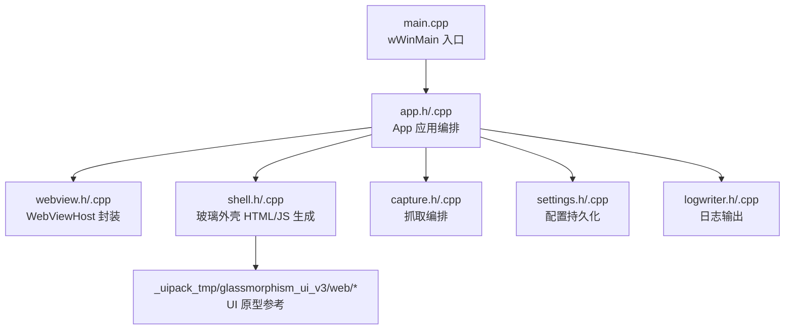
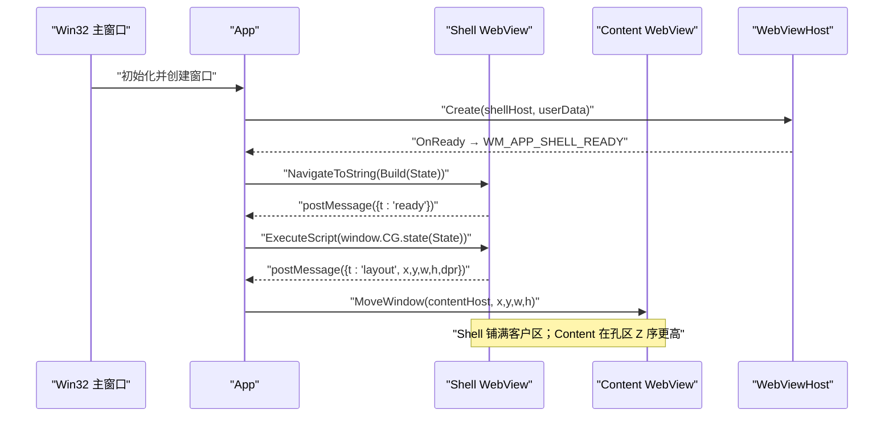
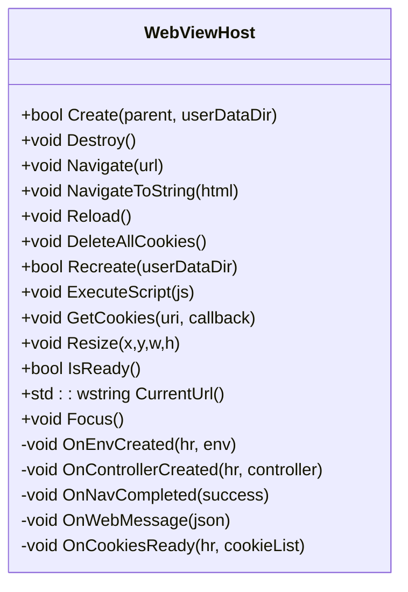
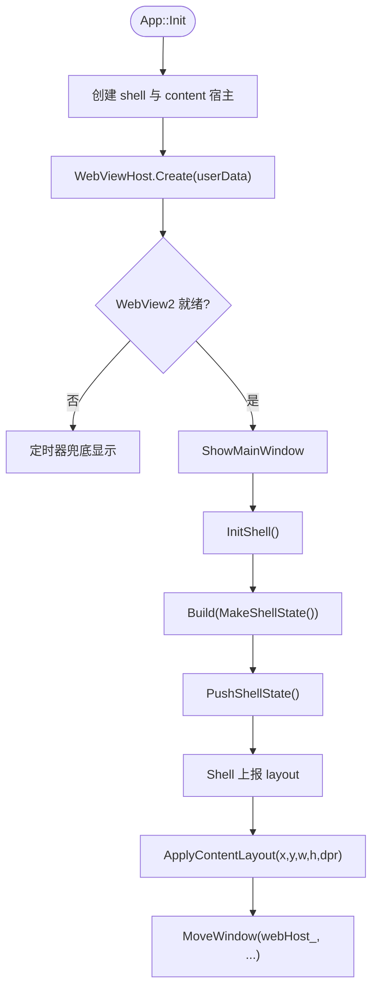
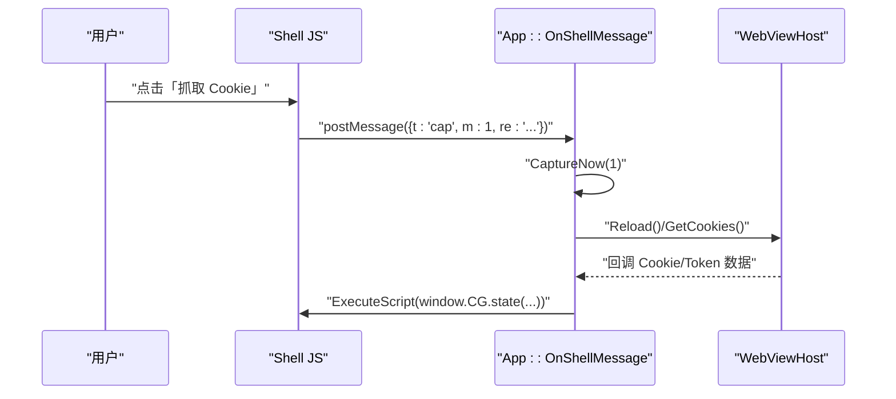
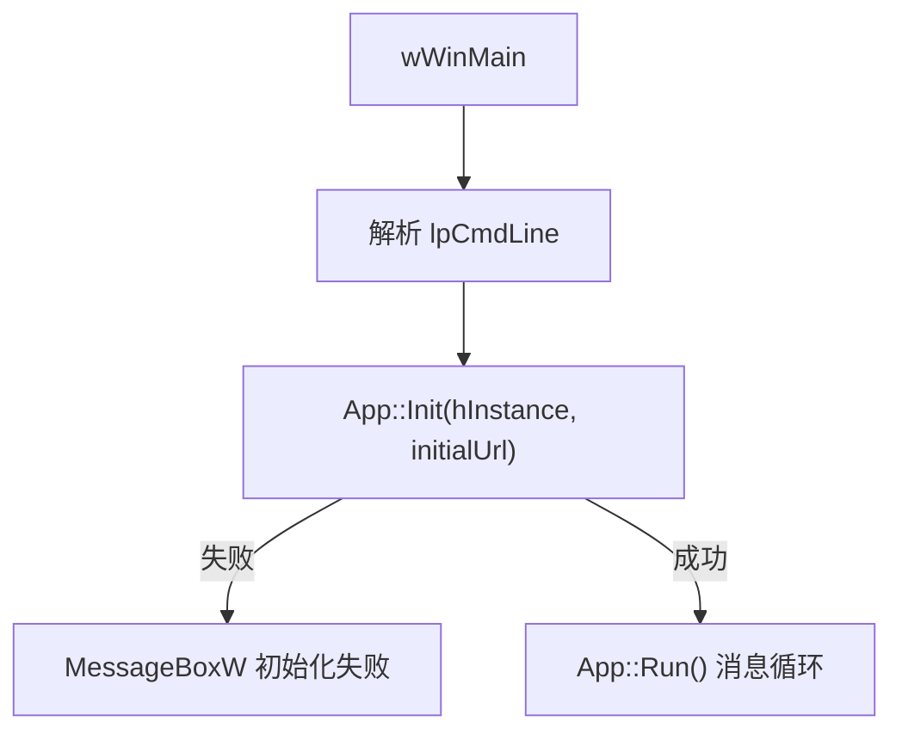
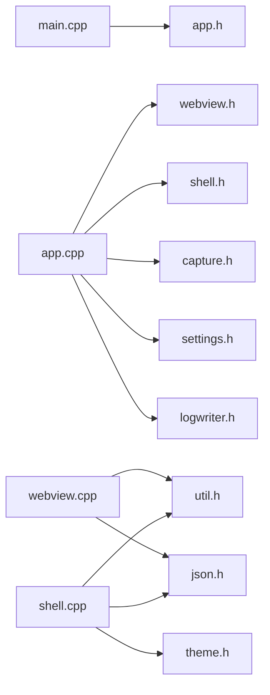

# WebView2 Glass Shell 模块

<cite>
**本文引用的文件**   
- [README.md](file://README.md)
- [main.cpp](file://src/main.cpp)
- [app.h](file://src/app.h)
- [app.cpp](file://src/app.cpp)
- [webview.h](file://src/webview.h)
- [webview.cpp](file://src/webview.cpp)
- [shell.h](file://src/shell.h)
- [shell.cpp](file://src/shell.cpp)
- [index.html](file://_uipack_tmp/glassmorphism_ui_v3/web/index.html)
- [app.js](file://_uipack_tmp/glassmorphism_ui_v3/web/app.js)
</cite>

## 目录
1. [引言](#引言)
2. [项目结构](#项目结构)
3. [核心组件](#核心组件)
4. [架构总览](#架构总览)
5. [详细组件分析](#详细组件分析)
6. [依赖关系分析](#依赖关系分析)
7. [性能与行为特征](#性能与行为特征)
8. [故障排查指南](#故障排查指南)
9. [结论](#结论)

## 引言
本模块聚焦于 Cookie 抓取工具的 **WebView2 玻璃外壳（Glass Shell）**：以 Win32 窗口为宿主，用两个 WebView2 实例分别承载“内容站点”和“整页玻璃 UI”，并通过 JS→host 消息桥完成双向控制。该设计把标题栏、导航、工具栏、设置页、说明页与状态栏全部交给 shell WebView 渲染，而真实网站仍由独立的 Content WebView 在“孔区”覆盖显示，从而获得原生无边框窗口 + 现代玻璃 UI 的组合体验。

## 项目结构
仓库采用按职责分层的 C++ 源码组织方式，WebView2 相关逻辑集中在 `src/webview.*`，玻璃外壳 HTML/JS 生成集中在 `src/shell.*`，应用编排与 Win32 消息循环集中在 `src/app.*`，入口位于 `src/main.cpp`。UI 原型参考 `_uipack_tmp/glassmorphism_ui_v3/web/*`，但实际运行时由 `shell.cpp` 动态拼装 HTML。

**图表来源**
- [main.cpp:6-18](file://src/main.cpp#L6-L18)
- [app.h:13-89](file://src/app.h#L13-L89)
- [webview.h:11-73](file://src/webview.h#L11-L73)
- [shell.h:16-39](file://src/shell.h#L16-L39)

**章节来源**
- [README.md:100-140](file://README.md#L100-L140)
- [main.cpp:1-20](file://src/main.cpp#L1-L20)

## 核心组件
- **App**：Win32 主窗口、双 WebView 宿主、布局、定时器、消息路由、Shell 状态推送。
- **WebViewHost**：封装 WebView2 COM 环境、控制器、导航、脚本注入、Cookie 读取、Token Hook 注入。
- **shell**：构建整页玻璃外壳 HTML，定义运行态快照 `State`，提供增量推送脚本。
- **CaptureManager / Settings / LogWriter**：抓取业务、配置与日志，被 App 组合但不直接参与 Shell 渲染。

**章节来源**
- [app.h:13-89](file://src/app.h#L13-L89)
- [webview.h:11-73](file://src/webview.h#L11-L73)
- [shell.h:16-39](file://src/shell.h#L16-L39)

## 架构总览
系统由三层组成：
1. **Win32 层**：注册窗口类、创建主窗口与两个子窗口（shell 宿主、content 宿主），处理 WM_SIZE / WM_DPICHANGED / WM_NCHITTEST 等。
2. **WebView2 层**：Content WebView 负责真实网站加载与 Token/Cookie 捕获；Shell WebView 负责整页玻璃 UI。
3. **JS 桥层**：Shell JS 通过 `window.chrome.webview.postMessage` 发送 `{t:"...",...}`，App 解析后调用业务方法；App 通过 `ExecuteScript("window.CG.state({...})")` 推送状态。

**图表来源**
- [app.cpp:106-149](file://src/app.cpp#L106-L149)
- [app.cpp:387-407](file://src/app.cpp#L387-L407)
- [app.cpp:437-455](file://src/app.cpp#L437-L455)
- [webview.cpp:225-250](file://src/webview.cpp#L225-L250)

## 详细组件分析

### WebViewHost：WebView2 生命周期与 Token 钩子
`WebViewHost` 是 WebView2 的进程内封装，负责：
- 加载器策略：优先 exe 同目录 `WebView2Loader.dll`，否则从资源释放到 `%TEMP%\CookieGrabber`。
- COM 环境创建、控制器创建、事件订阅（导航完成、WebMessage）。
- 导航、刷新、删除 Cookie、重建会话、执行脚本、异步获取 Cookie。
- 注入 Token 捕获 JS，拦截 `fetch` / `XMLHttpRequest` 请求头与 JSON 响应体，扫描 `localStorage` / `sessionStorage`。

**图表来源**
- [webview.h:11-73](file://src/webview.h#L11-L73)
- [webview.cpp:225-454](file://src/webview.cpp#L225-L454)

**章节来源**
- [webview.h:1-74](file://src/webview.h#L1-L74)
- [webview.cpp:184-271](file://src/webview.cpp#L184-L271)
- [webview.cpp:456-561](file://src/webview.cpp#L456-L561)

### App：双 WebView 编排与 Shell 状态推送
`App` 管理两个 WebView 宿主：
- `shellHost_`：承载整页玻璃 UI。
- `webHost_`：承载真实网站，仅在浏览器页可见并按 shell 上报的矩形定位。

关键流程：
- 初始化时创建两个子窗口，设置主题、设置、日志、定时器。
- Content WebView 就绪后显示主窗口；Shell WebView 就绪后生成 HTML 并推送初始状态。
- Shell JS 上报 `layout`，App 计算物理像素坐标并移动 content 宿主。
- 所有用户操作（打开、刷新、抓取、窗口控制、保存设置）统一通过 `{t:"...",...}` 分发。

**图表来源**
- [app.cpp:34-150](file://src/app.cpp#L34-L150)
- [app.cpp:178-216](file://src/app.cpp#L178-L216)
- [app.cpp:387-429](file://src/app.cpp#L387-L429)

**章节来源**
- [app.h:13-89](file://src/app.h#L13-L89)
- [app.cpp:34-150](file://src/app.cpp#L34-L150)
- [app.cpp:178-216](file://src/app.cpp#L178-L216)
- [app.cpp:387-429](file://src/app.cpp#L387-L429)

### Shell：玻璃外壳 HTML 与 JS 桥
`shell` 命名空间负责：
- 定义 `State` 快照，包含页面类型、深色模式、状态文本、Cookie/Token 计数、地址、日志目录、提示、最大化状态与设置。
- `Build(State)` 生成完整 HTML，包括标题栏、导航、工具栏、设置页、说明页、状态栏、缩放手柄与内联脚本。
- `StateJs(State)` 生成增量推送脚本体 `window.CG.state({...})`。

JS 侧通过 `window.chrome.webview.postMessage` 发送命令：
- `open`：打开网址。
- `reload`：刷新页面。
- `cap`：抓取 Cookie/Token。
- `regex`：更新 Cookie 筛选正则。
- `page`：切换视图。
- `win`：最小化、最大化、关闭、拖动、缩放。
- `cfg`：保存设置、清除登录状态、打开日志文件夹。
- `layout`：上报内容视口矩形。

**图表来源**
- [shell.cpp:27-46](file://src/shell.cpp#L27-L46)
- [shell.cpp:60-393](file://src/shell.cpp#L60-L393)
- [app.cpp:437-522](file://src/app.cpp#L437-L522)

**章节来源**
- [shell.h:16-39](file://src/shell.h#L16-L39)
- [shell.cpp:1-397](file://src/shell.cpp#L1-L397)
- [app.cpp:437-522](file://src/app.cpp#L437-L522)

### 入口与启动流程
`main.cpp` 解析命令行参数，调用 `App::Init`，失败则弹窗提示 WebView2 运行时可能未安装；成功则进入消息循环。

**图表来源**
- [main.cpp:6-18](file://src/main.cpp#L6-L18)

**章节来源**
- [main.cpp:1-20](file://src/main.cpp#L1-L20)

## 依赖关系分析
- `main.cpp` 仅依赖 `app.h`。
- `app.h/.cpp` 依赖 `webview.h`、`capture.h`、`settings.h`、`logwriter.h`、`shell.h`。
- `webview.h/.cpp` 依赖 `WebView2.h`、`util.h`、`json.h`、`logwriter.h`。
- `shell.h/.cpp` 依赖 `theme.h`、`util.h`、`json.h`、`settings.h`。
- UI 原型 `_uipack_tmp/glassmorphism_ui_v3/web/*` 不直接参与编译，仅作为样式与交互参考。

**图表来源**
- [main.cpp:2](file://src/main.cpp#L2)
- [app.h:7-11](file://src/app.h#L7-L11)
- [webview.h:4-9](file://src/webview.h#L4-L9)
- [shell.h:12-14](file://src/shell.h#L12-L14)

**章节来源**
- [README.md:131-140](file://README.md#L131-L140)

## 性能与行为特征
- **双缓冲与残影**：窗口背景刷为空，`WM_ERASEBKGND` 返回 1，一帧画完再上屏；布局变更后需整个客户区失效以避免残影。
- **DPI 感知**：使用 `MulDiv` 将逻辑像素转换为物理像素，支持 Per-Monitor V2。
- **WebView2 加载器复用**：进程级共享加载器 DLL，引用计数归零时才卸载，避免多实例互相卸载导致崩溃。
- **Token 捕获防抖**：JS 侧对重复 token 去重，限制内存中 seen 表大小；定期扫描存储。
- **状态推送节流**：仅在最大化/还原状态变化时推送，避免拖拽缩放时高频 `ExecuteScript`。

[本节为通用性能讨论，不直接分析具体代码行]

## 故障排查指南
- **WebView2 运行时缺失**：初始化失败时弹窗提示；若界面长时间不出现，检查是否安装 Edge WebView2 Runtime。
- **单实例冲突**：已存在同名互斥体时，尝试恢复已有窗口或提示已在运行。
- **日志写入失败**：优先 exe 同目录，不可写时回退 `%LOCALAPPDATA%\CookieGrabber\logs`。
- **Cookie/Token 未捕获**：确认 Token Hook 已注入，检查 `localStorage` / `sessionStorage` 与请求头/响应体是否符合匹配规则。
- **Shell 未就绪**：若 shell 控制器未就绪，拖动/缩放由 Win32 兜底；建议等待 `WM_APP_SHELL_READY` 后再进行复杂交互。

**章节来源**
- [app.cpp:38-54](file://src/app.cpp#L38-L54)
- [app.cpp:286-303](file://src/app.cpp#L286-L303)
- [webview.cpp:193-221](file://src/webview.cpp#L193-L221)
- [webview.cpp:456-561](file://src/webview.cpp#L456-L561)

## 结论
WebView2 Glass Shell 模块通过“双 WebView + JS 桥”实现了现代玻璃 UI 与真实网站浏览的解耦：Shell 负责外观与交互，Content 负责业务数据。该设计避免了原生 GDI 自绘的维护成本，同时保留了 WebView2 的强大能力。未来可继续扩展 Shell 的视图与控件，同时保持与 CaptureManager、Settings、LogWriter 的松耦合接口。