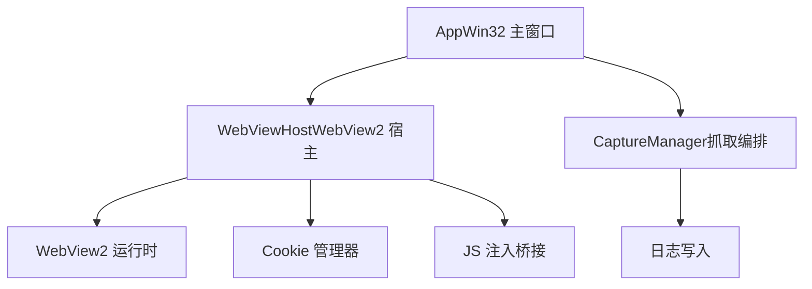
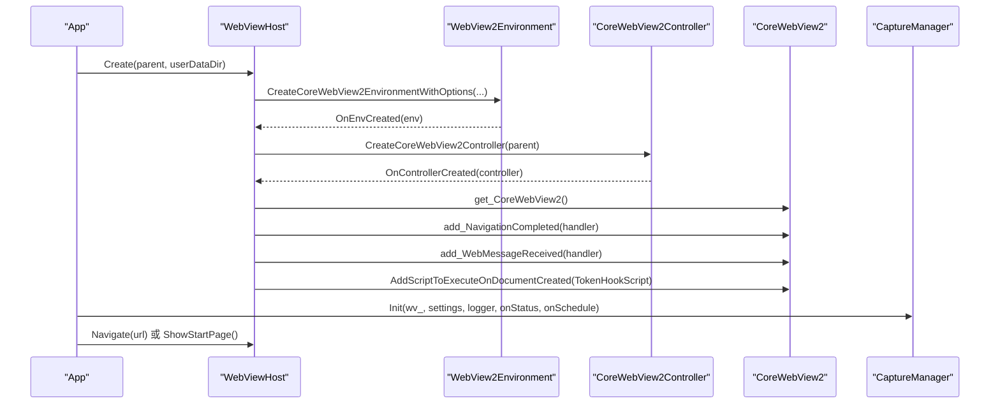
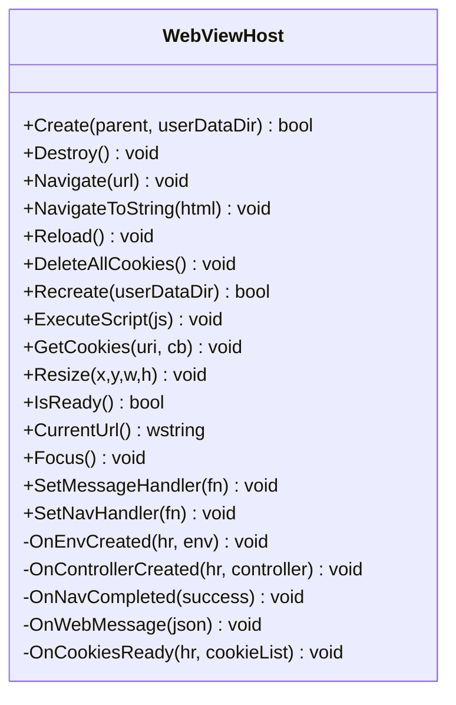
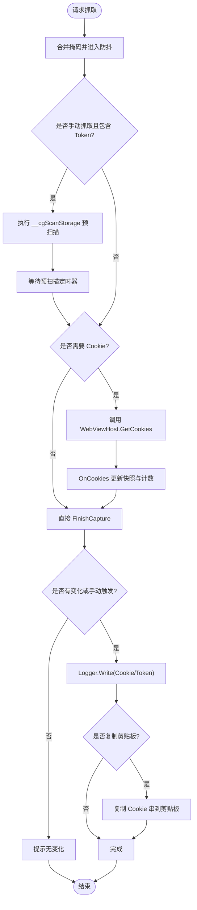
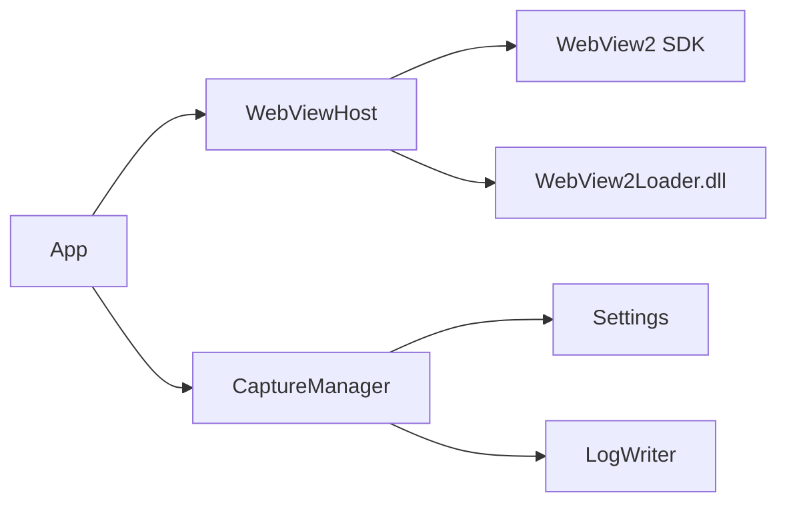

# WebView2 集成模块

<cite>
**本文引用的文件**   
- [webview.h](file://src/webview.h)
- [webview.cpp](file://src/webview.cpp)
- [app.h](file://src/app.h)
- [app.cpp](file://src/app.cpp)
- [capture.h](file://src/capture.h)
- [capture.cpp](file://src/capture.cpp)
</cite>

## 目录
1. [简介](#简介)
2. [项目结构](#项目结构)
3. [核心组件](#核心组件)
4. [架构总览](#架构总览)
5. [详细组件分析](#详细组件分析)
6. [依赖关系分析](#依赖关系分析)
7. [性能与兼容性](#性能与兼容性)
8. [故障排查指南](#故障排查指南)
9. [结论](#结论)

## 简介
本技术文档围绕 WebViewHost 类及其在应用中的集成，系统性说明 WebView2 浏览器引擎的初始化、控制器管理、页面导航与控制机制；深入解释 JavaScript 注入与执行、消息通道通信、Cookie 获取等核心能力；并给出环境创建、运行时配置、事件处理与错误恢复的具体实现路径。同时提供加载网页、执行脚本、处理浏览器事件的示例指引，以及与 App 模块的集成方式和数据传递机制。最后涵盖版本兼容性、性能优化和调试技巧。

## 项目结构
本项目采用 Win32 + WebView2 的桌面端架构：
- UI 层由原生 Win32 窗口承载，WebView2 作为子窗口嵌入。
- WebViewHost 封装 WebView2 生命周期、导航、脚本注入、消息与 Cookie 操作。
- CaptureManager 编排抓取流程，协调 Token 捕获、Cookie 快照比对与日志写入。
- App 负责窗口、控件、主题、布局与业务入口。

图表来源
- [app.cpp:66-173](file://src/app.cpp#L66-L173)
- [webview.cpp:217-296](file://src/webview.cpp#L217-L296)
- [capture.cpp:14-21](file://src/capture.cpp#L14-L21)

章节来源
- [app.cpp:66-173](file://src/app.cpp#L66-L173)
- [webview.cpp:217-296](file://src/webview.cpp#L217-L296)
- [capture.cpp:14-21](file://src/capture.cpp#L14-L21)

## 核心组件
- WebViewHost：封装 WebView2 环境/控制器创建、导航、脚本注入、消息、Cookie 读取、窗口尺寸调整与焦点控制。
- CaptureManager：Token 三通道汇总、Cookie 拉取、登录态检测、自动抓取防抖与定时轮询。
- App：Win32 GUI 主体，负责窗口创建、主题、布局、事件分发，以及调用 WebViewHost 与 CaptureManager。

章节来源
- [webview.h:11-70](file://src/webview.h#L11-L70)
- [capture.h:10-63](file://src/capture.h#L10-L63)
- [app.h:15-183](file://src/app.h#L15-L183)

## 架构总览
WebView2 集成从 App 启动开始，依次完成 COM 初始化、主题解析、设置加载、WebViewHost 创建与控制器就绪，随后注册导航与消息回调，并在必要时注入 Token 捕获脚本。CaptureManager 通过 WebViewHost 提供的接口异步获取 Cookie，并结合 JS 注入的 Token 消息进行统一编排与持久化。

图表来源
- [webview.cpp:217-296](file://src/webview.cpp#L217-L296)
- [app.cpp:141-168](file://src/app.cpp#L141-L168)
- [capture.cpp:14-21](file://src/capture.cpp#L14-L21)

## 详细组件分析

### WebViewHost：WebView2 宿主封装
职责与要点：
- 环境初始化：动态加载 WebView2Loader.dll，优先使用 exe 同目录版本，否则释放内嵌资源到临时目录后加载；创建 ICoreWebView2Environment。
- 控制器管理：创建 ICoreWebView2Controller，获取 ICoreWebView2，并尝试 QueryInterface 获取 ICoreWebView2_2 以支持 Cookie 管理。
- 导航与控制：支持 Navigate/NavigateToString/Reload/Resize/Focus/CurrentUrl；若控制器未就绪则挂起导航请求，待就绪后自动执行。
- 脚本注入：通过 AddScriptToExecuteOnDocumentCreated 注入 TokenHookScript，用于拦截 fetch/XMLHttpRequest/存储变更并上报 token。
- 消息通道：订阅 WebMessageReceived，将 JS 侧 postMessage 内容转为 UTF-8 字符串回调给上层。
- Cookie 获取：通过 CookieManager 异步 GetCookies，遍历列表构造 CookieItem 集合，保留 expires/httpOnly/secure/sameSite 等字段。
- 生命周期：Destroy 释放所有 COM 对象与加载器；Recreate 关闭会话、删除数据目录并重建环境。

关键实现路径
- 加载器加载与 DLL 释放逻辑：[webview.cpp:185-214](file://src/webview.cpp#L185-L214)
- 环境创建回调：[webview.cpp:254-261](file://src/webview.cpp#L254-L261)
- 控制器创建与事件绑定：[webview.cpp:263-296](file://src/webview.cpp#L263-L296)
- 导航与挂起队列：[webview.cpp:298-306](file://src/webview.cpp#L298-L306)
- Cookie 获取与回调处理：[webview.cpp:351-362](file://src/webview.cpp#L351-L362), [webview.cpp:393-430](file://src/webview.cpp#L393-L430)
- Token 注入脚本：[webview.cpp:433-536](file://src/webview.cpp#L433-L536)

图表来源
- [webview.h:11-70](file://src/webview.h#L11-L70)
- [webview.cpp:217-430](file://src/webview.cpp#L217-L430)

章节来源
- [webview.h:11-70](file://src/webview.h#L11-L70)
- [webview.cpp:185-536](file://src/webview.cpp#L185-L536)

### CaptureManager：抓取编排与状态机
职责与要点：
- 初始化：持有 WebViewHost、Settings、LogWriter 引用，并提供状态回调与定时器调度回调。
- Token 收集：解析 WebViewHost 转发的 JSON 消息，按 name/source 去重更新，触发自动抓取。
- Cookie 拉取：通过 WebViewHost::GetCookies 异步获取当前 URL 的 Cookie 列表，生成快照并与上次快照比较。
- 登录态检测：基于 Cookie 名称关键字判断是否已登录；首次打开可自动抓取。
- 防抖与预扫描：RequestCapture 合并掩码并进入防抖；手动抓取 Token 时先执行 window.__cgScanStorage 预扫描，再按需拉 Cookie。
- 结果输出：FinishCapture 根据掩码决定是否写 Cookie/Token，并可选复制到剪贴板。

关键实现路径
- 初始化与状态重置：[capture.cpp:14-39](file://src/capture.cpp#L14-L39)
- Token 消息处理：[capture.cpp:58-87](file://src/capture.cpp#L58-L87)
- 导航完成与域名切换：[capture.cpp:89-102](file://src/capture.cpp#L89-L102)
- 轮询与首次打开检查：[capture.cpp:104-133](file://src/capture.cpp#L104-L133)
- 防抖与预扫描：[capture.cpp:135-162](file://src/capture.cpp#L135-L162)
- Cookie 拉取与结果输出：[capture.cpp:164-232](file://src/capture.cpp#L164-L232)

图表来源
- [capture.cpp:135-232](file://src/capture.cpp#L135-L232)

章节来源
- [capture.h:10-63](file://src/capture.h#L10-L63)
- [capture.cpp:14-253](file://src/capture.cpp#L14-L253)

### App 与 WebViewHost 集成
职责与要点：
- 单实例互斥：避免多进程共享 WebView2 userdata 目录冲突。
- COM 初始化与控件注册：确保 STA 模式与公共控件可用。
- WebViewHost 创建与回调：设置 MessageHandler 与 NavHandler，分别转发至起始页消息与 CaptureManager。
- 初始导航：若无初始 URL 则显示内置起始页；有初始 URL 则直接 Navigate。
- 刷新与清除：RefreshPage 调用 Reload；ClearLoginState 清理本地存储、Cookie 并 Recreate 数据目录。

关键实现路径
- 初始化与 WebViewHost 绑定：[app.cpp:66-173](file://src/app.cpp#L66-L173)
- 导航与消息回调：[app.cpp:141-168](file://src/app.cpp#L141-L168)
- 刷新与清除登录状态：[app.cpp:588-637](file://src/app.cpp#L588-L637)

章节来源
- [app.cpp:66-173](file://src/app.cpp#L66-L173)
- [app.cpp:588-637](file://src/app.cpp#L588-L637)

### JavaScript 注入与执行机制
- 注入时机：控制器创建后，通过 AddScriptToExecuteOnDocumentCreated 注入 TokenHookScript，确保每个文档创建时执行。
- 注入内容：
  - 拦截 window.fetch 与 XMLHttpRequest，提取常见 Token 头名与响应体 JSON 中的敏感键值。
  - 监听 localStorage/sessionStorage 变更与 DOMContentLoaded，定期扫描存储。
  - 通过 window.chrome.webview.postMessage 发送结构化 JSON 消息（type=token）。
- 执行脚本：WebViewHost::ExecuteScript 支持任意 JS 执行，CaptureManager 在手动抓取 Token 时主动调用 window.__cgScanStorage。

关键实现路径
- 注入脚本注册：[webview.cpp:283-285](file://src/webview.cpp#L283-L285)
- TokenHookScript 定义：[webview.cpp:433-536](file://src/webview.cpp#L433-L536)
- 主动执行脚本：[capture.cpp:148-152](file://src/capture.cpp#L148-L152)

章节来源
- [webview.cpp:283-285](file://src/webview.cpp#L283-L285)
- [webview.cpp:433-536](file://src/webview.cpp#L433-L536)
- [capture.cpp:148-152](file://src/capture.cpp#L148-L152)

### 消息通道通信
- JS 侧：window.chrome.webview.postMessage(JSON.stringify({type:'token', ...}))
- C++ 侧：WebMessageHandlerImpl 接收消息，转换为 UTF-8 字符串并通过 WebViewHost::OnWebMessage 回调。
- 上层处理：App 中 SetMessageHandler 将消息分发给起始页导航或 CaptureManager；CaptureManager 解析 JSON 并更新 tokens_。

关键实现路径
- JS 消息发送：[webview.cpp:447](file://src/webview.cpp#L447)
- C++ 消息接收与转换：[webview.cpp:103-118](file://src/webview.cpp#L103-L118)
- App 消息分发：[app.cpp:141-146](file://src/app.cpp#L141-L146)
- CaptureManager 解析与聚合：[capture.cpp:58-87](file://src/capture.cpp#L58-L87)

章节来源
- [webview.cpp:103-118](file://src/webview.cpp#L103-L118)
- [app.cpp:141-146](file://src/app.cpp#L141-L146)
- [capture.cpp:58-87](file://src/capture.cpp#L58-L87)

### Cookie 获取方法
- 获取方式：WebViewHost::GetCookies 通过 CookieManager::GetCookies 异步获取指定 URI 的 Cookie 列表。
- 数据结构：遍历列表构造 CookieItem，包含 name/value/domain/path/expires/httpOnly/secure/isSession/sameSite。
- 使用场景：CaptureManager 定时轮询与首次打开检查，结合快照比对判断登录态变化。

关键实现路径
- 获取入口：[webview.cpp:351-362](file://src/webview.cpp#L351-L362)
- 回调处理与字段映射：[webview.cpp:393-430](file://src/webview.cpp#L393-L430)
- 轮询与快照比对：[capture.cpp:104-133](file://src/capture.cpp#L104-L133)

章节来源
- [webview.cpp:351-362](file://src/webview.cpp#L351-L362)
- [webview.cpp:393-430](file://src/webview.cpp#L393-L430)
- [capture.cpp:104-133](file://src/capture.cpp#L104-L133)

## 依赖关系分析
- WebViewHost 依赖 WebView2 SDK（WebView2.h），并通过动态加载 WebView2Loader.dll 获取 CreateCoreWebView2EnvironmentWithOptions。
- App 依赖 WebViewHost 与 CaptureManager，负责 UI 与业务编排。
- CaptureManager 依赖 Settings 与 LogWriter，并通过 WebViewHost 访问 WebView2 能力。

图表来源
- [webview.cpp:185-238](file://src/webview.cpp#L185-L238)
- [app.cpp:141-168](file://src/app.cpp#L141-L168)
- [capture.cpp:14-21](file://src/capture.cpp#L14-L21)

章节来源
- [webview.cpp:185-238](file://src/webview.cpp#L185-L238)
- [app.cpp:141-168](file://src/app.cpp#L141-L168)
- [capture.cpp:14-21](file://src/capture.cpp#L14-L21)

## 性能与兼容性
- 性能优化
  - 延迟注入：TokenHookScript 仅在文档创建时注入一次，避免重复开销。
  - 防抖与预扫描：RequestCapture 合并多次请求，减少频繁 Cookie 拉取；手动抓取 Token 时先预扫描存储，降低无效 IO。
  - 双缓冲绘制：App 使用内存 DC 与位图缓存，减少重绘闪烁。
  - 滚动裁剪：设置页滚动时对子控件区域裁剪，避免多余绘制。
- 兼容性
  - WebView2 运行时：需安装 Edge WebView2 运行时；App 在轮询中检测就绪状态并提示用户。
  - 数据目录隔离：通过独立 userDataDir 保证多实例安全；Recreate 删除数据目录以彻底重置会话。
  - 版本接口：尝试 QueryInterface 获取 ICoreWebView2_2，以启用 Cookie 管理；失败时降级为仅基础功能。

章节来源
- [app.cpp:711-726](file://src/app.cpp#L711-L726)
- [webview.cpp:263-269](file://src/webview.cpp#L263-L269)
- [webview.cpp:320-342](file://src/webview.cpp#L320-L342)

## 故障排查指南
- WebView2 初始化失败
  - 现象：IsReady 长期为 false，状态栏提示“WebView2 初始化失败”。
  - 排查：确认已安装 Edge WebView2 运行时；检查 userDataDir 权限；查看日志目录。
  - 相关代码：[app.cpp:711-726](file://src/app.cpp#L711-L726)
- 导航未完成或失败
  - 现象：NavigationCompleted 回调 success=false。
  - 排查：检查 URL 合法性；确认网络与站点可达；观察状态栏与地址框同步。
  - 相关代码：[webview.cpp:78-83](file://src/webview.cpp#L78-L83), [app.cpp:147-159](file://src/app.cpp#L147-L159)
- Cookie 获取为空或崩溃
  - 现象：GetCookies 返回空列表或异常。
  - 排查：确保当前 URL 为 http/https/file；避免 about:blank 等非有效 URI；检查 CookieManager 是否成功获取。
  - 相关代码：[capture.cpp:108-110](file://src/capture.cpp#L108-L110), [webview.cpp:351-362](file://src/webview.cpp#L351-L362)
- Token 未捕获
  - 现象：JS 未上报 token 或 CaptureManager 未收到消息。
  - 排查：确认 TokenHookScript 已注入；检查 fetch/XMLHttpRequest 头名是否在白名单；验证 window.chrome.webview.postMessage 是否被调用。
  - 相关代码：[webview.cpp:433-536](file://src/webview.cpp#L433-L536), [capture.cpp:58-87](file://src/capture.cpp#L58-L87)
- 清除登录状态失败
  - 现象：Recreate 后数据目录仍存在。
  - 排查：浏览器进程退出需要时间，代码已重试删除；必要时重启应用。
  - 相关代码：[webview.cpp:334-342](file://src/webview.cpp#L334-L342), [app.cpp:617-637](file://src/app.cpp#L617-L637)

章节来源
- [app.cpp:711-726](file://src/app.cpp#L711-L726)
- [webview.cpp:78-83](file://src/webview.cpp#L78-L83)
- [capture.cpp:108-110](file://src/capture.cpp#L108-L110)
- [webview.cpp:351-362](file://src/webview.cpp#L351-L362)
- [webview.cpp:433-536](file://src/webview.cpp#L433-L536)
- [capture.cpp:58-87](file://src/capture.cpp#L58-L87)
- [webview.cpp:334-342](file://src/webview.cpp#L334-L342)
- [app.cpp:617-637](file://src/app.cpp#L617-L637)

## 结论
WebViewHost 在本项目中承担了 WebView2 的核心集成职责，提供了稳定的环境初始化、控制器管理、导航控制、脚本注入与消息通道能力；配合 CaptureManager 的抓取编排，实现了 Token 与 Cookie 的统一采集与持久化。通过防抖、预扫描、双缓冲与滚动裁剪等手段，系统在交互体验与性能之间取得平衡。对于部署与运行，需确保 WebView2 运行时可用，并注意数据目录隔离与版本接口兼容。在实际使用中，建议结合日志与状态栏反馈进行问题定位，并按本文故障排查指南逐步排除常见问题。