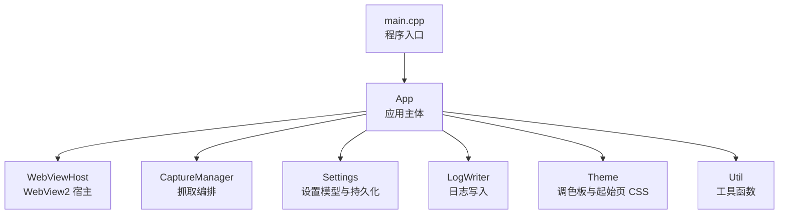
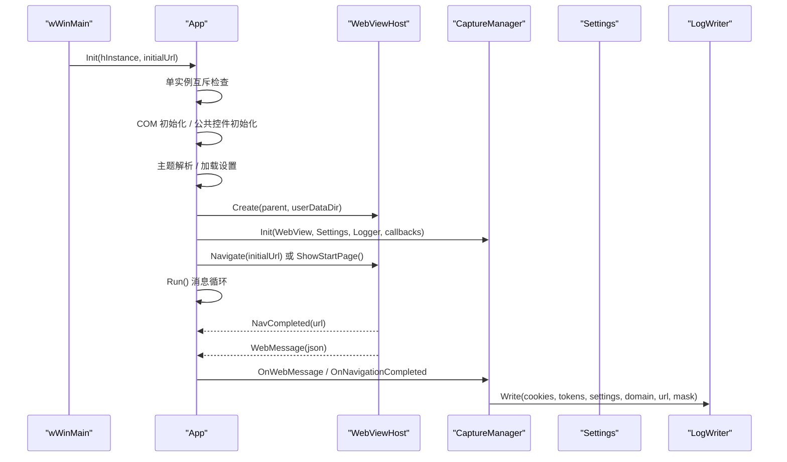
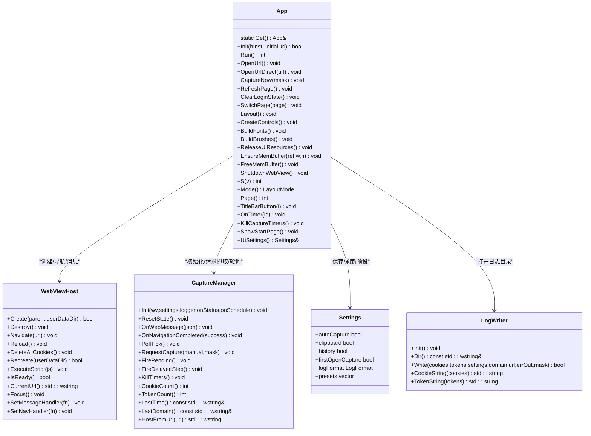
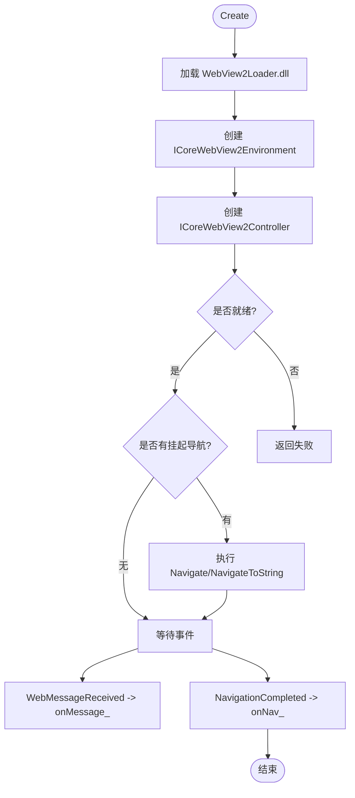
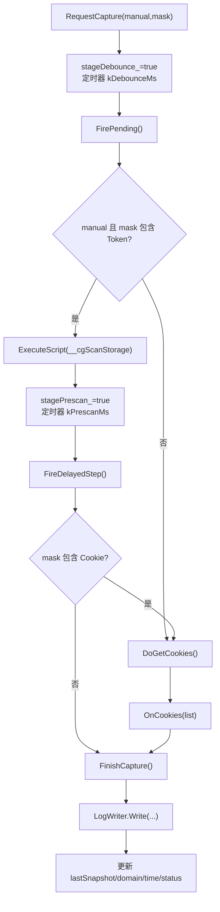
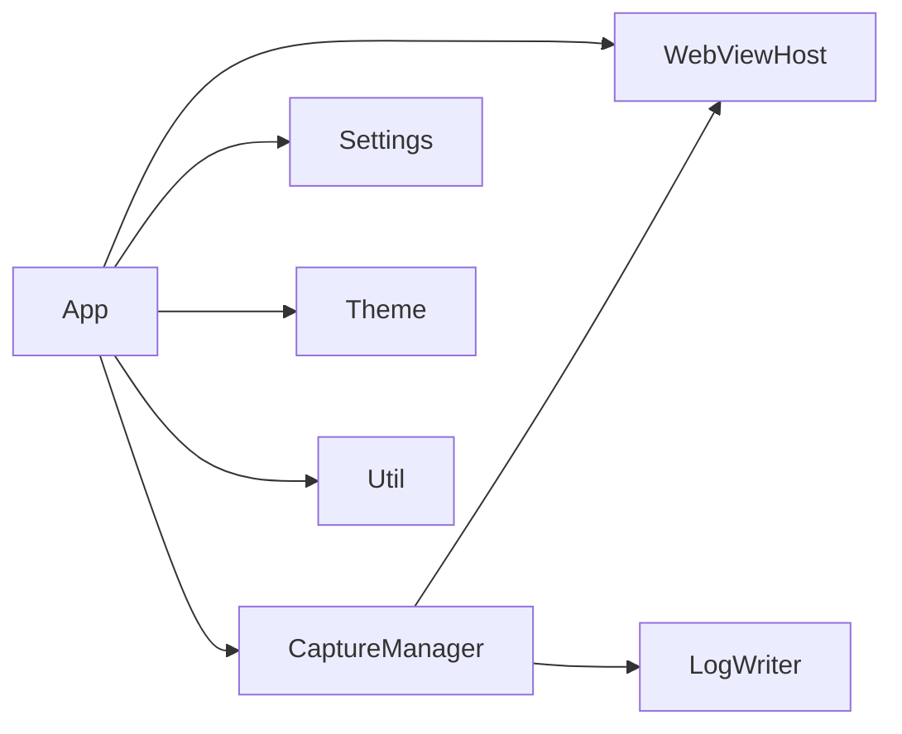

# 应用主体模块

<cite>
**本文引用的文件**   
- [app.h](file://src/app.h)
- [app.cpp](file://src/app.cpp)
- [webview.h](file://src/webview.h)
- [webview.cpp](file://src/webview.cpp)
- [capture.h](file://src/capture.h)
- [capture.cpp](file://src/capture.cpp)
- [settings.h](file://src/settings.h)
- [settings.cpp](file://src/settings.cpp)
- [logwriter.h](file://src/logwriter.h)
- [logwriter.cpp](file://src/logwriter.cpp)
- [main.cpp](file://src/main.cpp)
</cite>

## 目录
1. [引言](#引言)
2. [项目结构](#项目结构)
3. [核心组件](#核心组件)
4. [架构总览](#架构总览)
5. [详细组件分析](#详细组件分析)
6. [依赖关系分析](#依赖关系分析)
7. [性能与内存管理](#性能与内存管理)
8. [故障排查指南](#故障排查指南)
9. [结论](#结论)
10. [附录：关键流程示例](#附录关键流程示例)

## 引言
本文件为 App 类（应用主体）的技术文档，聚焦以下目标：
- 生命周期管理：单实例、COM 初始化、窗口创建、消息循环、资源释放。
- 窗口控制：无边框窗口、标题栏按钮、拖拽/缩放边框、DPI 感知与缩放。
- 响应式布局：LayoutExpanded / LayoutCompact / LayoutNarrow 三档布局。
- 双缓冲绘制：内存 DC + 位图缓存，尺寸变化时重建，失败时降级。
- 控件管理与事件处理：自绘导航标签、按钮、开关、分段选择、滚动条。
- 模块协作：WebViewHost、CaptureManager、Settings、LogWriter。
- 错误处理策略与性能优化建议，特别是内存管理与资源释放最佳实践。

## 项目结构
App 类位于 src/app.h 与 src/app.cpp，作为 Win32 GUI 的编排中心，负责：
- 主窗口注册、创建、消息循环。
- 主题解析、字体/画刷构建、控件创建与布局。
- WebView2 宿主封装、抓取编排、设置持久化、日志写入。
- 用户交互、页面切换、状态行更新。

图表来源
- [main.cpp:6-18](file://src/main.cpp#L6-L18)
- [app.h:15-183](file://src/app.h#L15-L183)
- [webview.h:11-70](file://src/webview.h#L11-L70)
- [capture.h:10-63](file://src/capture.h#L10-L63)
- [settings.h:6-25](file://src/settings.h#L6-L25)
- [logwriter.h:10-52](file://src/logwriter.h#L10-L52)

章节来源
- [main.cpp:1-20](file://src/main.cpp#L1-L20)
- [app.h:1-183](file://src/app.h#L1-L183)

## 核心组件
- App：应用主体，单例模式，负责 UI 生命周期、布局、事件、状态、与子模块协调。
- WebViewHost：WebView2 环境/控制器创建、导航、脚本注入、Cookie 读取、消息桥接。
- CaptureManager：Token 三通道汇总、Cookie 拉取、登录态检测、自动抓取防抖。
- Settings：设置模型、预设列表、JSON 持久化。
- LogWriter：多格式日志输出（字符串/JSON/明细）、历史追加、原子写入。

章节来源
- [app.h:15-183](file://src/app.h#L15-L183)
- [webview.h:11-70](file://src/webview.h#L11-L70)
- [capture.h:10-63](file://src/capture.h#L10-L63)
- [settings.h:6-25](file://src/settings.h#L6-L25)
- [logwriter.h:10-52](file://src/logwriter.h#L10-L52)

## 架构总览
App 通过单例获取实例，在 wWinMain 中完成初始化并进入消息循环。WebViewHost 提供浏览器能力；CaptureManager 基于 WebViewHost 异步获取 Cookie 并监听 Token；Settings 提供配置；LogWriter 将结果落盘。

图表来源
- [main.cpp:6-18](file://src/main.cpp#L6-L18)
- [app.cpp:66-173](file://src/app.cpp#L66-L173)
- [webview.cpp:217-296](file://src/webview.cpp#L217-L296)
- [capture.cpp:14-21](file://src/capture.cpp#L14-L21)
- [logwriter.cpp:35-142](file://src/logwriter.cpp#L35-L142)

## 详细组件分析

### App 类：生命周期、窗口控制与模块编排
- 单例模式：静态局部变量保证线程安全构造，Get() 返回引用。
- 初始化流程：
  - 单实例互斥体 Local\CookieGrabberSingleInstance，已存在则激活已有窗口。
  - COM STA 初始化，公共控件初始化。
  - 主题解析（theme::Resolve），设置加载（LoadSettings）。
  - 主窗口创建、DWM 圆角与边框色、居中显示。
  - WebViewHost 创建与回调绑定，CaptureManager 初始化。
  - 初始 URL 导航或显示起始页。
- 运行循环：
  - GetMessage/TranslateMessage/DispatchMessage。
  - 地址框回车触发 OpenUrl。
- DPI 感知与缩放：
  - WM_DPICHANGED 中更新 dpi_，重建字体/画刷，ApplyFonts，Layout，重绘。
  - S(v) 使用 MulDiv 进行 DPI 换算。
- 响应式布局：
  - 根据客户区宽度判定 LayoutExpanded / LayoutCompact / LayoutNarrow。
  - 顶部导航标签、全宽状态栏、内容区卡片布局。
  - 设置页表单几何计算与滚动裁剪。
- 双缓冲绘制：
  - EnsureMemBuffer 按需分配内存 DC 与位图，FreeMemBuffer 释放。
  - WM_PAINT 优先使用 MemDC 绘制后 BitBlt，失败时直接绘制。
- 控件管理：
  - 自绘导航标签、现代按钮、开关复选、分段单选。
  - 悬停跟踪、焦点矩形、自定义滚动条。
- 状态管理：
  - caption/status/hint 文本、Cookie/Token 计数、日志路径。
  - 开关 toggleOn_、分段 segSel_。
- 模块协调：
  - WebViewHost：SetMessageHandler/SetNavHandler，Navigate/Reload/DeleteAllCookies/Recreate。
  - CaptureManager：RequestCapture/PollTick/FirePending/FireDelayedStep。
  - Settings：SaveUiSettings/RefreshPresetList。
  - LogWriter：OpenLogFolder 打开日志目录。

图表来源
- [app.h:15-183](file://src/app.h#L15-L183)
- [webview.h:11-70](file://src/webview.h#L11-L70)
- [capture.h:10-63](file://src/capture.h#L10-L63)
- [settings.h:6-25](file://src/settings.h#L6-L25)
- [logwriter.h:10-52](file://src/logwriter.h#L10-L52)

章节来源
- [app.h:15-183](file://src/app.h#L15-L183)
- [app.cpp:66-173](file://src/app.cpp#L66-L173)
- [app.cpp:175-187](file://src/app.cpp#L175-L187)
- [app.cpp:191-212](file://src/app.cpp#L191-L212)
- [app.cpp:218-272](file://src/app.cpp#L218-L272)
- [app.cpp:274-347](file://src/app.cpp#L274-L347)
- [app.cpp:379-538](file://src/app.cpp#L379-L538)
- [app.cpp:540-561](file://src/app.cpp#L540-L561)
- [app.cpp:563-581](file://src/app.cpp#L563-L581)
- [app.cpp:583-598](file://src/app.cpp#L583-L598)
- [app.cpp:600-637](file://src/app.cpp#L600-L637)
- [app.cpp:639-700](file://src/app.cpp#L639-L700)
- [app.cpp:702-747](file://src/app.cpp#L702-L747)
- [app.cpp:749-821](file://src/app.cpp#L749-L821)
- [app.cpp:1034-1217](file://src/app.cpp#L1034-L1217)
- [app.cpp:1220-1567](file://src/app.cpp#L1220-L1567)

### WebViewHost：WebView2 宿主封装
- 环境/控制器创建：动态加载 WebView2Loader.dll（优先 exe 同目录，否则释放内嵌资源到临时目录）。
- 导航与脚本：Navigate/NavigateToString/Reload/ExecuteScript，支持控制器未就绪时挂起待执行。
- 消息与导航回调：WebMessageReceived/NavigationCompleted 回调转发至 App。
- Cookie 管理：GetCookies 异步获取，DeleteAllCookies 清理当前配置 Cookie。
- 重建会话：Recreate 关闭旧控制器与环境，删除数据目录后重新创建。
- Token 捕获 JS：注入 fetch/XMLHttpRequest/storage 钩子，扫描请求头与响应体中的 Token。

图表来源
- [webview.cpp:185-214](file://src/webview.cpp#L185-L214)
- [webview.cpp:217-296](file://src/webview.cpp#L217-L296)
- [webview.cpp:298-310](file://src/webview.cpp#L298-L310)
- [webview.cpp:312-342](file://src/webview.cpp#L312-L342)
- [webview.cpp:344-383](file://src/webview.cpp#L344-L383)
- [webview.cpp:385-430](file://src/webview.cpp#L385-L430)
- [webview.cpp:433-536](file://src/webview.cpp#L433-L536)

章节来源
- [webview.h:11-70](file://src/webview.h#L11-L70)
- [webview.cpp:185-214](file://src/webview.cpp#L185-L214)
- [webview.cpp:217-296](file://src/webview.cpp#L217-L296)
- [webview.cpp:298-310](file://src/webview.cpp#L298-L310)
- [webview.cpp:312-342](file://src/webview.cpp#L312-L342)
- [webview.cpp:344-383](file://src/webview.cpp#L344-L383)
- [webview.cpp:385-430](file://src/webview.cpp#L385-L430)
- [webview.cpp:433-536](file://src/webview.cpp#L433-L536)

### CaptureManager：抓取编排与状态机
- 初始化：绑定 WebViewHost、Settings、LogWriter 与回调。
- 消息处理：OnWebMessage 解析 JSON，合并同名 Token，必要时触发 RequestCapture。
- 导航完成：首次导航完成后根据 firstOpenCapture 标记首次抓取；域名切换清空 Token 累积。
- 轮询：PollTick 定时比较 Cookie 快照差异，触发 RequestCapture。
- 防抖与预扫描：RequestCapture 合并掩码，延迟触发 FirePending；手动抓取含 Token 时先执行存储扫描。
- 抓取流程：DoGetCookies 获取 Cookie，FinishCapture 按掩码写日志并更新状态。
- 登录态检测：IsLoggedIn 基于 Cookie 名关键词判断。

图表来源
- [capture.cpp:14-21](file://src/capture.cpp#L14-L21)
- [capture.cpp:58-87](file://src/capture.cpp#L58-L87)
- [capture.cpp:89-102](file://src/capture.cpp#L89-L102)
- [capture.cpp:104-133](file://src/capture.cpp#L104-L133)
- [capture.cpp:135-162](file://src/capture.cpp#L135-L162)
- [capture.cpp:164-182](file://src/capture.cpp#L164-L182)
- [capture.cpp:184-232](file://src/capture.cpp#L184-L232)
- [capture.cpp:234-252](file://src/capture.cpp#L234-L252)

章节来源
- [capture.h:10-63](file://src/capture.h#L10-L63)
- [capture.cpp:1-253](file://src/capture.cpp#L1-L253)

### Settings：设置模型与持久化
- 默认预设：微博、知乎、B站、GitHub。
- 加载：从 %LOCALAPPDATA%\CookieGrabber\settings.json 解析布尔值、枚举、预设数组。
- 保存：pretty JSON，原子写入。

章节来源
- [settings.h:6-25](file://src/settings.h#L6-L25)
- [settings.cpp:1-76](file://src/settings.cpp#L1-L76)

### LogWriter：日志写入
- 输出文件：cookie.log（字符串）、cookie.json（扁平）、cookie_detail.json（结构化）、cookie_history.log（追加）。
- 原子写入：覆盖文件使用临时文件+原子替换，避免损坏。
- 进程内互斥：std::mutex 保护 Write。
- 时间戳：ISO8601 UTC 与本地日志时间。

章节来源
- [logwriter.h:10-52](file://src/logwriter.h#L10-L52)
- [logwriter.cpp:1-144](file://src/logwriter.cpp#L1-L144)

## 依赖关系分析
- App 依赖 WebViewHost 进行网页渲染与交互。
- App 依赖 CaptureManager 进行抓取编排。
- CaptureManager 依赖 WebViewHost 获取 Cookie 与执行脚本。
- App 依赖 Settings 进行配置读写。
- CaptureManager 依赖 LogWriter 进行日志落盘。
- App 依赖 theme/util 等辅助模块。

图表来源
- [app.h:15-183](file://src/app.h#L15-L183)
- [webview.h:11-70](file://src/webview.h#L11-L70)
- [capture.h:10-63](file://src/capture.h#L10-L63)
- [settings.h:6-25](file://src/settings.h#L6-L25)
- [logwriter.h:10-52](file://src/logwriter.h#L10-L52)

章节来源
- [app.h:15-183](file://src/app.h#L15-L183)
- [webview.h:11-70](file://src/webview.h#L11-L70)
- [capture.h:10-63](file://src/capture.h#L10-L63)
- [settings.h:6-25](file://src/settings.h#L6-L25)
- [logwriter.h:10-52](file://src/logwriter.h#L10-L52)

## 性能与内存管理
- 双缓冲绘制：
  - 内存 DC 与位图仅在尺寸变化时重建，减少频繁分配开销。
  - 分配失败时降级为直接绘制，确保内容正确。
- DPI 感知：
  - WM_DPICHANGED 中重建字体/画刷，避免模糊与错位。
- 滚动优化：
  - 设置页滚动合并滚轮事件，只渲染最终位置。
  - 子控件部分可见时使用 HRGN 裁剪，避免残影。
- 资源释放：
  - ReleaseUiResources 释放字体/画刷/画笔。
  - FreeMemBuffer 释放内存 DC/位图。
  - ShutdownWebView 销毁 WebView2 环境与控制器。
  - Destroy 中释放 WebViewHost 所有 COM 对象与加载器 DLL。
- 日志写入：
  - 原子写入避免文件损坏。
  - 进程内互斥避免并发写冲突。

章节来源
- [app.cpp:191-212](file://src/app.cpp#L191-L212)
- [app.cpp:218-272](file://src/app.cpp#L218-L272)
- [app.cpp:1254-1265](file://src/app.cpp#L1254-L1265)
- [app.cpp:1467-1478](file://src/app.cpp#L1467-L1478)
- [webview.cpp:241-252](file://src/webview.cpp#L241-L252)
- [logwriter.cpp:35-142](file://src/logwriter.cpp#L35-L142)

## 故障排查指南
- WebView2 运行时未安装：
  - 现象：初始化失败，提示“WebView2 运行时可能未安装”。
  - 处理：安装 Edge WebView2 运行时后重试。
- WebView2 初始化失败：
  - 现象：轮询多次未就绪，状态行提示“WebView2 初始化失败”。
  - 处理：确认运行时安装与权限，重启应用。
- 清除登录状态失败：
  - 现象：数据目录残留，提示需重启应用。
  - 处理：重启应用以完全清除。
- 日志写入失败：
  - 现象：状态行提示“抓取完成但写日志失败”，附带错误信息。
  - 处理：检查日志目录权限与磁盘空间。
- 单实例冲突：
  - 现象：再次启动时提示“已在运行中”或激活已有窗口。
  - 处理：关闭已有实例或检查互斥体命名冲突。

章节来源
- [main.cpp:14-17](file://src/main.cpp#L14-L17)
- [app.cpp:70-83](file://src/app.cpp#L70-L83)
- [app.cpp:711-726](file://src/app.cpp#L711-L726)
- [app.cpp:600-637](file://src/app.cpp#L600-L637)
- [capture.cpp:216-218](file://src/capture.cpp#L216-L218)

## 结论
App 类作为应用主体，实现了完整的 Win32 GUI 生命周期管理、无边框窗口控制、DPI 感知与响应式布局，并通过 WebViewHost、CaptureManager、Settings、LogWriter 等模块协同完成 Cookie/Token 抓取与日志输出。其单例模式、双缓冲绘制、防抖机制与资源释放策略确保了良好的用户体验与系统稳定性。

## 附录：关键流程示例

### 初始化应用
- 入口 wWinMain 解析命令行参数，调用 App::Get().Init(hInstance, initialUrl)。
- App::Init 完成单实例检查、COM 初始化、主题解析、设置加载、主窗口创建、WebViewHost 创建、CaptureManager 初始化、导航或起始页显示。

章节来源
- [main.cpp:6-18](file://src/main.cpp#L6-L18)
- [app.cpp:66-173](file://src/app.cpp#L66-L173)

### 处理用户交互
- 地址框回车：OpenUrl -> OpenUrlDirect -> SwitchPage(0) -> webview_.Navigate(url)。
- 点击“立即抓取Cookie”：CaptureNow(1) -> capture_.RequestCapture(true, 1)。
- 点击“立即抓取Token”：CaptureNow(2) -> capture_.RequestCapture(true, 2)。
- 点击“刷新”：RefreshPage -> SwitchPage(0) -> webview_.Reload()。

章节来源
- [app.cpp:175-187](file://src/app.cpp#L175-L187)
- [app.cpp:563-598](file://src/app.cpp#L563-L598)
- [app.cpp:583-586](file://src/app.cpp#L583-L586)

### 管理页面切换
- SwitchPage(page) 隐藏/显示对应控件，重置滚动，布局并重绘导航标签。
- 浏览器页：工具栏卡片 + Web 卡片。
- 设置页：表单卡片 + 滚动条。
- 说明页：帮助文本。

章节来源
- [app.cpp:540-561](file://src/app.cpp#L540-L561)
- [app.cpp:379-538](file://src/app.cpp#L379-L538)
- [app.cpp:1190-1216](file://src/app.cpp#L1190-L1216)