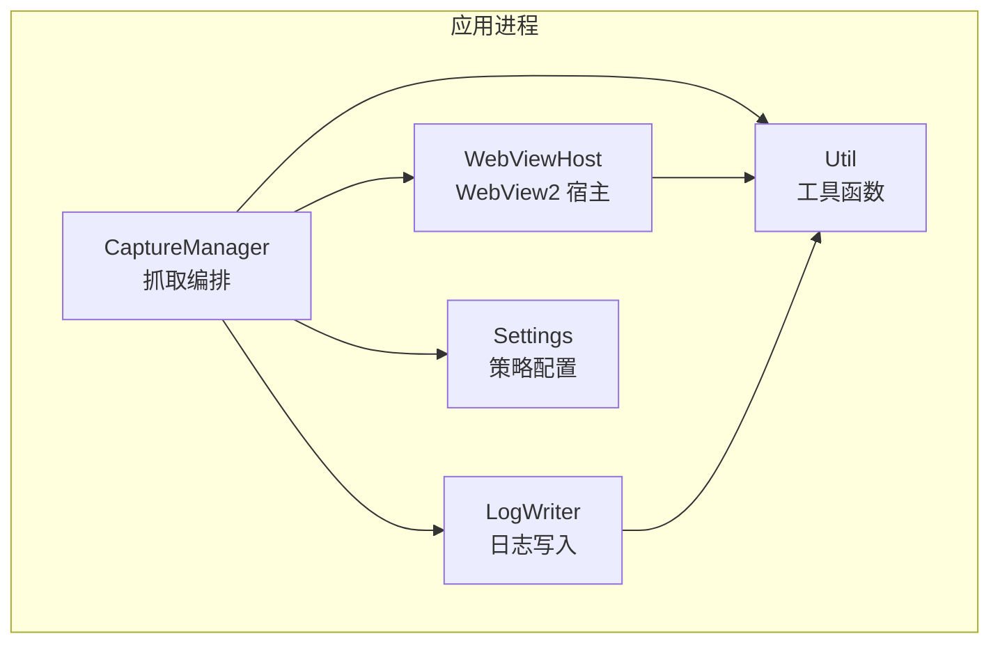
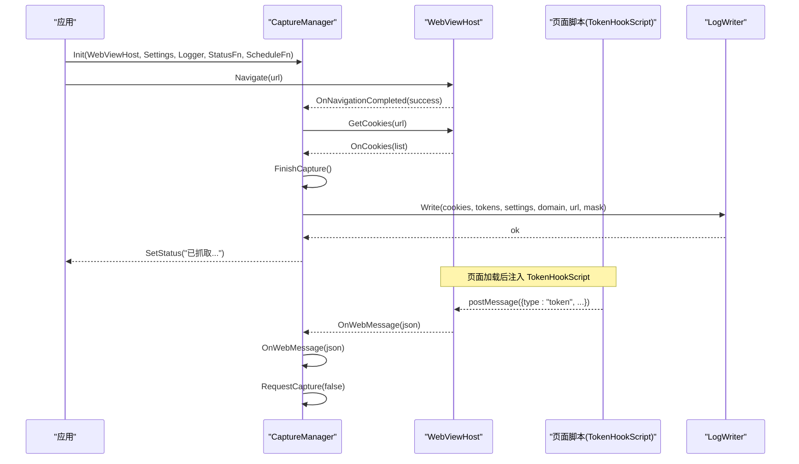
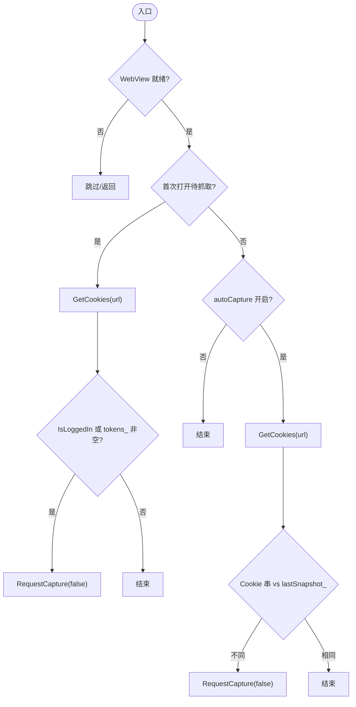
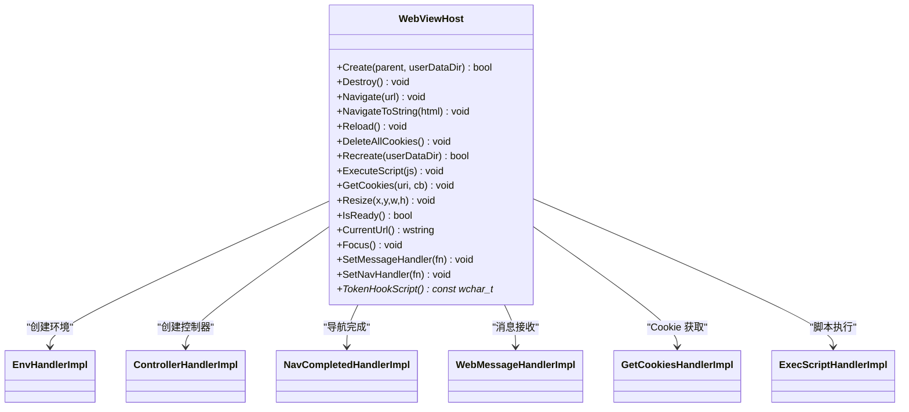
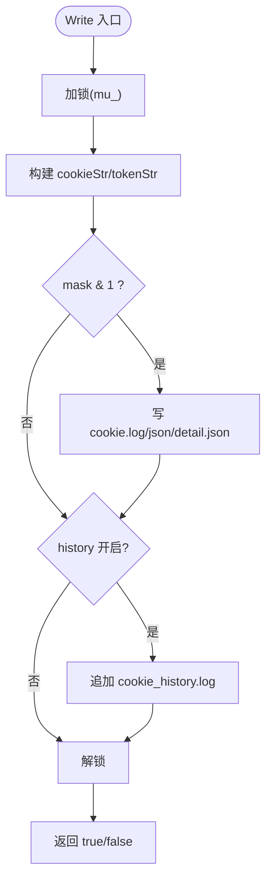
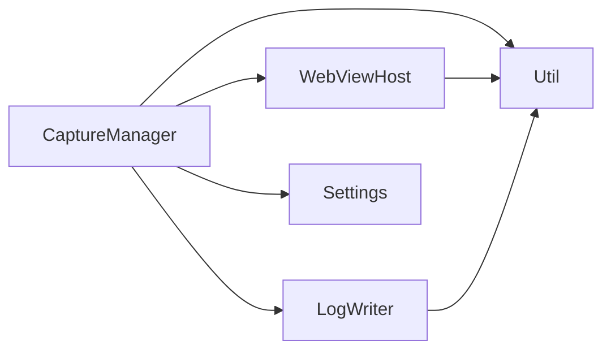

# 抓取管理器模块

<cite>
**本文引用的文件**   
- [capture.h](file://src/capture.h)
- [capture.cpp](file://src/capture.cpp)
- [webview.h](file://src/webview.h)
- [webview.cpp](file://src/webview.cpp)
- [logwriter.h](file://src/logwriter.h)
- [logwriter.cpp](file://src/logwriter.cpp)
- [settings.h](file://src/settings.h)
- [util.h](file://src/util.h)
</cite>

## 目录
1. [引言](#引言)
2. [项目结构](#项目结构)
3. [核心组件](#核心组件)
4. [架构总览](#架构总览)
5. [详细组件分析](#详细组件分析)
6. [依赖关系分析](#依赖关系分析)
7. [性能与精度调优](#性能与精度调优)
8. [故障排查指南](#故障排查指南)
9. [结论](#结论)
10. [附录：使用示例与最佳实践](#附录使用示例与最佳实践)

## 引言
本模块围绕 CaptureManager 类，实现“智能抓取”能力：自动检测登录态、防抖合并抓取请求、预扫描存储、Token 三通道捕获（Cookie、localStorage/sessionStorage、请求头），并输出 Cookie/Token 到日志与剪贴板。WebViewHost 负责 WebView2 环境、控制器、脚本注入、消息桥接与 Cookie 读取；LogWriter 负责多格式日志写入与历史追加；Settings 提供行为开关；Util 提供通用工具。

该文档面向开发者与高级用户，既给出高层架构说明，也深入到算法、状态机、数据流与错误处理细节，并提供可操作的配置与排错建议。

## 项目结构
本项目采用分层组织：
- 视图层：WebViewHost 封装 WebView2，提供导航、脚本执行、消息回调与 Cookie 获取。
- 业务编排层：CaptureManager 协调抓取流程、防抖、预扫描、状态比对与结果落盘。
- 数据持久层：LogWriter 统一写 Cookie/Token 日志与历史记录。
- 配置与工具：Settings 管理策略；Util 提供字符串、时间、路径、原子写等基础能力。

**图表来源**
- [capture.h:10-63](file://src/capture.h#L10-L63)
- [webview.h:11-70](file://src/webview.h#L11-L70)
- [logwriter.h:10-52](file://src/logwriter.h#L10-L52)
- [settings.h:6-26](file://src/settings.h#L6-L26)
- [util.h:7-45](file://src/util.h#L7-L45)

**章节来源**
- [capture.h:1-64](file://src/capture.h#L1-L64)
- [webview.h:1-71](file://src/webview.h#L1-L71)
- [logwriter.h:1-53](file://src/logwriter.h#L1-L53)
- [settings.h:1-26](file://src/settings.h#L1-L26)
- [util.h:1-46](file://src/util.h#L1-L46)

## 核心组件
- CaptureManager：抓取流程编排器，负责：
  - 定时轮询 Cookie 快照变化
  - 首次打开即抓取
  - 防抖合并多次抓取请求
  - 手动抓取时先预扫描 localStorage/sessionStorage
  - Token 三通道捕获汇总（Cookie、存储、请求头）
  - 登录态检测与状态比对
  - 结果落盘与剪贴板复制
- WebViewHost：WebView2 宿主封装，负责：
  - 环境与控制器生命周期
  - 页面导航与刷新
  - JS 脚本注入（TokenHookScript）
  - WebMessage 桥接（JS→C++）
  - Cookie 异步读取
- LogWriter：日志写入器，负责：
  - CookieString/TokenString 序列化
  - cookie.log / cookie.json / cookie_detail.json 原子写
  - cookie_history.log 追加历史
  - 进程内互斥保护
- Settings：策略模型，控制自动抓取、剪贴板、历史、首次抓取、日志格式等。
- Util：通用工具，包括 UTF 转换、时间格式化、原子写、剪贴板、路径解析等。

**章节来源**
- [capture.h:10-63](file://src/capture.h#L10-L63)
- [capture.cpp:14-253](file://src/capture.cpp#L14-L253)
- [webview.h:11-70](file://src/webview.h#L11-L70)
- [webview.cpp:217-537](file://src/webview.cpp#L217-L537)
- [logwriter.h:10-52](file://src/logwriter.h#L10-L52)
- [logwriter.cpp:9-144](file://src/logwriter.cpp#L9-L144)
- [settings.h:6-26](file://src/settings.h#L6-L26)
- [util.h:7-45](file://src/util.h#L7-L45)

## 架构总览
CaptureManager 作为调度中心，通过 WebViewHost 与浏览器交互，通过 LogWriter 持久化结果，依据 Settings 决定行为。WebViewHost 在文档创建阶段注入 TokenHookScript，监听存储变更与网络请求，将 Token 以 JSON 消息回传至 C++ 侧。

**图表来源**
- [capture.cpp:14-253](file://src/capture.cpp#L14-L253)
- [webview.cpp:217-537](file://src/webview.cpp#L217-L537)
- [logwriter.cpp:35-144](file://src/logwriter.cpp#L35-L144)

## 详细组件分析

### CaptureManager：抓取编排与状态机
CaptureManager 维护以下关键状态：
- lastCookies_：最近一次 Cookie 快照
- lastSnapshot_：上次成功写入的 Cookie 串（用于变更检测）
- tokens_：当前域名的 Token 列表
- currentHost_：当前域名（切换域名时清空 Token）
- firstNavDone_/firstOpenPending_：首次导航完成与首次打开待抓取标志
- stageDebounce_/stagePrescan_：防抖与预扫描阶段标志
- manualNext_/maskNext_：是否手动触发与本次掩码（1=Cookie，2=Token）
- pollInFlight_/captureInFlight_：轮询与抓取中标志
- tokensDirty_：Token 集合是否发生变化

核心方法职责：
- Init：绑定 WebViewHost、Settings、Logger、状态回调与定时器调度。
- ResetState：清理所有状态与定时器，用于登出或会话重建后重置。
- HostFromUrl：从 URL 提取主机名，忽略端口与认证信息。
- OnWebMessage：解析 JS 传来的 Token 消息，去重更新 tokens_，必要时触发自动抓取。
- OnNavigationCompleted：首次导航完成后根据设置决定是否等待首次抓取；域名切换时清空 Token 与快照。
- PollTick：定时轮询 Cookie 快照，若变化则触发抓取；首次打开时主动拉取 Cookie 并判断登录态。
- RequestCapture：合并掩码并进入防抖窗口；若为手动且含 Token，先执行预扫描再拉 Cookie。
- FirePending/FireDelayedStep：防抖到期与预扫描到期后的分支逻辑。
- DoGetCookies/OnCookies：发起 Cookie 获取并更新 lastCookies_ 与计数。
- FinishCapture：变更检测、写日志、更新 lastSnapshot_/lastDomain_/lastTime_，可选复制到剪贴板。
- IsLoggedIn：基于 Cookie 名称关键字判断是否已登录。
- KillTimers：清理阶段标志与飞行标志。

**图表来源**
- [capture.cpp:104-175](file://src/capture.cpp#L104-L175)

**章节来源**
- [capture.h:10-63](file://src/capture.h#L10-L63)
- [capture.cpp:14-253](file://src/capture.cpp#L14-L253)

### WebViewHost：WebView2 宿主与 Token 钩子
WebViewHost 的职责：
- 创建/销毁 WebView2 环境与控制器，支持重建（删除数据目录后重新初始化）。
- 导航与刷新页面，挂起未就绪时的导航请求。
- 注入 TokenHookScript，在文档创建时执行，拦截 fetch/XMLHttpRequest、监听 storage 事件、周期性扫描 localStorage/sessionStorage。
- 通过 WebMessageReceived 将 JS 捕获的 Token 消息转发给上层（CaptureManager）。
- 通过 CookieManager 异步获取 Cookie 列表，转换为 CookieItem 数组。

TokenHookScript 关键点：
- TOKEN_KEY_RE：匹配 token/jwt 键名。
- TOKEN_HEADERS：常见授权相关请求头白名单。
- scanObject：递归扫描对象字段，发现疑似 Token 值则上报。
- scanStorage：扫描 localStorage/sessionStorage。
- __cgScanStorage：供外部调用进行一次性扫描。
- fetch/XHR 拦截：捕获请求头与响应体中的 Token。
- 去重 seen：避免重复上报，限制内存占用。
- 定时扫描：每 3 秒扫描一次存储。

**图表来源**
- [webview.h:11-70](file://src/webview.h#L11-L70)
- [webview.cpp:15-182](file://src/webview.cpp#L15-L182)

**章节来源**
- [webview.h:1-71](file://src/webview.h#L1-L71)
- [webview.cpp:217-537](file://src/webview.cpp#L217-L537)

### LogWriter：日志结构与写入策略
LogWriter 提供两种静态序列化方法与统一的 Write 接口：
- CookieString：将 CookieItem 序列化为 "name=value; name=value" 字符串。
- TokenString：将 TokenItem 序列化为 "name=value; name=value" 字符串。
- Write：按 mask 选择写入目标：
  - cookie.log：字符串格式（首行时间，第二行 Cookie 串）。
  - cookie.json：扁平简洁型，包含 time/domain/url/cookie/token。
  - cookie_detail.json：结构化明细型，包含 cookies 数组与 tokens 数组。
  - cookie_history.log：追加历史，记录 domain/url/cookies/tokens 数量及内容。
- 原子写：对覆盖型文件使用临时文件+MoveFileEx 替换，保证一致性。
- 进程内互斥：使用 std::mutex 保护并发写入。

数据结构：
- CookieItem：name/value/domain/path/expires/httpOnly/secure/isSession/sameSite。
- TokenItem：name/value/source/url/capturedAt。

**图表来源**
- [logwriter.cpp:35-144](file://src/logwriter.cpp#L35-L144)

**章节来源**
- [logwriter.h:10-52](file://src/logwriter.h#L10-L52)
- [logwriter.cpp:9-144](file://src/logwriter.cpp#L9-L144)

### Settings 与 Util：策略与工具
- Settings：
  - autoCapture：检测到登录态变化自动抓取。
  - clipboard：抓取后复制到剪贴板。
  - history：追加 cookie_history.log。
  - firstOpenCapture：首次打开即抓取。
  - logFormat：String/Json/Both。
- Util：
  - Utf8ToWide/WideToUtf8：编码转换。
  - NowLogTime/NowIsoUtc/CookieExpiresToIso：时间格式化。
  - ResolveLogDir/WriteFileAtomic/AppendFile：日志目录与原子写。
  - SetClipboardText：剪贴板操作。
  - ToLower/StartsWithI：字符串比较与转换。

**章节来源**
- [settings.h:6-26](file://src/settings.h#L6-L26)
- [util.h:7-45](file://src/util.h#L7-L45)

## 依赖关系分析
- CaptureManager 依赖：
  - WebViewHost：IsReady/CurrentUrl/GetCookies/ExecuteScript。
  - LogWriter：Write/CookieString。
  - Settings：autoCapture/clipboard/history/firstOpenCapture/logFormat。
  - Util：HostFromUrl/NowLogTime/NowIsoUtc/WideToUtf8/SetClipboardText/StartsWithI/ToLower。
- WebViewHost 依赖：
  - WebView2 COM 接口（ICoreWebView2Environment/Controller/WebView/CookieManager）。
  - Util：ModuleDir/LocalAppDir/ResolveLogDir/WriteFileAtomic/AppendFile/DirExists/DeleteDirRecursive。
- LogWriter 依赖：
  - Util：CookieExpiresToIso/NowLogTimeA/WriteFileAtomic/AppendFile。
  - Settings：LogFormat。

**图表来源**
- [capture.cpp:1-253](file://src/capture.cpp#L1-L253)
- [webview.cpp:1-537](file://src/webview.cpp#L1-L537)
- [logwriter.cpp:1-144](file://src/logwriter.cpp#L1-L144)

**章节来源**
- [capture.cpp:1-253](file://src/capture.cpp#L1-L253)
- [webview.cpp:1-537](file://src/webview.cpp#L1-L537)
- [logwriter.cpp:1-144](file://src/logwriter.cpp#L1-L144)

## 性能与精度调优
- 防抖机制：
  - kDebounceMs = 600ms：合并短时间内的多次抓取请求，减少重复 IO 与 UI 抖动。
  - maskNext_ 采用“或”合并，保留先到的抓取范围，避免覆盖。
- 预扫描策略：
  - 手动抓取且含 Token 时，先执行 window.__cgScanStorage()，延迟 kPrescanMs = 250ms 后再拉 Cookie，确保存储扫描优先。
- 轮询间隔：
  - kPollMs = 1500ms：平衡实时性与性能，避免频繁 Cookie 查询。
- 变更检测：
  - Cookie 路径：比较 CookieString(lastCookies_) 与 lastSnapshot_。
  - Token 路径：仅当 tokensDirty_ 为真才认为有变化。
- Token 捕获精度：
  - TOKEN_KEY_RE：匹配 token/jwt 键名。
  - TOKEN_HEADERS：常见授权头白名单。
  - looksToken：长度 6~8192 的字符串判定，降低误报。
  - seen 去重：避免重复上报，限制最大条目数。
  - 响应体大小限制：4MB 以内尝试 JSON 解析，防止大响应阻塞。
- 域名隔离：
  - 切换域名时清空 tokens_ 与 lastSnapshot_，避免跨域污染。
- 日志原子写：
  - 覆盖型文件使用临时文件+MoveFileEx，保证一致性与完整性。
- 剪贴板：
  - 仅在 Cookie 抓取路径下启用，避免 Token 直接暴露到剪贴板。

优化建议：
- 调整 kDebounceMs/kPollMs/kPrescanMs 以适应不同网站加载速度。
- 扩展 TOKEN_HEADERS 白名单以适配自定义头。
- 调整 TOKEN_KEY_RE 正则以适配更多命名约定。
- 关闭 history 或 logFormat=Json 以减少磁盘 IO。
- 禁用 clipboard 以避免剪贴板失败影响用户体验。

**章节来源**
- [capture.cpp:9-13](file://src/capture.cpp#L9-L13)
- [capture.cpp:135-162](file://src/capture.cpp#L135-L162)
- [capture.cpp:184-232](file://src/capture.cpp#L184-L232)
- [webview.cpp:433-535](file://src/webview.cpp#L433-L535)
- [logwriter.cpp:35-144](file://src/logwriter.cpp#L35-L144)

## 故障排查指南
常见问题与解决方案：
- 页面为空或非 http/https/file：
  - 现象：提示“尚未打开页面，无法抓取”或“当前页面不支持抓取”。
  - 原因：URL 为空或协议不被支持。
  - 解决：确保已导航到有效页面。
- 首次打开未抓取：
  - 检查 Settings.firstOpenCapture 是否为真。
  - 确认 OnNavigationCompleted 被触发且 firstNavDone_ 置位。
- 自动抓取不生效：
  - 检查 Settings.autoCapture 是否为真。
  - 确认 PollTick 未被 captureInFlight_ 或 pollInFlight_ 阻止。
- Cookie 无变化但 Token 有变化：
  - 现象：提示“登录状态无变化”，但 Token 已更新。
  - 原因：仅 Cookie 路径比较 CookieString，Token 路径看 tokensDirty_。
  - 解决：手动触发抓取或等待下一次 Token 变更。
- 写日志失败：
  - 现象：提示“抓取完成但写日志失败: ...”。
  - 原因：权限不足、路径不可写、磁盘空间不足。
  - 解决：检查日志目录权限与可用空间，或使用 ResolveLogDir 回退路径。
- 剪贴板复制失败：
  - 现象：提示“已抓取 Cookie（剪贴板复制失败）”。
  - 原因：剪贴板被占用或权限问题。
  - 解决：重试或禁用 clipboard。
- WebView2 环境创建失败：
  - 现象：Create 返回 false。
  - 原因：WebView2Loader.dll 缺失或加载失败。
  - 解决：确保 exe 同目录存在 WebView2Loader.dll，或允许释放到 %TEMP%\CookieGrabber。
- 域名切换导致 Token 丢失：
  - 现象：切换域名后 tokens_ 清空。
  - 原因：设计如此，避免跨域污染。
  - 解决：在同一域名下聚合 Token，或分别管理多个域名。

定位步骤：
- 查看 cookie_history.log 记录的时间、domain、url、cookies/tokens 数量。
- 检查 cookie.json/cookie_detail.json 的结构化内容。
- 观察 UI 状态回调（SetStatus）输出。
- 确认 WebViewHost.TokenHookScript 是否注入成功（可通过控制台检查 window.__cgInstalled）。

**章节来源**
- [capture.cpp:164-175](file://src/capture.cpp#L164-L175)
- [capture.cpp:184-232](file://src/capture.cpp#L184-L232)
- [webview.cpp:217-239](file://src/webview.cpp#L217-L239)
- [webview.cpp:433-535](file://src/webview.cpp#L433-L535)

## 结论
CaptureManager 通过防抖、预扫描、状态比对与 Token 三通道捕获，实现了稳定高效的智能抓取能力。WebViewHost 提供可靠的 WebView2 集成与脚本注入，LogWriter 保证日志的一致性与可读性。结合 Settings 与 Util，系统具备良好的可扩展性与可维护性。通过合理调优参数与遵循最佳实践，可在不同网站环境下获得稳定的抓取精度与性能表现。

## 附录：使用示例与最佳实践

### 启动抓取流程
- 初始化：
  - 创建 WebViewHost 实例并调用 Create(parent, userDataDir)。
  - 创建 CaptureManager 实例并调用 Init(wv, settings, logger, onStatus, onSchedule)。
  - 注册 WebViewHost 的消息与导航回调，将回调转发到 CaptureManager.OnWebMessage 与 OnNavigationCompleted。
- 导航页面：
  - 调用 WebViewHost.Navigate(url) 或 NavigateToString(html)。
- 定时轮询：
  - 使用 onSchedule(TIMER_POLL, kPollMs) 周期触发 CaptureManager.PollTick。
- 手动抓取：
  - 调用 CaptureManager.RequestCapture(true, 3) 触发手动抓取（Cookie+Token）。

参考路径：
- [capture.cpp:14-21](file://src/capture.cpp#L14-L21)
- [capture.cpp:135-156](file://src/capture.cpp#L135-L156)
- [webview.cpp:298-306](file://src/webview.cpp#L298-L306)

### 处理捕获结果
- 状态回调：
  - 通过 onStatus_ 显示“正在抓取…”、“已抓取 Cookie”、“已抓取 Token”等状态。
- 日志输出：
  - cookie.log：字符串格式，适合快速查看 Cookie。
  - cookie.json：扁平 JSON，适合自动化处理。
  - cookie_detail.json：结构化明细，适合分析与审计。
  - cookie_history.log：追加历史，便于回溯。
- 剪贴板：
  - 若 Settings.clipboard 为真，Cookie 抓取成功后自动复制到剪贴板。

参考路径：
- [capture.cpp:184-232](file://src/capture.cpp#L184-L232)
- [logwriter.cpp:35-144](file://src/logwriter.cpp#L35-L144)

### 管理历史记录
- 启用 history：
  - Settings.history = true，每次抓取会追加 cookie_history.log。
- 查看历史：
  - 打开 cookie_history.log，按时间顺序查看 domain/url/cookies/tokens。
- 清理历史：
  - 手动删除 cookie_history.log 或定期归档。

参考路径：
- [settings.h:13-20](file://src/settings.h#L13-L20)
- [logwriter.cpp:125-144](file://src/logwriter.cpp#L125-L144)

### 与 WebViewHost 的数据交互方式
- 消息桥接：
  - JS 通过 window.chrome.webview.postMessage 发送 Token 消息。
  - WebViewHost.WebMessageHandlerImpl 接收并调用 OnWebMessage。
  - CaptureManager.OnWebMessage 解析并更新 tokens_。
- Cookie 读取：
  - CaptureManager.DoGetCookies 调用 WebViewHost.GetCookies。
  - WebViewHost.GetCookiesHandlerImpl 回调 OnCookiesReady，转换为 CookieItem 数组。
- 脚本注入：
  - WebViewHost.OnControllerCreated 调用 AddScriptToExecuteOnDocumentCreated 注入 TokenHookScript。

参考路径：
- [webview.cpp:86-119](file://src/webview.cpp#L86-L119)
- [webview.cpp:141-162](file://src/webview.cpp#L141-L162)
- [webview.cpp:393-430](file://src/webview.cpp#L393-L430)
- [capture.cpp:58-87](file://src/capture.cpp#L58-L87)

### 性能优化策略
- 合理设置轮询与防抖间隔。
- 禁用不必要的日志格式（如仅 String 或仅 Json）。
- 关闭 history 以降低 IO 压力。
- 避免频繁手动抓取，利用自动抓取与防抖机制。
- 监控 TokenHookScript 的内存占用（seen 去重与大小限制）。

参考路径：
- [capture.cpp:9-13](file://src/capture.cpp#L9-L13)
- [webview.cpp:433-535](file://src/webview.cpp#L433-L535)