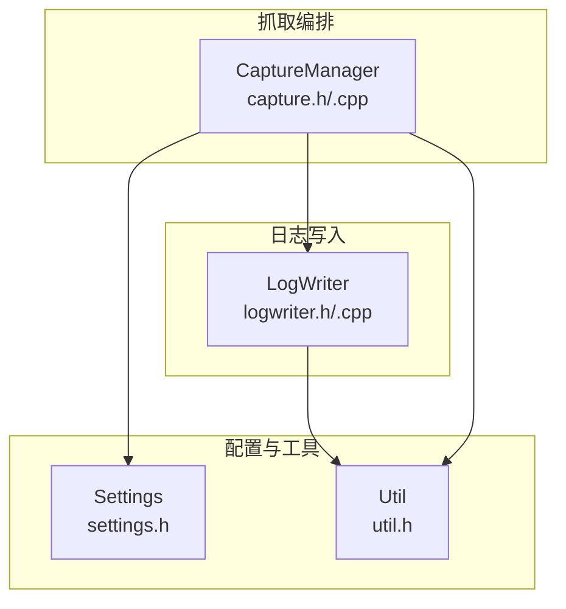
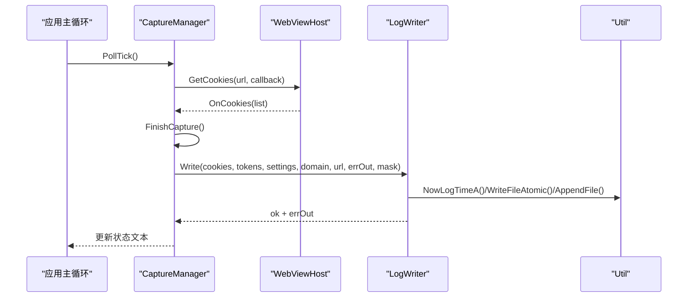
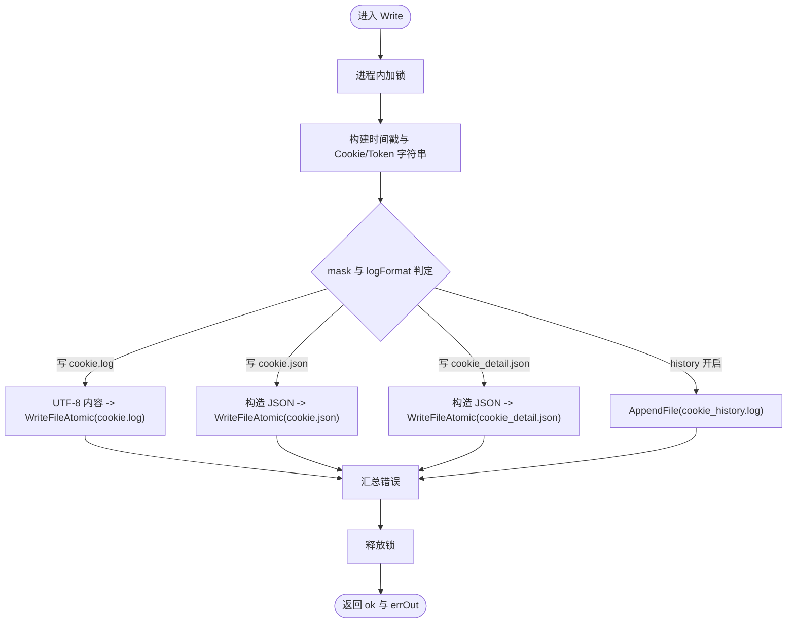
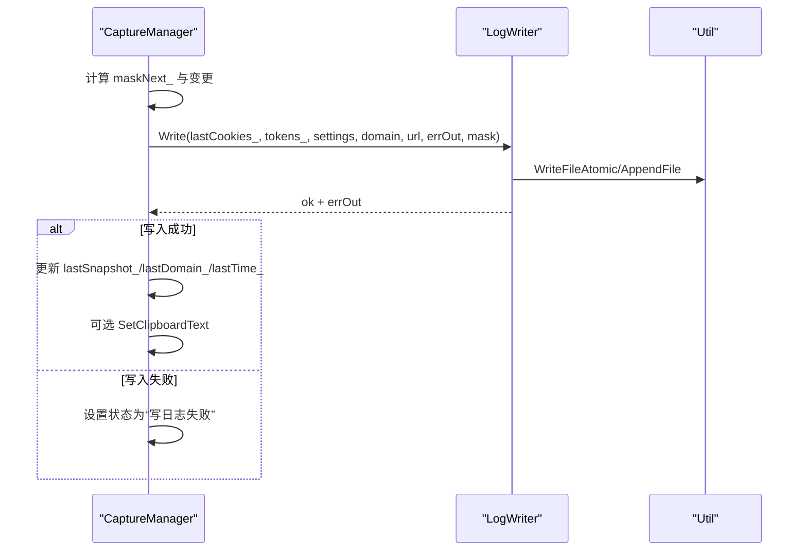
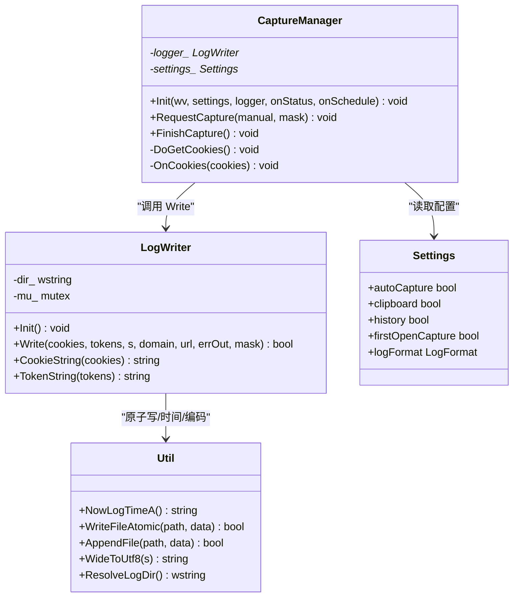

# 日志写入器模块

<cite>
**本文引用的文件**   
- [logwriter.h](file://src/logwriter.h)
- [logwriter.cpp](file://src/logwriter.cpp)
- [capture.h](file://src/capture.h)
- [capture.cpp](file://src/capture.cpp)
- [settings.h](file://src/settings.h)
- [util.h](file://src/util.h)
</cite>

## 目录
1. [简介](#简介)
2. [项目结构](#项目结构)
3. [核心组件](#核心组件)
4. [架构总览](#架构总览)
5. [详细组件分析](#详细组件分析)
6. [依赖关系分析](#依赖关系分析)
7. [性能与并发特性](#性能与并发特性)
8. [故障排查指南](#故障排查指南)
9. [结论](#结论)
10. [附录：使用示例与扩展点](#附录使用示例与扩展点)

## 简介
本模块围绕 LogWriter 类，提供多格式日志输出能力，支持字符串、JSON、混合格式；同时负责原子文件写入、进程内互斥、历史追加、时间戳与编码处理。LogWriter 与 CaptureManager 协作，在 Cookie/Token 变化时按策略写出 cookie.log、cookie.json、cookie_detail.json 与 cookie_history.log，并可通过设置控制输出格式、是否开启历史日志、是否自动抓取等。

## 项目结构
与日志写入相关的代码集中在 src 目录下：
- logwriter.h / logwriter.cpp：定义 LogWriter 及其数据模型、格式化与写入逻辑
- capture.h / capture.cpp：CaptureManager 编排抓取流程，调用 LogWriter 完成落盘
- settings.h：Settings 与 LogFormat 枚举，决定日志输出模式
- util.h：工具函数，包含时间、路径、原子写、追加写、剪贴板等

**图表来源**
- [capture.h:10-63](file://src/capture.h#L10-L63)
- [capture.cpp:14-232](file://src/capture.cpp#L14-L232)
- [logwriter.h:30-52](file://src/logwriter.h#L30-L52)
- [logwriter.cpp:31-143](file://src/logwriter.cpp#L31-L143)
- [settings.h:6-20](file://src/settings.h#L6-L20)
- [util.h:31-37](file://src/util.h#L31-L37)

**章节来源**
- [logwriter.h:1-53](file://src/logwriter.h#L1-L53)
- [logwriter.cpp:1-144](file://src/logwriter.cpp#L1-L144)
- [capture.h:1-64](file://src/capture.h#L1-L64)
- [capture.cpp:1-253](file://src/capture.cpp#L1-L253)
- [settings.h:1-26](file://src/settings.h#L1-L26)
- [util.h:1-46](file://src/util.h#L1-L46)

## 核心组件
- LogWriter：负责日志目录解析、Cookie/Token 数据到多种格式的转换、原子写入与错误聚合
- CaptureManager：负责 WebView 交互、Cookie/Token 采集、防抖与轮询、变更检测，并最终调用 LogWriter.Write
- Settings：包含日志格式（String/Json/Both）、是否启用历史日志、自动抓取、剪贴板复制等开关
- Util：提供 UTF-8/Wide 转换、时间格式化、原子写、追加写、目录解析等基础能力

关键数据结构：
- CookieItem：描述单个 Cookie 的字段（名称、值、域、路径、过期、安全标志、SameSite 等）
- TokenItem：描述单个 Token 的来源、URL、捕获时间与键值对

**章节来源**
- [logwriter.h:10-28](file://src/logwriter.h#L10-L28)
- [logwriter.h:30-52](file://src/logwriter.h#L30-L52)
- [settings.h:6-20](file://src/settings.h#L6-L20)

## 架构总览
LogWriter 作为“纯写入层”，不感知 UI 与 WebView，仅接收结构化数据与设置，输出标准化日志文件。CaptureManager 作为“编排层”，协调 WebViewHost、计时器、状态回调，并在必要时触发 LogWriter 写入。

**图表来源**
- [capture.cpp:104-133](file://src/capture.cpp#L104-L133)
- [capture.cpp:177-232](file://src/capture.cpp#L177-L232)
- [logwriter.cpp:31-143](file://src/logwriter.cpp#L31-L143)
- [util.h:31-37](file://src/util.h#L31-L37)

## 详细组件分析

### LogWriter：多格式日志输出与原子写入
职责边界：
- Init：解析日志目录（优先 exe 目录，不可写回退 %LOCALAPPDATA%\CookieGrabber\logs）
- Write：根据 mask 与 Settings::logFormat 组合，选择性写出 cookie.log、cookie.json、cookie_detail.json、cookie_history.log
- CookieString/TokenString：生成 URL 查询风格的键值串，用于 cookie.log 与 history

写入规则要点：
- cookie.log：字符串格式，首行本地时间，第二行 Cookie 串；仅在 String 或 Both 模式下输出
- cookie.json：扁平 JSON，time/domain/url/cookie/token；token 为单值字符串或多键对象；仅在 Json 或 Both 模式下输出
- cookie_detail.json：结构化明细 JSON，包含 cookies 数组与 tokens 数组；仅在 Json 或 Both 模式下输出
- cookie_history.log：追加模式，记录时间、domain、url、cookies/tokens 数量及对应串；由 Settings::history 控制

原子性与互斥：
- 所有覆盖型写入通过 util::WriteFileAtomic 实现“临时文件 + MoveFileEx 替换”的原子性
- 进程内互斥由成员 std::mutex mu_ 保证，Write 内部以 lock_guard 加锁

错误处理：
- Write 内部维护 bool ok 与 errOut，任一文件失败即标记 ok=false 并累积错误信息
- 返回给调用方（CaptureManager），由其统一提示用户

**图表来源**
- [logwriter.cpp:31-143](file://src/logwriter.cpp#L31-L143)
- [util.h:31-37](file://src/util.h#L31-L37)

**章节来源**
- [logwriter.h:30-52](file://src/logwriter.h#L30-L52)
- [logwriter.cpp:9-143](file://src/logwriter.cpp#L9-L143)
- [util.h:31-37](file://src/util.h#L31-L37)

### CaptureManager 与 LogWriter 的数据集成
集成方式：
- CaptureManager::FinishCapture 计算变更（含 Cookie 快照对比与 tokensDirty_），决定是否调用 logger_->Write
- 传入参数包括 lastCookies_、tokens_、Settings、domain、url、errOut 与 mask（1=Cookie，2=Token，3=两者）
- 成功写入后更新 lastSnapshot_、lastDomain_、lastTime_，并根据设置决定是否复制到剪贴板

变更检测策略：
- 当 mask 包含 Cookie 时，比较当前 Cookie 串与上次快照；若不同或 tokensDirty_=true，则视为变更
- 当仅 Token 时，只看 tokensDirty_

**图表来源**
- [capture.cpp:184-232](file://src/capture.cpp#L184-L232)
- [logwriter.cpp:35-143](file://src/logwriter.cpp#L35-L143)

**章节来源**
- [capture.h:10-63](file://src/capture.h#L10-L63)
- [capture.cpp:135-232](file://src/capture.cpp#L135-L232)

### 日志级别管理、格式化模板与编码处理
- 日志级别：当前未实现分级（如 DEBUG/INFO/ERROR），但通过 mask 区分 Cookie/Token 两类写入范围
- 格式化模板：
  - cookie.log：两行文本（时间、Cookie 串）
  - cookie.json：扁平对象，token 字段根据数量动态选择字符串或对象
  - cookie_detail.json：结构化数组（cookies、tokens），包含完整字段映射
- 编码处理：
  - 所有写入内容为 UTF-8 无 BOM
  - WideToUtf8 用于将宽字符转换为 UTF-8
  - CookieExpiresToIso 将 double 过期时间转为 ISO8601 字符串，会话 Cookie 返回 "session"

**章节来源**
- [logwriter.cpp:9-29](file://src/logwriter.cpp#L9-L29)
- [logwriter.cpp:55-123](file://src/logwriter.cpp#L55-L123)
- [util.h:13-19](file://src/util.h#L13-L19)

### 原子文件操作、进程内互斥、文件轮转与清理机制
- 原子文件操作：WriteFileAtomic 基于临时文件 + MoveFileEx 替换，确保覆盖写入的原子性
- 进程内互斥：LogWriter::mu_ 保证同一进程内并发写入串行化
- 文件轮转：当前未实现自动轮转（如按大小/时间切分）
- 清理机制：未实现自动清理；可借助 util::DeleteDirRecursive 进行手动清理（需外部调用）

建议扩展：
- 在 LogWriter 中增加轮转策略（按文件大小或日期）
- 在 Init 中执行一次清理任务（保留最近 N 天或 M 个文件）

**章节来源**
- [logwriter.cpp:31-143](file://src/logwriter.cpp#L31-L143)
- [util.h:27-37](file://src/util.h#L27-L37)

## 依赖关系分析
- LogWriter 依赖：
  - util：时间、路径、原子写、追加写、编码转换
  - json：mjson::Writer 用于 JSON 序列化
- CaptureManager 依赖：
  - WebViewHost：获取 Cookie、执行脚本
  - Settings：读取日志格式、历史、自动抓取等
  - LogWriter：最终写入日志

**图表来源**
- [logwriter.h:30-52](file://src/logwriter.h#L30-L52)
- [capture.h:10-63](file://src/capture.h#L10-L63)
- [settings.h:6-20](file://src/settings.h#L6-L20)
- [util.h:31-37](file://src/util.h#L31-L37)

**章节来源**
- [logwriter.h:30-52](file://src/logwriter.h#L30-L52)
- [capture.h:10-63](file://src/capture.h#L10-L63)
- [settings.h:6-20](file://src/settings.h#L6-L20)
- [util.h:31-37](file://src/util.h#L31-L37)

## 性能与并发特性
- 进程内串行写入：通过 std::mutex 避免竞争条件，代价是并发写入被串行化
- 原子写开销：每次覆盖写入会创建临时文件并进行系统级替换，适合小文件；大文件场景建议批量化或异步队列
- 变更检测优化：CaptureManager 通过 Cookie 快照与 tokensDirty_ 减少不必要的写入
- I/O 合并：当前每个 Write 可能多次调用 WriteFileAtomic/AppendFile；可考虑在 LogWriter 内部合并 I/O 以降低系统调用次数

优化建议：
- 引入写缓冲与批量提交（例如定时 flush 或达到阈值 flush）
- 对 cookie_history.log 采用顺序追加，避免频繁打开关闭句柄
- 对 JSON 序列化使用流式 Writer（已使用 mjson::Writer），避免中间字符串拼接

[本节为通用性能讨论，无需特定文件引用]

## 故障排查指南
常见问题与定位：
- 写入失败：检查 errOut 返回值，常见原因包括磁盘空间不足、权限不足、路径不可写
- 日志目录异常：确认 ResolveLogDir 选择的目录是否存在且可写；必要时回退至 %LOCALAPPDATA%\CookieGrabber\logs
- 历史日志未更新：检查 Settings::history 是否为 true
- 格式不符合预期：检查 Settings::logFormat 与 mask 的组合

调试步骤：
- 在 CaptureManager::FinishCapture 中打印 mask、domain、url、errOut
- 在 LogWriter::Write 中打印各文件的写入结果与错误信息
- 验证 util::WriteFileAtomic 与 AppendFile 的返回值

**章节来源**
- [capture.cpp:207-232](file://src/capture.cpp#L207-L232)
- [logwriter.cpp:49-53](file://src/logwriter.cpp#L49-L53)
- [util.h:31-37](file://src/util.h#L31-L37)

## 结论
LogWriter 提供了稳定、可扩展的多格式日志写入能力，结合 CaptureManager 的变更检测与防抖机制，能够在 Cookie/Token 变化时高效、可靠地输出日志。其原子写入与进程内互斥保证了数据一致性。未来可在轮转、清理、压缩归档与远程传输方面进一步扩展。

[本节为总结性内容，无需特定文件引用]

## 附录：使用示例与扩展点

### 写入不同类型的日志
- 仅 Cookie：mask=1，Settings::logFormat=String/Json/Both
- 仅 Token：mask=2，Settings::history=true 以便记录 Token 历史
- 两者：mask=3，默认行为

参考路径：
- [logwriter.cpp:55-143](file://src/logwriter.cpp#L55-L143)
- [capture.cpp:184-232](file://src/capture.cpp#L184-L232)

### 管理日志文件
- 初始化目录：调用 LogWriter::Init
- 解析目录：util::ResolveLogDir
- 删除目录：util::DeleteDirRecursive（谨慎使用）

参考路径：
- [logwriter.cpp:31-33](file://src/logwriter.cpp#L31-L33)
- [util.h:27-32](file://src/util.h#L27-L32)

### 处理写入错误
- 读取 Write 返回值与 errOut
- 在 CaptureManager 中统一提示用户

参考路径：
- [logwriter.cpp:49-53](file://src/logwriter.cpp#L49-L53)
- [capture.cpp:216-218](file://src/capture.cpp#L216-L218)

### 与 CaptureManager 的数据集成
- CaptureManager 在 FinishCapture 中调用 LogWriter::Write
- 传入 Cookies、Tokens、Settings、domain、url、errOut、mask

参考路径：
- [capture.cpp:184-232](file://src/capture.cpp#L184-L232)
- [logwriter.cpp:35-143](file://src/logwriter.cpp#L35-L143)

### 性能优化策略
- 利用变更检测减少不必要写入
- 批量化 I/O 与缓冲
- 避免重复序列化

参考路径：
- [capture.cpp:184-232](file://src/capture.cpp#L184-L232)
- [logwriter.cpp:55-143](file://src/logwriter.cpp#L55-L143)

### 日志文件的压缩归档与远程传输扩展点
- 压缩归档：可在 LogWriter 中新增方法 ArchiveAndCompress(file, archivePath)，在轮转时调用
- 远程传输：新增 UploadToRemote(file, endpoint)，在写入成功后异步上传
- 事件钩子：在 Write 完成后触发回调，便于外部接入监控与告警

[本节为概念性扩展说明，无需特定文件引用]