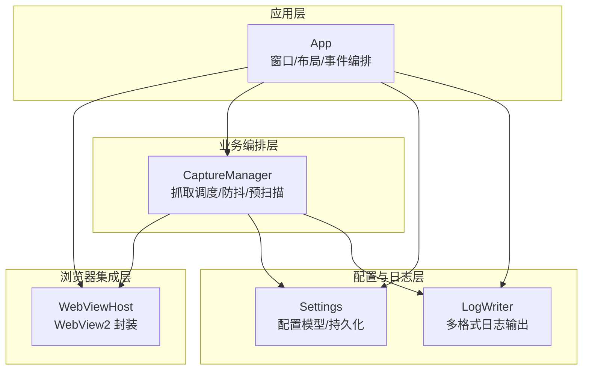
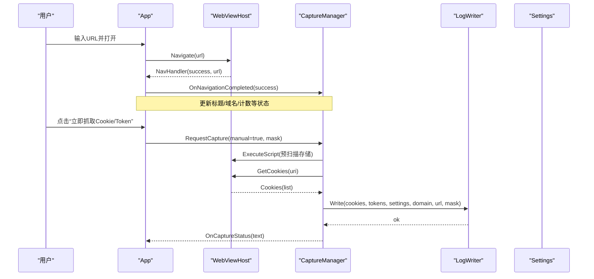
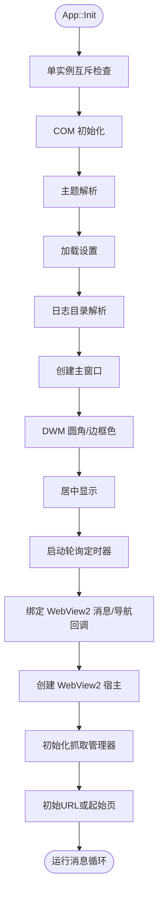
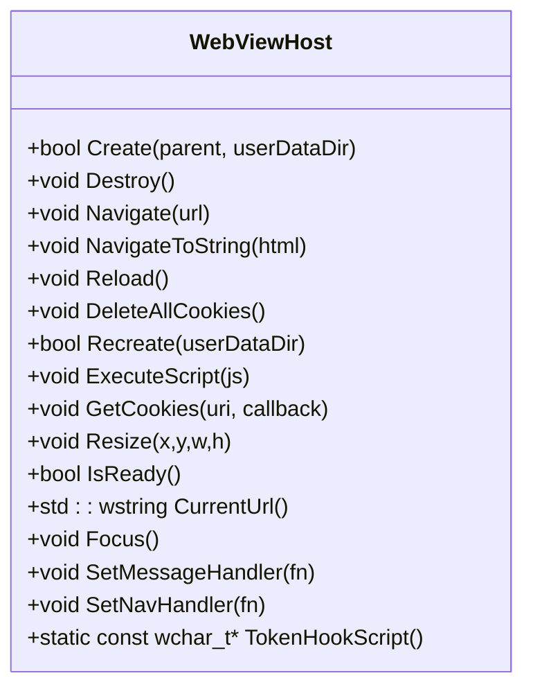
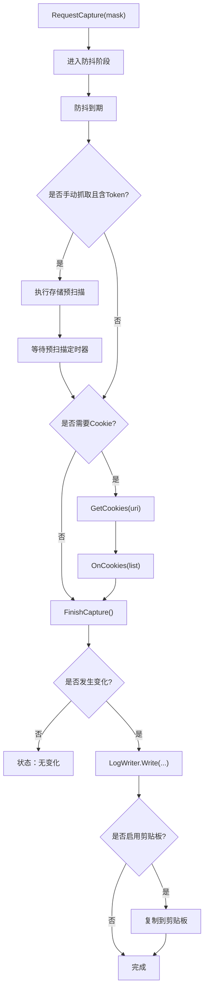
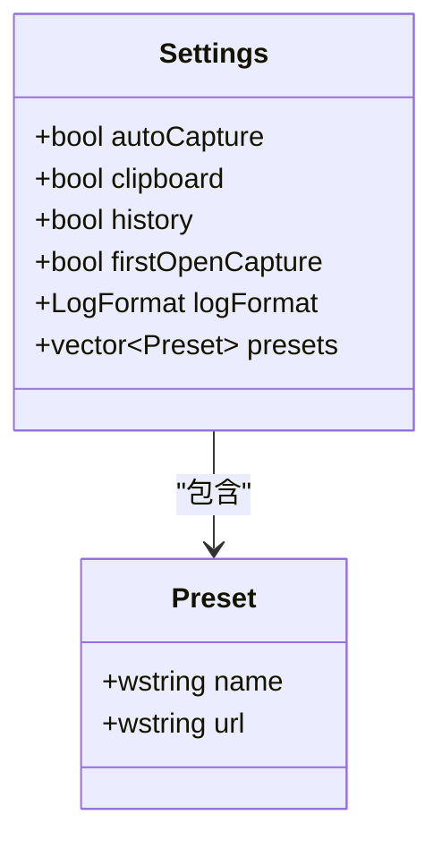
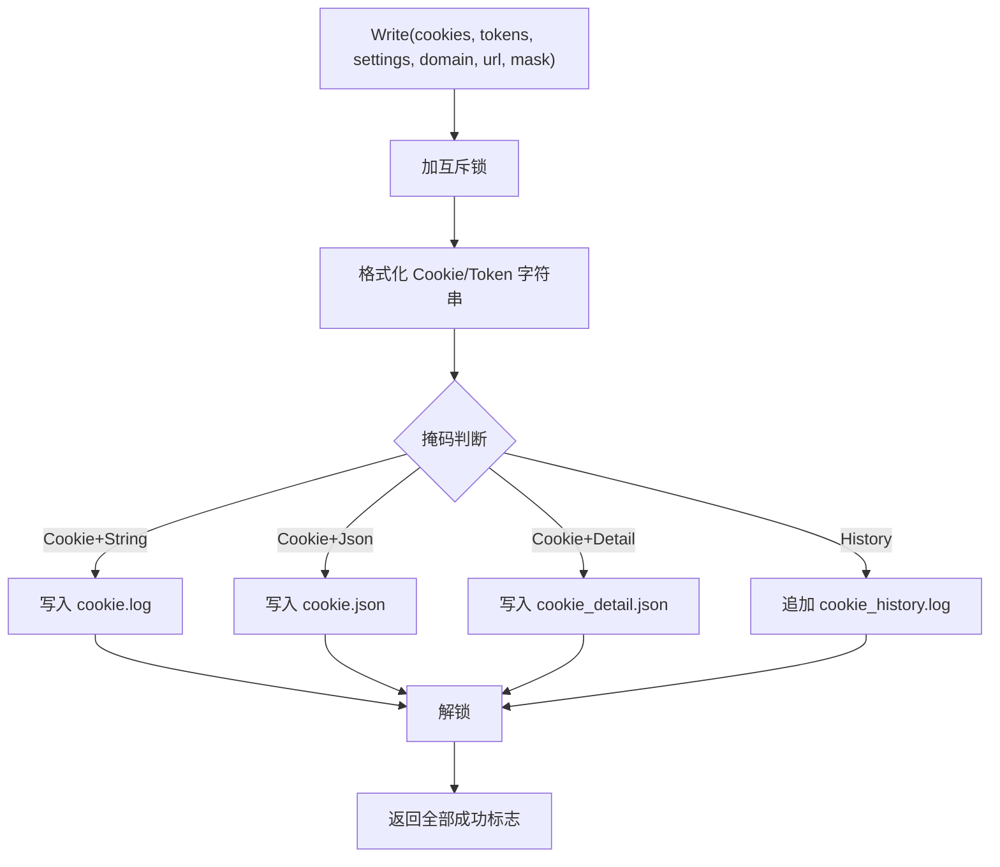
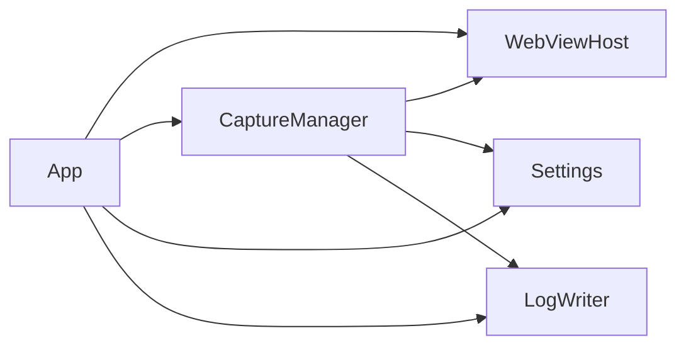

# 核心模块详解

<cite>
**本文引用的文件**   
- [app.h](file://src/app.h)
- [app.cpp](file://src/app.cpp)
- [webview.h](file://src/webview.h)
- [webview.cpp](file://src/webview.cpp)
- [capture.h](file://src/capture.h)
- [capture.cpp](file://src/capture.cpp)
- [settings.h](file://src/settings.h)
- [settings.cpp](file://src/settings.cpp)
- [logwriter.h](file://src/logwriter.h)
- [logwriter.cpp](file://src/logwriter.cpp)
</cite>

## 目录
1. [引言](#引言)
2. [项目结构](#项目结构)
3. [核心组件](#核心组件)
4. [架构总览](#架构总览)
5. [详细组件分析](#详细组件分析)
6. [依赖关系分析](#依赖关系分析)
7. [性能与优化建议](#性能与优化建议)
8. [故障排查指南](#故障排查指南)
9. [结论](#结论)

## 引言
本文件面向“Cookie 抓取工具”的核心模块，围绕以下目标展开：
- 解释 App 类的生命周期管理、窗口控制与页面编排；
- 说明 WebViewHost 对浏览器引擎（WebView2）的封装与集成；
- 解析 CaptureManager 的智能抓取算法（防抖、预扫描、Cookie/Token 三通道汇总）；
- 阐述 Settings 的配置模型与持久化机制；
- 描述 LogWriter 的多格式日志输出策略；
- 给出模块间协作关系、错误处理策略与性能优化建议。

该文档既适合开发者深入理解实现细节，也适合非技术读者通过图示和分层说明把握系统行为。

## 项目结构
仓库采用按功能划分的源码组织方式，核心模块集中在 src 目录下：
- app：Win32 GUI 应用主体，负责窗口创建、主题、布局、控件与事件编排；
- webview：WebView2 宿主封装，负责环境加载、控制器创建、导航、脚本注入与 Cookie 读取；
- capture：抓取编排器，协调 WebViewHost、Settings、LogWriter，实现智能抓取；
- settings：设置模型与 JSON 持久化；
- logwriter：多格式日志写入（字符串、JSON、明细 JSON、历史追加）。

**图表来源**
- [app.h:15-183](file://src/app.h#L15-L183)
- [webview.h:11-70](file://src/webview.h#L11-L70)
- [capture.h:10-63](file://src/capture.h#L10-L63)
- [settings.h:13-25](file://src/settings.h#L13-L25)
- [logwriter.h:30-52](file://src/logwriter.h#L30-L52)

**章节来源**
- [app.h:1-183](file://src/app.h#L1-L183)
- [webview.h:1-71](file://src/webview.h#L1-L71)
- [capture.h:1-64](file://src/capture.h#L1-L64)
- [settings.h:1-26](file://src/settings.h#L1-L26)
- [logwriter.h:1-53](file://src/logwriter.h#L1-L53)

## 核心组件
本节概述各模块的职责边界与关键接口，便于快速定位后续详细分析。

- App
  - 职责：单实例控制、COM 初始化、主题与字体画刷构建、窗口与控件创建、响应式布局、WebView2 宿主与抓取管理器编排、状态栏与提示更新。
  - 关键接口：Init、Run、OpenUrl/OpenUrlDirect、CaptureNow、RefreshPage、ClearLoginState、SwitchPage、Layout、CreateControls、ApplyFonts、BuildBrushes、ReleaseUiResources、ShutdownWebView、OnTimer、TitleBarButton、ShowStartPage。
  - 内部资源：双缓冲 DC/位图、标题栏按钮矩形、滚动状态、切换开关与分段选择、WebViewHost/CaptureManager/LogWriter/Settings 成员。

- WebViewHost
  - 职责：WebView2 环境/控制器创建、导航与刷新、脚本注入、消息桥接、Cookie 异步读取、窗口尺寸同步、数据目录管理与重建。
  - 关键接口：Create、Destroy、Navigate、NavigateToString、Reload、DeleteAllCookies、Recreate、ExecuteScript、GetCookies、Resize、IsReady、CurrentUrl、Focus、SetMessageHandler、SetNavHandler、TokenHookScript。

- CaptureManager
  - 职责：Token 三通道汇总（请求头、存储、响应体）、Cookie 拉取、登录态检测、自动抓取（防抖 + 预扫描）、定时轮询与状态更新。
  - 关键接口：Init、ResetState、OnWebMessage、OnNavigationCompleted、PollTick、RequestCapture、FirePending、FireDelayedStep、KillTimers、CookieCount、TokenCount、LastTime、LastDomain、HostFromUrl。

- Settings
  - 职责：定义抓取与 UI 偏好（自动抓取、剪贴板、历史、首次打开抓取、日志格式、预设站点），提供默认值、加载与保存。
  - 关键接口：LoadSettings、SaveSettings、SettingsFilePath、DefaultSettings。

- LogWriter
  - 职责：解析日志目录、线程安全地写 cookie.log / cookie.json / cookie_detail.json / cookie_history.log，支持覆盖原子替换与追加模式。
  - 关键接口：Init、Dir、Write、CookieString、TokenString。

**章节来源**
- [app.h:15-183](file://src/app.h#L15-L183)
- [webview.h:11-70](file://src/webview.h#L11-L70)
- [capture.h:10-63](file://src/capture.h#L10-L63)
- [settings.h:13-25](file://src/settings.h#L13-L25)
- [logwriter.h:30-52](file://src/logwriter.h#L30-L52)

## 架构总览
下图展示核心模块之间的调用与数据流向，体现“界面编排 → 浏览器集成 → 抓取调度 → 配置与日志”的分层协作。

**图表来源**
- [app.cpp:141-169](file://src/app.cpp#L141-L169)
- [webview.cpp:298-310](file://src/webview.cpp#L298-L310)
- [capture.cpp:135-175](file://src/capture.cpp#L135-L175)
- [logwriter.cpp:35-143](file://src/logwriter.cpp#L35-L143)

## 详细组件分析

### App 类：生命周期与窗口控制
- 生命周期
  - Init：单实例互斥检查、COM 初始化、控件库初始化、主题解析、设置加载、日志目录解析、主窗口创建、DWM 圆角与边框色、居中显示、定时器启动、WebView2 消息与导航回调绑定、WebView2 宿主创建、抓取管理器初始化、初始页或 URL 导航。
  - Run：消息循环，回车键在地址框时触发 OpenUrl。
  - ShutdownWebView：销毁 WebView2 控制器与环境。

- 窗口与布局
  - CreateControls：创建顶部导航标签、浏览器页控件（地址框、打开/刷新/抓取按钮）、WebView 宿主、设置页表单控件。
  - Layout：根据客户区宽度计算三档布局（Expanded/Compact/Narrow），计算标题栏按钮区域、顶部导航条、状态栏、内容卡片与 WebView 宿主尺寸；设置页滚动裁剪与可见性控制。
  - SwitchPage：切换浏览器页与设置页，隐藏/显示对应控件，重绘导航与主窗口。

- 业务入口
  - OpenUrl/OpenUrlDirect：校验 URL 协议前缀，切换到浏览器页，更新标题域，调用 WebViewHost::Navigate。
  - CaptureNow：委托 CaptureManager::RequestCapture，mask=1 仅 Cookie，mask=2 仅 Token。
  - RefreshPage：确保在浏览器页且 WebView2 就绪后 Reload，状态随 NavigationCompleted 更新。
  - ClearLoginState：确认对话框 → 清空 Web 存储与 Cookie → 重建 WebView2 会话（删除 userdata）→ 重置抓取状态 → 显示起始页或提示。

- UI 资源与绘制
  - BuildFonts/ApplyFonts：按 DPI 缩放创建字体并应用到控件。
  - BuildBrushes/ReleaseUiResources：从主题调色板创建画刷与画笔，统一释放。
  - EnsureMemBuffer/FreeMemBuffer：双缓冲内存 DC/位图，尺寸变化时重建。

- 交互与状态
  - TitleBarButton：最小化/最大化/关闭。
  - OnStartPageMessage：解析起始页 JS 消息，跳转到指定 URL。
  - ShowStartPage：生成内嵌 HTML 起始页，使用主题 CSS 变量保持风格一致。
  - SaveSettingsClicked/SaveUiSettings：将 UI 开关与单选状态同步到 Settings 并持久化。
  - OnCaptureStatus/UpdateStatus：更新状态行文本并重绘。

- 定时器与 WebView2 就绪检测
  - OnTimer：轮询捕获（PollTick）、防抖到期（FirePending）、预扫描等待到期（FireDelayedStep）；连续多次未就绪则提示安装 WebView2 运行时。

**图表来源**
- [app.cpp:66-173](file://src/app.cpp#L66-L173)

**章节来源**
- [app.cpp:66-187](file://src/app.cpp#L66-L187)
- [app.cpp:218-272](file://src/app.cpp#L218-L272)
- [app.cpp:274-347](file://src/app.cpp#L274-L347)
- [app.cpp:379-538](file://src/app.cpp#L379-L538)
- [app.cpp:540-747](file://src/app.cpp#L540-L747)
- [app.cpp:749-800](file://src/app.cpp#L749-L800)

### WebViewHost：浏览器引擎集成
- 加载器策略
  - 优先加载 exe 同目录 WebView2Loader.dll；若不存在，则从资源中释放到 %TEMP%\CookieGrabber 并加载；避免重复释放已映射 DLL。
- 环境与控制器
  - 异步创建 ICoreWebView2Environment 与 ICoreWebView2Controller，注册 NavigationCompleted、WebMessageReceived 事件处理器。
  - 注入 TokenHookScript，在文档创建时执行，拦截 fetch/XMLHttpRequest、localStorage/sessionStorage、响应体 JSON，向宿主 postMessage。
- 导航与脚本
  - Navigate/NavigateToString：控制器未就绪时挂起待执行；Reload 刷新当前页面；ExecuteScript 执行任意 JS。
- Cookie 读取
  - GetCookies：通过 CookieManager 异步获取 Cookie 列表，转换为 CookieItem 数组并回调上层。
- 生命周期与重建
  - Destroy：释放所有 COM 对象与临时加载器；Recreate：注销事件、关闭控制器、删除 userdata 目录（重试数次）、重新创建环境与控制器。

**图表来源**
- [webview.h:11-70](file://src/webview.h#L11-L70)

**章节来源**
- [webview.cpp:185-239](file://src/webview.cpp#L185-L239)
- [webview.cpp:254-310](file://src/webview.cpp#L254-L310)
- [webview.cpp:320-383](file://src/webview.cpp#L320-L383)
- [webview.cpp:393-430](file://src/webview.cpp#L393-L430)
- [webview.cpp:433-536](file://src/webview.cpp#L433-L536)

### CaptureManager：智能抓取算法
- 三通道 Token 汇总
  - 请求头：拦截 fetch/XMLHttpRequest 的请求头，匹配常见 token 字段名。
  - 存储：监听 storage 事件与 DOMContentLoaded，扫描 localStorage/sessionStorage 中与 token 相关的键。
  - 响应体：解析 JSON 响应体，递归扫描包含 token 相关键名的值。
- Cookie 拉取与登录态检测
  - 定时轮询 Cookie 快照，比较上次成功写入的 Cookie 串是否变化；首次打开时可主动检测是否已登录（基于 Cookie 名关键词）。
- 防抖与预扫描
  - RequestCapture 合并多次请求掩码，进入防抖阶段；手动抓取含 Token 时先执行存储预扫描，再按需拉取 Cookie。
- 完成与状态更新
  - FinishCapture：按掩码决定是否写 Cookie/Token，更新 lastSnapshot/domain/time，必要时复制剪贴板，更新状态文本。

**图表来源**
- [capture.cpp:135-175](file://src/capture.cpp#L135-L175)
- [capture.cpp:184-232](file://src/capture.cpp#L184-L232)

**章节来源**
- [capture.cpp:14-21](file://src/capture.cpp#L14-L21)
- [capture.cpp:23-52](file://src/capture.cpp#L23-L52)
- [capture.cpp:58-102](file://src/capture.cpp#L58-L102)
- [capture.cpp:104-133](file://src/capture.cpp#L104-L133)
- [capture.cpp:135-175](file://src/capture.cpp#L135-L175)
- [capture.cpp:177-232](file://src/capture.cpp#L177-L232)
- [capture.cpp:234-252](file://src/capture.cpp#L234-L252)

### Settings：配置模型与持久化
- 模型
  - autoCapture：检测到登录后自动抓取；clipboard：抓取后复制到剪贴板；history：追加历史日志；firstOpenCapture：首次打开若已登录则自动抓取；logFormat：字符串/JSON/两者；presets：预设站点名称与 URL。
- 持久化
  - LoadSettings：从 %LOCALAPPDATA%\CookieGrabber\settings.json 读取，缺失或格式异常回退默认值；兼容旧字段与预设数组。
  - SaveSettings：以 pretty JSON 写出，使用原子写入保证一致性。

**图表来源**
- [settings.h:6-20](file://src/settings.h#L6-L20)

**章节来源**
- [settings.cpp:9-20](file://src/settings.cpp#L9-L20)
- [settings.cpp:22-48](file://src/settings.cpp#L22-L48)
- [settings.cpp:50-75](file://src/settings.cpp#L50-L75)

### LogWriter：多格式日志输出
- 输出文件
  - cookie.log：字符串格式，时间行 + Cookie 串；
  - cookie.json：扁平简洁型，包含 time/domain/url/cookie/token；
  - cookie_detail.json：结构化明细，包含 cookies 数组与 tokens 数组；
  - cookie_history.log：追加历史，记录抓取摘要与 Cookie/Token 串。
- 写入策略
  - 线程安全：进程内互斥锁保护；
  - 原子替换：覆盖文件使用临时文件 + 原子替换；
  - 历史追加：append 模式；
  - 目录解析：优先 exe 目录，不可写回退 %LOCALAPPDATA%\CookieGrabber\logs。

**图表来源**
- [logwriter.cpp:35-143](file://src/logwriter.cpp#L35-L143)

**章节来源**
- [logwriter.cpp:9-29](file://src/logwriter.cpp#L9-L29)
- [logwriter.cpp:31-33](file://src/logwriter.cpp#L31-L33)
- [logwriter.cpp:35-143](file://src/logwriter.cpp#L35-L143)

## 依赖关系分析
- 耦合与内聚
  - App 高内聚于 UI 与编排，低耦合于 WebViewHost/CaptureManager/Settings/LogWriter；
  - WebViewHost 独立封装 WebView2 API，对外暴露稳定接口；
  - CaptureManager 聚合 WebViewHost、Settings、LogWriter，承担业务逻辑；
  - Settings 与 LogWriter 为基础设施层，被上层广泛依赖。
- 直接依赖
  - App → WebViewHost、CaptureManager、Settings、LogWriter；
  - CaptureManager → WebViewHost、Settings、LogWriter；
  - WebViewHost → LogWriter（仅类型引用，实际不直接调用）；
  - Settings → util/json（外部工具与轻量 JSON 库）。
- 潜在循环依赖
  - 未见明显循环；CaptureManager 通过回调与定时器与 App 解耦。

**图表来源**
- [app.h:15-183](file://src/app.h#L15-L183)
- [capture.h:10-63](file://src/capture.h#L10-L63)

**章节来源**
- [app.h:15-183](file://src/app.h#L15-L183)
- [capture.h:10-63](file://src/capture.h#L10-L63)

## 性能与优化建议
- WebView2 初始化与重建
  - 复用已加载的 WebView2Loader.dll，避免重复释放与覆盖写失败；
  - Recreate 时对 userdata 目录删除进行重试，减少因进程占用导致的失败。
- 抓取调度
  - 防抖合并多次抓取请求，减少不必要的 Cookie 拉取与日志写入；
  - 预扫描仅在手动抓取含 Token 时执行，降低常规自动抓取的开销；
  - 轮询间隔与防抖/预扫描时长可调（kPollMs/kDebounceMs/kPrescanMs）。
- 日志写入
  - 原子替换避免部分写入导致的数据损坏；
  - 历史日志追加模式减少频繁覆写；
  - 进程内互斥保证并发安全。
- UI 绘制
  - 双缓冲 DC/位图减少闪烁；
  - 滚动时整体失效并重绘，避免残影累积；
  - 按 DPI 缩放字体与控件尺寸，提升清晰度与可用性。

[本节为通用指导，不直接分析具体代码文件]

## 故障排查指南
- WebView2 初始化失败
  - 现象：状态栏提示“WebView2 初始化失败：请安装 Edge WebView2 运行时后重试”。
  - 排查：确认系统已安装 WebView2 运行时；检查 loader 加载路径与临时目录权限。
  - 参考：App::OnTimer 中的就绪检测计数与提示。

- 抓取无变化
  - 现象：状态栏显示“登录状态无变化”。
  - 排查：确认页面为 http/https/file 协议；检查 Cookie 快照是否确实变化；确认自动抓取开关与防抖逻辑。
  - 参考：CaptureManager::FinishCapture 的变化检测与状态更新。

- 日志写入失败
  - 现象：状态栏提示“抓取完成但写日志失败: ...”。
  - 排查：检查日志目录权限与磁盘空间；确认 cookie.log/cookie.json/cookie_detail.json/cookie_history.log 可写；查看错误信息拼接。
  - 参考：LogWriter::Write 的错误收集与返回标志。

- 清除登录状态后仍有残留
  - 现象：提示“数据目录有残留，重启应用后可完全清除”。
  - 排查：userdata 目录可能仍被 WebView2 进程占用；等待进程退出或重启应用。
  - 参考：App::ClearLoginState 的重建流程与提示。

**章节来源**
- [app.cpp:711-726](file://src/app.cpp#L711-L726)
- [capture.cpp:184-232](file://src/capture.cpp#L184-L232)
- [logwriter.cpp:35-143](file://src/logwriter.cpp#L35-L143)
- [app.cpp:600-637](file://src/app.cpp#L600-L637)

## 结论
本项目的核心模块围绕“界面编排—浏览器集成—抓取调度—配置与日志”四层展开，职责清晰、耦合合理。App 作为编排中枢，WebViewHost 屏蔽 WebView2 复杂性，CaptureManager 实现智能抓取与防抖预扫描，Settings 与 LogWriter 提供稳定的配置与日志能力。通过原子写入、互斥保护、双缓冲绘制与 DPI 适配，系统在可用性与健壮性上具备良好基础。建议在扩展新站点或新增抓取通道时，遵循现有接口契约，并在 CaptureManager 中完善 Token 识别规则与变更检测逻辑，同时关注性能与用户体验的平衡。

[本节为总结性内容，不直接分析具体代码文件]