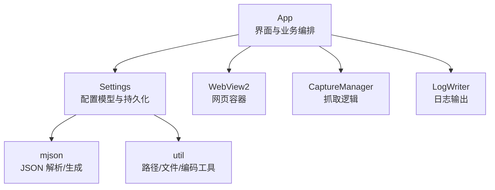
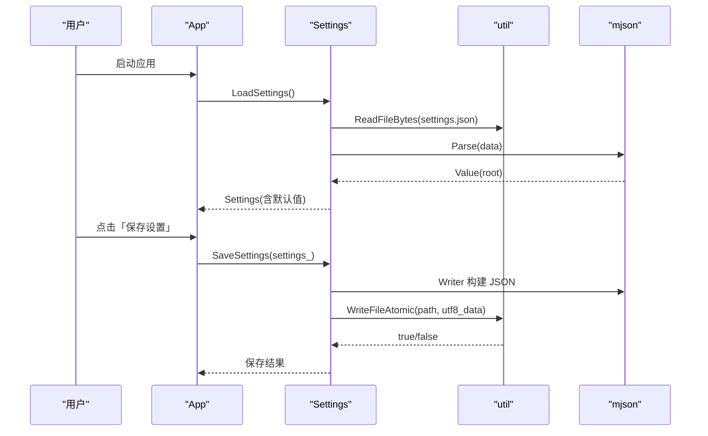
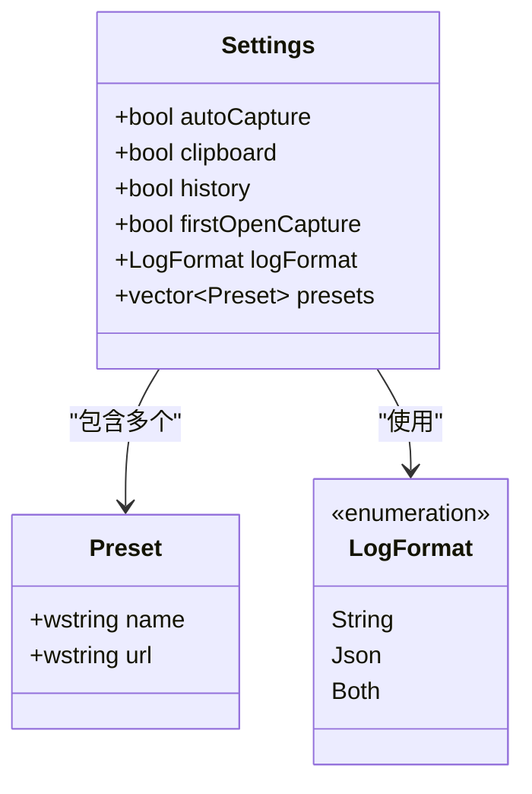
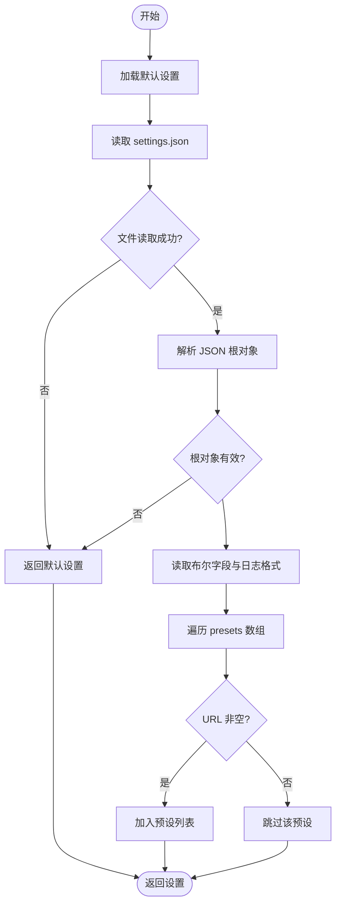
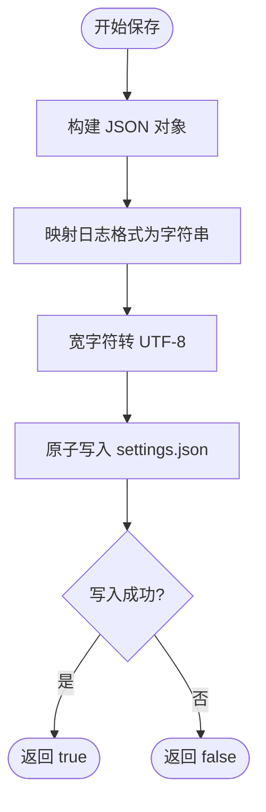
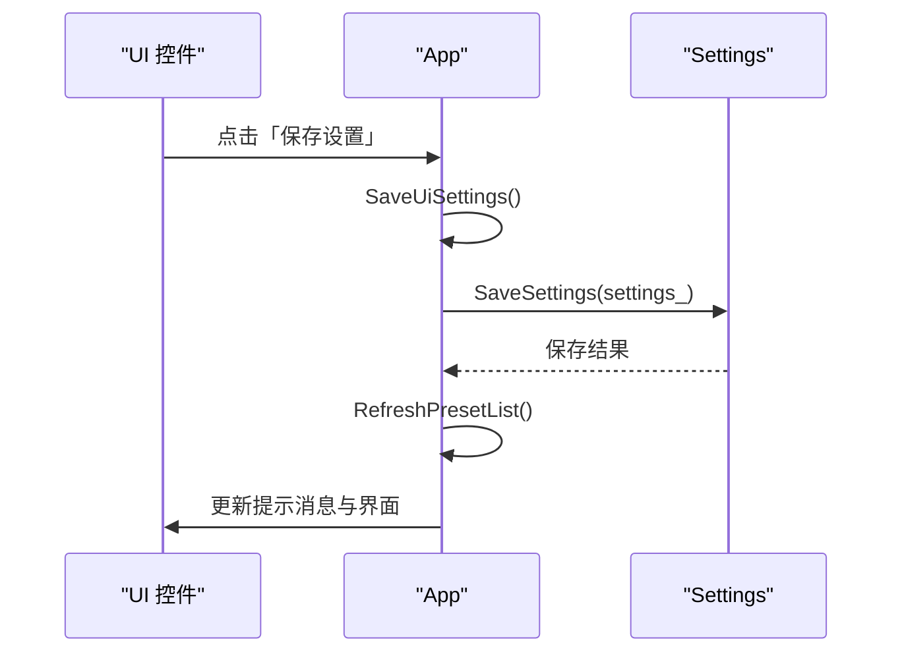
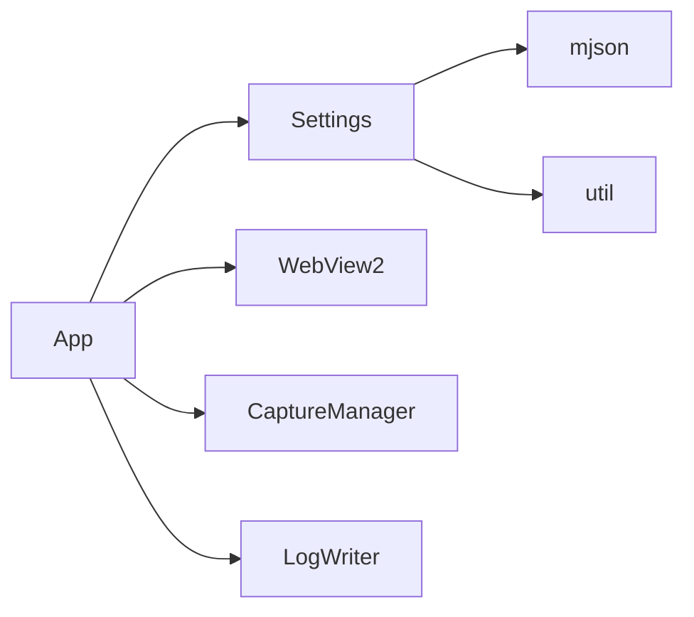

# 设置管理模块

<cite>
**本文引用的文件**   
- [settings.h](file://src/settings.h)
- [settings.cpp](file://src/settings.cpp)
- [app.h](file://src/app.h)
- [app.cpp](file://src/app.cpp)
- [json.h](file://src/json.h)
- [util.h](file://src/util.h)
- [util.cpp](file://src/util.cpp)
</cite>

## 目录
1. [引言](#引言)
2. [项目结构中的设置相关位置](#项目结构中的设置相关位置)
3. [核心组件总览](#核心组件总览)
4. [架构概览](#架构概览)
5. [详细组件分析](#详细组件分析)
6. [依赖关系分析](#依赖关系分析)
7. [性能与并发特性](#性能与并发特性)
8. [配置格式、默认值与兼容性](#配置格式默认值与兼容性)
9. [备份恢复与数据迁移建议](#备份恢复与数据迁移建议)
10. [常见问题排查](#常见问题排查)
11. [结论](#结论)

## 引言
本技术文档聚焦于 `Settings` 类及其在应用中的完整使用方式，目标是帮助开发者理解：
- 配置模型设计：预设网站、用户偏好开关、日志格式等。
- 配置文件持久化机制：JSON 结构、读写流程、原子写入、错误处理。
- UI 与业务层的数据绑定：App 如何加载、展示、保存和同步设置。
- 扩展能力：预设管理、历史日志开关、版本兼容策略、备份恢复思路。

该模块位于 Win32 + WebView2 的桌面应用中，负责将用户配置以 JSON 形式持久化到 `%LOCALAPPDATA%\CookieGrabber\settings.json`，并在应用启动时自动加载，在用户点击“保存设置”后更新。

## 项目结构中的设置相关位置
设置相关代码主要分布在以下文件中：
- 配置模型与持久化接口：`src/settings.h`、`src/settings.cpp`
- JSON 解析与生成：`src/json.h`
- 通用工具（路径、文件 I/O、编码转换）：`src/util.h`、`src/util.cpp`
- 应用主体与 UI 绑定：`src/app.h`、`src/app.cpp`



**图表来源**
- [app.h:15-183](file://src/app.h#L15-L183)
- [settings.h:8-25](file://src/settings.h#L8-L25)
- [json.h:12-86](file://src/json.h#L12-L86)
- [util.h:7-45](file://src/util.h#L7-L45)

**章节来源**
- [settings.h:1-26](file://src/settings.h#L1-L26)
- [settings.cpp:1-76](file://src/settings.cpp#L1-L76)
- [app.h:15-183](file://src/app.h#L15-L183)
- [json.h:1-223](file://src/json.h#L1-L223)
- [util.h:1-46](file://src/util.h#L1-L46)

## 核心组件总览
- `Settings`：配置数据结构，包含布尔开关、日志格式枚举、预设列表。
- `Preset`：预设网站条目，包含名称与登录网址。
- `LoadSettings()`：从 `settings.json` 读取并合并默认值。
- `SaveSettings()`：将当前设置序列化为 JSON 并原子写入。
- `DefaultSettings()`：提供初始预设（微博、知乎、B站、GitHub）。
- `SettingsFilePath()`：返回配置文件绝对路径。
- `App::UiSettings()`：暴露给 UI 层的设置引用，用于双向绑定。
- `App::SaveSettingsClicked()`：UI 触发保存，同时支持更新选中预设的 URL。

**章节来源**
- [settings.h:8-25](file://src/settings.h#L8-L25)
- [settings.cpp:13-75](file://src/settings.cpp#L13-L75)
- [app.h:128-129](file://src/app.h#L128-L129)
- [app.cpp:664-700](file://src/app.cpp#L664-L700)

## 架构概览
设置模块采用“模型 + 持久化 + UI 绑定”的分层结构：
- 模型层：`Settings` 与 `Preset` 定义配置结构。
- 持久化层：`LoadSettings` / `SaveSettings` 负责 JSON 序列化与反序列化。
- UI 层：`App` 持有 `Settings` 引用，初始化时加载，按钮点击时保存。
- 工具层：`util` 提供 UTF-8 转换、原子写、路径解析；`mjson` 提供轻量 JSON 支持。



**图表来源**
- [app.cpp:114-115](file://src/app.cpp#L114-L115)
- [settings.cpp:22-47](file://src/settings.cpp#L22-L47)
- [settings.cpp:50-75](file://src/settings.cpp#L50-L75)
- [util.cpp:70-80](file://src/util.cpp#L70-L80)
- [util.cpp:135-149](file://src/util.cpp#L135-L149)

## 详细组件分析

### Settings 配置模型
`Settings` 是核心配置对象，字段包括：
- `autoCapture`：检测到登录状态变化时自动抓取。
- `clipboard`：抓取后复制到剪贴板。
- `history`：追加写入 `cookie_history.log`。
- `firstOpenCapture`：首次打开若已登录则自动抓取。
- `logFormat`：日志格式，枚举为字符串、JSON、或两者都写。
- `presets`：预设网站列表，每个预设包含名称与登录 URL。

`Preset` 结构简单，仅包含 `name` 与 `url`，用于下拉选择与快速跳转。



**图表来源**
- [settings.h:6-20](file://src/settings.h#L6-L20)

**章节来源**
- [settings.h:6-20](file://src/settings.h#L6-L20)

### 配置加载与默认值处理
`LoadSettings()` 的执行流程如下：
1. 先调用 `DefaultSettings()` 获取默认配置。
2. 尝试读取 `settings.json`，失败则直接返回默认配置。
3. 使用 `mjson::Parse` 解析 JSON 根对象。
4. 逐个字段读取布尔值，缺失时使用默认值。
5. 解析 `logFormat` 字符串映射到枚举。
6. 解析 `presets` 数组，转换为宽字符并过滤空 URL。



**图表来源**
- [settings.cpp:13-47](file://src/settings.cpp#L13-L47)

**章节来源**
- [settings.cpp:13-47](file://src/settings.cpp#L13-L47)

### 配置保存与原子写入
`SaveSettings()` 将 `Settings` 序列化为 JSON，并通过 `util::WriteFileAtomic` 原子写入：
- 使用 `mjson::Writer` 构建格式化 JSON。
- 将 `LogFormat` 枚举映射为字符串。
- 将 `Preset` 的宽字符转为 UTF-8。
- 写入临时文件后通过 `MoveFileExW` 替换目标文件，避免部分写入导致损坏。



**图表来源**
- [settings.cpp:50-75](file://src/settings.cpp#L50-L75)
- [util.cpp:135-149](file://src/util.cpp#L135-L149)

**章节来源**
- [settings.cpp:50-75](file://src/settings.cpp#L50-L75)
- [util.cpp:135-149](file://src/util.cpp#L135-L149)

### UI 与 App 的数据绑定
`App` 在初始化时加载设置，并将 UI 控件状态与 `Settings` 同步：
- 创建控件后，根据 `settings_` 填充复选框与单选按钮。
- 预设下拉列表由 `RefreshPresetList()` 动态构建。
- 点击“保存设置”时，调用 `SaveUiSettings()` 将 UI 状态写回 `settings_`，再调用 `SaveSettings()` 持久化。
- 如果修改了选中预设的 URL，会立即更新预设列表并重新显示起始页。



**图表来源**
- [app.cpp:664-700](file://src/app.cpp#L664-L700)
- [app.cpp:639-662](file://src/app.cpp#L639-L662)

**章节来源**
- [app.cpp:338-347](file://src/app.cpp#L338-L347)
- [app.cpp:639-700](file://src/app.cpp#L639-L700)

## 依赖关系分析
设置模块依赖以下外部组件：
- `mjson`：轻量 JSON 解析与生成，无第三方依赖。
- `util`：文件 I/O、UTF-8 转换、路径解析。
- `App`：UI 层持有 `Settings` 引用，负责交互与状态同步。



**图表来源**
- [settings.cpp:1-4](file://src/settings.cpp#L1-L4)
- [app.h:7-10](file://src/app.h#L7-L10)

**章节来源**
- [settings.cpp:1-4](file://src/settings.cpp#L1-L4)
- [app.h:7-10](file://src/app.h#L7-L10)

## 性能与并发特性
- 文件读取限制最大 64MB，防止超大配置导致内存压力。
- 原子写入确保配置文件的完整性，避免部分写入导致的损坏。
- 当前实现未引入显式锁，但应用主线程串行处理 UI 事件，降低并发冲突风险。
- 建议在多线程环境下对 `Settings` 的读写增加互斥保护，尤其是当其他线程可能访问配置时。

**章节来源**
- [util.cpp:70-80](file://src/util.cpp#L70-L80)
- [util.cpp:135-149](file://src/util.cpp#L135-L149)

## 配置格式、默认值与兼容性
### JSON 结构
配置文件 `settings.json` 的结构如下：
```json
{
  "autoCapture": true,
  "clipboard": true,
  "history": true,
  "firstOpenCapture": true,
  "logFormat": "string",
  "presets": [
    {"name": "微博", "url": "https://weibo.com"},
    {"name": "知乎", "url": "https://www.zhihu.com"},
    {"name": "B站", "url": "https://www.bilibili.com"},
    {"name": "GitHub", "url": "https://github.com/login"}
  ]
}
```

### 默认值处理
- 布尔字段缺失时默认为 `true`。
- `logFormat` 缺失或非法时默认为 `string`。
- `presets` 缺失时为空数组，但 `DefaultSettings()` 提供初始预设。

### 兼容性策略
- 新增字段时，旧配置文件仍可正常加载，新字段使用默认值。
- 删除字段时，旧配置中的多余字段会被忽略。
- 建议未来引入 `version` 字段以支持显式迁移逻辑。

**章节来源**
- [settings.cpp:28-46](file://src/settings.cpp#L28-L46)
- [settings.cpp:54-71](file://src/settings.cpp#L54-L71)

## 备份恢复与数据迁移建议
当前实现未内置备份恢复功能，但可基于现有工具扩展：
- 备份：复制 `settings.json` 到带时间戳的文件名。
- 恢复：用备份文件覆盖当前配置。
- 迁移：在 `LoadSettings()` 中检查 `version` 字段，按版本执行迁移逻辑。

示例步骤：
1. 在 `Settings` 中添加 `version` 字段。
2. 在 `LoadSettings()` 中检测版本并执行迁移。
3. 在 `SaveSettings()` 中写入最新版本号。
4. 提供备份恢复 API，供 UI 调用。

**章节来源**
- [settings.cpp:22-47](file://src/settings.cpp#L22-L47)
- [settings.cpp:50-75](file://src/settings.cpp#L50-L75)

## 常见问题排查
- **配置文件无法读取**：检查路径权限与文件是否存在。
- **预设不生效**：确认 `presets` 数组中的 URL 非空且格式正确。
- **日志格式异常**：检查 `logFormat` 是否为 `string`、`json` 或 `both`。
- **保存失败**：检查磁盘空间与文件锁定情况。

**章节来源**
- [settings.cpp:22-47](file://src/settings.cpp#L22-L47)
- [settings.cpp:50-75](file://src/settings.cpp#L50-L75)

## 结论
`Settings` 模块提供了简洁可靠的配置管理方案，结合 `App` 实现了完整的 UI 绑定与持久化。其设计清晰、扩展性强，适合进一步添加版本迁移、备份恢复等功能。对于高并发场景，建议引入线程安全机制以确保配置一致性。