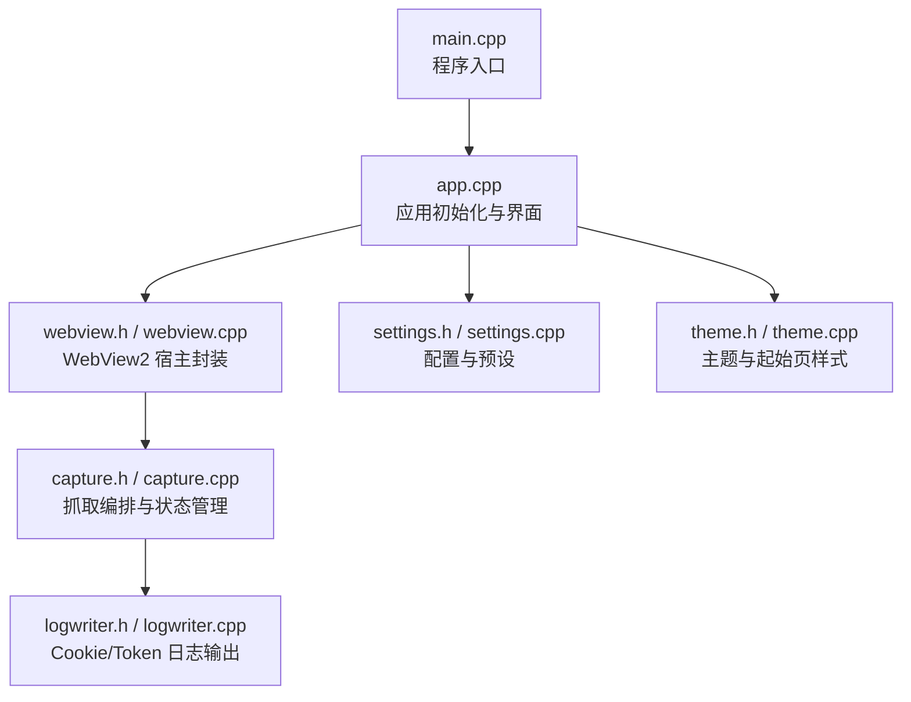
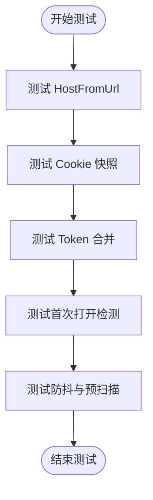

# 测试与调试

<cite>
**本文引用的文件**   
- [main.cpp](file://src/main.cpp)
- [app.cpp](file://src/app.cpp)
- [webview.h](file://src/webview.h)
- [webview.cpp](file://src/webview.cpp)
- [capture.h](file://src/capture.h)
- [capture.cpp](file://src/capture.cpp)
- [build.bat](file://build.bat)
- [login.html](file://test/login.html)
- [serve.py](file://test/serve.py)
</cite>

## 目录
1. [引言](#引言)
2. [项目结构与测试入口](#项目结构与测试入口)
3. [本地测试环境搭建](#本地测试环境搭建)
4. [模拟登录页面使用指南](#模拟登录页面使用指南)
5. [WebView2 调试技巧](#webview2-调试技巧)
6. [WinDbg 等调试器使用方法](#windbg-等调试器使用方法)
7. [单元测试编写建议与框架选择](#单元测试编写建议与框架选择)
8. [性能分析与优化方法](#性能分析与优化方法)
9. [常见问题诊断与解决方案](#常见问题诊断与解决方案)
10. [结论](#结论)

## 引言
本指南面向 Cookie 抓取工具的测试与调试场景，重点说明如何搭建本地测试服务器、使用模拟登录页面验证 Cookie 与 Token 捕获流程，并给出 WebView2 开发者工具、WinDbg 等调试手段的使用建议。同时提供单元测试编写思路、性能分析方法和常见问题的排查路径。

## 项目结构与测试入口
该工程是一个 Windows 原生应用，主入口解析命令行参数后启动应用；WebView2 负责承载网页，Token 捕获脚本通过注入 JavaScript 拦截请求头、响应体与 Web 存储，最终由抓取管理器统一写入日志或剪贴板。

**图表来源**
- [main.cpp:6-18](file://src/main.cpp#L6-L18)
- [app.cpp:66-172](file://src/app.cpp#L66-L172)
- [webview.h:11-37](file://src/webview.h#L11-L37)
- [webview.cpp:217-296](file://src/webview.cpp#L217-L296)
- [capture.h:10-31](file://src/capture.h#L10-L31)
- [capture.cpp:14-21](file://src/capture.cpp#L14-L21)

**章节来源**
- [main.cpp:1-20](file://src/main.cpp#L1-L20)
- [app.cpp:66-172](file://src/app.cpp#L66-L172)

## 本地测试环境搭建
### 构建应用
使用仓库提供的批处理脚本进行构建。脚本会检查 MinGW-w64 工具链，将资源编译为资源文件，然后编译生成单文件可执行文件。

- 运行 `build.bat` 完成 windres 资源编译、g++ 编译与输出大小打印。
- 若提示找不到 g++，按脚本提示安装 WinGet 的 MinGW-w64 包。

**章节来源**
- [build.bat:1-34](file://build.bat#L1-L34)

### 启动本地测试服务器
测试目录包含一个 Python 本地服务器，用于：
- 静态返回 `login.html`
- 提供 `/api/login` 接口，返回带 token 的 JSON

操作步骤：
1. 打开终端，进入 `test` 目录。
2. 运行 `python serve.py`。
3. 控制台会输出测试服务器地址，例如 `http://127.0.0.1:8899/login.html`。
4. 在应用地址栏输入该地址，或使用“打开”按钮加载。

**章节来源**
- [serve.py:1-64](file://test/serve.py#L1-L64)

### 验证 WebView2 运行时
应用启动时会尝试创建 WebView2 环境；若未就绪，会在状态栏提示需要安装 Edge WebView2 运行时。若出现初始化失败弹窗，请确认系统已安装 WebView2 运行时。

**章节来源**
- [app.cpp:711-725](file://src/app.cpp#L711-L725)
- [main.cpp:14-18](file://src/main.cpp#L14-L18)

## 模拟登录页面使用指南
### 页面行为
模拟登录页面会：
- 在点击“登录”时写入 Cookie（会话 Cookie）
- 写入 localStorage 与 sessionStorage 中的 Token
- 发起带 Authorization 头的 POST 请求到 `/api/login`
- 根据响应更新页面标题与状态文本

此外，页面加载 1 秒后会自动执行登录逻辑，便于自动化测试快速进入“已登录”状态。

**章节来源**
- [login.html:1-57](file://test/login.html#L1-L57)

### 服务端响应结构
本地服务器的 `/api/login` 返回 JSON，包含：
- code
- msg
- data.access_token
- data.refresh_token
- data.expires_in
- data.user.token

该响应会被注入的 Token 捕获脚本扫描响应体，提取符合规则的值并通过消息通道上报给 C++ 层。

**章节来源**
- [serve.py:41-56](file://test/serve.py#L41-L56)

### 在应用中验证
1. 启动 `serve.py`。
2. 在应用地址栏输入 `http://127.0.0.1:8899/login.html` 并打开。
3. 等待自动登录或手动点击“登录”。
4. 观察状态栏是否显示“已抓取 Cookie”或“已抓取 Token”。
5. 查看日志文件路径（设置页中可配置），确认 Cookie 与 Token 是否被记录。

**章节来源**
- [app.cpp:563-581](file://src/app.cpp#L563-L581)
- [capture.cpp:135-175](file://src/capture.cpp#L135-L175)

## WebView2 调试技巧
### 启用开发者工具
当前代码未显式启用 WebView2 DevTools。若需调试页面 JS、网络请求与 Console，可在 WebView2 环境创建时添加 DevTools 相关选项。建议在开发分支中临时开启，以便定位 Token 注入、消息传递与 Cookie 读取问题。

推荐步骤：
1. 在 `CreateCoreWebView2EnvironmentWithOptions` 调用处增加 DevTools 启用选项。
2. 重启应用后，在 WebView2 窗口中使用快捷键打开开发者工具。
3. 在 Network 面板查看 `/api/login` 请求与响应。
4. 在 Console 面板检查 Token 捕获脚本是否报错。
5. 在 Application 面板检查 Cookie、localStorage、sessionStorage。

注意：
- 生产版本应关闭 DevTools，避免泄露敏感信息。
- 若仅调试 C++ 侧，可优先使用 WinDbg 或 Visual Studio 调试器。

**章节来源**
- [webview.cpp:232-238](file://src/webview.cpp#L232-L238)

### 使用 WebView2 消息通道调试
Token 捕获脚本通过 `window.chrome.webview.postMessage` 发送 JSON 消息，C++ 层通过 `WebMessageHandlerImpl` 接收并转换为 UTF-8 字符串，再交给 `CaptureManager::OnWebMessage`。

调试要点：
- 在浏览器端 Console 打印 postMessage 内容，确认格式正确。
- 在 C++ 层断点 `OnWebMessage`，检查 JSON 字段是否完整。
- 若消息丢失，检查 WebView2 是否已就绪、是否成功注入 TokenHookScript。

**章节来源**
- [webview.cpp:86-119](file://src/webview.cpp#L86-L119)
- [capture.cpp:58-87](file://src/capture.cpp#L58-L87)

### 使用 WebView2 Cookie 管理器调试
抓取流程通过 `ICoreWebView2CookieManager::GetCookies` 获取 Cookie 列表，并转换为内部结构后写入日志。

调试要点：
- 在 `OnCookiesReady` 断点，检查 Cookie 数量与字段。
- 确认 URL 是有效 URI（http/https/file），避免 about:blank 导致崩溃。
- 若 Cookie 为空，检查站点是否跨域、是否使用 HttpOnly、是否在同一 userDataDir 下。

**章节来源**
- [webview.cpp:141-162](file://src/webview.cpp#L141-L162)
- [webview.cpp:393-430](file://src/webview.cpp#L393-L430)
- [capture.cpp:104-133](file://src/capture.cpp#L104-L133)

## WinDbg 等调试器使用方法
### 使用 WinDbg 附加进程
适用场景：
- 应用崩溃或无响应
- WebView2 初始化失败
- Cookie 读取异常但无法在 IDE 中复现

操作步骤：
1. 以管理员身份运行 WinDbg。
2. 附加到 `CookieGrabber.exe` 进程。
3. 设置符号路径，确保能加载 PDB。
4. 在关键函数设置断点，如 `WebViewHost::Create`、`WebViewHost::OnControllerCreated`、`CaptureManager::FinishCapture`。
5. 触发登录与抓取，观察堆栈与变量。

常用命令：
- `.sympath SRV*https://msdl.microsoft.com/download/symbols;SRV*C:\Symbols`
- `bp WebViewHost::Create`
- `bp CaptureManager::FinishCapture`
- `k` 查看调用栈
- `dt` 查看对象字段

### 使用 Visual Studio 调试
适用场景：
- 源码级调试
- 断点与监视变量
- 多线程与 UI 线程交互

操作步骤：
1. 使用 VS 打开工程或附加到进程。
2. 在 `App::Init`、`WebViewHost::Create`、`CaptureManager::PollTick` 设置断点。
3. 运行应用，触发登录与抓取。
4. 检查 WebView2 是否就绪、消息是否到达、Cookie 列表是否为空。

**章节来源**
- [webview.cpp:217-296](file://src/webview.cpp#L217-L296)
- [capture.cpp:104-175](file://src/capture.cpp#L104-L175)

## 单元测试编写建议与框架选择
### 测试范围建议
由于该应用是 Windows GUI 应用，核心可测试部分包括：
- URL 主机提取逻辑
- Cookie 快照比对
- Token 去重与合并
- 日志写入格式
- 配置加载与保存

不建议直接对 Win32 窗口消息循环做单元测试；可通过抽取纯函数与数据流进行测试。

### 推荐框架
- Google Test（gtest）：适合 C++ 单元测试，易于集成。
- Catch2：轻量、头文件为主，适合小型项目。
- Boost.Test：若项目已依赖 Boost。

### 测试用例设计
- 主机提取：
  - 输入含端口、用户名密码、路径的 URL，验证返回主机名。
- Cookie 快照：
  - 构造不同 Cookie 列表，验证字符串序列化是否稳定。
- Token 合并：
  - 同一域名同名 Token 多次出现，验证保留最新值。
- 首次打开检测：
  - 模拟导航完成事件，验证首次抓取逻辑。
- 防抖与预扫描：
  - 多次 RequestCapture，验证合并掩码与定时任务。

### 示例测试结构

[此图为概念性流程图，不映射具体源码]

## 性能分析与优化方法
### CPU 使用率分析
- 使用 Windows Performance Recorder（WPR）录制用户态与内核态采样。
- 使用 PerfView 分析 CPU 热点，关注 WebView2 回调、消息处理与日志写入。
- 针对频繁轮询（PollTick）与定时器（Debounce、Prescan）评估间隔是否合理。

### 内存泄漏检测
- 使用 Visual Studio 内置内存诊断工具，检查 WebView2 COM 对象释放。
- 使用 WinDbg 的 `!heap -stat` 与 `!dumpheap` 分析堆分配。
- 重点关注 WebView2 环境、控制器、CookieManager 的生命周期。

### WebView2 生命周期优化
- 避免重复创建环境与控制器。
- 在 Destroy 中释放所有 COM 引用。
- Recreate 前注销事件、关闭控制器、删除数据目录并重试。

**章节来源**
- [webview.cpp:241-252](file://src/webview.cpp#L241-L252)
- [webview.cpp:320-342](file://src/webview.cpp#L320-L342)

## 常见问题诊断与解决方案
### WebView2 初始化失败
现象：
- 启动时报错或状态栏提示 WebView2 初始化失败。

排查：
- 确认已安装 Edge WebView2 运行时。
- 检查 `CoInitializeEx` 是否成功。
- 检查 `CreateCoreWebView2EnvironmentWithOptions` 返回值。

解决：
- 安装 WebView2 运行时。
- 重启应用后重试。

**章节来源**
- [app.cpp:711-725](file://src/app.cpp#L711-L725)
- [webview.cpp:222-238](file://src/webview.cpp#L222-L238)

### Cookie 为空或抓取不到
现象：
- 登录后状态栏显示“已抓取 Cookie”，但日志为空。

排查：
- 检查 URL 是否为 http/https/file。
- 检查 Cookie 是否为 HttpOnly 或跨域。
- 检查 userDataDir 是否一致。

解决：
- 使用相同 userDataDir 登录与抓取。
- 在 WebView2 开发者工具中检查 Cookie 是否存在。

**章节来源**
- [capture.cpp:104-133](file://src/capture.cpp#L104-L133)
- [webview.cpp:393-430](file://src/webview.cpp#L393-L430)

### Token 未捕获
现象：
- 页面有 Token，但未写入日志。

排查：
- 检查 TokenHookScript 是否注入成功。
- 检查 postMessage 是否到达 C++ 层。
- 检查 JSON 字段是否符合预期。

解决：
- 在 WebView2 开发者工具 Console 检查脚本错误。
- 在 C++ 层断点 `OnWebMessage`，确认消息内容。

**章节来源**
- [webview.cpp:433-536](file://src/webview.cpp#L433-L536)
- [capture.cpp:58-87](file://src/capture.cpp#L58-L87)

### 清除登录状态失败
现象：
- 点击“清除登录状态”后仍有残留。

排查：
- 检查数据目录是否被删除。
- 检查 WebView2 重建是否成功。

解决：
- 重启应用后再次尝试。
- 手动删除 userdata 目录后重启。

**章节来源**
- [app.cpp:600-637](file://src/app.cpp#L600-L637)
- [webview.cpp:320-342](file://src/webview.cpp#L320-L342)

## 结论
本指南提供了从本地测试环境搭建、模拟登录页面使用，到 WebView2 调试、WinDbg 调试、单元测试建议与性能分析的完整路径。实际调试中，建议优先使用 WebView2 开发者工具验证前端行为，再用 WinDbg 或 Visual Studio 深入 C++ 层；对于 Cookie 与 Token 问题，应从 URL、userDataDir、消息通道与日志写入四个维度逐步排查。