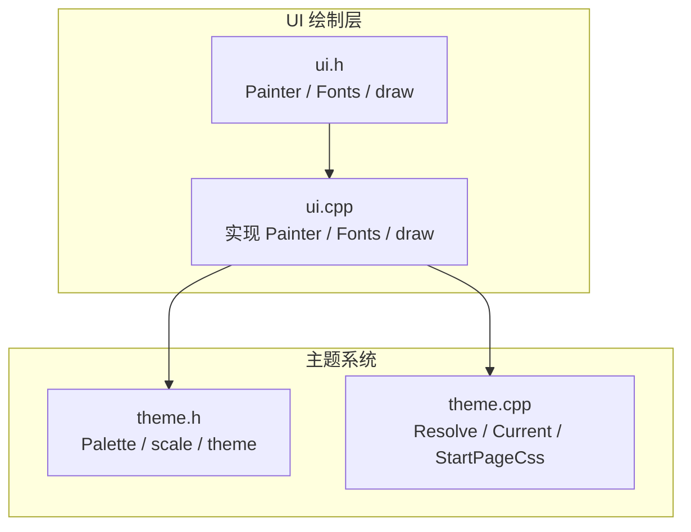
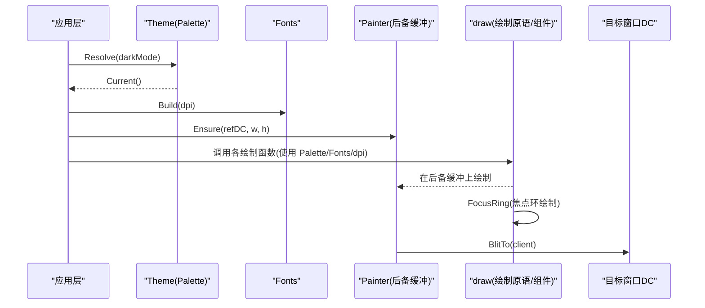
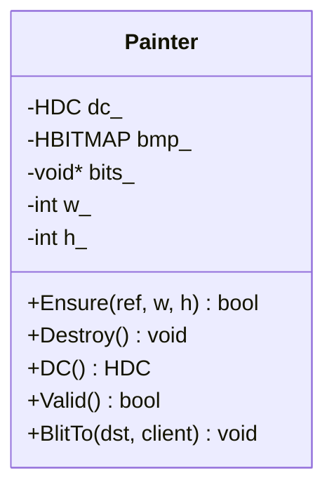
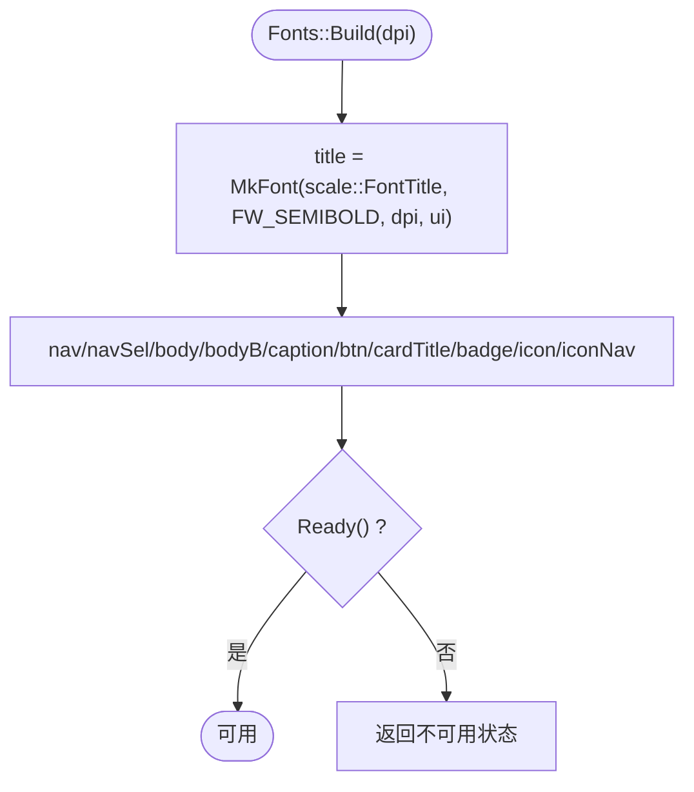
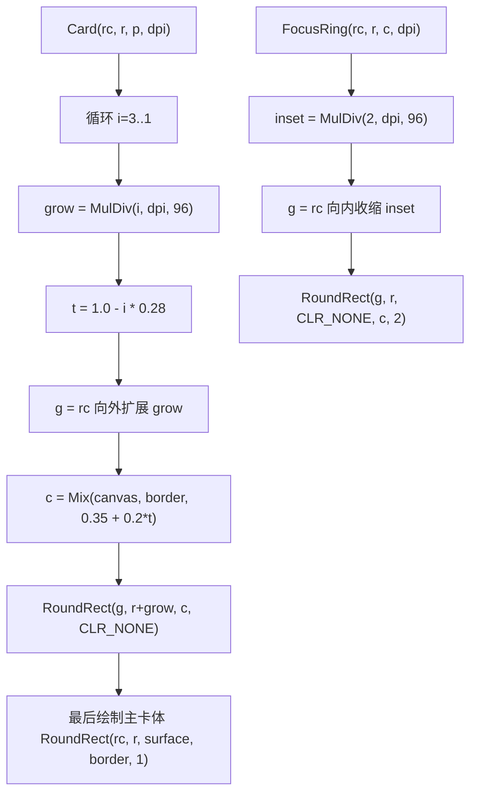
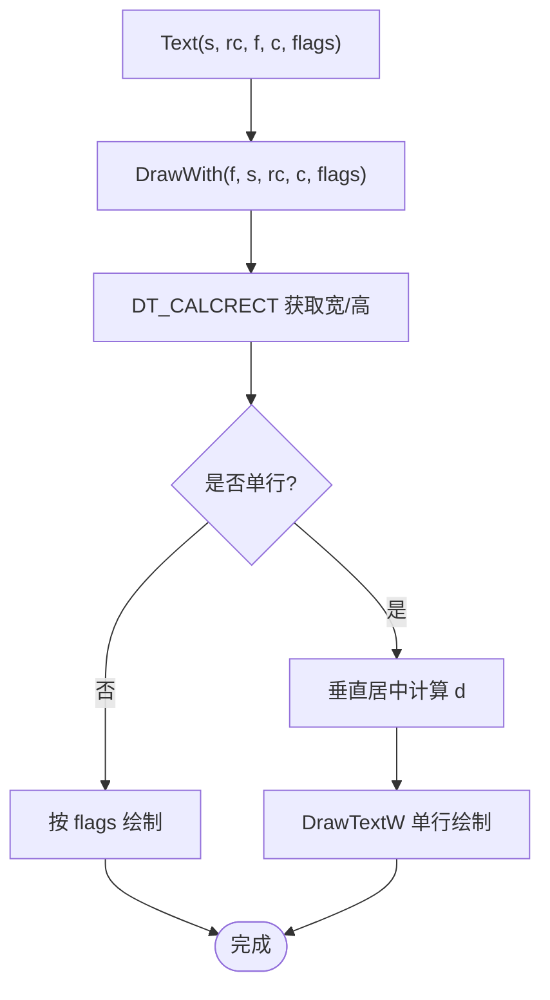
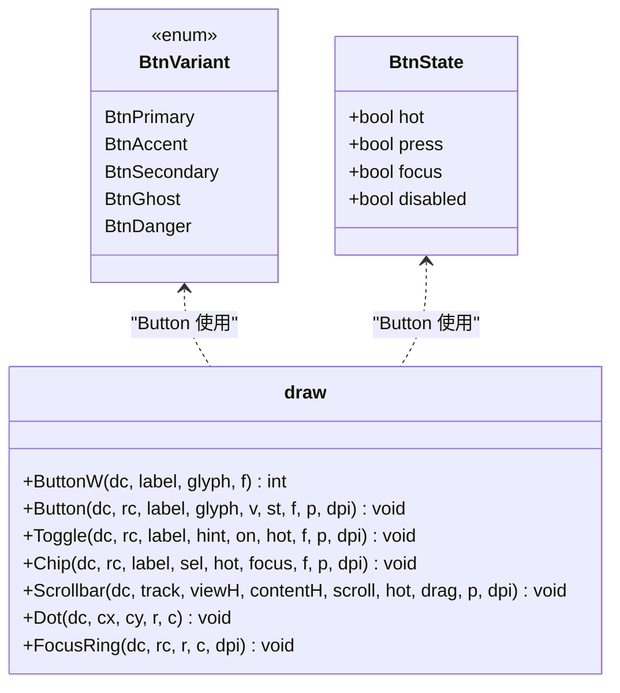
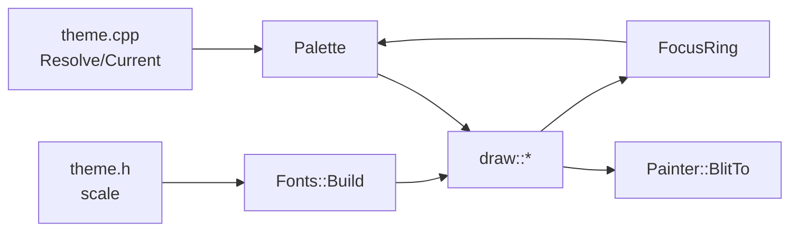

# UI 绘制层

<cite>
**本文引用的文件**   
- [ui.h](file://src/ui.h)
- [ui.cpp](file://src/ui.cpp)
- [theme.h](file://src/theme.h)
- [theme.cpp](file://src/theme.cpp)
</cite>

## 更新摘要
**所做更改**   
- 更新了自定义焦点环实现，替代了DrawFocusRect系统焦点指示器
- 增强了焦点环的视觉设计，包括圆角、内缩和颜色区分
- 添加了上下文感知的焦点可见性机制，仅在键盘导航时显示
- 完善了按钮和其他控件的焦点状态处理逻辑
- 强调了focusRing调色板属性的使用

## 目录
1. [引言](#引言)
2. [项目结构](#项目结构)
3. [核心组件](#核心组件)
4. [架构总览](#架构总览)
5. [详细组件分析](#详细组件分析)
6. [依赖关系分析](#依赖关系分析)
7. [性能与内存优化](#性能与内存优化)
8. [使用示例与最佳实践](#使用示例与最佳实践)
9. [故障排查指南](#故障排查指南)
10. [结论](#结论)

## 引言
本文件面向 UI 绘制层，系统性说明以下目标：
- Painter 类的后备缓冲机制，包括 32 位 top-down DIB 段实现、内存管理与性能优化。
- Fonts 字体集的设计，包括按 DPI 构建字体、字体资源管理与释放机制。
- draw 命名空间下的所有绘制函数：基础绘制（Rect、RoundRect、Card、HLine、VLine）、文字绘制（Text、Measure、WrapText）和组件绘制（Button、Toggle、Chip、Scrollbar）。
- **重要更新**：所有绘制函数现在使用集中式主题系统替代硬编码RGB值，增强按钮状态和悬停效果，确保所有交互元素使用一致的视觉反馈。
- **新增焦点系统**：实现了自定义焦点环机制，替代系统DrawFocusRect，提供更一致和美观的焦点指示器。
- 提供具体使用示例与最佳实践，说明如何避免风格漂移并确保绘制一致性。

## 项目结构
UI 绘制层主要由两个源文件组成：
- ui.h：声明 Painter、Fonts 与 draw 命名空间中的绘制原语与组件。
- ui.cpp：实现 Painter 的后备缓冲、Fonts 的字体构建与释放，以及 draw 中所有绘制逻辑。
主题与调色板由 theme.h/theme.cpp 提供，确保原生绘制与 WebView2 起始页共享同一套视觉语言。

**图表来源**
- [ui.h:1-93](file://src/ui.h#L1-L93)
- [ui.cpp:1-350](file://src/ui.cpp#L1-L350)
- [theme.h:1-91](file://src/theme.h#L1-L91)
- [theme.cpp:1-119](file://src/theme.cpp#L1-L119)

**章节来源**
- [ui.h:1-93](file://src/ui.h#L1-L93)
- [ui.cpp:1-350](file://src/ui.cpp#L1-L350)
- [theme.h:1-91](file://src/theme.h#L1-L91)
- [theme.cpp:1-119](file://src/theme.cpp#L1-L119)

## 核心组件
- Painter：负责创建并管理一个 32 位 top-down DIB 段的后备缓冲 DC，用于离屏绘制后一次性 Blit 到目标窗口 DC。
- Fonts：按 DPI 构建一组 HFONT，并提供统一 Release 接口，避免字体泄漏。
- draw：封装所有像素级绘制原语与组件，保证界面元素通过唯一入口产生，杜绝"同一个界面多种画法"的风格漂移。
- **主题集成**：所有绘制函数现在通过 Palette 参数访问颜色，确保视觉一致性。
- **焦点系统**：实现了自定义 FocusRing 函数，提供圆角、内缩的焦点指示器，替代系统 DrawFocusRect。

**章节来源**
- [ui.h:8-43](file://src/ui.h#L8-L43)
- [ui.h:45-92](file://src/ui.h#L45-L92)
- [ui.cpp:7-44](file://src/ui.cpp#L7-L44)
- [ui.cpp:48-100](file://src/ui.cpp#L48-L100)

## 架构总览
UI 绘制层以"单一绘制原语 + 主题调色板"为核心，形成稳定的渲染管线：
- 主题系统提供 Palette 与 scale 常量，作为颜色与尺寸的权威来源。
- Fonts 在 DPI 变化时重建字体集合，确保文本在不同缩放下清晰一致。
- Painter 提供离屏缓冲，避免频繁重绘导致的闪烁与残影。
- draw 中的所有组件均基于基础原语组合而成，并通过 Palette 参数获取颜色，保证视觉一致性。
- **焦点系统**：FocusRing 函数提供统一的焦点指示器样式，通过 Palette.focusRing 获取颜色。

**图表来源**
- [theme.cpp:67-73](file://src/theme.cpp#L67-L73)
- [ui.cpp:81-100](file://src/ui.cpp#L81-L100)
- [ui.cpp:7-44](file://src/ui.cpp#L7-L44)
- [ui.cpp:102-350](file://src/ui.cpp#L102-L350)

## 详细组件分析

### Painter 类与后备缓冲机制
- 设计目标：使用 32 位 top-down DIB 段作为后备缓冲，显式控制像素格式（BI_RGB/32bpp），避免 CreateCompatibleBitmap 带来的隐式像素格式差异；同时确保位图尺寸与内容始终与本次绘制一致，防止高频 resize/滚动时的旧帧残影。
- 关键流程：
  - Ensure：若已有 DC 且宽高未变则复用；否则销毁旧对象，创建 CompatibleDC 与 DIBSection，选择位图到 DC，记录宽高。
  - Destroy：释放位图、DC，清空 bits_ 指针与宽高。
  - BlitTo：将后备缓冲复制到目标 DC 的客户区矩形。
- 内存管理：
  - 每次 Ensure 失败或尺寸变化都会先 Destroy，避免悬挂句柄。
  - bits_ 由 GDI 内部持有，模块不直接释放，但通过 DeleteObject(bmp_) 间接释放底层像素缓冲区。
- 性能优化：
  - 复用 DC/位图减少分配开销。
  - top-down DIB 便于逐行写入，适合自定义像素操作场景。
  - 仅 BitBlt 一次输出，降低闪烁。

**图表来源**
- [ui.h:8-24](file://src/ui.h#L8-L24)
- [ui.cpp:7-44](file://src/ui.cpp#L7-L44)

**章节来源**
- [ui.h:8-24](file://src/ui.h#L8-L24)
- [ui.cpp:7-44](file://src/ui.cpp#L7-L44)

### Fonts 字体集设计与资源管理
- 设计目标：按 DPI 一次性构建字体集合，DPI 变化时整体重建，避免部分字体不一致导致的排版抖动。
- 构建过程：
  - MkFont：根据逻辑像素、字重、DPI 与字体面名创建 HFONT。
  - IconFace：优先尝试 Segoe Fluent Icons，回退到 Segoe MDL2 Assets，缓存结果。
  - Fonts::Build：为标题、导航、正文、按钮、卡片标题、徽章、图标等分别创建字体。
- 资源释放：
  - Fonts::Release：遍历所有 HFONT 并 DeleteObject，然后置空，避免泄漏。
- 与主题联动：
  - 字体大小来自 theme::scale 中的逻辑像素值，确保在不同 DPI 下一致。

**图表来源**
- [ui.cpp:48-58](file://src/ui.cpp#L48-L58)
- [ui.cpp:61-79](file://src/ui.cpp#L61-L79)
- [ui.cpp:81-100](file://src/ui.cpp#L81-L100)
- [theme.h:38-78](file://src/theme.h#L38-L78)

**章节来源**
- [ui.cpp:48-100](file://src/ui.cpp#L48-L100)
- [theme.h:38-78](file://src/theme.h#L38-L78)

### draw 命名空间：基础绘制函数
- Mix：颜色混合的唯一入口，供悬停/投影等派生态使用，确保颜色过渡一致。
- Rect：纯色填充矩形，支持 CLR_NONE 跳过绘制。
- RoundRect：圆角矩形，支持填充与描边，自动限制圆角半径不超过宽高一半。
- Card：通过三层递淡描边模拟柔和外投影，不依赖 Alpha，缩放/DPI 下无锯齿毛边。**更新**：现在使用 Palette 参数获取 canvas 和 border 颜色。
- HLine/VLine：水平/垂直分割线，基于 Rect 实现。
- Glyph：图标字符居中绘制。
- **FocusRing**：**重大更新** - 新的自定义焦点环实现，替代系统 DrawFocusRect。焦点环内缩 2 像素，具有圆角边框，使用 Palette.focusRing 颜色，宽度为 2 像素（DPI 感知）。

**图表来源**
- [ui.cpp:104-109](file://src/ui.cpp#L104-L109)
- [ui.cpp:140-184](file://src/ui.cpp#L140-L184)
- [ui.cpp:164-174](file://src/ui.cpp#L164-L174)
- [ui.cpp:186-195](file://src/ui.cpp#L186-L195)
- [ui.cpp:191-195](file://src/ui.cpp#L191-L195)

**章节来源**
- [ui.h:47-58](file://src/ui.h#L47-L58)
- [ui.cpp:104-195](file://src/ui.cpp#L104-L195)

### draw 命名空间：文字绘制函数
- Text：统一文字绘制入口，内部使用 DrawWith 处理字体选择、背景模式、颜色设置与对齐方式；单行时进行垂直居中对齐，避免 GDI 基线偏移。
- Measure：测量文本宽度，用于自适应布局（如按钮宽度）。
- WrapText：多行换行排版，返回占用高度；先 CALCRECT 计算高度，再实际绘制。

**图表来源**
- [ui.cpp:111-138](file://src/ui.cpp#L111-L138)
- [ui.cpp:197-223](file://src/ui.cpp#L197-L223)

**章节来源**
- [ui.h:59-63](file://src/ui.h#L59-L63)
- [ui.cpp:111-138](file://src/ui.cpp#L111-L138)
- [ui.cpp:197-223](file://src/ui.cpp#L197-L223)

### draw 命名空间：组件绘制函数
- Button/ButtonW：
  - **重大更新**：完全基于 Palette 参数决定填充、边框与文字颜色，不再使用硬编码RGB值。
  - 根据 BtnVariant 与 BtnState 动态选择颜色：primary 使用 accentFill/accentHover/accentActive，accent 使用 surface/accent/accentText 等。
  - 使用 RoundRect 绘制控件主体，必要时绘制 FocusRing。
  - 图标与文字水平排列，文字右端省略号截断。
  - ButtonW 返回所需宽度，用于自适应按钮宽度。
  - **焦点处理**：当 BtnState.focus 为 true 时，调用 FocusRing 绘制焦点环。
- Toggle：
  - 悬停底铺满控件矩形，轨道与滑块圆角绘制。
  - **更新**：轨道颜色使用 accentFill 或 knobOff，滑块使用 surface，标签颜色使用 text/text2。
  - 右侧显示标签与可选提示，双行布局。
- Chip：
  - 独立分段胶囊，每个选项自成一体，之间留缝。
  - **更新**：选中态使用 accentTint/accent/accentText，非选中态使用 hover/surface/text2。
  - **焦点处理**：支持 focus 参数，当为 true 时绘制 FocusRing。
- Scrollbar：
  - track 为整条轨道矩形，thumb 高度按比例计算，最小高度受 DPI 约束。
  - **更新**：track 使用 track 颜色，thumb 使用 accent/knobOff。
  - hot/drag 改变 thumb 颜色。
- Dot：
  - 小圆点绘制，用于指示器或装饰。

**图表来源**
- [ui.h:65-90](file://src/ui.h#L65-L90)
- [ui.cpp:227-349](file://src/ui.cpp#L227-L349)
- [ui.cpp:191-195](file://src/ui.cpp#L191-L195)

**章节来源**
- [ui.h:65-90](file://src/ui.h#L65-L90)
- [ui.cpp:227-349](file://src/ui.cpp#L227-L349)

## 依赖关系分析
- Painter 依赖 Windows GDI API（CreateCompatibleDC、CreateDIBSection、BitBlt、DeleteObject、DeleteDC）。
- Fonts 依赖 theme::scale 提供的逻辑像素值，并通过 CreateFontIndirectW 创建字体。
- draw 依赖 Palette 与 Fonts，所有颜色与字体均来自主题与字体集，避免硬编码。
- **主题系统集成**：所有绘制函数现在接收 Palette 参数，确保颜色来源统一。
- **焦点系统集成**：FocusRing 函数使用 Palette.focusRing 颜色，确保焦点指示器与主题一致。
- 主题系统 theme 提供 Current() 与 Resolve()，确保原生与 WebView2 起始页共用同一调色板。

**图表来源**
- [theme.cpp:67-73](file://src/theme.cpp#L67-L73)
- [theme.h:38-78](file://src/theme.h#L38-L78)
- [ui.cpp:81-100](file://src/ui.cpp#L81-L100)
- [ui.cpp:102-350](file://src/ui.cpp#L102-L350)
- [ui.cpp:41-44](file://src/ui.cpp#L41-L44)
- [ui.cpp:191-195](file://src/ui.cpp#L191-L195)

**章节来源**
- [theme.h:1-91](file://src/theme.h#L1-L91)
- [theme.cpp:1-119](file://src/theme.cpp#L1-L119)
- [ui.cpp:41-44](file://src/ui.cpp#L41-L44)
- [ui.cpp:81-100](file://src/ui.cpp#L81-L100)
- [ui.cpp:102-350](file://src/ui.cpp#L102-L350)

## 性能与内存优化
- 后备缓冲复用：Painter::Ensure 在尺寸不变时复用 DC/位图，减少分配与销毁开销。
- top-down DIB：便于逐行写入，适合自定义像素操作；避免兼容位图的隐式像素格式问题。
- 颜色混合集中化：Mix 作为唯一入口，避免重复实现导致的不一致。
- 字体构建批量管理：Fonts::Build 一次性构建全部字体，Fonts::Release 统一释放，避免泄漏。
- 绘制原语最小化：基础原语（Rect/RoundRect/HLine/VLine/Glyph/FocusRing）被组件复用，减少重复代码。
- 文本测量与绘制分离：Measure 与 Text/WrapText 分离，便于布局计算与绘制解耦。
- **主题优化**：通过 Palette 参数传递颜色，避免重复的颜色查找和计算。
- **焦点环优化**：FocusRing 使用简单的圆角矩形绘制，避免复杂的系统调用开销。

## 使用示例与最佳实践
- 使用 Painter 作为离屏缓冲：
  - 在窗口绘制前调用 Painter::Ensure(refDC, width, height)。
  - 所有绘制调用都传入 Painter::DC()。
  - 绘制完成后调用 Painter::BlitTo(targetDC, clientRect)。
- 使用 Fonts：
  - 在 DPI 变化时调用 Fonts::Build(newDpi)。
  - 在退出或主题切换时调用 Fonts::Release()。
  - 所有文本绘制使用 Fonts 中的对应 HFONT。
- **主题系统集成最佳实践**：
  - 所有绘制函数必须接收 Palette 参数，禁止硬编码RGB值。
  - 使用 Palette 中的语义化颜色：text、surface、accent、hover、border 等。
  - 按钮状态颜色应基于 Palette：accentFill（主按钮底色）、accentHover（悬停色）、accentActive（按下色）。
  - 组件颜色应保持一致性：Toggle 使用 accentFill/knobOff，Chip 使用 accentTint/accent。
- **焦点系统最佳实践**：
  - 使用 FocusRing 函数绘制焦点环，而不是系统 DrawFocusRect。
  - 焦点环会自动内缩 2 像素，避免覆盖控件内容。
  - 焦点环颜色来自 Palette.focusRing，确保与主题一致。
  - 只在键盘导航时显示焦点环，鼠标交互时隐藏。
  - 所有可聚焦控件都应支持 focus 状态参数。
- 使用 draw 原语与组件：
  - 颜色一律从 Palette 获取，禁止硬编码 RGB。
  - 尺寸一律经 MulDiv(scale::*, dpi, 96) 转换。
  - 按钮、开关、芯片、滚动条等组件统一通过 draw 函数绘制，避免自行实现样式。
- 避免风格漂移：
  - 所有像素经由同一套原语产生，杜绝"同一个界面多种画法"。
  - 悬停、按下、禁用等状态的颜色与边框均由 draw 内部逻辑决定，外部只传递状态。
  - **新增**：所有颜色通过 Palette 统一管理，确保跨组件一致性。
  - **新增**：焦点环样式统一，避免不同控件焦点指示器不一致。
- 确保绘制一致性：
  - 使用 FocusRing 统一焦点环样式。
  - 使用 Card 的统一阴影策略，避免不同位置阴影不一致。
  - 使用 Text/WrapText 的垂直居中与换行逻辑，避免文本溢出或错位。
  - **新增**：使用统一的 Palette 颜色方案，确保明暗主题下的视觉一致性。
  - **新增**：焦点环在所有可聚焦控件上保持一致的视觉效果。

## 故障排查指南
- 后备缓冲无效：
  - 检查 Painter::Ensure 返回值，确认 refDC 有效且宽高为正。
  - 若失败，检查 GDI 资源是否耗尽（位图/DC 数量过多）。
- 字体缺失或异常：
  - 确认 Fonts::Build 已调用且 dpi 正确。
  - 图标字体回退逻辑会检测系统字体可用性，若图标显示异常，检查系统是否安装 Segoe Fluent Icons。
- **颜色不一致问题**：
  - 确认所有颜色来自 Palette，避免硬编码。
  - 检查 Mix 的使用是否正确，尤其是悬停/投影等派生态。
  - **新增**：确保所有组件函数都接收正确的 Palette 参数。
  - **新增**：检查按钮状态颜色映射是否正确（accentFill vs accentHover vs accentActive）。
- **焦点环问题**：
  - 确认 FocusRing 函数被正确调用，传入正确的 RECT 和颜色。
  - 检查 Palette.focusRing 颜色是否设置正确。
  - 验证焦点环的内缩距离是否符合预期（默认 2 像素）。
  - 确认焦点环的圆角半径与控件圆角半径一致。
- 文本重叠或溢出：
  - 使用 Measure 计算宽度，结合 ButtonW 等自适应宽度函数。
  - 使用 WrapText 处理多行文本，确保高度计算与实际绘制一致。
- 滚动条异常：
  - 检查 contentH > viewH 的条件，避免无内容时绘制 thumb。
  - 校验 scroll 范围与 thumb 高度计算，避免越界。
- **主题相关问题**：
  - 确认 theme::Resolve 已在应用启动时调用。
  - 检查明暗主题切换时 Palette 是否正确更新。
  - 验证 WebView2 起始页 CSS 是否与原生绘制使用相同的 Palette。
  - **新增**：检查 focusRing 颜色在明暗主题下是否有足够的对比度。

**章节来源**
- [ui.cpp:7-44](file://src/ui.cpp#L7-L44)
- [ui.cpp:61-79](file://src/ui.cpp#L61-L79)
- [ui.cpp:104-109](file://src/ui.cpp#L104-L109)
- [ui.cpp:191-195](file://src/ui.cpp#L191-L195)
- [ui.cpp:201-223](file://src/ui.cpp#L201-L223)
- [ui.cpp:324-337](file://src/ui.cpp#L324-L337)

## 结论
UI 绘制层通过 Painter 的后备缓冲、Fonts 的字体集管理与 draw 的统一绘制原语，构建了稳定、一致且高性能的渲染体系。**重大更新**：所有绘制函数现在使用集中式主题系统，通过 Palette 参数提供颜色，彻底消除了硬编码RGB值的问题。**新增焦点系统**：实现了自定义 FocusRing 机制，替代系统 DrawFocusRect，提供更一致和美观的焦点指示器。这种设计确保了：

1. **视觉一致性**：所有交互元素（按钮、开关、芯片、滚动条）使用统一的 accent、surface、text 等语义化颜色。
2. **状态反馈统一**：悬停、按下、禁用等状态的颜色变化通过 Palette 中的 accentHover、accentActive、text3 等属性统一管理。
3. **焦点指示统一**：自定义 FocusRing 提供一致的焦点指示器样式，内缩 2 像素，圆角边框，使用主题颜色。
4. **主题适配完善**：明暗主题切换时，所有颜色自动适配，无需修改绘制逻辑。
5. **可维护性提升**：颜色定义集中在 theme.cpp 中，修改视觉效果只需调整 Palette 配置。

遵循本文的最佳实践，可在不同 DPI 与主题下获得一致的视觉效果，同时保持良好的性能与可维护性。新的主题系统集成和焦点系统使得 UI 绘制层更加健壮和易于扩展。