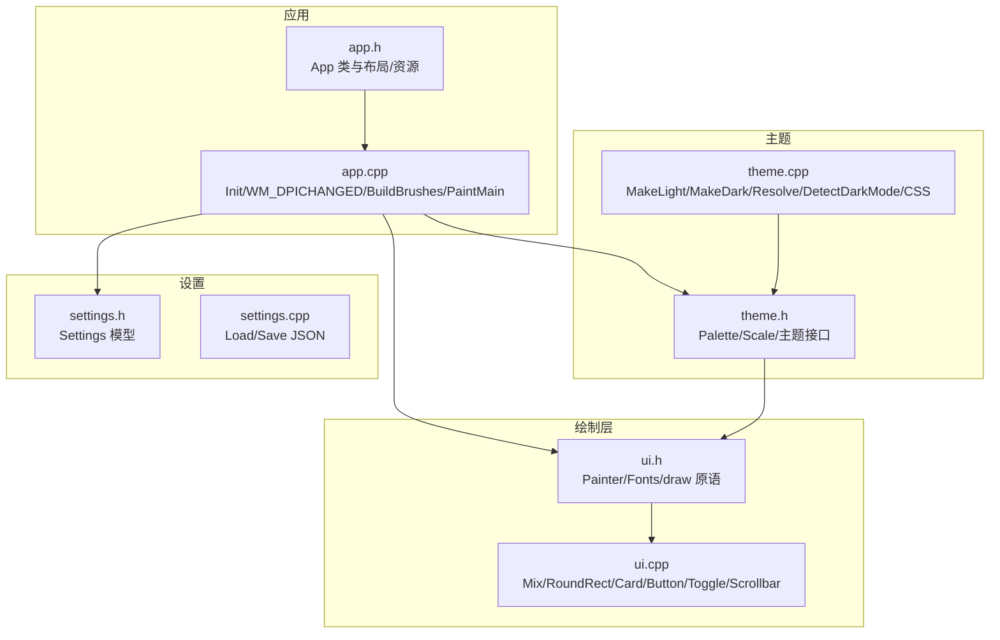
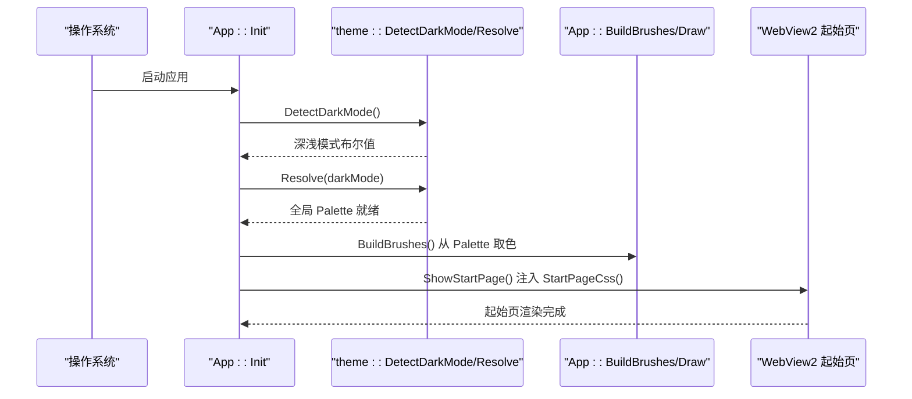
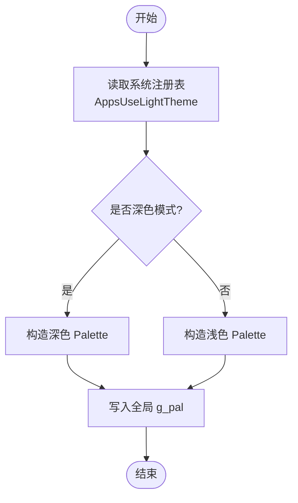
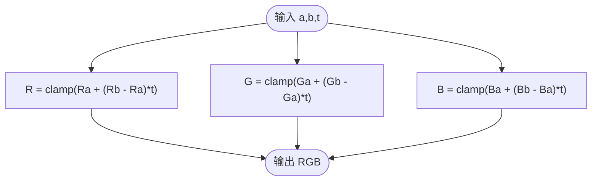
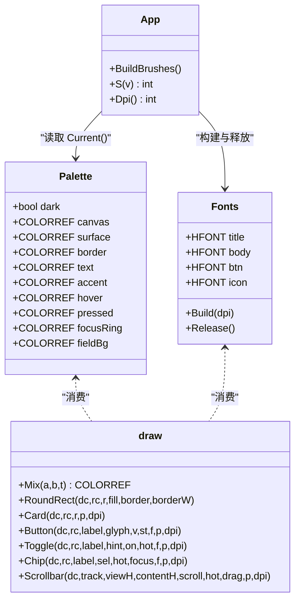
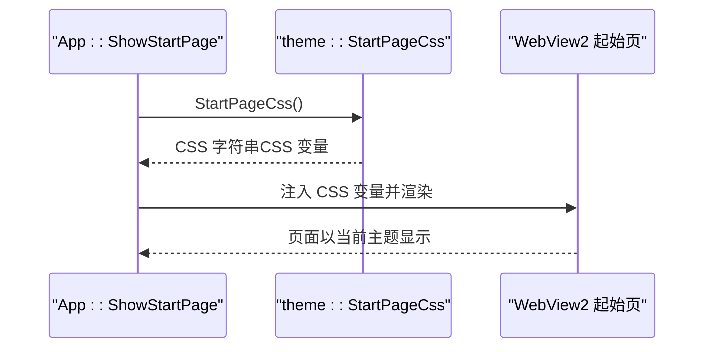
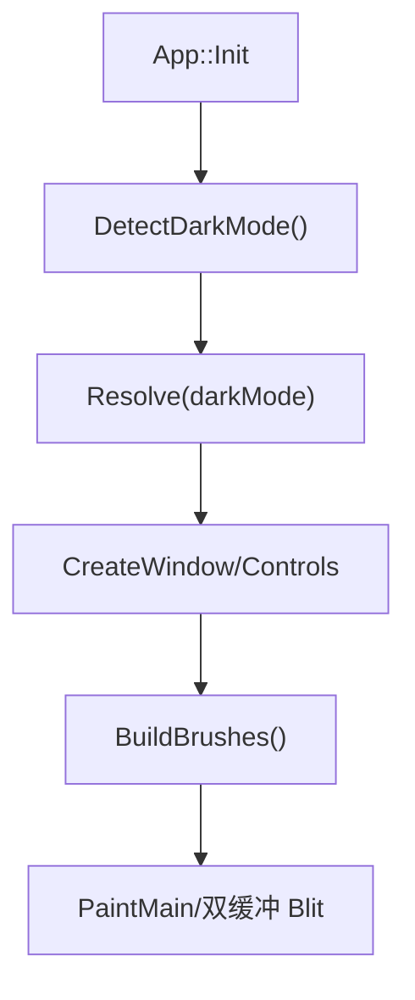
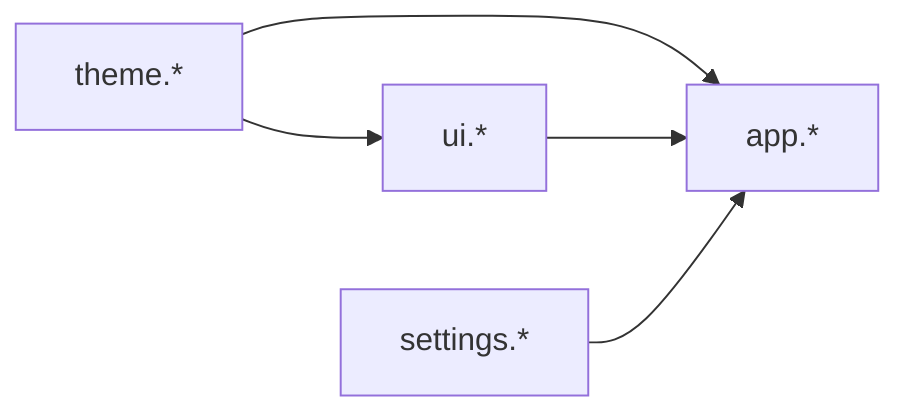
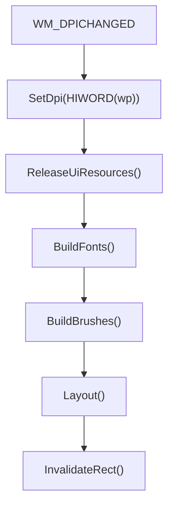

# 主题系统

<cite>
**本文引用的文件**   
- [theme.h](file://src/theme.h)
- [theme.cpp](file://src/theme.cpp)
- [ui.h](file://src/ui.h)
- [ui.cpp](file://src/ui.cpp)
- [app.h](file://src/app.h)
- [app.cpp](file://src/app.cpp)
- [settings.h](file://src/settings.h)
- [settings.cpp](file://src/settings.cpp)
</cite>

## 更新摘要
**变更内容**   
- 重构了主题系统架构，创建了专门的 theme.cpp 和 ui.cpp 模块
- 实现了集中化的 Palette 调色板系统，统一管理所有颜色定义
- 改进了 WebView2 集成，通过 CSS 变量确保原生和 Web 组件的主题一致性
- 增强了 DPI 自适应机制，支持高分辨率屏幕的字体和控件缩放

## 目录
1. [引言](#引言)
2. [项目结构](#项目结构)
3. [核心组件](#核心组件)
4. [架构总览](#架构总览)
5. [详细组件分析](#详细组件分析)
6. [依赖关系分析](#依赖关系分析)
7. [性能与 DPI 自适应](#性能与-dpi-自适应)
8. [自定义主题与扩展实践](#自定义主题与扩展实践)
9. [故障排查](#故障排查)
10. [结论](#结论)

## 引言
本文件面向主题系统的实现与使用，重点说明：
- Palette 调色板的设计模式、颜色语义化命名与深浅色切换机制。
- 主题解析与全局访问方式（当前仓库中通过函数式接口管理主题状态）。
- 颜色混合算法与 UI 绘制层如何消费主题。
- DPI 自适应缩放原理：字体构建、控件尺寸调整与高分屏适配。
- 起始页 WebView2 与原生绘制的主题一致性方案。
- 自定义主题创建方法与扩展建议。

## 项目结构
主题相关代码集中在以下模块：
- theme.h / theme.cpp：定义调色板、尺度常量、主题解析与 CSS 变量生成。
- ui.h / ui.cpp：绘制原语、组件与颜色混合实现，统一消费 Palette。
- app.h / app.cpp：应用初始化、DPI 变化处理、画刷构建与窗口绘制流程。
- settings.h / settings.cpp：设置持久化模型（当前未包含主题字段，但可作为未来扩展点）。

**图表来源**
- [theme.h:1-91](file://src/theme.h#L1-L91)
- [theme.cpp:1-119](file://src/theme.cpp#L1-L119)
- [ui.h:1-93](file://src/ui.h#L1-L93)
- [ui.cpp:1-350](file://src/ui.cpp#L1-L350)
- [app.h:1-192](file://src/app.h#L1-L192)
- [app.cpp:1-1663](file://src/app.cpp#L1-L1663)

**章节来源**
- [theme.h:1-91](file://src/theme.h#L1-L91)
- [theme.cpp:1-119](file://src/theme.cpp#L1-L119)
- [ui.h:1-93](file://src/ui.h#L1-L93)
- [ui.cpp:1-350](file://src/ui.cpp#L1-L350)
- [app.h:1-192](file://src/app.h#L1-L192)
- [app.cpp:1-1663](file://src/app.cpp#L1-L1663)

## 核心组件
- Palette 调色板：以语义化字段描述界面色彩，如 canvas/surface/accent/text/hover/pressed/focusRing 等，避免在绘制代码中出现裸 RGB 字面量。
- scale 尺度常量：以 96dpi 逻辑像素为基准，所有尺寸在绘制前经 MulDiv 或 App::S 换算到实际 DPI。
- 主题接口：Current() 返回当前调色板；Resolve(darkMode) 根据深浅模式重建调色板；DetectDarkMode() 读取系统偏好；StartPageCss() 将调色板导出为 CSS 变量。
- 绘制层 draw 命名空间：提供 Mix 颜色混合、基础图形、卡片投影、按钮、开关、分段胶囊、滚动条等可复用原语，全部基于 Palette 与 Fonts。
- Painter 后备缓冲：32bpp top-down DIB 段，避免高频 resize/滚动时的残影。
- Fonts 字体集：按 DPI 一次性构建，DPI 变化时整体重建。
- App 应用主体：负责主题解析、DPI 变化处理、画刷构建、布局与绘制流程编排。

**章节来源**
- [theme.h:9-36](file://src/theme.h#L9-L36)
- [theme.h:38-78](file://src/theme.h#L38-L78)
- [theme.h:80-91](file://src/theme.h#L80-L91)
- [ui.h:8-43](file://src/ui.h#L8-L43)
- [ui.h:45-92](file://src/ui.h#L45-L92)
- [app.h:12-60](file://src/app.h#L12-L60)

## 架构总览
主题系统采用"单一调色板 + 绘制原语 + 应用编排"的分层设计：
- 主题层（theme）：维护唯一的全局调色板，提供深浅模式检测与 CSS 变量导出。
- 绘制层（ui）：封装 GDI 绘图原语与组件，统一从 Palette 取色，保证视觉一致性。
- 应用层（app）：在初始化与 DPI 变化时重建字体与画刷，协调布局与绘制。

**图表来源**
- [app.cpp:117-120](file://src/app.cpp#L117-L120)
- [theme.cpp:67-88](file://src/theme.cpp#L67-L88)
- [theme.cpp:96-118](file://src/theme.cpp#L96-L118)
- [app.cpp:817-871](file://src/app.cpp#L817-L871)

**章节来源**
- [app.cpp:117-120](file://src/app.cpp#L117-L120)
- [theme.cpp:67-118](file://src/theme.cpp#L67-L118)
- [app.cpp:817-871](file://src/app.cpp#L817-L871)

## 详细组件分析

### Palette 调色板与深浅色主题
- Palette 字段覆盖背景、表面、边框、文字层级、强调色、成功/危险态、悬停/按下、轨道、焦点环、输入框底等。
- MakeLight()/MakeDark() 分别构造浅色与深色调色板，确保对比度达标（例如 accentFill 与 onAccent 的白字对比度）。
- theme::Resolve(bool darkMode) 根据传入标志选择对应调色板并写入全局 g_pal。
- theme::DetectDarkMode() 读取注册表键 AppsUseLightTheme，值为 0 表示深色模式。

**图表来源**
- [theme.cpp:6-69](file://src/theme.cpp#L6-L69)
- [theme.cpp:75-88](file://src/theme.cpp#L75-L88)

**章节来源**
- [theme.h:10-36](file://src/theme.h#L10-L36)
- [theme.cpp:6-69](file://src/theme.cpp#L6-L69)
- [theme.cpp:75-88](file://src/theme.cpp#L75-L88)

### 颜色混合算法
draw::Mix(a, b, t) 对 RGB 三通道进行线性插值，t ∈ [0,1]，用于悬停、投影等派生态的颜色过渡。该函数是绘制层唯一的颜色混合入口，确保交互态一致。

**图表来源**
- [ui.cpp:104-109](file://src/ui.cpp#L104-L109)

**章节来源**
- [ui.h:48-49](file://src/ui.h#L48-L49)
- [ui.cpp:104-109](file://src/ui.cpp#L104-L109)

### 主题与 UI 绘制层的集成
- 应用侧通过 App::BuildBrushes() 从 theme::Current() 获取 Palette，并据此创建画刷与画笔。
- 绘制原语（RoundRect/Card/Button/Toggle/Chip/Scrollbar）均接受 Palette 与 dpi，内部使用 MulDiv 将逻辑尺寸转换为物理像素。
- 卡片阴影通过多层递淡描边模拟柔和投影，避免 Alpha 与高斯模糊带来的锯齿问题。

**图表来源**
- [theme.h:10-36](file://src/theme.h#L10-L36)
- [ui.h:27-43](file://src/ui.h#L27-L43)
- [ui.h:45-92](file://src/ui.h#L45-L92)
- [app.h:64-81](file://src/app.h#L64-L81)

**章节来源**
- [ui.cpp:147-174](file://src/ui.cpp#L147-L174)
- [ui.cpp:233-337](file://src/ui.cpp#L233-L337)
- [app.cpp:295-306](file://src/app.cpp#L295-L306)

### 起始页 WebView2 的主题一致性
- theme::StartPageCss() 将 Palette 中的关键颜色与圆角半径导出为 CSS 变量（--canvas/--surface/--accent/--radius-card 等）。
- App::ShowStartPage() 将这些 CSS 变量注入起始页 HTML，使 WebView2 页面与原生绘制共享同一套配色与尺度。

**图表来源**
- [theme.cpp:96-118](file://src/theme.cpp#L96-L118)
- [app.cpp:817-871](file://src/app.cpp#L817-L871)

**章节来源**
- [theme.cpp:96-118](file://src/theme.cpp#L96-L118)
- [app.cpp:817-871](file://src/app.cpp#L817-L871)

### 主题初始化与动态切换
- 初始化阶段：App::Init() 调用 theme::DetectDarkMode() 与 theme::Resolve()，随后创建窗口、构建画刷与控件。
- 动态切换：当前仓库未暴露用户手动切换主题的 API；如需支持，可在 App 中增加 SwitchTheme(bool dark) 方法，调用 theme::Resolve(dark)，然后重建画刷并触发重绘。
- 持久化存储：settings.json 目前不包含主题字段；若需持久化用户选择的主题，可在 Settings 模型中添加字段并在 Load/Save 中读写。

**图表来源**
- [app.cpp:117-120](file://src/app.cpp#L117-L120)
- [app.cpp:295-306](file://src/app.cpp#L295-L306)

**章节来源**
- [app.cpp:117-120](file://src/app.cpp#L117-L120)
- [app.cpp:295-306](file://src/app.cpp#L295-L306)
- [settings.h:13-20](file://src/settings.h#L13-L20)
- [settings.cpp:22-47](file://src/settings.cpp#L22-L47)

## 依赖关系分析
- theme 模块不依赖 ui 与 app，仅依赖 Windows API 与标准库。
- ui 模块依赖 theme（Palette），并提供绘制原语供 app 与业务模块使用。
- app 模块依赖 theme（Current/Resolve）、ui（Painter/Fonts/draw）与 settings（持久化）。
- 无循环依赖；耦合方向清晰：app → ui → theme。

**图表来源**
- [theme.h:1-91](file://src/theme.h#L1-L91)
- [ui.h:1-93](file://src/ui.h#L1-L93)
- [app.h:1-192](file://src/app.h#L1-L192)
- [settings.h:1-26](file://src/settings.h#L1-L26)

**章节来源**
- [theme.h:1-91](file://src/theme.h#L1-L91)
- [ui.h:1-93](file://src/ui.h#L1-L93)
- [app.h:1-192](file://src/app.h#L1-L192)
- [settings.h:1-26](file://src/settings.h#L1-L26)

## 性能与 DPI 自适应
- 后备缓冲：Painter 使用 32bpp top-down DIB 段，仅在尺寸变化时重建，避免高频 resize/滚动产生旧帧残影。
- 双缓冲绘制：App 在 WM_PAINT 中优先使用内存 DC 绘制后 BitBlt 到屏幕 DC，失败时降级为直接绘制以保证正确性。
- DPI 自适应：
  - 字体构建：MkFont 使用 MulDiv(px, dpi, 96) 将逻辑像素换算为物理像素；Fonts::Build 按 DPI 一次性构建所有字体。
  - 控件尺寸：scale 常量以 96dpi 逻辑像素书写，绘制时通过 MulDiv 或 App::S 换算。
  - DPI 变化：WM_DPICHANGED 中更新 dpi_、重建字体与画刷、重新布局并重绘。
- 高分辨率适配：所有圆角、间距、字号、图标尺寸均通过 MulDiv 与 dpi 参数计算，确保在不同 DPI 下视觉一致。

**图表来源**
- [app.cpp:1312-1324](file://src/app.cpp#L1312-L1324)
- [ui.cpp:48-58](file://src/ui.cpp#L48-L58)
- [ui.cpp:81-100](file://src/ui.cpp#L81-L100)

**章节来源**
- [ui.cpp:7-44](file://src/ui.cpp#L7-L44)
- [ui.cpp:48-100](file://src/ui.cpp#L48-L100)
- [app.cpp:218-218](file://src/app.cpp#L218-L218)
- [app.cpp:262-280](file://src/app.cpp#L262-L280)
- [app.cpp:1312-1324](file://src/app.cpp#L1312-L1324)

## 自定义主题与扩展实践
- 新增主题变体：
  - 在 theme.cpp 中新增 MakeCustom() 函数，填充 Palette 字段。
  - 在 theme.h 的 theme 命名空间中暴露新的 Resolve 重载或枚举，以便应用层选择。
  - 在 App::Init() 或新增的 SwitchTheme() 中调用新的 Resolve 路径。
- 扩展颜色语义：
  - 在 Palette 中新增字段（如 info/warning 等），并在 draw 原语中使用。
  - 同步更新 StartPageCss()，将新颜色导出为 CSS 变量。
- 主题持久化：
  - 在 Settings 模型中添加主题字段（如 themeMode: light/dark/custom）。
  - 在 LoadSettings/SaveSettings 中读写该字段。
  - 在应用启动时根据持久化的主题模式调用 theme::Resolve。
- 最佳实践：
  - 保持语义化命名，禁止在绘制代码中硬编码 RGB。
  - 所有尺寸与字号通过 scale 常量与 MulDiv/App::S 换算。
  - 确保对比度达标（尤其是强调色上的文字）。
  - 起始页与原生绘制共用同一份 Palette，避免两套配色。

**章节来源**
- [theme.h:10-36](file://src/theme.h#L10-L36)
- [theme.cpp:6-69](file://src/theme.cpp#L6-L69)
- [theme.cpp:96-118](file://src/theme.cpp#L96-L118)
- [settings.h:13-20](file://src/settings.h#L13-L20)
- [settings.cpp:22-75](file://src/settings.cpp#L22-L75)

## 故障排查
- 主题未生效：
  - 检查 App::Init() 是否在创建窗口前调用 theme::Resolve(theme::DetectDarkMode())。
  - 确认 theme::Current() 返回的 Palette 非全零（未初始化会导致纯黑）。
- 起始页颜色异常：
  - 确认 ShowStartPage() 注入了 theme::StartPageCss() 生成的 CSS 变量。
- DPI 导致字体模糊或错位：
  - 检查 WM_DPICHANGED 是否重建字体与画刷并触发 Layout/Invalidate。
  - 确认所有尺寸通过 MulDiv 或 App::S 换算。
- 滚动残影：
  - 确认 Painter 的 Ensure/Destroy 与 App 的双缓冲逻辑正确。
  - 滚动后对整个客户区失效，而非仅视口区域。

**章节来源**
- [app.cpp:117-120](file://src/app.cpp#L117-L120)
- [app.cpp:817-871](file://src/app.cpp#L817-L871)
- [app.cpp:1312-1324](file://src/app.cpp#L1312-L1324)
- [ui.cpp:7-44](file://src/ui.cpp#L7-L44)

## 结论
该主题系统通过 Palette 语义化颜色、scale 逻辑像素与统一的绘制原语，实现了深浅色主题的一致性与可扩展性。主题解析与 CSS 变量导出确保了原生绘制与 WebView2 起始页的视觉同源。DPI 自适应通过字体与尺寸的 MulDiv 换算以及 WM_DPICHANGED 的重建流程，保障了高分屏下的体验一致性。未来可通过扩展 Palette、引入主题持久化与用户切换 API，进一步增强主题系统的灵活性与可用性。