# 用户界面系统

<cite>
**本文引用的文件**   
- [ui.h](file://src/ui.h)
- [ui.cpp](file://src/ui.cpp)
- [theme.h](file://src/theme.h)
- [theme.cpp](file://src/theme.cpp)
- [app.h](file://src/app.h)
- [app.cpp](file://src/app.cpp)
</cite>

## 目录
1. [引言](#引言)
2. [项目结构](#项目结构)
3. [核心组件](#核心组件)
4. [架构总览](#架构总览)
5. [详细组件分析](#详细组件分析)
6. [依赖关系分析](#依赖关系分析)
7. [性能与绘制特性](#性能与绘制特性)
8. [主题系统与调色板](#主题系统与调色板)
9. [UI 组件使用示例与自定义样式](#ui-组件使用示例与自定义样式)
10. [响应式布局实现](#响应式布局实现)
11. [动画效果添加方式](#动画效果添加方式)
12. [故障排查指南](#故障排查指南)
13. [结论](#结论)

## 引言
本文件面向开发者与使用者，系统化说明该 Windows 桌面应用的现代化无边框用户界面系统。重点包括：
- 现代化无边框窗口的实现原理与消息处理
- GDI+ 绘图与后备缓冲机制（Painter、双缓冲）
- draw 命名空间下的绘制原语与控件绘制
- 主题系统：Palette 调色板、深色/浅色切换、DPI 自适应缩放
- UI 组件的使用方法与自定义样式思路
- 响应式布局与可组合的视觉语言
- 动画效果的扩展建议

## 项目结构
界面相关代码集中在以下模块：
- ui.h / ui.cpp：绘制层，包含 Painter 后备缓冲、Fonts 字体集、draw 绘制原语与基础组件
- theme.h / theme.cpp：主题与调色板、尺度常量、CSS 变量生成
- app.h / app.cpp：应用主体、无边框窗口、响应式布局、自绘控件、主绘制流程

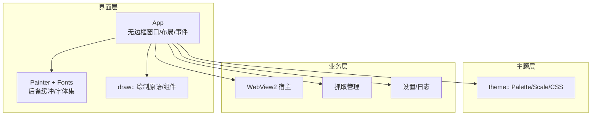

**图表来源**
- [app.cpp:117-172](file://src/app.cpp#L117-L172)
- [ui.h:11-43](file://src/ui.h#L11-L43)
- [theme.h:10-78](file://src/theme.h#L10-L78)

**章节来源**
- [app.h:15-183](file://src/app.h#L15-L183)
- [app.cpp:117-172](file://src/app.cpp#L117-L172)
- [ui.h:11-43](file://src/ui.h#L11-L43)
- [theme.h:10-78](file://src/theme.h#L10-L78)

## 核心组件
- App：应用主体，负责窗口创建、无边框框架、响应式布局、控件生命周期、主绘制流程与消息分发。
- Painter：基于 top-down DIB 段的后备缓冲，避免高频 resize/滚动时的旧帧残影。
- Fonts：按 DPI 构建字体集，支持图标字体回退策略。
- draw：统一的绘制原语与基础组件（矩形、圆角、卡片、文字、按钮、开关、分段胶囊、滚动条等）。
- theme：全局调色板、尺度常量、深浅色检测与 CSS 变量生成，确保原生与 WebView2 起始页同源配色。

**章节来源**
- [app.h:15-183](file://src/app.h#L15-L183)
- [ui.h:11-92](file://src/ui.h#L11-L92)
- [theme.h:10-91](file://src/theme.h#L10-L91)

## 架构总览
下图展示从窗口消息到绘制输出的关键路径：

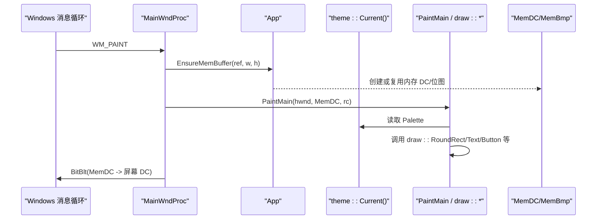

**图表来源**
- [app.cpp:1233-1248](file://src/app.cpp#L1233-L1248)
- [ui.cpp:7-44](file://src/ui.cpp#L7-L44)
- [theme.cpp:67-73](file://src/theme.cpp#L67-L73)

**章节来源**
- [app.cpp:1233-1248](file://src/app.cpp#L1233-L1248)
- [ui.cpp:7-44](file://src/ui.cpp#L7-L44)

## 详细组件分析

### Painter 后备缓冲机制
- 使用 CreateCompatibleDC + CreateDIBSection 构造 32bpp top-down DIB 段，显式控制像素格式与尺寸。
- Ensure 在尺寸变化时重建，BlitTo 将内容复制到目标 DC。
- 优势：避免 CreateCompatibleBitmap 在高频 resize/滚动时出现旧帧残影；统一像素格式便于后续混合与缩放。

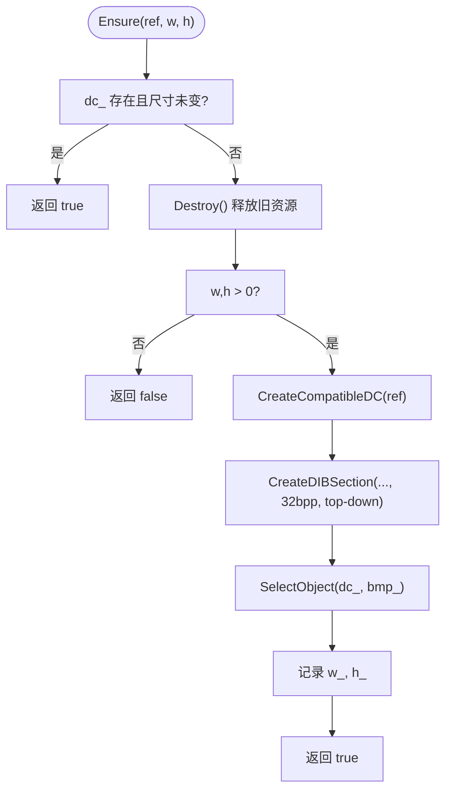

**图表来源**
- [ui.cpp:7-44](file://src/ui.cpp#L7-L44)

**章节来源**
- [ui.h:11-24](file://src/ui.h#L11-L24)
- [ui.cpp:7-44](file://src/ui.cpp#L7-L44)

### Fonts 字体集与图标字体回退
- 通过 LOGFONTW 与 MulDiv 按 DPI 计算逻辑像素字号。
- 图标字体优先 Segoe Fluent Icons，不存在则回退到 Segoe MDL2 Assets。
- Build/Release 成对管理 HFONT 资源，避免泄漏。

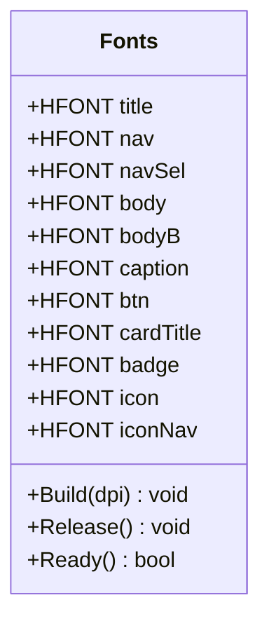

**图表来源**
- [ui.h:27-43](file://src/ui.h#L27-L43)
- [ui.cpp:48-100](file://src/ui.cpp#L48-L100)

**章节来源**
- [ui.h:27-43](file://src/ui.h#L27-L43)
- [ui.cpp:48-100](file://src/ui.cpp#L48-L100)

### draw 命名空间绘制函数
- 基础原语：Mix、Rect、RoundRect、Card、HLine/VLine、Glyph、FocusRing、Text、Measure、WrapText。
- 组件：Button（含 BtnVariant/BtnState）、Toggle、Chip、Scrollbar、Dot。
- 特点：所有颜色来自 Palette；所有尺寸经 DPI 缩放；圆角与描边统一；文字排版考虑垂直居中与换行测量。

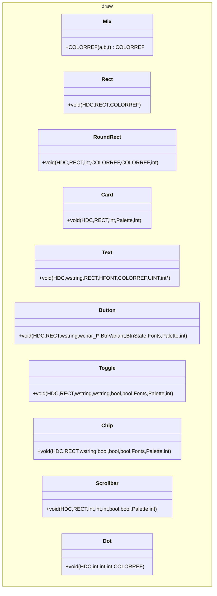

**图表来源**
- [ui.h:45-92](file://src/ui.h#L45-L92)
- [ui.cpp:104-349](file://src/ui.cpp#L104-L349)

**章节来源**
- [ui.h:45-92](file://src/ui.h#L45-L92)
- [ui.cpp:104-349](file://src/ui.cpp#L104-L349)

### 无边框窗口与标题栏按钮
- 通过 WM_NCCALCSIZE 返回 0 使客户区等于窗口矩形，配合 DWM 属性设置圆角与边框色。
- WM_NCHITTEST 自定义标题栏拖拽、四边缩放区域与标题栏按钮命中测试。
- 标题栏按钮绘制与悬停/按下状态由 MainWndProc 维护 tbHot_/tbPress_ 并局部刷新。

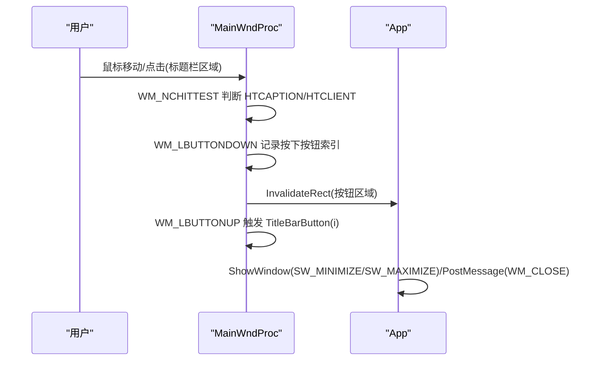

**图表来源**
- [app.cpp:1274-1307](file://src/app.cpp#L1274-L1307)
- [app.cpp:1326-1374](file://src/app.cpp#L1326-L1374)
- [app.cpp:1006-1027](file://src/app.cpp#L1006-L1027)

**章节来源**
- [app.cpp:1274-1307](file://src/app.cpp#L1274-L1307)
- [app.cpp:1326-1374](file://src/app.cpp#L1326-L1374)
- [app.cpp:1006-1027](file://src/app.cpp#L1006-L1027)

### 主绘制流程与双缓冲
- WM_ERASEBKGND 返回 1 禁用默认背景擦除，配合自定义填充避免闪烁。
- WM_PAINT 中先 EnsureMemBuffer，再 PaintMain 绘制到内存 DC，最后 BitBlt 到屏幕 DC。
- 尺寸变化时自动重建内存缓冲，失败时降级为直接绘制保证正确性。

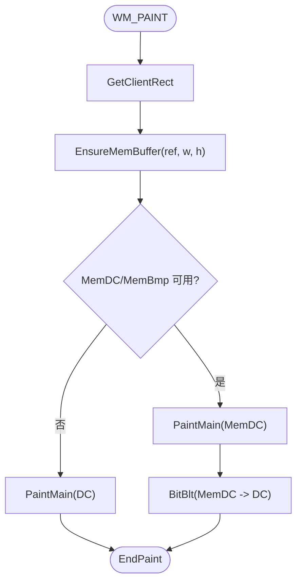

**图表来源**
- [app.cpp:1231-1248](file://src/app.cpp#L1231-L1248)

**章节来源**
- [app.cpp:1231-1248](file://src/app.cpp#L1231-L1248)

### 自绘控件与主题一致性
- 导航标签、按钮、复选框、单选分段均采用 owner-draw，并在 DRAWITEM 中根据当前 Palette 渲染。
- 按钮语义与 draw::Button 保持一致（BtnPrimary/Secondary/Danger 等），避免两套颜色。
- 复选框与单选分段采用 2.0 风格：方框对勾与圆点选择态。

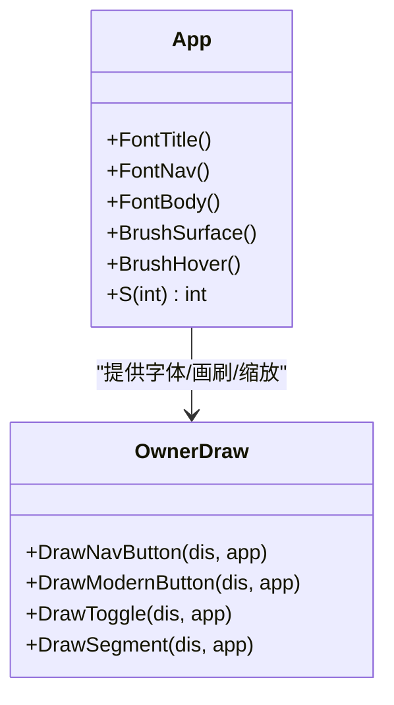

**图表来源**
- [app.cpp:829-1003](file://src/app.cpp#L829-L1003)
- [app.h:64-82](file://src/app.h#L64-L82)

**章节来源**
- [app.cpp:829-1003](file://src/app.cpp#L829-L1003)
- [app.h:64-82](file://src/app.h#L64-L82)

## 依赖关系分析
- App 依赖 theme::Current() 获取 Palette，用于构建画刷与绘制。
- App 依赖 WebView2 进行页面加载与消息回调。
- App 依赖 CaptureManager 与 LogWriter 完成抓取与日志输出。
- ui.h/ui.cpp 提供 Painter、Fonts、draw 原语，供 App 与主题层共同消费。

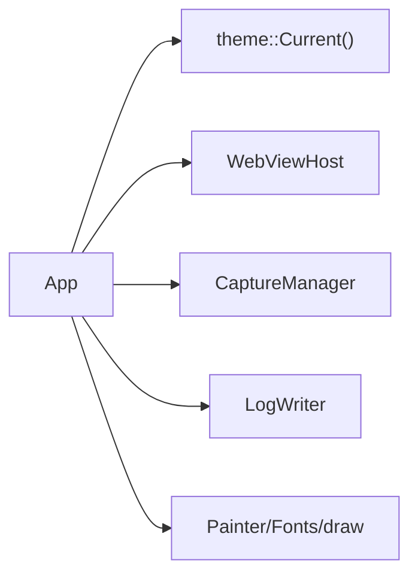

**图表来源**
- [app.h:15-183](file://src/app.h#L15-L183)
- [app.cpp:141-172](file://src/app.cpp#L141-L172)

**章节来源**
- [app.h:15-183](file://src/app.h#L15-L183)
- [app.cpp:141-172](file://src/app.cpp#L141-L172)

## 性能与绘制特性
- 双缓冲：内存 DC + 位图仅在尺寸变化时重建，减少频繁分配开销。
- 文本绘制：DrawWith 内部使用 DT_CALCRECT 精确测量宽度，避免重叠；单行文本垂直居中修正基线偏移。
- 卡片投影：Card 通过多层递淡描边模拟柔和阴影，避免 Alpha 混合带来的锯齿问题。
- 滚动优化：设置页滚动合并连续滚轮事件，只渲染最终位置；子控件裁剪避免视口外残片。

**章节来源**
- [ui.cpp:113-137](file://src/ui.cpp#L113-L137)
- [ui.cpp:164-174](file://src/ui.cpp#L164-L174)
- [app.cpp:1467-1476](file://src/app.cpp#L1467-L1476)
- [app.cpp:504-537](file://src/app.cpp#L504-L537)

## 主题系统与调色板
- Palette 定义语义化颜色字段（canvas/surface/accent/onAccent 等），禁止在绘制代码中使用裸 RGB。
- 深浅色检测：读取注册表 AppsUseLightTheme，Resolve 生成 g_pal。
- 尺度常量：scale 命名空间集中半径、间距、字号等设计令牌，统一以 96dpi 逻辑像素书写，绘制前经 S()/MulDiv 缩放。
- CSS 变量：StartPageCss 将 Palette 映射为 CSS 变量，确保 WebView2 起始页与原生绘制同源配色。

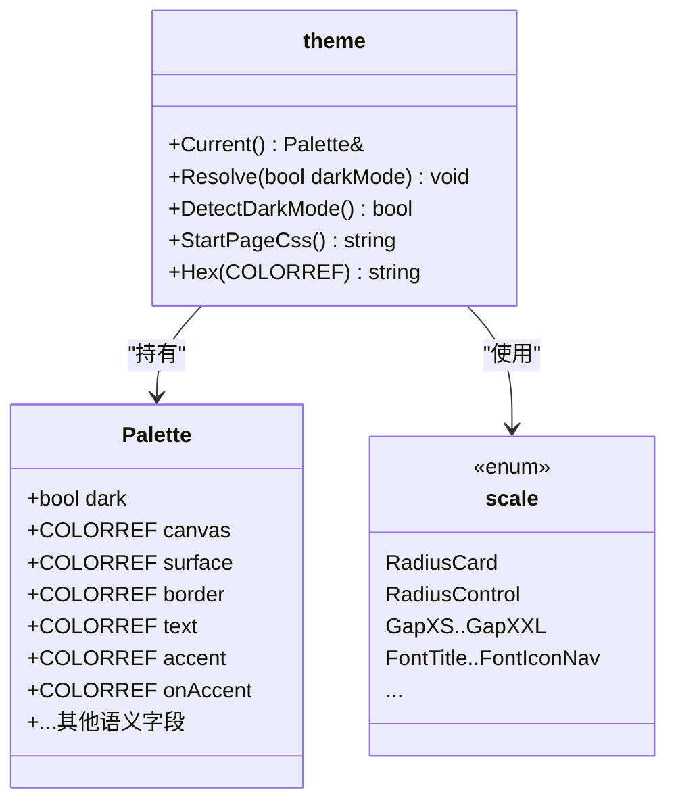

**图表来源**
- [theme.h:10-78](file://src/theme.h#L10-L78)
- [theme.cpp:6-65](file://src/theme.cpp#L6-L65)
- [theme.cpp:67-118](file://src/theme.cpp#L67-L118)

**章节来源**
- [theme.h:10-91](file://src/theme.h#L10-L91)
- [theme.cpp:6-118](file://src/theme.cpp#L6-L118)

## UI 组件使用示例与自定义样式
- 按钮：使用 draw::Button，传入 BtnVariant（Primary/Accent/Secondary/Ghost/Danger）与 BtnState（hot/press/focus/disabled），结合 Fonts 与 Palette 渲染。
- 开关：draw::Toggle 显示 on/off 状态与可选 hint 文案，悬停高亮轨道。
- 分段胶囊：draw::Chip 独立圆角胶囊，选中态使用 accentTint/accent/accentText。
- 滚动条：draw::Scrollbar 根据 viewH/contentH/scroll 计算 thumb 高度与位置，hot/drag 使用 accent。

自定义样式建议：
- 新增 Palette 字段并更新 MakeLight/MakeDark，保持对比度达标。
- 在 draw 命名空间新增组件函数，遵循 DPI 缩放与语义化颜色。
- 在 App 的 owner-draw 绘制函数中复用 draw 原语，确保与通用组件一致。

**章节来源**
- [ui.h:65-88](file://src/ui.h#L65-L88)
- [ui.cpp:227-349](file://src/ui.cpp#L227-L349)
- [theme.cpp:6-65](file://src/theme.cpp#L6-L65)

## 响应式布局实现
- 三档布局：LayoutExpanded/Compact/Narrow，依据客户区宽度（已 DPI 换算）切换。
- 工具栏卡片：宽窗口单行排列地址框与按钮；窄窗口自动换行为两行。
- 设置页：单张大表单卡片，右侧带滚动条；子控件按交集裁剪避免错位。
- 状态栏：全宽显示状态文字、Cookie/Token 计数与日志路径，动态对齐。

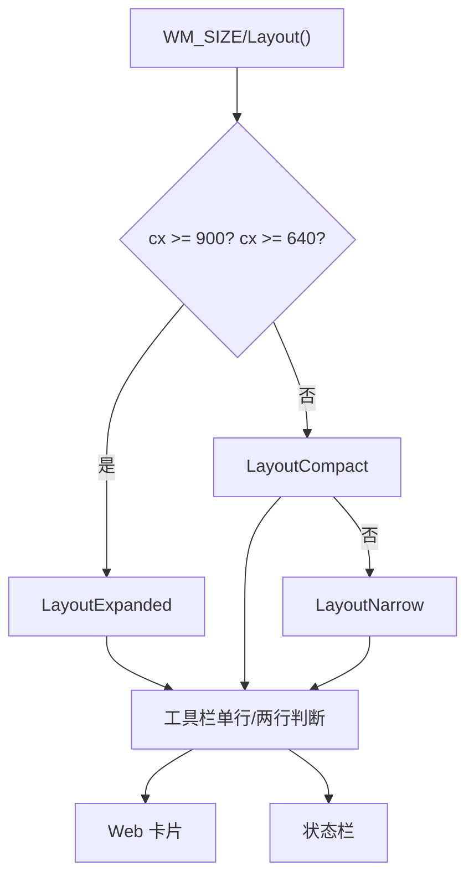

**图表来源**
- [app.cpp:379-537](file://src/app.cpp#L379-L537)

**章节来源**
- [app.cpp:379-537](file://src/app.cpp#L379-L537)

## 动画效果添加方式
当前界面以即时交互为主，未内置复杂动画。可在以下位置扩展：
- 标题栏按钮悬停/按下过渡：在 DrawTitleButton 中引入缓动插值（如 Mix）与定时器驱动重绘。
- 按钮与开关状态过渡：在 owner-draw 绘制函数中缓存上一帧状态，使用 Mix 平滑过渡 fill/text/border。
- 滚动条 thumb 位置过渡：在 SetSettingsScroll 后启动轻量定时器逐步逼近目标 scroll。
- 卡片阴影与焦点环：在 Card/FocusRing 中增加渐变层次与淡入淡出。

注意：
- 所有过渡需保持 DPI 感知（使用 S()/MulDiv）。
- 动画帧需与 InvalidateRect 局部刷新结合，避免全屏重绘抖动。
- 若使用 GDI+，需注意线程模型与资源释放；当前 GDI 方案更稳定。

[本节为概念性指导，不直接分析具体文件]

## 故障排查指南
- 双标题栏：检查 WM_NCCALCSIZE 是否对 wp=FALSE 返回 0，避免 DefWindowProc 保留标准标题栏。
- 滚动残影：确保 InvalidateRect(main_, nullptr, FALSE) 在布局变更后执行；子控件裁剪与隐藏逻辑正确。
- WebView2 初始化失败：OnTimer 中多次检测未就绪则提示安装运行时；确认 userData 目录权限。
- 主题颜色异常：确保 theme::Resolve 在窗口创建前调用；Palette 字段完整且对比度达标。
- DPI 缩放异常：WM_DPICHANGED 中重建字体与画刷，ApplyFonts 应用到所有子控件。

**章节来源**
- [app.cpp:1274-1287](file://src/app.cpp#L1274-L1287)
- [app.cpp:504-537](file://src/app.cpp#L504-L537)
- [app.cpp:711-726](file://src/app.cpp#L711-L726)
- [app.cpp:1254-1265](file://src/app.cpp#L1254-L1265)

## 结论
该用户界面系统以主题驱动的 Palette 为核心，结合 Painter 后备缓冲与 draw 命名空间的统一绘制原语，实现了现代化无边框窗口、响应式布局与一致的视觉语言。App 作为编排中心，协调窗口消息、布局、WebView2 与业务模块，确保界面稳定、可维护且可扩展。通过 Palette 与 scale 的设计令牌，深色/浅色主题与 DPI 自适应得以无缝切换；draw 组件为二次开发提供了清晰的扩展点。未来可在保持主题一致性的前提下，按需加入平滑动画与更丰富的交互反馈。