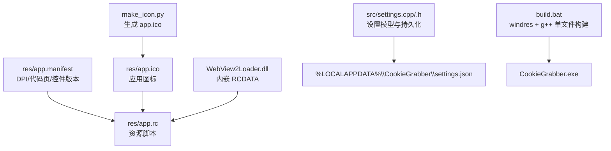
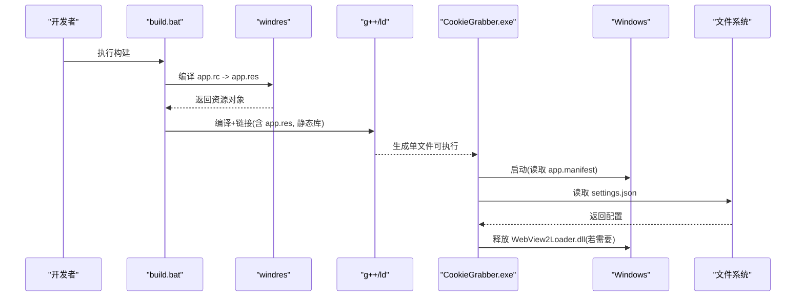
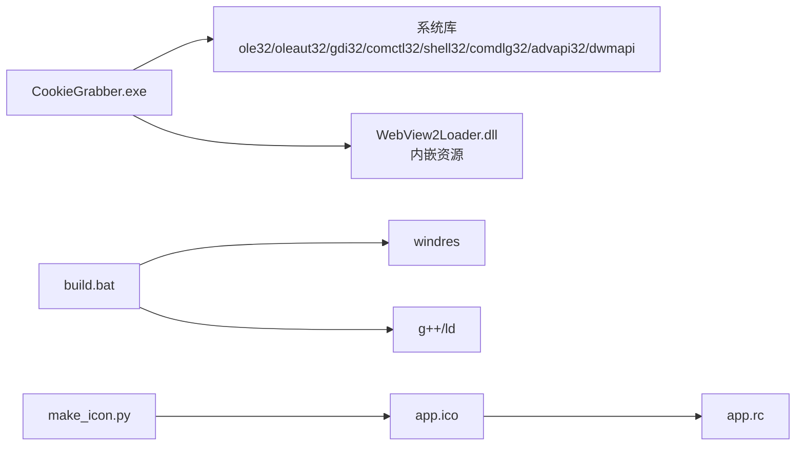

# 配置与部署

<cite>
**本文引用的文件**   
- [app.manifest](file://res/app.manifest)
- [app.rc](file://res/app.rc)
- [settings.cpp](file://src/settings.cpp)
- [settings.h](file://src/settings.h)
- [build.bat](file://build.bat)
- [make_icon.py](file://make_icon.py)
</cite>

## 目录
1. [简介](#简介)
2. [项目结构](#项目结构)
3. [核心组件](#核心组件)
4. [架构总览](#架构总览)
5. [详细组件分析](#详细组件分析)
6. [依赖关系分析](#依赖关系分析)
7. [性能考虑](#性能考虑)
8. [故障排除指南](#故障排除指南)
9. [结论](#结论)
10. [附录](#附录)

## 简介
本指南面向 Cookie 抓取工具的开发者与维护者，聚焦以下目标：
- 解释应用程序清单 app.manifest 的关键配置项（DPI 感知、管理员权限、代码页等）及其影响。
- 说明资源脚本 app.rc 的结构与图标、清单、WebView2Loader.dll 内嵌方式。
- 梳理配置文件 settings.json 的数据结构与字段含义（预设管理、历史记录开关、日志格式等）。
- 提供单文件打包与分发的最佳实践，包括依赖处理与构建流程。
- 给出常见部署问题的排查步骤与解决方案。

## 项目结构
本项目采用“功能模块 + 资源/构建”的清晰分层：
- res：应用资源（清单、资源脚本、图标、内嵌 DLL）。
- src：C++ 源码（UI、WebView、捕获、设置持久化、主题、工具函数等）。
- build.bat：MinGW-w64 构建脚本，负责 windres 编译资源与 g++ 链接生成单文件可执行。
- make_icon.py：纯 Python 脚本，生成 32x32 ICO 图标。

图表来源
- [app.manifest:1-17](file://res/app.manifest#L1-L17)
- [app.rc:1-12](file://res/app.rc#L1-L12)
- [settings.cpp:1-76](file://src/settings.cpp#L1-L76)
- [settings.h:1-26](file://src/settings.h#L1-L26)
- [build.bat:1-34](file://build.bat#L1-L34)
- [make_icon.py:1-51](file://make_icon.py#L1-L51)

章节来源
- [app.manifest:1-17](file://res/app.manifest#L1-L17)
- [app.rc:1-12](file://res/app.rc#L1-L12)
- [settings.cpp:1-76](file://src/settings.cpp#L1-L76)
- [settings.h:1-26](file://src/settings.h#L1-L26)
- [build.bat:1-34](file://build.bat#L1-L34)
- [make_icon.py:1-51](file://make_icon.py#L1-L51)

## 核心组件
- 应用清单（app.manifest）：声明 Windows 平台相关行为，如 DPI 感知、通用控件版本、UTF-8 代码页。
- 资源脚本（app.rc）：将图标、清单、WebView2Loader.dll 等资源嵌入到最终可执行文件中。
- 设置持久化（settings.cpp/.h）：定义 Settings/Preset 数据模型，读写 %LOCALAPPDATA%\CookieGrabber\settings.json。
- 构建脚本（build.bat）：调用 windres 编译资源，g++ 链接生成静态库的单文件可执行。
- 图标生成（make_icon.py）：生成 32bpp 32x32 ICO 供资源脚本引用。

章节来源
- [app.manifest:1-17](file://res/app.manifest#L1-L17)
- [app.rc:1-12](file://res/app.rc#L1-L12)
- [settings.cpp:1-76](file://src/settings.cpp#L1-L76)
- [settings.h:1-26](file://src/settings.h#L1-L26)
- [build.bat:1-34](file://build.bat#L1-L34)
- [make_icon.py:1-51](file://make_icon.py#L1-L51)

## 架构总览
下图展示从构建到运行时的关键路径：构建脚本编译资源并链接；运行时加载内嵌 WebView2Loader.dll；设置通过 JSON 文件持久化。

图表来源
- [build.bat:21-29](file://build.bat#L21-L29)
- [app.rc:1-12](file://res/app.rc#L1-L12)
- [settings.cpp:9-11](file://src/settings.cpp#L9-L11)

## 详细组件分析

### 应用清单 app.manifest 配置
- 通用控件版本：声明使用 Microsoft.Windows.Common-Controls v6，以获得现代 UI 外观。
- DPI 感知：
  - dpiAware=true：启用基础 DPI 感知。
  - dpiAwareness=PerMonitorV2, PerMonitor：启用每显示器 DPI 感知 V2，适配多显示器高 DPI 场景。
- 代码页：activeCodePage=UTF-8，确保控制台/文本处理以 UTF-8 编码工作。
- 管理员权限：清单中未声明 requireAdministrator，默认不以管理员身份运行。如需提权，可在 application/windowsSettings 下添加相应声明。

建议
- 保持 PerMonitorV2 开启以获得最佳多显示器体验。
- 仅在确实需要系统级访问时启用管理员权限，避免不必要的 UAC 提示。

章节来源
- [app.manifest:4-14](file://res/app.manifest#L4-L14)

### 资源脚本 app.rc 与图标处理
- 图标资源：100 ICON "app.ico"，为应用窗口和任务栏显示图标。
- 清单资源：1 24 "app.manifest"，将清单作为资源嵌入，编译器会合并或保留该清单。
- WebView2Loader.dll：101 RCDATA "WebView2Loader.dll"，将 x64 版本的 WebView2Loader.dll 作为二进制资源内嵌，便于单文件分发。

图标生成
- 使用 make_icon.py 生成 32x32 32bpp ICO，包含 XOR 位图与 AND 掩码，支持 Alpha 通道。
- 生成的 app.ico 需放置于 res 目录，以便 windres 编译进资源。

章节来源
- [app.rc:1-12](file://res/app.rc#L1-L12)
- [make_icon.py:1-51](file://make_icon.py#L1-L51)

### 配置文件结构与字段含义（settings.json）
位置：%LOCALAPPDATA%\CookieGrabber\settings.json

数据结构
- Settings（顶层对象）
  - autoCapture: boolean，检测到登录状态变化自动抓取。
  - clipboard: boolean，抓取后复制到剪贴板。
  - history: boolean，是否追加 cookie_history.log。
  - firstOpenCapture: boolean，首次打开即抓取。
  - logFormat: string，枚举值："string" | "json" | "both"。
  - presets: array，预设列表，每项为对象：
    - name: string，预设名称。
    - url: string，预设 URL。

默认值
- 当 settings.json 不存在或解析失败时，程序使用内置默认值（例如若干常用站点预设）。

写入策略
- 使用原子写入（先写临时文件再替换），降低损坏风险。
- 输出为格式化 JSON，末尾带换行符。

示例结构（示意）
{
  "autoCapture": true,
  "clipboard": true,
  "history": true,
  "firstOpenCapture": true,
  "logFormat": "string",
  "presets": [
    {"name": "微博", "url": "https://weibo.com"},
    {"name": "知乎", "url": "https://www.zhihu.com"}
  ]
}

章节来源
- [settings.h:6-20](file://src/settings.h#L6-L20)
- [settings.cpp:13-47](file://src/settings.cpp#L13-L47)
- [settings.cpp:50-75](file://src/settings.cpp#L50-L75)

### 构建与单文件打包（build.bat）
构建流程
- 准备环境：检测 MinGW-w64 工具链。
- 资源编译：windres 将 app.rc 编译为 app.res。
- 编译链接：g++ 编译所有源文件，链接系统库与静态运行时，生成单文件 CookieGrabber.exe。
- 输出信息：打印文件大小与完成提示。

关键点
- 内嵌 WebView2Loader.dll：通过 windres 将 dll 作为 RCDATA 资源嵌入，运行时按需释放，保证单文件分发。
- 静态链接：-static-libgcc -static-libstdc++ 减少外部依赖。
- 清单合并警告：ld 可能报告多个非默认清单合并警告，属预期行为，最终保留我们的清单。

章节来源
- [build.bat:1-34](file://build.bat#L1-L34)
- [app.rc:10-11](file://res/app.rc#L10-L11)

## 依赖关系分析
- 运行时依赖
  - Windows API：ole32、oleaut32、uuid、gdi32、comctl32、shell32、comdlg32、advapi32、dwmapi。
  - WebView2：通过内嵌 WebView2Loader.dll 提供运行时桥接。
- 构建期依赖
  - MinGW-w64（g++、windres、ld）。
  - Python（可选，用于生成图标）。

图表来源
- [build.bat:27-29](file://build.bat#L27-L29)
- [app.rc:10-11](file://res/app.rc#L10-L11)
- [make_icon.py:48-50](file://make_icon.py#L48-L50)

章节来源
- [build.bat:27-29](file://build.bat#L27-L29)
- [app.rc:10-11](file://res/app.rc#L10-L11)

## 性能考虑
- DPI 感知：启用 PerMonitorV2 可减少重绘与缩放开销，提升多显示器体验。
- 资源体积：内嵌 WebView2Loader.dll 会增加可执行体积，但简化了分发与部署。
- 设置 IO：settings.json 使用原子写入，避免并发写入导致损坏；频繁保存时应注意磁盘 IO 压力。
- 日志格式：选择 "json" 或 "both" 会增加序列化开销，可根据需求权衡。

[本节为通用指导，不直接分析具体文件]

## 故障排除指南
常见问题与解决思路
- 构建失败：g++ 未找到
  - 现象：脚本提示未找到 g++。
  - 解决：安装 MinGW-w64（winget install BrechtSanders.WinLibs.POSIX.UCRT），并确保 PATH 正确。
- 资源编译失败：windres 报错
  - 现象：windres 无法找到 include 目录或资源文件。
  - 解决：确认 include 与 src 目录存在，且 app.rc 引用的 ids.h、app.ico、WebView2Loader.dll 路径正确。
- 清单合并警告
  - 现象：ld 输出“.rsrc merge failure: multiple non-default manifests”。
  - 解决：此为预期行为，最终保留我们提供的清单；忽略该警告即可。
- 运行时缺少 WebView2Loader.dll
  - 现象：启动时报找不到 WebView2Loader.dll。
  - 解决：确保构建脚本已将 WebView2Loader.dll 复制到 res 目录并被 windres 内嵌；检查 app.rc 中的 RCDATA 条目是否存在。
- 设置文件损坏或丢失
  - 现象：首次打开无预设或配置异常。
  - 解决：删除 %LOCALAPPDATA%\CookieGrabber\settings.json，让程序重建默认配置；检查磁盘权限与防病毒软件拦截。
- 管理员权限问题
  - 现象：需要系统级访问但权限不足。
  - 解决：在 app.manifest 中添加 requireAdministrator 声明，重新构建；谨慎使用，避免不必要的 UAC 弹窗。

章节来源
- [build.bat:14-19](file://build.bat#L14-L19)
- [build.bat:21-25](file://build.bat#L21-L25)
- [build.bat:27-29](file://build.bat#L27-L29)
- [app.rc:10-11](file://res/app.rc#L10-L11)
- [settings.cpp:22-27](file://src/settings.cpp#L22-L27)
- [app.manifest:9-14](file://res/app.manifest#L9-L14)

## 结论
- 通过 app.manifest 精确控制 DPI 感知与代码页，可获得稳定且友好的多显示器体验。
- 使用 app.rc 将图标、清单与 WebView2Loader.dll 内嵌，结合 build.bat 实现真正的单文件分发。
- settings.json 提供了清晰的配置模型，支持预设管理与灵活的日志格式选项。
- 遵循本指南的构建与排错步骤，可显著降低部署复杂度与出错概率。

[本节为总结性内容，不直接分析具体文件]

## 附录
- 环境变量与路径
  - MINGW：构建脚本默认指向 WinGet 安装的 MinGW-w64 路径。
  - 设置文件路径：%LOCALAPPDATA%\CookieGrabber\settings.json。
- 图标制作
  - 使用 make_icon.py 生成 app.ico，确保位于 res 目录。
- 清单扩展
  - 如需管理员权限，请在 application/windowsSettings 下添加 requireAdministrator 节点，然后重新构建。

[本节为补充信息，不直接分析具体文件]