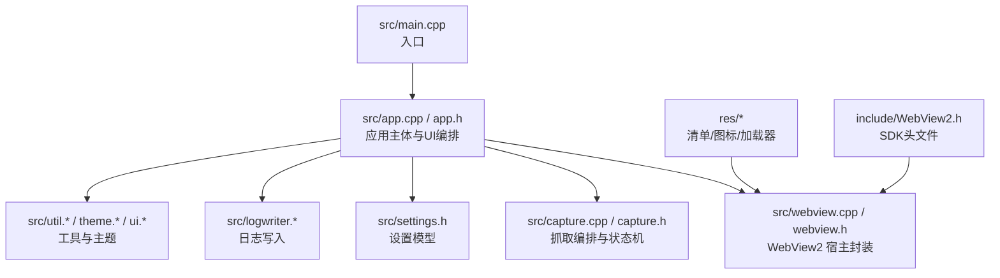
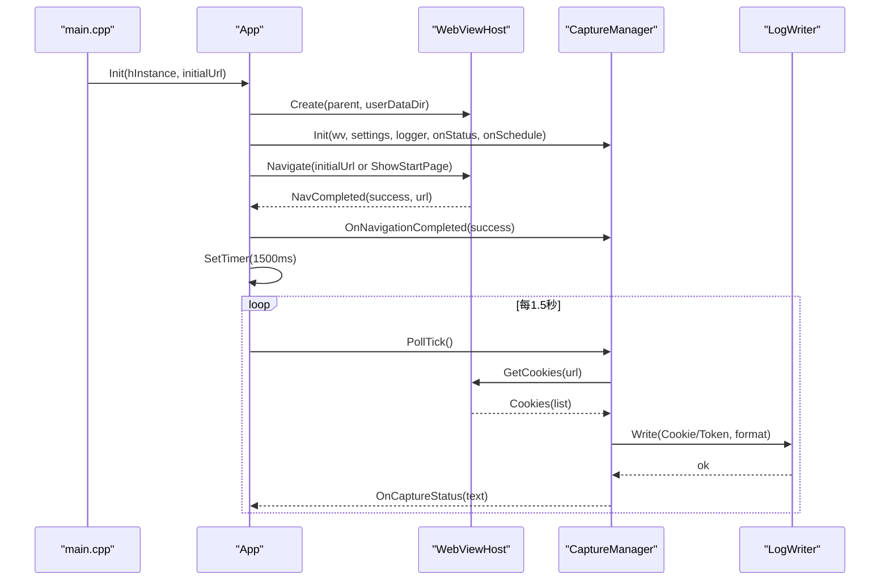
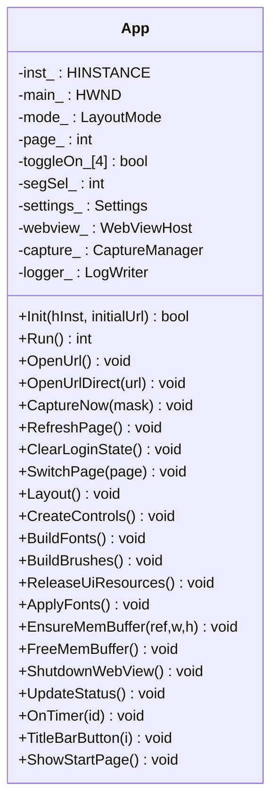
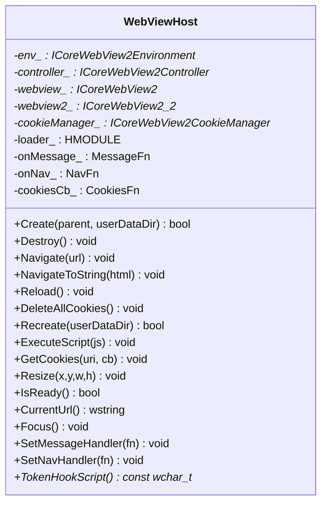
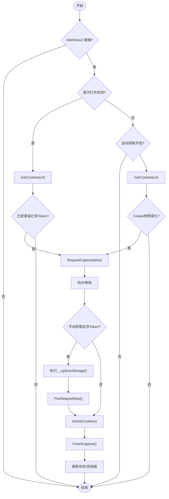
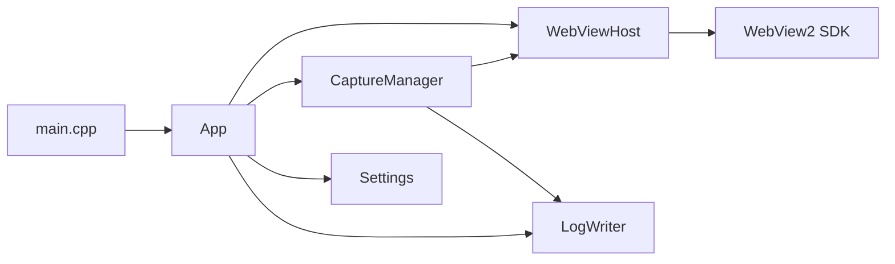

# 项目概述

<cite>
**本文引用的文件**   
- [README.md](file://README.md)
- [main.cpp](file://src/main.cpp)
- [app.h](file://src/app.h)
- [capture.h](file://src/capture.h)
- [webview.h](file://src/webview.h)
- [settings.h](file://src/settings.h)
- [build.bat](file://build.bat)
</cite>

## 更新摘要
**变更内容**   
- 更新了项目简介和功能特性描述，基于最新的README.md文档
- 增强了技术栈说明，包含详细的编译和链接选项
- 添加了完整的环境要求和构建指南
- 扩展了目录结构和模块依赖关系说明
- 新增了设计原则和已知限制的详细说明
- 完善了快速开始指南和本地测试流程

## 目录
1. [简介](#简介)
2. [功能特性](#功能特性)
3. [技术栈](#技术栈)
4. [环境要求](#环境要求)
5. [项目结构](#项目结构)
6. [核心组件](#核心组件)
7. [架构总览](#架构总览)
8. [关键组件详解](#关键组件详解)
9. [依赖关系分析](#依赖关系分析)
10. [设计原则](#设计原则)
11. [快速开始](#快速开始)
12. [本地测试](#本地测试)
13. [已知限制](#已知限制)
14. [常见问题排查](#常见问题排查)
15. [结语](#结语)

## 简介
CookieGrabber 是一个基于 **Win32 + Microsoft Edge WebView2** 的 Windows 桌面抓取工具。它能够在内嵌浏览器中登录任意网站，自动或手动提取该站点的 **Cookie** 与 **Token**（localStorage / sessionStorage / 请求头 / JSON 响应体），并以多种格式落盘为日志，支持一键复制到剪贴板。

整个程序编译为**单个 `CookieGrabber.exe`（约 1.7 MB）**，`WebView2Loader.dll` 作为资源内嵌在可执行文件里，拷走一个文件即可运行。

**更新** 基于最新 README.md 文档，项目现在提供完整的中文文档体系，包括分层 Wiki 和知识卡片。

## 功能特性

### 浏览器页
- 地址栏（可编辑下拉框）+ 网站预设，回车或点「打开」即可导航；支持命令行传入初始网址
- 工具栏四个按钮：`打开` / `刷新` / `立即抓取Cookie` / `立即抓取Token`，Cookie 与 Token 互不影响
- 内嵌 WebView2 渲染真实网站，底部状态栏常驻显示抓取状态、`Cookie` / `Token` 计数与日志目录

### 抓取与检测
- **自动抓取**：定时轮询（1.5s）比对 Cookie 快照，登录态变化即触发抓取
- **防抖合并**：短时间内的多次请求按位或合并抓取范围（600ms 防抖 + 250ms 存储预扫描），避免后到请求覆盖先到的
- **Token 三通道捕获**：注入 JS Hook 拦截 `fetch` / `XMLHttpRequest` 请求头与 JSON 响应体，并扫描 `localStorage` / `sessionStorage`
- **首次打开即抓取**：导航完成后自动完成一次登录态采集
- **清除登录状态**：删除全部 Cookie 并重建 WebView2 用户数据目录，得到全新会话

### 输出与设置
- 日志格式可选 `字符串` / `JSON` / `两种都写`，对应 `cookie.log`、`cookie.json`、`cookie_detail.json`
- `cookie_history.log` 追加保存全部抓取记录（含 Token 明细与来源）
- 抓取后可自动复制 Cookie 串到剪贴板
- 网站预设：百度网盘、阿里云盘、夸克网盘、天翼云盘、迅雷网盘、115网盘、B站、GitHub
- 设置页可滚动、自适应宽度，「保存设置」立即生效；选中预设并修改登录网址会回写到该预设

### 界面
- **GDI 全自绘 UI**：无边框窗口 + 自绘标题栏、按钮、开关、分段选择、滚动条，不依赖任何 UI 库
- 浅色 / 深色主题，自动跟随系统（读取注册表 `AppsUseLightTheme`）
- Per-Monitor V2 DPI 感知，三档响应式布局（宽屏 / 紧凑 / 窄屏）

## 技术栈

| 层面 | 选型 | 说明 |
|---|---|---|
| 语言 | C++17 | 无第三方库，仅 Windows SDK + WebView2 |
| 窗口 | Win32 API | `wWinMain` 入口，`WM_NCCALCSIZE` 实现无边框客户区 |
| 绘制 | GDI | 32 位 top-down DIB 段双缓冲，`RoundRect` / `DrawTextW` 自绘全部控件 |
| 网页 | WebView2 | COM 接口 `ICoreWebView2Environment` → `Controller` → `ICoreWebView2` |
| 字体 | Segoe UI + Segoe Fluent Icons（回退 MDL2） | 图标以字形（glyph）方式绘制 |
| JSON | 自研微型库 `src/json.h`（`mjson`） | 配置读写与消息解析 |
| 构建 | MinGW-w64 GCC + `windres` | 由根目录 `build.bat` 驱动 |
| 链接 | `-static -static-libgcc -static-libstdc++` | 运行时全部静态链接，单文件分发 |

依赖管理上**没有包管理器**：没有 `vcpkg.json` / `CMakeLists.txt` / `package.json`，WebView2 的头文件与加载器 DLL 以「源码树内附带（vendoring）」方式分发，`include/WebView2Loader.dll` 在构建时复制到 `res/` 并由 `windres` 打包进 exe（`RCDATA` 资源 ID 101）。

## 环境要求

- Windows 10 及以上（x64）；程序按 `_WIN32_WINNT=0x0A00` 编译
- **Microsoft Edge WebView2 Runtime**（Win11 与新版 Win10 已内置；缺失时程序初始化会弹窗提示）
- MinGW-w64（仅构建时需要）：

```powershell
winget install BrechtSanders.WinLibs.POSIX.UCRT
```

> `build.bat` 默认从 `%LOCALAPPDATA%\Microsoft\WinGet\Packages\BrechtSanders.WinLibs.POSIX.UCRT_*\mingw64` 定位工具链；若装在别处，请把 `g++` 加入 `PATH`。

## 项目结构
仓库采用按职责划分的模块化结构：
- src：源代码，包含应用主体、WebView2 宿主封装、抓取编排、设置模型、日志写入、工具函数等。
- res：资源文件（清单、图标、嵌入的 WebView2Loader.dll）。
- include：外部头文件（如 WebView2 SDK）。
- test：测试页面与本地服务脚本。
- build.bat：MinGW-w64 一键构建脚本。



**图表来源**
- [main.cpp:6-18](file://src/main.cpp#L6-L18)
- [app.h:15-192](file://src/app.h#L15-L192)
- [webview.h:11-74](file://src/webview.h#L11-L74)
- [capture.h:10-64](file://src/capture.h#L10-L64)
- [settings.h:6-26](file://src/settings.h#L6-L26)

## 核心组件
- App（应用主体）
  - 负责单实例、COM 初始化、Win32 窗口创建、主题解析、控件布局、消息循环、WebView2 生命周期管理、抓取状态提示与页面切换。
  - 暴露 OpenUrl/OpenUrlDirect/CaptureNow/RefreshPage/ClearLoginState 等业务方法，并与 CaptureManager、WebViewHost、Settings、LogWriter 协作。
- WebViewHost（WebView2 宿主封装）
  - 封装环境创建、控制器创建、导航、刷新、脚本注入、WebMessage 接收、Cookie 异步读取、Resize/Focus 等。
  - 内置 Token 捕获 JS，拦截 fetch/XMLHttpRequest 请求头与响应体，扫描 localStorage/sessionStorage，向宿主发送 token 事件。
- CaptureManager（抓取编排）
  - 维护 Cookie/Token 快照、域名切换、首次打开检测、防抖与预扫描定时器。
  - 协调 WebViewHost 获取 Cookie、调用 LogWriter 写日志、更新状态栏与剪贴板。
- Settings（设置模型）
  - 定义自动抓取、剪贴板、历史、首次打开、日志格式、预设站点等配置项，并提供持久化接口。
- LogWriter（日志写入）
  - 将 Cookie 与 Token 以字符串或 JSON 格式写入日志文件，支持历史追加。

## 架构总览
整体采用"事件驱动 + 模块解耦"的设计：
- 入口 main.cpp 启动 App，App 完成初始化后进入消息循环 Run。
- WebViewHost 作为 WebView2 的抽象层，屏蔽 COM 回调细节，向上提供 Navigate/GetCookies/ExecuteScript 等简洁 API。
- CaptureManager 订阅 WebViewHost 的消息与导航完成事件，结合定时轮询实现智能抓取。
- App 负责 UI 与业务编排，CaptureManager 与 WebViewHost 之间通过回调与定时器解耦。



**图表来源**
- [main.cpp:6-18](file://src/main.cpp#L6-L18)
- [app.h:15-192](file://src/app.h#L15-L192)
- [webview.h:11-74](file://src/webview.h#L11-L74)
- [capture.h:10-64](file://src/capture.h#L10-L64)

## 关键组件详解

### App（应用主体与 UI 编排）
- 单实例互斥：避免多进程共享 WebView2 userdata 目录冲突。
- 主题与 DPI：优先解析主题，再创建窗口；使用 DWM 圆角与边框色；根据 DPI 缩放字体与布局。
- 响应式布局：宽/中/窄三档模式，工具栏在窄屏自动换行，设置页表单自适应滚动裁剪。
- 页面切换：浏览器页与设置页独立控件集合，切换时显隐与区域裁剪。
- 清理与重建：清除登录状态时执行 localStorage/sessionStorage.clear、删除 Cookie、关闭并重建 WebView2 会话。



**图表来源**
- [app.h:15-192](file://src/app.h#L15-L192)

### WebViewHost（WebView2 宿主封装）
- 加载策略：优先从 exe 同目录加载 WebView2Loader.dll；否则释放内嵌资源到 %TEMP%\CookieGrabber 后加载。
- 生命周期：Create -> OnEnvCreated -> OnControllerCreated -> 注册导航与消息事件 -> 注入 TokenHookScript。
- Cookie 读取：通过 CookieManager.GetCookies 异步获取，回调中解析为 CookieItem 列表。
- Token 捕获：注入 JS 拦截 fetch/XMLHttpRequest 请求头与响应体，扫描 localStorage/sessionStorage，postMessage 上报 token。



**图表来源**
- [webview.h:11-74](file://src/webview.h#L11-L74)

### CaptureManager（抓取编排与状态机）
- 状态字段：lastSnapshot（上次 Cookie 串）、tokens（Token 列表）、currentHost（当前域名）、maskNext（待写入掩码）、firstOpenPending（首次打开检测）、stageDebounce/Prescan（防抖与预扫描阶段）。
- 流程要点：
  - 定时 PollTick：若启用自动抓取且 Cookie 快照变化，则触发 RequestCapture。
  - RequestCapture：合并 mask，进入防抖；手动抓取含 Token 时先执行存储预扫描。
  - FirePending/FireDelayedStep：按需拉取 Cookie 或直接写 Token。
  - FinishCapture：比较变更、调用 LogWriter.Write、可选复制到剪贴板、更新状态栏。
  - IsLoggedIn：基于 Cookie 名关键词判断是否已登录。



**图表来源**
- [capture.h:10-64](file://src/capture.h#L10-L64)

### Settings（设置模型）
- 字段：autoCapture、clipboard、history、firstOpenCapture、logFormat、presets。
- 用途：控制自动抓取行为、输出格式、历史追加、预设站点 URL 等。
- 持久化：通过 LoadSettings/SaveSettings 读写 settings.json。

## 依赖关系分析
- main.cpp 仅负责命令行参数解析与 App::Init/App::Run 调度。
- App 组合 WebViewHost、CaptureManager、Settings、LogWriter，承担 UI 与业务编排。
- WebViewHost 依赖 WebView2 SDK 与系统 COM；CaptureManager 依赖 WebViewHost 提供的 Cookie 与脚本能力。
- CaptureManager 与 LogWriter 协作完成数据落盘；Settings 被 App 与 CaptureManager 共同读取。



**图表来源**
- [main.cpp:6-18](file://src/main.cpp#L6-L18)
- [app.h:15-192](file://src/app.h#L15-L192)
- [webview.h:11-74](file://src/webview.h#L11-L74)
- [capture.h:10-64](file://src/capture.h#L10-L64)

## 设计原则

**单文件分发。** C/C++ 运行时静态链接，`WebView2Loader.dll` 以 `RCDATA` 内嵌。加载策略：优先 exe 同目录的 DLL，找不到才从资源释放到 `%TEMP%` 再加载——因此放一个 exe 在任意目录都能跑。

**GDI 自绘 UI。** 所有像素都经由 `src/ui.h` 的同一套原语产生（`Rect/RoundRect/Card/FocusRing/Text/Button/Toggle/Chip/Scrollbar/Dot`），杜绝"同一个界面多种画法"造成的风格漂移。卡片投影用多层递淡描边模拟（GDI 无高斯模糊，分层描边在缩放下无锯齿）。

**双缓冲与残影。** 窗口类背景刷为空、`WM_ERASEBKGND` 直接返回 1，一帧画完再 `BitBlt` 上屏。代价是：子控件被 `MoveWindow` 移动后腾出的旧像素不会被系统擦除，因此**布局/滚动变更后必须让整个客户区失效**（`InvalidateRect(main_, nullptr, FALSE)`），只失效局部会累积成多重残影。

**焦点提示。** 自绘圆角按钮不使用 `DrawFocusRect`——它画的是 XOR 点状**直角**框，四角落在圆角之外，看起来像被裁掉的影子边。改为内缩的圆角焦点环，且只在键盘导航时显示，鼠标点击一律不显示。

**颜色与尺寸。** 绘制代码里禁止出现裸 `RGB()` 字面量，一律取 `theme::Current()` 的语义色；所有尺寸以 96dpi 逻辑像素书写，绘制前经 `App::S()` 缩放。

**错误处理。** 无统一异常框架：WebView2 异步操作以 `HRESULT` 透传并在回调内消化；同步 API（`App::Init`、`WebViewHost::Create`）返回 `bool`；日志写入采取"部分失败可接受"策略，逐个格式尽力写出并把错误文本累积到 `errOut`。弹窗只用于初始化失败、单实例重复启动提示和破坏性操作确认三处；其余运行期错误（非 http 页、写日志失败、剪贴板复制失败等）统一写到状态行。WebView2 初始化失败不向上抛，所以靠启动兜底定时器保证界面仍会出现，并用就绪计数给出提示。

## 快速开始
- 环境准备
  - 安装 MinGW-w64（可通过 winget 安装 BrechtSanders.WinLibs.POSIX.UCRT）。
  - 确保 include 目录下存在 WebView2 SDK 头文件。
- 构建
  - 运行 build.bat，脚本会编译源码并将 WebView2Loader.dll 作为资源嵌入。
- 运行
  - 双击 CookieGrabber.exe。
  - 在地址栏输入目标网站 URL，点击"打开"。
  - 在页面内完成登录。
  - 程序会自动抓取 Cookie/Token 并写入日志；也可点击"立即抓取Cookie/Token"手动触发。
- 查看日志
  - 在设置页点击"打开日志文件夹"，查看 cookie.log 或 cookie_history.log。

## 本地测试

```powershell
python test\serve.py            # 监听 http://127.0.0.1:8899
# 在应用地址栏打开 http://127.0.0.1:8899/ 并点击页面上的「登 录」
```

`login.html` 会一次写入三类目标数据，用于验证三条捕获链路是否同时生效：

- **Cookie**：`session_id`、`csrf_token`
- **Web 存储**：`localStorage` 的 `access_token` / `refresh_token`、`sessionStorage` 的 `jwt`
- **请求头与响应体**：`POST /api/login` 携带 `Authorization` / `X-Auth-Token`，响应体返回 `access_token`、`refresh_token` 与嵌套的 `user.token`

## 已知限制

- 仅支持 x64 Windows，无交叉编译或其他架构目标
- 需要系统已安装 WebView2 Runtime；离线环境下无法加载网页
- 无版本化/签名/安装包流水线，`build.bat` 只产出裸 exe
- 依赖升级需手动替换 `include/WebView2.h` 与 `WebView2Loader.dll` 并重新提交
- 未指定许可证，代码版权归仓库所有者

## 常见问题排查
- WebView2 运行时未安装
  - 现象：初始化失败提示"WebView2 运行时可能未安装"。
  - 处理：安装 Microsoft Edge WebView2 运行时后重试。
- WebView2 初始化多次失败
  - 现象：状态栏提示"WebView2 初始化失败：请安装 Edge WebView2 运行时后重试"。
  - 处理：确认运行时已安装，重启应用；必要时检查 userdata 目录权限。
- 无法抓取非 http/https/file 页面
  - 现象：状态栏提示"当前页面不支持抓取（非 http/https/file 页面）"。
  - 处理：仅对有效 URI 查询 Cookie，避免 about:blank 等导致崩溃。
- 清除登录状态后仍有残留
  - 现象：提示"数据目录有残留，重启应用后可完全清除"。
  - 处理：重启应用以确保 WebView2 进程退出并删除 userdata。

## 结语
本项目以 C++ Win32 API 与 WebView2 为核心，构建了轻量、高效、现代的 Cookie/Token 抓取工具。通过模块化设计与事件驱动模式，实现了 UI 与业务逻辑的良好解耦；借助智能抓取算法与现代化界面，为用户提供了直观易用的自动化体验。建议在生产环境中关注 WebView2 运行时版本与 userdata 目录权限，以获得稳定可靠的抓取结果。

**更新** 项目现已提供完整的中文文档体系，包括 `.qoder/repowiki/` 下的分层 Wiki 和知识卡片，涵盖编码规范、业务术语表、错误处理模式等详细内容。